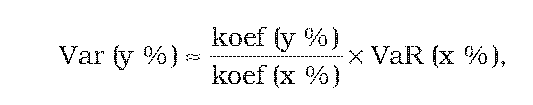
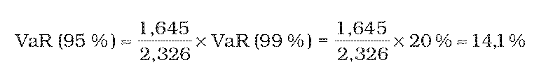
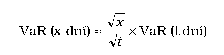
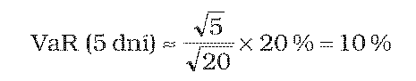
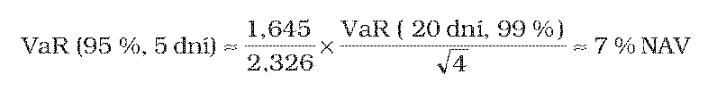

Príloha č. 7 k opatreniu č. 155/2012 Z. z.

- ZÁSADY ÚPRAVY LIMITU ABSOLÚTNEJ HODNOTY V RIZIKU Úprava limitu absolútnej hodnoty v riziku (Value at Risk) na rozdielne intervaly spoľahlivosti a rozdielne časové horizonty, pre ktoré sa vypočítava hodnota v riziku, sa vykonáva v súlade s týmito zásadami:

  - 1. Pri prispôsobení maximálneho limitu absolútnej hodnoty v riziku na rozdielny interval spoľahlivosti sa zohľadňuje táto tabuľka normálneho rozdelenia:

  - Úroveň spoľahlivosti | | Koeficient normálneho rozdelenia

  - 99,0 % | | 2,326

  - 97,5 % | | 1,96

  - 95,0 % | | 1,645

  - 2. Pre interval spoľahlivosti y % a časový horizont 20 dní sa maximálny limit absolútnej hodnoty v riziku podľa § 23 ods. 2 s intervalom spoľahlivosti x % (napr. 99 %) upraví na nový maximálny limit absolútnej hodnoty v riziku podľa tohto vzorca:

  - 

    - kde VaR je hodnota v riziku (Value at Risk)

  - 3. Ak sa na výpočet celkového rizika metódou absolútnej hodnoty v riziku používa vo vnútorných postupoch správcovskej spoločnosti interval spoľahlivosti 95 %, použitie vzorca podľa bodu 2 vedie k nasledujúcej novej výške maximálneho limitu absolútnej hodnoty v riziku:

  - 

  - 4. Rovnakým spôsobom ako v bodoch 2 a 3 možno postupovať pri úprave limitu absolútnej hodnoty v riziku z jedného časového horizontu na iný časový horizont použitím druhej odmocniny časového pravidla. Na používanie metódy absolútnej hodnoty v riziku s časovým horizontom x dní a intervalom spoľahlivosti 99 % sa maximálny limit absolútnej hodnoty v riziku podľa § 23 ods. 2 s časovým horizontom t dní (napr. 20) upraví na nový limit absolútnej hodnoty v riziku podľa tohto vzorca:

  - 

  - 5. Ak sa na výpočet celkového rizika metódou absolútnej hodnoty v riziku používa časový horizont päť dní, použitie vzorca podľa bodu štyri vedie k tejto novej výške maximálneho limitu absolútnej hodnoty v riziku

  - 

  - 6. Ak sa na výpočet celkového rizika metódou absolútnej hodnoty v riziku používa interval spoľahlivosti 95 % a časový horizont päť dní, nová výška maximálneho limitu absolútnej hodnoty v riziku je

  - 
