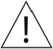

# Čl. I

Nariadenie vlády Slovenskej republiky č. 658/2005 Z. z., ktorým sa ustanovujú požiadavky na kozmetické výrobky v znení nariadenia vlády Slovenskej republiky č. 538/2006 Z. z., nariadenia vlády Slovenskej republiky č. 108/2007 Z. z., nariadenia vlády Slovenskej republiky č. 418/2007 Z. z., nariadenia vlády Slovenskej republiky č. 124/2008 Z. z., nariadenia vlády Slovenskej republiky č. 374/2008 Z. z., nariadenia vlády Slovenskej republiky č. 141/2009 Z. z., nariadenia vlády Slovenskej republiky č. 522/2009 Z. z., nariadenia vlády Slovenskej republiky č. 81/2010 Z. z., nariadenia vlády Slovenskej republiky č. 287/2010 Z. z. a nariadenia vlády Slovenskej republiky č. 432/2011 Z. z. sa mení a dopĺňa takto:

- 1. Poznámka pod čiarou k odkazu 18 znie:

- „18)

- § 68 ods. 2 zákona č. 131/2002 Z. z. o vysokých školách a o zmene a doplnení niektorých zákonov v znení zákona č. 363/2007 Z. z.

- § 33 až 35 zákona č. 578/2004 Z. z. o poskytovateľoch zdravotnej starostlivosti, zdravotníckych pracovníkoch, stavovských organizáciách v zdravotníctve a o zmene a doplnení niektorých zákonov v znení neskorších predpisov.

- § 2 písm. g) zákona č. 293/2007 Z. z. o uznávaní odborných kvalifikácií.

- Nariadenie vlády Slovenskej republiky č. 296/2010 Z. z. o odbornej spôsobilosti na výkon zdravotníckeho povolania, spôsobe ďalšieho vzdelávania zdravotníckych pracovníkov, sústave špecializačných odborov a sústave certifikovaných pracovných činností.“.

- 2. V poznámke pod čiarou k odkazu 20 sa vypúšťajú slová: „o vysokých školách a o zmene a doplnení niektorých zákonov“.

- 3. V prílohe č. 3 časti 1 referenčné číslo 12 znie:

- „

- Ref. číslo | Látka | O b m e d z e n i a | | | | | Podmienky použitia a upozornenia, ktoré musia byť uvedené na obale kozmetického výrobku

- | | Oblasť aplikácie/použitia | | | Najvyššia prípustná koncentrácia v kozmetickom výrobku v hmotnostných percentách | Ďalšie obmedzenia a požiadavky |

- a | b | c | | | d | e | f

- 12 | Peroxid vodíka a iné zlúčeniny alebo zmesi, ktoré uvoľňujú peroxid vodíka, vrátane peroxidu močoviny a peroxidu zinočnatého | a) Zmesi na starostlivosť o vlasy b) Zmesi na starostlivosť o pokožku | | | a) 12 % hm. (40 objemových dielov) peroxidu vodíka prítomného alebo uvoľneného | e) Len na predaj pre zubných lekárov. Pri každom cykle použitia sa prvé použitie vyhradzuje zubným lekárom alebo sa uskutočňuje pod ich priamym dohľadom, ak je zabezpečená rovnocenná úroveň bezpečnosti. | a) Použiť vhodné rukavice. a), b), c), e) Obsahuje hydrogen peroxide. Nesmie prísť do kontaktu s očami. Ak príde do kontaktu s očami, ihneď ich vypláchnuť vodou.

- | Hydrogen peroxide and other compounds or mixtures that release hydrogen peroxide, including carbamide peroxide and zinc peroxide o | c) Zmesi na spevnenie nechtov d) Výrobky na starostlivosť o ústnu hygienu vrátane výrobkov na výplach ústnej dutiny, zubných pást a výrobkov na bielenie alebo zosvetlenie zubov e) Výrobky na bielenie alebo zosvetlenie zubov | | | b) 4 % hm. peroxidu vodíka prítomného alebo uvoľneného c) 2 % hm. peroxidu vodíka prítomného alebo uvoľneného d) 0,1 % hm. peroxidu vodíka prítomného alebo uvoľneného e) >0,1 % 6 % hm. peroxidu vodíka prítomného alebo uvoľneného | Následne sa poskytne spotrebiteľovi na dokončenie cyklu. Nie je určený pre osoby mladšie ako18 rokov. | e) Uvedie sa konkrétna koncentrácia prítomného alebo uvoľneného peroxidu vodíka v hmotnostných percentách. Nie je určený pre osoby mladšie ako 18 rokov. Len na predaj pre zubných lekárov. Pri každom cykle použitia sa prvé použitie vyhradzuje zubným lekárom alebo sa uskutočňuje pod ich priamym dohľadom, ak je zabezpečená rovnocenná úroveň bezpečnosti. Následne sa poskytne spotrebiteľovi na dokončenie cyklu.

- “.

- 4. V prílohe č. 3 časti 1 referenčných číslach 201, 215, 216, 222, 225, 227, 237, 239, 241, 245, 250, 251 a 252 stĺpci f písm. a) sa na konci pripájajú tieto vety:

- „ Farby na vlasy môžu vyvolať vážne alergické reakcie.

- Prečítajte si pokyny a dodržiavajte ich.

- Tento výrobok nie je určený pre osoby mladšie ako 16 rokov.

- Dočasné tetovanie čiernou henou môže zvýšiť riziko alergie.

- Nefarbite si vlasy, ak:

- – máte na tvári vyrážky alebo máte citlivú, podráždenú alebo poškodenú pokožku hlavy,

- – ste v minulosti zaznamenali reakciu po farbení vlasov,

- – ste v minulosti zaznamenali reakciu na dočasné tetovanie čiernou henou.“.

- 5. V prílohe č. 3 časti 1 referenčných číslach 217, 218, 223, 230, 232, 234, 238, 242 až 244, 246, 248 a 249 stĺpci f sa na konci pripájajú tieto vety:

- „ Farby na vlasy môžu vyvolať vážne alergické reakcie.

- Prečítajte si pokyny a dodržiavajte ich.

- Tento výrobok nie je určený pre osoby mladšie ako 16 rokov.

- Dočasné tetovanie čiernou henou môže zvýšiť riziko alergie.

- Nefarbite si vlasy, ak:

- – máte na tvári vyrážky alebo máte citlivú, podráždenú alebo poškodenú pokožku hlavy,

- – ste v minulosti zaznamenali reakciu po farbení vlasov,

- – ste v minulosti zaznamenali reakciu na dočasné tetovanie čiernou henou.“.

- 6. Príloha č. 17 sa dopĺňa 74. bodom, ktorý znie:

- „74.

- Smernica Rady 2011/84/EÚ z 20. septembra 2011, ktorou sa mení a dopĺňa smernica 76/768/EHS o kozmetických výrobkoch s cieľom prispôsobiť jej prílohu III technickému pokroku (Ú. v. EÚ L 283, 29. 10. 2011).“.
