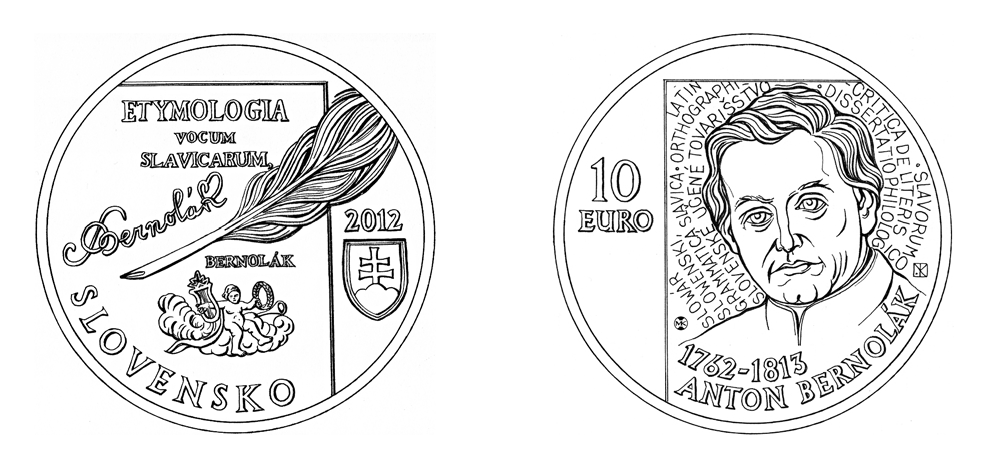

## 194

OZNÁMENIE

Národnej banky Slovenska

zo 4. júna 2012

## o vydaní strieborných zberateľských euromincí v nominálnej hodnote 10 eur pri príležitosti 250. výročia narodenia Antona Bernoláka

1. Úvodné ustanovenia

- a) Národná banka Slovenska podľa § 17h ods. 1 zákona Národnej rady Slovenskej republiky č. 566/1992 Zb. o Národnej banke Slovenska v znení neskorších predpisov a podľa § 1 ods. 2 písm. d) zákona Národnej rady Slovenskej republiky č. 1/1993 Z. z. o Zbierke zákonov Slovenskej republiky v znení zákona č. 275/2002 Z. z. oznamuje, že pri príležitosti 250. výročia narodenia Antona Bernoláka vydáva do obehu strieborné zberateľské euromince v nominálnej hodnote 10 eur (ďalej len „zberateľská eurominca“).

- b) Zberateľská eurominca má štatút zákonného platidla len v Slovenskej republike.

- c) Zberateľská eurominca sa razí zo zliatiny obsahujúcej 900 dielov striebra a 100 dielov medi; jej hmotnosť je 18 g a priemer 34 mm. Pri razbe zberateľskej euromince je povolená horná a dolná odchýlka v priemere 0,1 mm; povolená horná odchýlka v hmotnosti je 0,4 g a v obsahu striebra 10/1000.

2. Vzhľad zberateľskej euromince

- a) Na líci zberateľskej euromince sú vyobrazené historické reálie spojené so životom a dielom Antona Bernoláka – titulná strana zo spisu „Etymologia vocum Slavicarum“, ktorú dopĺňa faksimile jeho podpisu a vtáčie brko na písanie. Pri pravom okraji zberateľskej euromince je umiestnený štátny znak Slovenskej republiky, nad ktorým je letopočet „2012“. Názov štátu „SLOVENSKO“ je v opise v spodnej časti mincového poľa.

- b) Na rube zberateľskej euromince je vyobrazený portrét Antona Bernoláka vkomponovaný do písmovej štruktúry, ktorú prevažne tvoria názvy jeho jazykovedných diel. Pri ľavom okraji zberateľskej euromince je v dvoch riadkoch označenie nominálnej hodnoty zberateľskej euromince „10 EURO“. V spodnej časti mincového poľa je v opise meno a priezvisko „ANTON BERNOLÁK“ a nad ním letopočty jeho narodenia a úmrtia „1762 – 1813“. Značka Mincovne Kremnica, štátny podnik, ktorú tvorí skratka „MK“ umiestnená medzi dvoma razidlami, je vľavo od portrétu a štylizované iniciálky mena a priezviska autora výtvarného návrhu zberateľskej euromince Pavla Károlyho „PK“ sú vpravo od neho.

- c) Na hrane zberateľskej euromince je reliéfny nápis do hĺbky „TU MÁTE SLOVO MOJE O REČI VAŠEJ“. Začiatok a koniec nápisu je oddelený lipovým listom.

Štát vydania: Slovenská republika

Začiatok vydávania: september 2012

Jozef Makúch v. r.
