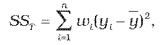
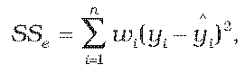
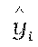
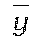

Príloha k vyhláške č. 263/2012 Z. z.

- KOEFICIENT DETERMINÁCIE FARMACEUTICKO-NÁKLADOVEJ SKUPINY

  - Zvýšenie predpovedacej sily po zaradení jednej farmaceuticko-nákladovej skupiny do zoznamu farmaceuticko-nákladových skupín sa posudzuje pomocou koeficientu viacnásobnej determinácie R2.

  - Ak označíme SST ako celkový súčet štvorcov vzťahujúcich sa k spracovávaným dátam, t. j.

- 

  - a SSe ako reziduálny súčet štvorcov odhadnutého regresného modelu, t. j.

- 

  - kde

-  – je hodnota nákladov predikovaná odhadnutým modelom pre i-teho poistenca,

-  – je hodnota priemerných nákladov na poistenca,

  - yi – je hodnota nákladov na i-teho poistenca,

  - n – je počet poistencov,

  - w – počet mesiacov.

  - Koeficient viacnásobnej determinácie je potom definovaný ako

  - R2 = 1 – SSe/SST.
