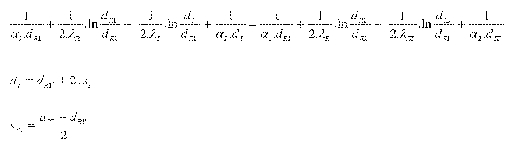

Príloha č. 2 k vyhláške č. 282/2012 Z. z.

- Minimálna hrúbka tepelnej izolácie rozvodov tepla a teplej vody v budovách pre zvolený izolačný materiál

  - Minimálna hrúbka tepelnej izolácie pre zvolený izolačný materiál sIZ sa vypočíta z rovníc

- 

  - pričom

- α1 | súčiniteľ prestupu tepla na vnútornej strane rúrky | [W . m-2. K-1]

- dR1 | vnútorný priemer rúrky podľa dimenzie potrubia | [m]

- dR1´ | vonkajší priemer rúrky podľa dimenzie potrubia | [m]

- λR | súčiniteľ tepelnej vodivosti rúrky | [W . m-1. K-1]

- dI | vonkajší priemer rúrky s izoláciou | [m]

- λI | súčiniteľ tepelnej vodivosti izolačného materiálu | [W . m-1. K-1]

- α2 | súčiniteľ prestupu tepla na povrchu izolácie | [W . m-2. K-1]

- λIZ | súčiniteľ tepelnej vodivosti zvoleného izolačného materiálu | [W . m-1. K-1]

- dIZ | vonkajší priemer rúrky so zvoleným izolačným materiálom | [m]

- sIZ | minimálna hrúbka izolácie zvoleného izolačného materiálu | [m]

  - Pri výpočte je možné zanedbať súčiniteľ prestupu tepla na vnútornej strane rúrky α1 a pre súčiniteľ prestupu tepla na povrchu izolácie α2 je možné použiť hodnotu 10 W . m-2 . K-1.
