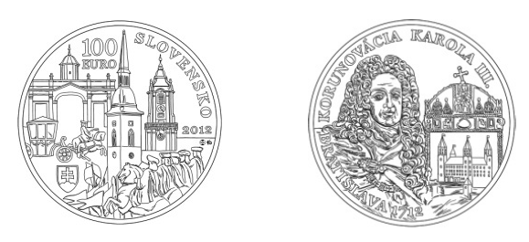

## 310

OZNÁMENIE

Národnej banky Slovenska

z 18. septembra 2012

## o vydaní zlatých zberateľských euromincí v nominálnej hodnote 100 eur pri príležitosti 300. výročia korunovácie Karola III. v Bratislave

1. Úvodné ustanovenia

- a) Národná banka Slovenska podľa § 17h ods. 1 zákona Národnej rady Slovenskej republiky č. 566/1992 Zb. o Národnej banke Slovenska v znení neskorších predpisov a podľa § 1 ods. 2 písm. d) zákona Národnej rady Slovenskej republiky č. 1/1993 Z. z. o Zbierke zákonov Slovenskej republiky v znení zákona č. 275/2002 Z. z. oznamuje, že pri príležitosti 300. výročia korunovácie Karola III. v Bratislave vydáva do obehu zlaté zberateľské euromince v nominálnej hodnote 100 eur (ďalej len „zberateľská eurominca“).

- b) Zberateľská eurominca má štatút zákonného platidla len v Slovenskej republike.

- c) Zberateľská eurominca sa razí zo zliatiny obsahujúcej 900 dielov zlata, 75 dielov striebra a 25 dielov medi; jej hmotnosť je 9,5 g a priemer 26 mm. Pri razbe euromince je povolená horná a dolná odchýlka v priemere 0,1 mm; povolená horná odchýlka v hmotnosti je 0,08 g a v obsahu zlata 10/1000.

2. Vzhľad zberateľskej euromince

- a) Na líci zberateľskej euromince sú vyobrazené architektonické dominanty Bratislavy súvisiace s korunovačným aktom – Viedenská brána Bratislavského hradu, veža Dómu svätého Martina a veža Starej radnice, ktoré sú doplnené výjavom z korunovačného sprievodu. V spodnej časti mincového poľa je pri ľavom okraji zberateľskej euromince štátny znak Slovenskej republiky. V hornej časti mincového poľa je v dvoch riadkoch označenie nominálnej hodnoty „100 EURO“. Pri pravom okraji zberateľskej euromince je v opise zľava doprava názov štátu „SLOVENSKO“, pod ktorým je umiestnený letopočet „2012“. Značka Mincovne Kremnica, štátny podnik, ktorú tvorí skratka „MK“ umiestnená medzi dvoma razidlami a štylizované iniciálky mena a priezviska autora výtvarného návrhu zberateľskej euromince Karola Lička „KL“ sú umiestnené pri jej pravom okraji.

- b) Na rube zberateľskej euromince je vyobrazený portrét kráľa Karola III., ktorý je v pravej časti mincového poľa doplnený uhorskou kráľovskou korunou a dobovým vyobrazením Bratislavského hradu. Pri ľavom okraji zberateľskej euromince je v hornej časti v opise zľava doprava text „KORUNOVÁCIA KAROLA III.“ a v spodnej časti text „BRATISLAVA“ a letopočet korunovácie „1712“.

- c) Hrana zberateľskej euromince je vrúbkovaná.

Štát vydania: Slovenská republika

Začiatok vydávania: december 2012

Jozef Makúch v. r.
