# Čl. I

Vyhláška Ministerstva dopravy, výstavby a regionálneho rozvoja Slovenskej republiky č. 410/2011 Z. z., ktorou sa ustanovuje spôsob označenia úsekov diaľnic a rýchlostných ciest, ktorých užívanie podlieha úhrade, vzor nálepky a spôsob jej umiestnenia na motorovom vozidle sa mení takto:

- 1. V § 6 ods. 1 písm. h) prvý a druhý bod znejú:

- „1.

- opakujúci sa mikrotext „SLOVENSKÁ REPUBLIKA“, opakujúci sa mikrotext „SLOVAK REPUBLIC“ a opakujúci sa mikrotext „SR“,

- 2.

- opakujúci sa motív jazdca a motív štátneho znaku Slovenskej republiky.“.

- 2. Prílohy č. 1 až 6 vrátane nadpisov znejú:

- „Príloha č. 1 k vyhláške č. 410/2011 Z. z.

- VZOR NÁLEPKY

- s ročnou dobou platnosti pre dvojstopové motorové vozidlá a jazdné súpravy do 3,5 t a dvojstopové motorové vozidlá kategórie M1 bez ohľadu na ich celkovú hmotnosť

- 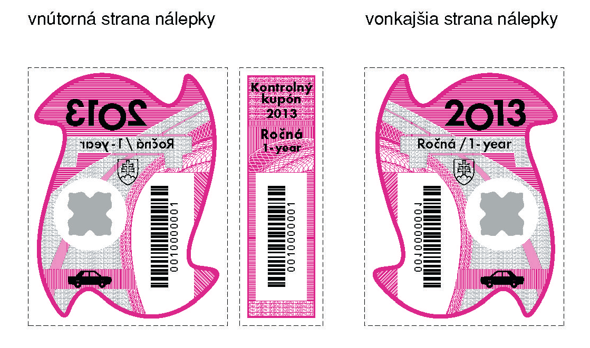

- VZOR TEXTU NA PAPIEROVEJ PODLOŽKE NÁLEPKY

- s ročnou dobou platnosti pre dvojstopové motorové vozidlá a jazdné súpravy do 3,5 t a dvojstopové motorové vozidlá kategórie M1 bez ohľadu na ich celkovú hmotnosť

- 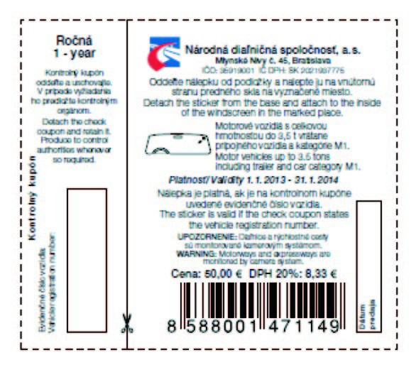

- „Príloha č. 2 k vyhláške č. 410/2011 Z. z.

- VZOR NÁLEPKY

- s mesačnou dobou platnosti pre dvojstopové motorové vozidlá a jazdné súpravy do 3,5 t a dvojstopové motorové vozidlá kategórie M1 bez ohľadu na ich celkovú hmotnosť

- 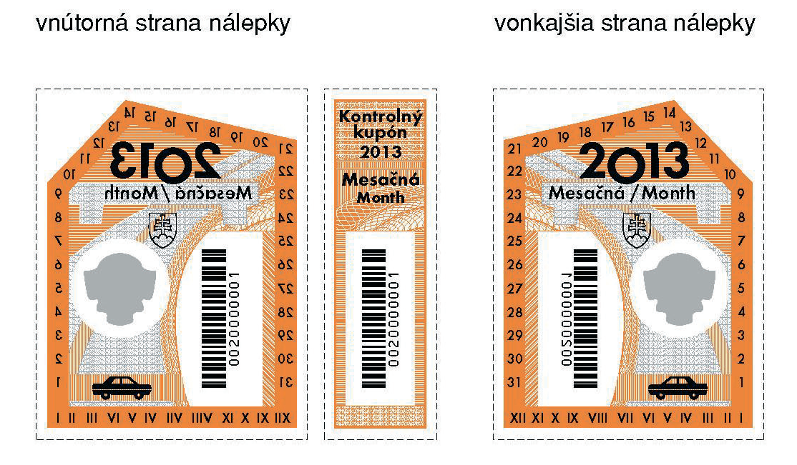

- VZOR TEXTU NA PAPIEROVEJ PODLOŽKE NÁLEPKY

- s mesačnou dobou platnosti pre dvojstopové motorové vozidlá a jazdné súpravy do 3,5 t a dvojstopové motorové vozidlá kategórie M1 bez ohľadu na ich celkovú hmotnosť

- 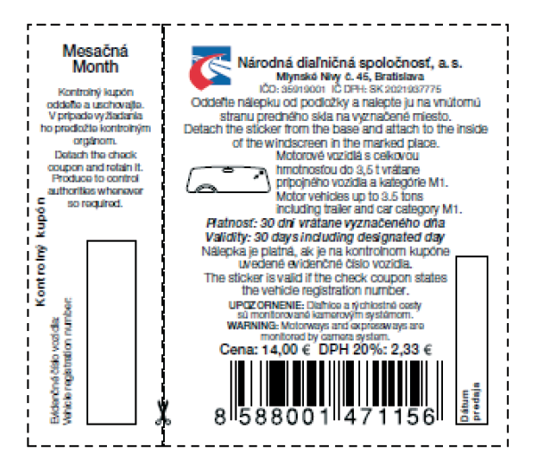

- „Príloha č. 3 k vyhláške č. 410/2011 Z. z.

- VZOR NÁLEPKY

- s 10-dňovou dobou platnosti pre dvojstopové motorové vozidlá a jazdné súpravy do 3,5 t a dvojstopové motorové vozidlá kategórie M1 bez ohľadu na ich celkovú hmotnosť

- 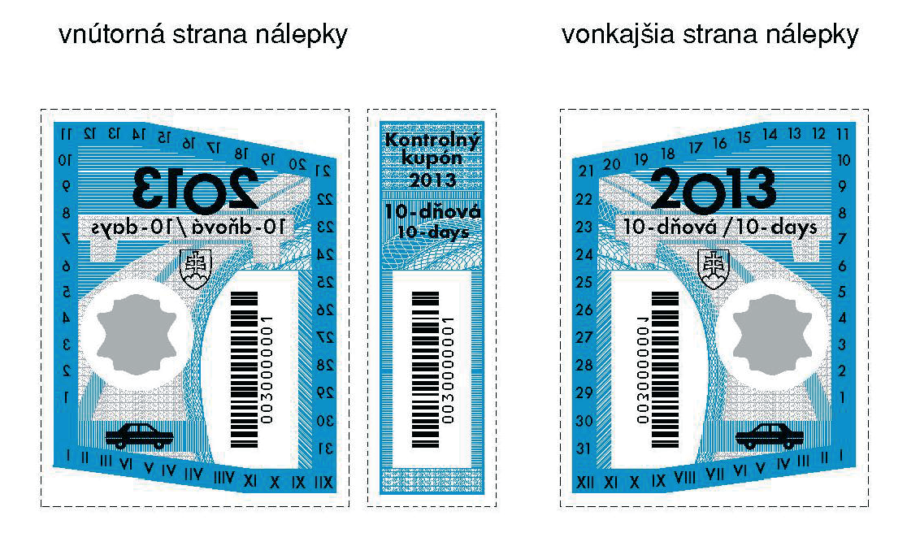

- VZOR TEXTU NA PAPIEROVEJ PODLOŽKE NÁLEPKY

- s 10-dňovou dobou platnosti pre dvojstopové motorové vozidlá a jazdné súpravy do 3,5 t a dvojstopové motorové vozidlá kategórie M1 bez ohľadu na ich celkovú hmotnosť

- 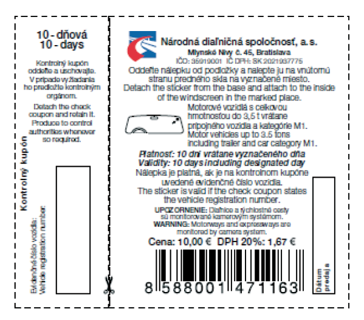

- „Príloha č. 4 k vyhláške č. 410/2011 Z. z.

- VZOR NÁLEPKY

- s ročnou dobou platnosti pre prípojné vozidlá kategórie O1 a O2

- 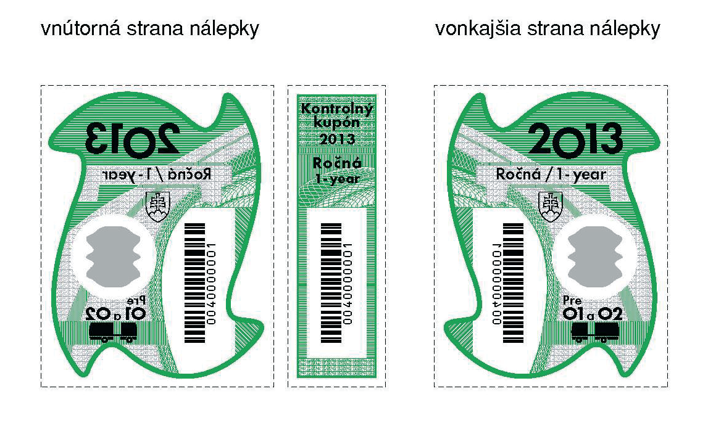

- VZOR TEXTU NA PAPIEROVEJ PODLOŽKE NÁLEPKY

- s ročnou dobou platnosti pre prípojné vozidlá kategórie O1 a O2

- 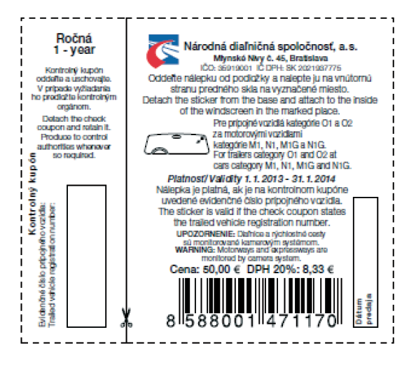

- „Príloha č. 5 k vyhláške č. 410/2011 Z. z.

- VZOR NÁLEPKY

- s mesačnou dobou platnosti pre prípojné vozidlá kategórie O1 a O2

- 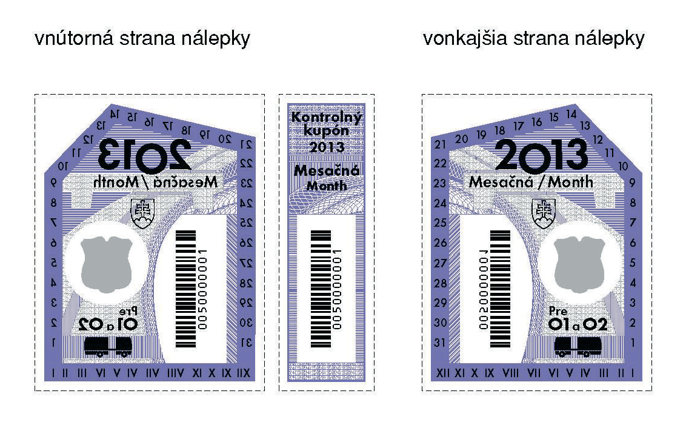

- VZOR TEXTU NA PAPIEROVEJ PODLOŽKE NÁLEPKY

- s mesačnou dobou platnosti pre prípojné vozidlá kategórie O1 a O2

- 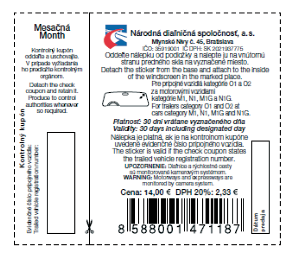

- „Príloha č. 6 k vyhláške č. 410/2011 Z. z.

- VZOR NÁLEPKY

- s 10-dňovou dobou platnosti pre prípojné vozidlá kategórie O1 a O2

- 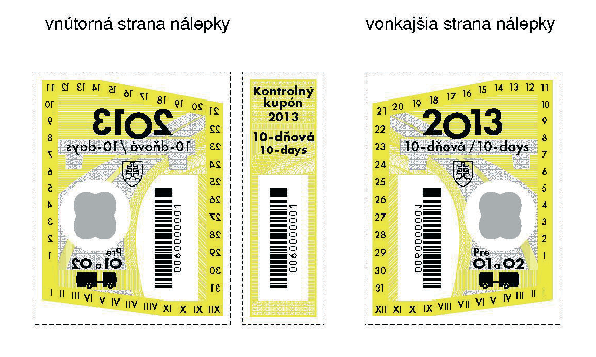

- VZOR TEXTU NA PAPIEROVEJ PODLOŽKE NÁLEPKY

- s 10-dňovou dobou platnosti pre prípojné vozidlá kategórie O1 a O2

- 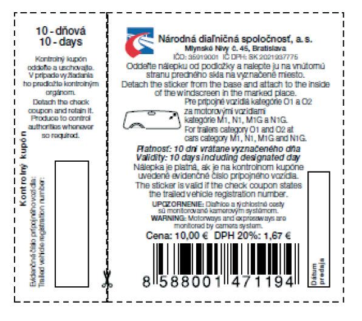
