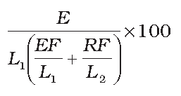
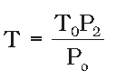
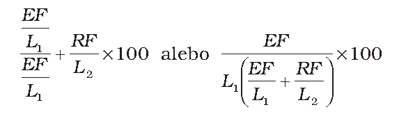
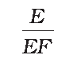
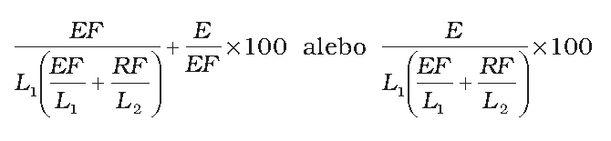
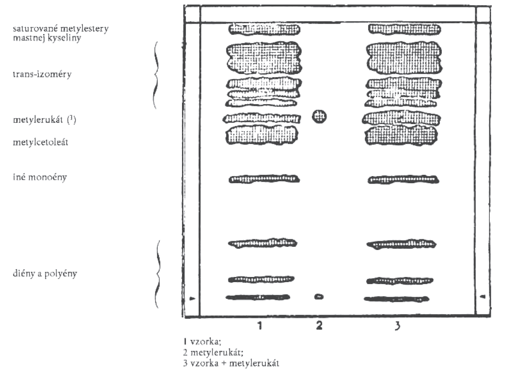

Príloha č. 1 k vyhláške č. 38/2012 Z. z.

- Určenie obsahu kyseliny erukovej v olejoch a tukoch alebo v ich zmesiach určených na ľudskú spotrebu a v potravinách s prídavkom olejov a tukov alebo ich zmesí

  - Časť A ÚVOD

    - 1. PRÍPRAVA VZORIEK

      - 1.1. Všeobecne

      - Množstvo vzorky na laboratórnu analýzu je spravidla 50 g, ak nie je požadované väčšie množstvo.

      - 1.2. Príprava vzorky na analýzu v laboratóriu

      - Pred analýzou musí byť vzorka homogenizovaná.

      - 1.3. Nádoby

      - Vzorka pripravená podľa bodu 1.2 sa uschová vo vzduchotesnej a vodotesnej nádobe.

    - 2. CHEMICKÉ ČINIDLÁ

      - 2.1. Voda

        - 2.1.1. Ak sa požaduje voda ako rozpúšťadlo, riedidlo alebo prostriedok na umývanie, použije sa destilovaná voda alebo demineralizovaná voda prinajmenšom ekvivalentnej čistoty.

        - 2.1.2. Ak sa uvádza roztok alebo riedidlo bez špecifikovania ďalšieho chemického činidla, rozumie sa ním vodný roztok alebo riedidlo.

      - 2.2. Chemikálie

      - Všetky použité chemikálie musia mať uznanú analytickú kvalitu s výnimkou, ak sú špecifikované inak.

    - 3. APARATÚRA

      - 3.1. Zoznam aparatúry

      - Tento zoznam obsahuje iba súčasti, ktoré majú špeciálne použitie a špecifikáciu.

      - 3.2. Analytické váhy

      - Analytickými váhami sa rozumejú váhy s citlivosťou 0,1 mg alebo vyššou.

    - 4. VYJADRENIE VÝSLEDKOV

      - 4.1. Výsledky

      - Výsledok uvedený v oficiálnej analytickej správe je stredná hodnota získaná najmenej z dvoch určení, ktorých reprodukovateľnosť je vyhovujúca.

      - 4.2. Percentuálny výpočet

      - Ak nie je uvedené inak, výsledky sa vyjadria ako percentuálny podiel (m/m) celkových mastných kyselín vo vzorke prijatej laboratóriom.

      - 4.3. Počet platných číslic

      - Počet platných číslic vo výsledku vyjadrenom podľa bodu 4.2 sa určí podľa presnosti metódy.

  - Časť B URČENIE OBSAHU KYSELINY ERUKOVEJ

    - 1. ROZSAH A OBLASŤ POUŽITIA

    - Metóda určuje obsah kyseliny erukovej v

      - a) olejoch a tukoch obsahujúcich kyselinu cetylolejovú (najmä cis-izomér kyseliny dokozánovej, ktorý sa nachádza v rybích olejoch), a

      - b) stužených olejoch a tukoch obsahujúcich trans-izoméry a cis-izoméry kyseliny dokozánovej.

    - 2. DEFINÍCIA

    - Obsahom kyseliny erukovej sa rozumie obsah kyseliny erukovej určený špecifikovanou metódou.

    - 3. PRINCÍP

    - Metylestery jednotlivých mastných kyselín olejov alebo tukov sú oddelené nízkotepelnou striebornou chromatografiou na tenkej vrstve a kvantitatívne určené plynovo-kvapalnou chromatografiou.

    - 4. CHEMICKÉ ČINIDLÁ

      - 4.1. Dietyléter čerstvo destilovaný bez obsahu peroxidu.

      - 4.2. n-hexán.

      - 4.3. Silikagél G na chromatografiu na tenkej vrstve.

      - 4.4. Silikagél na stĺpcovú chromatografiu.

      - 4.5. Roztok dusičnanu strieborného, 200g/l. 24 g dusičnanu strieborného sa rozpustí vo vode a doplní sa vodou do 120 ml.

      - 4.6. Roztok metylerukátu 5 mg/ml. 50 mg metylerukátu sa rozpustí v niekoľkých mililitroch n-hexánu a zriedi sa n-hexánom na 10 ml.

      - 4.7. Metyltetrakozanát, vnútorný štandardný roztok, 0,25 mg/ml. 25 mg metyltetrakozanátu sa rozpustí v niekoľkých mililitroch n-hexánu (ako v bode 4.6) a zriedi sa n-hexánom na 100 ml.

      - 4.8. Vývojka. Toluén: n-hexán 90:10 (v/v).

      - Roztok 2,7 dichlórfluoresceínu 0,5 g/l. Zahrievaním a miešaním sa rozpustí 50 mg 2,7 dichlórfluoresceínu v 100 ml 50 % vodného roztoku metanolu.

    - 5. APARATÚRA

      - 5.1. Aparatúra na chromatografiu na tenkej vrstve obsahuje najmä

        - 5.1.1. zariadenie na hlboké zmrazovanie schopné udržať vývojnicu a obsah pri teplote – 20 °C až – 25 °C,

        - 5.1.2. sklené platne s rozmermi 200 200 mm,

        - 5.1.3. ultrafialová lampa,

        - 5.1.4. sklené kolóny s dĺžkou 200 mm a vnútorným priemerom 10 mm vybavené filtrom zo sklenej vaty alebo sintrovaného skla, prípadne malé lieviky s filtrom zo sintrovaného skla,

        - 5.1.5. aplikátor na nanášanie roztokov vo forme úzkych pásov alebo pruhov na TLC platne.

      - 5.2. Plynovo-kvapalný chromatograf spolu s elektronickým integrátorom.1)

    - 6. POSTUP

      - 6.1. Príprava metylesterov mastných kyselín

      - Odoberie sa 400 mg olejovej alebo tukovej zložky z analyzovanej vzorky a pripraví sa roztok, ktorý obsahuje 20 až 50 mg/ml metylesterov mastnej kyseliny v n-hexáne, metódou opísanou v technickej norme.1)

      - 6.2. Chromatografia na tenkej vrstve

        - 6.2.1. Príprava platní

        - 60 g silikagélu (podľa bodu 4.3) sa vloží do 500 ml banky s guľatým dnom, pridá sa 120 ml roztoku dusičnanu strieborného (podľa bodu 4.5) a pretrepáva sa jednu minútu do získania homogénnej suspenzie. Suspenzia sa nanesie bežným spôsobom na platne v hrúbke 0,5 mm; toto množstvo suspenzie postačuje na prípravu piatich platní s rozmermi 200 x 200 mm.

        - Platne sa nechajú čiastočne voľne vyschnúť (ak je to možné, uložia sa na tmavom mieste na 30 minút). Pre úplné vysušenie a aktivovanie sa platne vložia na dve a pol hodiny do sušiarne pri teplote 100 °C. Platne sa použijú čo najskôr po aktivovaní alebo sa uchovávajú v tmavej komore a pred ich použitím sa reaktivujú; aktivácia pri 110 °C trvajúca jednu hodinu sa považuje za dostatočnú, ak platne počas nej nestmavnú. Pred použitím sa do nanášanej vrstvy vyryjú línie vo vzdialenosti 10 mm od okrajov a vrcholov každej platne, čím sa redukuje okrajový efekt počas vyvíjania.

        - 6.2.2. Nanášanie metylesterov

        - Použitím aplikátora (podľa bodu 5.1.5) sa nanesie 50 µl roztoku metylesterov (podľa bodu 6.1) pripravených zo vzorky v úzkom pruhu dlhom 50 mm, aspoň 40 mm od bočného okraja platne a 10 mm od spodného okraja. Podobným spôsobom sa nanesie 100 µl roztoku obsahujúceho rovnaký objem pripraveného roztoku metylesterov (podľa bodu 6.1) a roztok metylerukátu (podľa bodu 4.6). Pri nanášaní roztokov sa berie ohľad na krehkosť nanášanej vrstvy; ak je to žiaduce, 50 µl roztoku metylerukátu (podľa bodu 4.6) možno naniesť na platňu ako pomôcku na identifikovanie pásu metylerukátu po vyvíjaní. Po nanesení metylesterov sa spodný okraj platne ponechá v dietyléteri, pokiaľ éter vystúpi 5 mm nad oblasť nanášania vzorky; metylestery sa tým koncentrujú do úzkeho pásu.

        - 6.2.3. Vyvíjanie platní

        - Vývojka (podľa bodu 4.8) sa naleje do vývojnice do výšky 5 mm. Vývojnica doplnená vekom sa uloží do zariadenia na hlboké zmrazovanie (podľa bodu 5.1.1) uchovaného pri – 25 °C alebo čo možno najbližšie k tejto teplote; ak je to potrebné, možno vývojnicu obložiť. Po dvoch hodinách sa platňa opatrne vloží do vývojnice a roztok sa nechá vystúpiť do polovice až do dvoch tretín výšky platne. Platňa sa vytiahne a jemne sa z nej nechá vypariť roztok v prúde dusíka. Platňa sa znovu vloží do vývojnice a roztok sa nechá vystúpiť po vrchný okraj platne. Platňa sa vytiahne a znova sa vysuší v prúde dusíka a potom sa opatrne postrieka roztokom 2,7 dichlórfluoresceínu (podľa bodu 4.9).

        - Platňa sa prezrie pod ultrafialovým svetlom a určí sa pás vo vzorke obsahujúci metylerukát porovnaním s intenzívnym pásom vo vzorke, do ktorej bol pridaný metylerukát.

        - 6.2.4. Separácia metylesterových frakcií

        - Pás metylerukátu pochádzajúci zo vzorky sa zoškriabe do 50 ml nádoby tak, aby nedošlo k stratám. Podobne sa prenesie silikagél nachádzajúci sa nad pásom a pod pásom metylerukátu do ďalšej 50 ml nádoby; tento pás obsahuje všetky ostatné frakcie metylesterov mastných kyselín. Do každej nádoby sa pridá 1 ml štandardného roztoku metyltetrakozanátu (podľa bodu 4.7) a 10 ml dietyléteru (podľa bodu 4.1). Obsahy nádob sa premiešajú a jednotlivo prenesú do kolón alebo lievikov (podľa bodu 5.1.4), ktoré obsahujú asi 1 g silikagélu (podľa bodu 4.4). Metylestery sa vylúhujú tromi alebo štyrmi 10 ml dávkami dietyléteru. Filtráty sa zbierajú do malých baniek. Objem každého filtrátu sa zníži vyparovaním pod jemným prúdom dusíka a metylestery sa prenesú do malých sklenených skúmaviek so špicatým dnom. Celý roztok sa odstráni vyparením v prúde dusíka tak, aby sa koncentrát metylesterov sústredil na dne skúmaviek. Metylestery sa rozpustia v 25 až 50 µl n-hexánu (podľa bodu 4.2).

      - 6.3. Plynovo-kvapalná chromatografia

        - 6.3.1. Postupuje sa podľa technickej normy.1) Analyzujú sa 1 až 2 µl roztokov metylesterov získaných z frakcie obsahujúcej metylerukát podľa bodu 6.3.2 písm. a) a frakcií obsahujúcich zvyšok metylovaných mastných kyselín podľa bodu 6.3.2 písm. b).

        - 6.3.2. Z elektronického integrátora sa vyberú nasledujúce oblasti vrcholov:

          - a) z chromatogramu frakcie obsahujúcej metylerukát:

            - 1. metylerukát [E],

            - 2. vnútorný štandard [L1],

            - 3. všetky metylesterové oblasti vrcholov okrem vnútorného štandardu [EF],

          - b) z chromatogramu frakcií obsahujúcich zvyšok metylesterov mastných kyselín:

            - 1. všetky metylesterové oblasti vrcholov okrem vnútorného štandardu [RF],

            - 2. vnútorný štandard [L2].

    - 7. VYJADRENIE VÝSLEDKOV

      - 7.1. Metóda výpočtu a vzorec

        - 7.1.1. Obsah kyseliny erukovej vo vzorke vyjadrený jej metylesterom ako percentuálny podiel všetkých metylesterov mastných kyselín získaných zo vzorky sa určí takto:

        - 

          - kde E, EF, RF, L1a L2 sú oblasti vrcholov podľa bodu 6.3.2, ak je to nevyhnutné, korigované použitím kalibračných faktorov.

          - Na praktické účely je hodnota metylerukátu získaná vyššie uvedeným vzorcom ekvivalentná hladine kyseliny erukovej vyjadrenej ako percento celkovej hladiny mastných kyselín vo vzorke.

        - 7.1.2. Ak sú oblasti vrcholov získané v percentách, hodnoty pre EF a RF možno vypočítať nasledujúcim spôsobom:

          - EF=100 – L1

          - RF=100 – L2

        - 7.1.3. Metóda výpočtu podľa bodu 7.1.1 predpokladá, že hladina kyseliny tetrakozánovej vo vzorke je nepatrná. Ak sa preukáže prítomnosť väčšieho množstva tejto kyseliny, množstvo kyseliny tetrakozánovej (L2) získané z chromatogramu frakcií obsahujúcich zvyšok metylesterov mastných kyselín sa zredukuje na

          - L2– T2

        - kde 

          - T2 je oblasť vrcholu metyltetrakozanátu určená zo vzorky a ktorá tvorí časť oblasti vrcholu prisudzovanej vnútornému štandardu v chromatograme zvyškovej frakcie metylesterov mastných kyselín.

          - P2 je oblasť vrcholu metylpalmitátu získaná z chromatogramu zvyškovej frakcie.

          - T0 je oblasť vrcholu metyltetrakosanátu získaná z chromatogramu metylesterov všetkých mastných kyselín určených analýzou podľa § 2 ods. 2.

          - P0 je oblasť vrcholu metylpalmitátu získaná z chromatogramu metylesterov všetkých mastných kyselín určených analýzou podľa § 2 ods. 2.

        - 7.1.4. Odvodenie vzorca

        - Podiel mastných kyselín vo frakcii obsahujúcej metylerukát vyjadrený ako percentuálny podiel všetkých mastných kyselín vo vzorke sa určí takto:

        - 

          - Podiel kyseliny erukovej vo frakcii obsahujúcej metylerukát sa určí takto:

        - 

          - Obsah kyseliny erukovej vo vzorke vyjadrený ako percento všetkých mastných kyselín sa určí takto:

        - 

        - 7.1.5. Reprodukovateľnosť

        - Rozdiel medzi hodnotami dvoch určení uskutočnených súčasne alebo v rýchlej postupnosti na tej istej vzorke tým istým analytikom za tých istých podmienok nesmie presiahnuť 10 % výslednej hodnoty alebo 0,5 g/100 g vzorky, pričom je rozhodujúca vyššia hodnota.

        - OBRÁZOK

        - Typický chromatogram na tenkej vrstve zobrazujúci separáciu metylesterov kyseliny erukovej, kyseliny cetylolejovej a trans-izomérov kyseliny dokozánovej

      - 

      - (1) Frakcia metylesteru kyseliny erukovej spravidla obsahuje metylestery iných monoénových kyselín okrem metylesteru kyseliny cetylolejovej.
