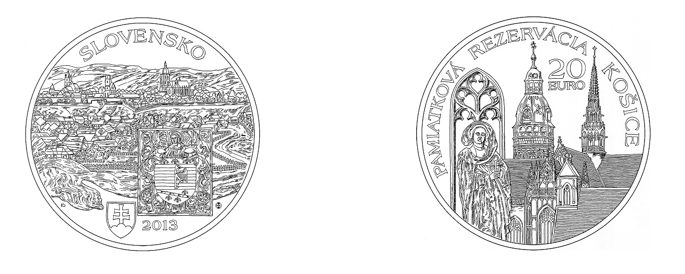

## 407

OZNÁMENIE

Národnej banky Slovenska

z 20. novembra 2012

## o vydaní strieborných zberateľských euromincí v nominálnej hodnote 20 eur s tematikou pamiatkovej rezervácie Košice

1. Úvodné ustanovenia

- a) Národná banka Slovenska podľa § 17h ods. 1 zákona Národnej rady Slovenskej republiky č. 566/1992 Zb. o Národnej banke Slovenska v znení neskorších predpisov a podľa § 1 ods. 2 písm. d) zákona Národnej rady Slovenskej republiky č. 1/1993 Z. z. o Zbierke zákonov Slovenskej republiky v znení zákona č. 275/2002 Z. z. oznamuje, že vydáva do obehu strieborné zberateľské euromince v nominálnej hodnote 20 eur s tematikou pamiatkovej rezervácie Košice (ďalej len „zberateľská eurominca“).

- b) Zberateľská eurominca má štatút zákonného platidla len v Slovenskej republike.

- c) Zberateľská eurominca sa razí zo zliatiny obsahujúcej 925 dielov striebra a 75 dielov medi; jej hmotnosť je 33,63 g a priemer 40 mm. Pri razbe zberateľskej euromince je povolená horná a dolná odchýlka v priemere 0,1 mm; povolená horná odchýlka v hmotnosti je 0,4 g a v obsahu striebra 10/1 000.

2. Vzhľad zberateľskej euromince

- a) Na líci zberateľskej euromince je vyobrazená časť veduty z roku 1617 doplnená historickým erbom mesta Košice. Štátny znak Slovenskej republiky je v spodnej časti mincového poľa. Napravo od neho je letopočet „2013“. Názov štátu „SLOVENSKO“ je v hornej časti mincového poľa v opise zľava doprava. Štylizované iniciálky mena a priezviska autora výtvarného návrhu zberateľskej euromince Karola Lička „KL“ sú pri ľavom okraji zberateľskej euromince v jej spodnej časti. Značka Mincovne Kremnica, štátny podnik, ktorú tvorí skratka „MK“ umiestnená medzi dvoma razidlami, je napravo od historického erbu.

- b) Na rube zberateľskej euromince je vyobrazená architektonická dominanta pamiatkovej rezervácie Košice – Dóm sv. Alžbety s Kaplnkou sv. Michala. V ľavej časti mincového poľa je vyobrazenie plastiky patrónky Košíc sv. Alžbety Uhorskej z hlavného oltára dómu, ktoré je doplnené gotickým oblúkom s ornamentálnymi prvkami. Pri okraji zberateľskej euromince je v opise zľava doprava nápis „PAMIATKOVÁ REZERVÁCIA KOŠICE“. Označenie nominálnej hodnoty zberateľskej euromince „20 EURO“ je v dvoch riadkoch v hornej časti mincového poľa.

- c) Na hrane mince je reliéfny nápis „EURÓPSKE HLAVNÉ MESTO KULTÚRY 2013“. Začiatok a koniec textu je oddelený vyobrazením štylizovaného kľúča.

Štát vydania: Slovenská republika

Začiatok vydávania: február 2013

Jozef Makúch v. r.
