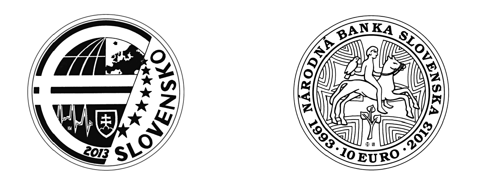

## 408

OZNÁMENIE

Národnej banky Slovenska

z 20. novembra 2012

## o vydaní strieborných zberateľských euromincí v nominálnej hodnote 10 eur pri príležitosti 20. výročia vzniku Národnej banky Slovenska

1. Úvodné ustanovenia

- a) Národná banka Slovenska podľa § 17h ods. 1 zákona Národnej rady Slovenskej republiky č. 566/1992 Zb. o Národnej banke Slovenska v znení neskorších predpisov a podľa § 1 ods. 2 písm. d) zákona Národnej rady Slovenskej republiky č. 1/1993 Z. z. o Zbierke zákonov Slovenskej republiky v znení zákona č. 275/2002 Z. z. oznamuje, že pri príležitosti 20. výročia vzniku Národnej banky Slovenska vydáva do obehu strieborné zberateľské euromince v nominálnej hodnote 10 eur (ďalej len „zberateľská eurominca“).

- b) Zberateľská eurominca má štatút zákonného platidla len v Slovenskej republike.

- c) Zberateľská eurominca sa razí zo zliatiny obsahujúcej 900 dielov striebra a 100 dielov medi; jej hmotnosť je 18 g a priemer 34 mm. Pri razbe zberateľskej euromince je povolená horná a dolná odchýlka v priemere 0,1 mm; povolená horná odchýlka v hmotnosti je 0,4 g a v obsahu striebra 10/1 000.

2. Vzhľad zberateľskej euromince

- a) Na líci zberateľskej euromince je vyobrazený štylizovaný symbol eura „€“ (ďalej len „symbol eura“) doplnený v hornej časti mincového poľa časťou glóbusu a časťou mapy Európy, ktoré vyjadrujú začlenenie Národnej banky Slovenska do Eurosystému. Symbol eura je v spodnej časti doplnený grafom. Napravo od symbolu eura je sedem hviezd. Vľavo od nich je štátny znak Slovenskej republiky. Názov štátu „SLOVENSKO“ je v opise pri pravom okraji zberateľskej euromince a vľavo od neho je letopočet „2013“. Štylizované iniciálky mena a priezviska autora lícnej strany zberateľskej euromince PhDr. Klimenta Mituru „KM“ sú umiestnené pod grafom.

- b) Na rube zberateľskej euromince je vyobrazené logo Národnej banky Slovenska doplnené dvojkrížom a dekoratívnymi prvkami na pozadí. V hornej časti mincového poľa je v opise zľava doprava nápis „NÁRODNÁ BANKA SLOVENSKA“. Pri spodnom okraji zberateľskej euromince je v opise označenie jej nominálnej hodnoty „10 EURO“. Letopočty „1993“ a 2013“ sú v opise po oboch stranách označenia nominálnej hodnoty, od ktorého sú oddelené grafickými značkami. Značka Mincovne Kremnica, štátny podnik, ktorú tvorí skratka „MK“ umiestnená medzi dvoma razidlami, a štylizované iniciálky mena a priezviska autora výtvarného návrhu rubovej strany zberateľskej euromince Mgr. art. Romana Lugára „RL“ sú umiestnené v spodnej časti mincového poľa.

- c) Na hrane zberateľskej euromince je reliéfny nápis do hĺbky „NBS – CENTRÁLNA BANKA SLOVENSKEJ REPUBLIKY“. Začiatok a koniec nápisu je oddelený lipovým lístkom.

Štát vydania: Slovenská republika

Začiatok vydávania: január 2013

Jozef Makúch v. r.
