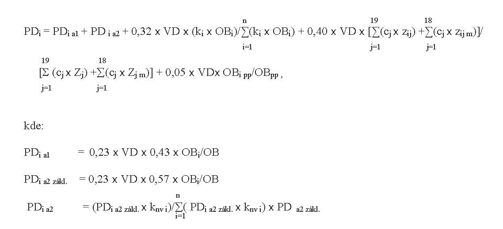

# Čl. I

Nariadenie vlády Slovenskej republiky č. 668/2004 Z. z. o rozdeľovaní výnosu dane z príjmov územnej samospráve v znení nariadenia vlády Slovenskej republiky č. 519/2006 Z. z., nariadenia vlády Slovenskej republiky č. 623/2007 Z. z., nariadenia vlády Slovenskej republiky č. 412/2008 Z. z., nariadenia vlády Slovenskej republiky č. 276/2010 Z. z. a nariadenia vlády Slovenskej republiky č. 531/2010 Z. z. sa mení a dopĺňa takto:

- 1. V § 2 ods. 1 písmeno c) znie:

- „c)

- 40 % podľa počtu žiakov (detí, poslucháčov) škôl a školských zariadení zisteného zberom údajov podľa osobitného predpisu1) a prepočítaného príslušným koeficientom uvedeným v prílohe č. 3,“.

- Poznámka pod čiarou k odkazu 1 znie:

- „1)

- § 7a a 9d zákona č. 597/2003 Z. z. o financovaní základných škôl, stredných škôl a školských zariadení v znení neskorších predpisov.“.

- 2. Za § 4 sa vkladá § 4a, ktorý znie:

- 㤠4a

- V roku 2013 sa na rozdeľovanie výnosu dane obciam podľa § 2 ods. 1 písm. a), b) a d) použijú údaje o počte obyvateľov s trvalým pobytom na území obce k 1. januáru 2011.“.

- 3. Príloha č. 3 znie:

- „Príloha č. 3 k nariadeniu vlády č. 668/2004 Z. z.

- KOEFICIENTY ZÁKLADNEJ UMELECKEJ ŠKOLY, MATERSKEJ ŠKOLY, JAZYKOVEJ ŠKOLY A ŠKOLSKÉHO ZARIADENIA PRE JEDNOTLIVÉ KATEGÓRIE ZÁKLADNÝCH UMELECKÝCH ŠKÔL, MATERSKÝCH ŠKÔL, JAZYKOVÝCH ŠKÔL A ŠKOLSKÝCH ZARIADENÍ, KOEFICIENT NA ZÁUJMOVÉ VZDELÁVANIE, KOEFICIENT NA STRAVOVANIE A KOEFICIENT NA SPRÁVU ŠKOLSKÝCH OBJEKTOV

- Tabuľka č. 1 Hodnoty koeficientov

- Index j | Subjekt indexu | Koeficient

- 1 | Žiak základnej umeleckej školy v individuálnej forme vzdelávania | 11,4

- 2 | Žiak základnej umeleckej školy v skupinovej forme vzdelávania | 7,0

- 3 | Dieťa materskej školy | 27,3

- 4 | Dieťa materskej školy pre deti so špeciálnymi výchovno-vzdelávacími potrebami | 68,2

- 5 | Dieťa materskej školy pri zdravotníckom zariadení | 40,9

- 6 | Na činnosť školského klubu detí podľa počtu žiakov základnej školy | 1,6

- 7 | Dieťa v školskom klube detí pri základnej škole pre žiakov so špeciálnymi výchovno-vzdelávacími potrebami vrátane internátnych škôl | 13,2

- 8 | Dieťa v školskom klube detí pri zdravotníckom zariadení | 7,9

- 9 | Potenciálny stravník – žiak základnej školy, základnej školy pre žiakov so špeciálnymi výchovno-vzdelávacími potrebami, gymnázia, konzervatória | 1,8

- 10 | Potenciálny stravník – žiak základnej školy internátnej, základnej školy internátnej pre žiakov so špeciálnymi výchovno-vzdelávacími potrebami, internátneho gymnázia, internátneho konzervatória | 3,6

- 11 | Poslucháč jazykovej školy | 0,5

- 12 | Dieťa školského internátu z materskej školy, základnej školy, strednej školy | 15,0

- 13 | Dieťa školského internátu zo školy pre deti a žiakov so špeciálnymi výchovno-vzdelávacími potrebami | 75,0

- 14 | Na záujmové vzdelávanie detí v centre voľného času | 1,1

- 15 | Dieťa v reedukačnom centre | 117,0

- 16 | Dieťa v liečebno-výchovnom sanatóriu | 113,0

- 17 | Dieťa v centre pedagogicko-psychologického poradenstva a prevencie | 0,2

- 18 | Dieťa v centre špeciálno-pedagogického poradenstva | 2,0

- 19 | Na správu školských objektov podľa počtu detí materskej školy a základnej školy v zriaďovateľskej pôsobnosti obce | 1,5

- Tabuľka č. 2 Hodnoty, o ktoré sa zvyšujú koeficienty pre materskú školu v zriaďovateľskej pôsobnosti obce, ak celkový počet detí v materskej škole alebo materských školách zriaďovateľa nepresahuje 25

- Počet detí v materskej škole (materských školách) zriaďovateľa | Zvýšenie koeficientov (bez ohľadu na vek dieťaťa) o hodnotu

- do 10 | 20,6

- od 11 do 15 | 12,6

- od 16 do 20 | 6,5

- od 21 do 25 | 1,7

- Tabuľka č. 3 Hodnoty, o ktoré sa zvyšujú koeficienty na žiaka základnej školy zriadenej na území obce na činnosť školského klubu detí, ak celkový počet žiakov v základnej škole nepresahuje 100

- Počet žiakov základnej školy | Zvýšenie koeficientov o hodnotu

- do 25 | 4,0

- od 26 do 48 | 3,0

- od 49 do 100 | 1,0

- “.

- 4. Príloha č. 3a sa vypúšťa.

- 5. Príloha č. 4 znie:

- „Príloha č. 4 k nariadeniu vlády č. 668/2004 Z. z.

- VZOREC

- na výpočet podielu obce na výnose dane

- 

- Vysvetlivky:

- PDi | - | podiel obce „i“ na výnose dane v eurách

- PDi a1 | - | podiel obce „i“ na výnose podielových daní v eurách neupravený koeficientom nadmorskej výšky obce

- PDi a2 zákl . | - | pomocný výpočet základne pre výpočet podielu obce PDia2

- PDi a2 | - | podiel obce „i“ na výnose podielových daní v eurách upravený koeficientom nadmorskej výšky obce

- VD | - | výnos dane podľa § 2 zákona v eurách

- OBi | - | počet obyvateľov obce „i“

- OB | - | počet obyvateľov Slovenskej republiky

- knvi | - | koeficient nadmorskej výšky obce „i“

- ki | - | koeficient obce „i“

- cj | - | koeficienty „j“ uvedené v prílohe č. 3

- zij | - | počet žiakov (detí, poslucháčov) „j“ škôl a školských zariadení v zriaďovateľskej pôsobnosti obce „i“ zistený zberom údajov podľa osobitného predpisu1)

- zij m | - | počet žiakov (detí, poslucháčov) „j“ škôl a školských zariadení zistený zberom údajov podľa osobitného predpisu1) v zriaďovateľskej pôsobnosti štátom uznanej cirkvi alebo súkromnej osoby na území obce „i“

- Zj | - | počet žiakov (detí, poslucháčov) „j“ škôl a školských zariadení v zriaďovateľskej pôsobnosti obcí v Slovenskej republike zistený zberom údajov podľa osobitného predpisu1)

- Zj m | - | počet žiakov (detí, poslucháčov) „j“ škôl a školských zariadení v zriaďovateľskej pôsobnosti zákonom uznanej cirkvi alebo súkromnej osoby na území obcí v Slovenskej republike zistený zberom údajov podľa osobitného predpisu1)

- OBi pp | - | počet obyvateľov obce „i“, ktorí dovŕšili vek 62 rokov

- OBpp | - | počet obyvateľov Slovenskej republiky, ktorí dovŕšili vek 62 rokov

- i | - | údaj týkajúci sa príslušnej obce

- j | - | údaj týkajúci sa príslušnej školy a školských zariadení uvedených v osobitnom predpise1)

- n | - | počet obcí“.

- “.
