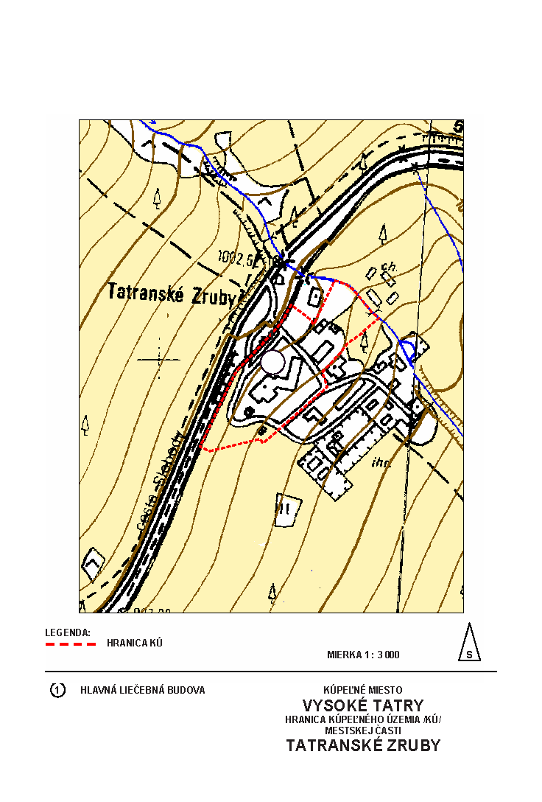

# Čl. I

Nariadenie vlády Slovenskej republiky č. 446/2006 Z. z., ktorým sa vydáva Štatút kúpeľného miesta Vysoké Tatry sa mení a dopĺňa takto:

- 1. V prílohe čl. I sa odsek 3 dopĺňa písmenom h), ktoré znie:

- „h)

- kúpeľné územie v mestskej časti Tatranské Zruby.“.

- 2. V prílohe čl. I ods. 4 druhej vete sa číslo „8“ nahrádza číslom „9“.

- 3. V prílohe sa čl. I dopĺňa odsekom 12, ktorý znie:

- „(12)

- Opis hraníc kúpeľného územia v mestskej časti Tatranské Zruby:

- a)

- západnú hranicu tvorí časť trate Tatranskej elektrickej železnice nad areálom kúpeľnej liečebne od koncového bodu južnej hranice až po asfaltové parkovisko pri bytovom dome Vostok, odkiaľ pokračuje severná hranica,

- b)

- severná hranica vedie od trate Tatranskej elektrickej železnice k asfaltovému parkovisku pri bytovom dome Vostok (parc. č. 504/2), pokračuje okolo plochy parkoviska k potoku a ďalej je tvorená potokom až po chodník nad objektom na pozemku parc. č. 504/12,

- c)

- východná hranica sa napája na severnú hranicu v priesečníku potoka a chodníka nad objektom na pozemku parc. č. 504/12, pokračuje po tomto chodníku až po cestu vedúcu z parkoviska pre hlavnú liečebnú budovu nad objektom na pozemku parc. č. 504/10 a pod pozemkom parc. č. 504/46 – zeleň pod hlavnou liečebnou budovou,

- d)

- južná hranica smeruje po hranici pozemkov parc. č. 504/49 a parc. č. 504/39 až po trať Tatranskej elektrickej železnice, odkiaľ sa začína západná hranica.“.

- 4. V prílohe sa za obrázok č. 8 dopĺňa obrázok č. 9:

- 
