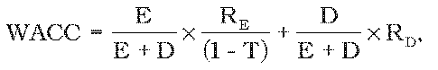
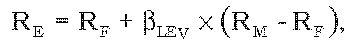
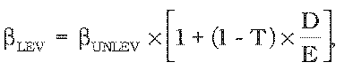

# § 5 Spôsob určenia výšky primeraného zisku

(1) Primeraný zisk zohľadňuje rozsah potrebných investícií na zabezpečenie dlhodobej spoľahlivej, bezpečnej a efektívnej prevádzky siete, primeranú návratnosť prevádzkových aktív a stimuláciu stabilného dlhodobého podnikania.

(2) Výška primeraného zisku za prístup do distribučnej siete a distribúciu plynu pre regulovaný subjekt, ktorý distribuuje plyn distribučnou sieťou v roku t a do ktorej je v roku t-1 pripojených viac ako 100 000 odberných miest, je určená ako reálna miera výnosnosti regulačnej bázy aktív pred zdanením na regulačné obdobie (WACC) vypočítaná podľa vzorca

- kde

- T je sadzba dane z príjmov na rok t,

- E je vlastné imanie v eurách k 31. decembru 2010,

- D sú cudzie zdroje v eurách k 31. decembru 2010,

- RD je reálna cena cudzích zdrojov, prepočítaná priemerná výška úverov poskytnutých nefinančným spoločnostiam na obdobie piatich a viac rokov s výškou úveru nad jeden milión eur na východiskový rok vo výške 5,13 %,

- RE je reálna cena vlastného kapitálu a vlastných zdrojov vypočítaná podľa vzorca

- kde

- RF je výnosnosť bezrizikového aktíva, prepočítaný priemerný výnos päť a viacročných štátnych dlhopisov emitovaných na slovenskom trhu za roky 2007 až 2011 na východiskový rok vo výške 4,01 %,

- ßLEV je vážený koeficient â, ktorý definuje citlivosť akcie spoločnosti na riziko trhu so zohľadnením sadzby dane z príjmov a podielu cudzích zdrojov, vypočítaný podľa vzorca

- kde

- ßUNLEV je nevážený koeficient â bez vplyvu sadzby dane z príjmov a podielu cudzích zdrojov na východiskový rok vo výške 0,30; pre ďalšie roky je určený úradom v intervale od 0,30 do 0,65,

- T je sadzba dane z príjmov na rok t,

- D/E je pomer cudzích zdrojov k vlastnému imaniu; na východiskový rok je určený vo výške 60 % v prospech cudzieho kapitálu,

- RMje výkonnosť tržného portfólia určená úradom na východiskový rok vo výške 7,01 %,

- (RM – RF) je celková riziková prémia pre východiskový rok určená úradom vo výške 3 %; pre ďalšie roky regulačného obdobia určená úradom v intervale od 3 % do 6 %.

- Pre východiskový rok je úradom vypočítaná reálna miera výnosnosti regulačnej bázy aktív (WACC) vo výške 6,04 %. Hodnoty parametrov pre ďalšie roky, ktoré slúžia na výpočet miery výnosnosti regulačnej bázy aktív (WACC) pred zdanením, sú zverejnené na webovom sídle úradu do 30. júna kalendárneho roka.
