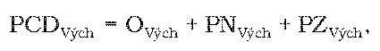
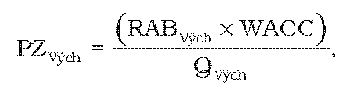

# § 11 Výpočet východiskovej maximálnej ceny za prístup do distribučnej siete a distribúciu plynu

(1) PCDVýchje východisková maximálna cena za prístup do distribučnej siete a distribúciu plynu v eurách na objemovú jednotku množstva distribuovaného plynu na regulačné obdobie a zároveň je to cena za prístup do distribučnej siete a distribúciu plynu na prvý rok tohto regulačného obdobia, teda PCDVých= PCD2012, a vypočíta sa podľa vzorca

- kde

- OVých je východisková ročná hodnota odpisov regulovaného subjektu v eurách na objemovú jednotku množstva distribuovaného plynu vo východiskovom roku regulačného obdobia; na účely cenovej regulácie je OVých určená úradom na základe hodnoty regulovanej bázy aktív regulovaného subjektu RABVých, zohľadňujúc zostatkovú dobu technickej životnosti aktív,

- PNVých sú ročné prevádzkové náklady regulovaného subjektu v eurách na objemovú jednotku množstva distribuovaného plynu vo východiskovom roku regulačného obdobia súvisiace s regulovanou činnosťou okrem odpisov určené podľa § 4 ods. 1, pričom PNVýchsú stanovené na celé regulačné obdobie a zahŕňajú aj plánované náklady na plnenie povinností regulovaného subjektu vyplývajúcich z osobitného predpisu32) a hodnotu plánovaných nákladov na krytie strát plynu a vlastnej spotreby plynu v sieti na rok 2012; do prevádzkových nákladov vynaložených za prístup do distribučnej siete a distribúciu plynu, ktoré sú zabezpečované regulovaným subjektom, iným ako regulovaným subjektom alebo subjektom, ktorý je alebo bol súčasťou vertikálne integrovaného podniku,26) je možné zarátať len primerané náklady v súlade s osobitným predpisom33) a výpočet PNVých sa predloží regulovaným subjektom ako súčasť návrhu ceny spolu s odôvodnením výpočtu jednotlivých nákladových položiek,

- PZVých je východisková hodnota primeraného zisku regulovaného subjektu, na ktorej výpočet boli použité hodnoty stanovené podľa odseku 2.

(2) PZvých je východisková hodnota primeraného zisku, ktorá sa vypočíta podľa vzorca

- kde

- RABVých je hodnota regulovanej bázy aktív vo východiskovom roku regulačného obdobia v eurách, ktorá zohľadňuje hodnotu

- a) majetku regulovaného subjektu z roku 2006 používaného výhradne na regulovanú činnosť, ktorý bol predmetom znaleckého posudku zo strany úradu,

- b) skutočných investícií v rokoch 2007 až 2010,

- c) plánovaných investícií v roku 2011,

- d) stanovených odpisov na obdobie rokov 2007 až 2010 a plánovaných odpisov na rok 2011,

- WACC je určená miera výnosnosti regulačnej bázy aktív podľa § 5 ods. 2,

- QVých je celkový objem množstva distribuovaného plynu vo východiskovom roku regulačného obdobia vypočítaný z priemerného množstva distribuovaného plynu v rokoch t-3 až t+1, pričom za roky t-3 a t-2 sa použije skutočný objem distribuovaného plynu, za rok t-1 sa použije skutočný objem distribuovaného plynu za mesiace január až jún a plánovaný objem distribuovaného plynu za mesiace júl až december a za roky t a t+1 sa použije plánovaný objem distribuovaného plynu.
