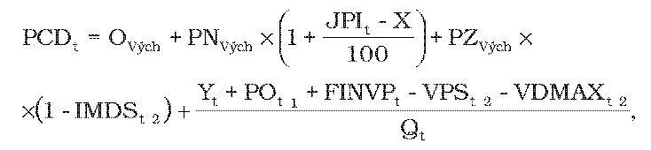
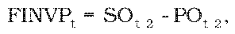

# § 12

(1) Maximálna cena za prístup do distribučnej siete a distribúciu plynu PCDt v eurách na jednotku množstva distribuovaného plynu pre jednotlivé roky regulačného obdobia sa vypočíta podľa vzorca

- kde

- OVých je východisková ročná hodnota odpisov podľa § 11 ods. 1,

- PNVýchje východisková ročná hodnota prevádzkových nákladov podľa § 11 ods. 1,

- PZVýchje východisková hodnota primeraného zisku podľa § 11 ods. 2,

- JPItje aritmetický priemer zverejnených hodnôt ukazovateľa „jadrová inflácia“ za obdobie posledných 12 mesiacov predchádzajúcich predloženiu návrhu ceny podľa osobitného predpisu7) uvedených na webovom sídle Štatistického úradu Slovenskej republiky v časti „Jadrová a čistá inflácia – oproti rovnakému obdobiu minulého roku v percentách“,

- X je faktor efektivity v každom roku regulačného obdobia, ktorého hodnota je 3,5 %,

- IMDSt-2 je index miery využitia dosiahnutých disponibilných zdrojov regulovaného subjektu, ktorý je stanovený úradom na základe využitia dosiahnutých disponibilných zdrojov regulovaného subjektu za rok t-2 na obnovu a rozvoj siete v intervale 0 až 1,

- VPSt-2 je hodnota skutočných ročných výnosov za pripojenie do distribučnej siete v eurách za rok t-2,

- VDMAXt-2je hodnota skutočných ročných výnosov za prekročenie zmluvne dohodnutej dennej distribučnej kapacity v eurách za rok t-2,

- Yt je hodnota vyjadrená v eurách zohľadňujúca hodnotu zmeny nákladov na krytie strát plynu a vlastnej spotreby plynu v sieti v roku t oproti plánovanej hodnote nákladov na krytie strát a vlastnej spotreby plynu v sieti v roku t-1,

- POt-1 je hodnota odpisov v eurách zo zaradeného nového dlhodobého majetku nevyhnutne potrebného na zabezpečenie prevádzkyschopnosti siete zohľadňujúca technickú dobu životnosti zaradeného majetku v roku t-1 najviac vo výške 2,5 % jeho obstarávacej hodnoty,

- FINVPtje faktor investícií v eurách na rok t vypočítaný podľa vzorca

- kde

- SOt-2 je skutočná hodnota odpisov v eurách zo skutočnej hodnoty zaradeného nového dlhodobého majetku nevyhnutne potrebného na zabezpečenie prevádzkyschopnosti siete zohľadňujúca technickú dobu životnosti zaradeného majetku v roku t-2, najviac vo výške 2,5 % jeho obstarávacej hodnoty,

- POt-2 je plánovaná hodnota odpisov v eurách zo zaradeného nového dlhodobého majetku nevyhnutne potrebného na zabezpečenie prevádzkyschopnosti siete zohľadňujúca technickú dobu životnosti zaradeného majetku v roku t-2, najviac vo výške 2,5 % jeho obstarávacej hodnoty,

- Qtje plánované množstvo distribuovaného plynu na rok t.

(2) Hodnoty vstupujúce do výpočtov podľa odseku 1 sa odôvodňujú analýzami, ktoré sa predkladajú s návrhom ceny.

(3) Ak je hodnota rozdielu JPIta Xnižšia ako 0, na účely výpočtu maximálnej ceny za prístup do distribučnej siete a distribúciu plynu na rok t sa hodnota rozdielu rovná 0.
