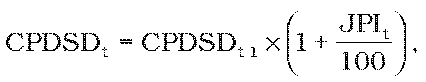
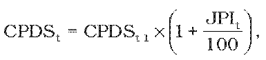

## Pripojenie do distribučnej siete a pripojenie nových výrobcov plynu do distribučnej siete

# § 16

(1) Cenová regulácia pripojenia do distribučnej siete sa vzťahuje na regulovaný subjekt, ktorý prevádzkuje distribučnú sieť v roku t.

(2) Súčasťou návrhu ceny za pripojenie do distribučnej siete a pripojenie nových výrobcov plynu do distribučnej siete sú

- a) účtovná závierka28) za rok t-2,

- b) správa audítora k účtovnej závierke za rok t-2 podľa osobitného predpisu,29) ak má regulovaný subjekt povinnosť overenia účtovnej závierky audítorom,

- c) návrh ceny za pripojenie do distribučnej siete podľa § 16 alebo § 17,

- d) podklady k navrhovanej cene podľa § 16 alebo § 17, prípadne iné podklady na posúdenie návrhu ceny.

(3) Ak podklady podľa odseku 2 písm. a) a b) boli súčasťou návrhu ceny na rok t za inú regulovanú činnosť, uvedie sa táto skutočnosť v návrhu ceny.

(4) Maximálna cena za pripojenie do distribučnej siete vo východiskovom roku regulačného obdobia sa vypočíta v súlade s odsekom 5 na základe plánovaných priemerných ekonomicky oprávnených nákladov na pripojenie plynového zariadenia do distribučnej siete na rok t, vynaložených prevádzkovateľom distribučnej siete pri úkonoch v štandardnom rozsahu potrebných na pripojenie plynového zariadenia. Úkony v štandardnom rozsahu predstavujú úkony a činnosti, ktoré sú porovnateľné pri vykonávaní každého pripojenia plynového zariadenia do distribučnej siete.

(5) Maximálna cena za pripojenie do distribučnej siete vo východiskovom roku regulačného obdobia obsahuje ekonomicky oprávnené náklady spojené

- a) so stanovením podmienok pripojenia do distribučnej siete,

- b) s kontrolou žiadosti o realizáciu pripojenia do distribučnej siete a montážou meradla vrátane kontroly predloženej správy o odbornej prehliadke a skúške odberného plynového zariadenia,

(6) Maximálna cena za pripojenie do distribučnej siete sa navrhuje osobitne pre odberateľov plynu v domácnosti a osobitne pre odberateľov plynu mimo domácnosti.

(7) Maximálna cena za pripojenie do distribučnej siete pre odberateľov plynu v domácnosti CPDSDtna roky nasledujúce po východiskovom roku regulačného obdobia sa vypočíta podľa vzorca

- kde

- CPDSDt-1je maximálna cena za pripojenie do distribučnej siete pre odberateľov plynu v domácnosti v roku t-1 regulačného obdobia,

- JPIt je aritmetický priemer zverejnených hodnôt ukazovateľa „jadrová inflácia“ za obdobie posledných 12 mesiacov predchádzajúcich predloženiu návrhu ceny podľa osobitného predpisu,7) uvedených na webovom sídle Štatistického úradu Slovenskej republiky v časti „Jadrová a čistá inflácia – oproti rovnakému obdobiu minulého roku v percentách“.

(8) Maximálna cena za pripojenie do distribučnej siete pre odberateľov plynu mimo domácnosti CPDStna roky nasledujúce po východiskovom roku regulačného obdobia sa vypočíta podľa vzorca

- kde

- CPDSt-1je maximálna cena za pripojenie do distribučnej siete pre odberateľov plynu mimo domácnosti v roku t-1 regulačného obdobia,

- JPItje aritmetický priemer zverejnených hodnôt ukazovateľa „jadrová inflácia“ za obdobie posledných 12 mesiacov predchádzajúcich predloženiu návrhu ceny podľa osobitného predpisu,7) uvedených na webovom sídle Štatistického úradu Slovenskej republiky v časti „Jadrová a čistá inflácia – oproti rovnakému obdobiu minulého roku v percentách“.

(9) Skutočné výnosy a náklady regulovaného subjektu súvisiace s pripojením do distribučnej siete sa evidujú oddelene.

(10) Ak sa návrh ceny v priebehu regulačného obdobia podáva prvýkrát, rok, na ktorý sa podáva návrh ceny, sa na účely výpočtu maximálnej ceny za pripojenie do distribučnej siete považuje za východiskový.
