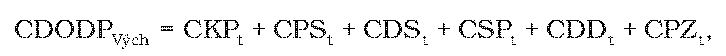
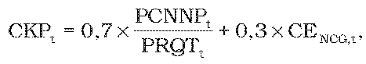

# § 19 Spôsob výpočtu maximálnej ceny za dodávku plynu pre domácnosti

(1) Ak sa návrh ceny v priebehu regulačného obdobia podáva prvýkrát, rok, na ktorý sa podáva návrh ceny, sa na účely výpočtu ceny za dodávku plynu pre domácnosti považuje za východiskový.

(2) Maximálna východisková cena za dodávku plynu pre domácnosti CDODPVýchv eurách na jednotku množstva plynu na rok t, na ktorý sa regulovaným subjektom podáva návrh ceny prvýkrát, sa vypočíta podľa vzorca

- kde

- CKPt sú náklady na nákup plynu v eurách na jednotku množstva plynu na rok t a vypočítajú sa podľa vzorca

- kde

- PCNNPt sú celkové plánované náklady v eurách na nákup plynu na rok t vyplývajúce zo všetkých zmlúv o nákupe plynu pre zabezpečenie zmluvných dodávok plynu pre všetkých odberateľov plynu vrátane krátkodobých zmlúv na obchodných miestach Európskej únie,

- PRQTt je celkové plánované množstvo nakúpeného plynu pre zabezpečenie dodávky plynu pre všetkých odberateľov plynu na rok t,

- CENCG,t je aritmetický priemer denných cien zverejnených burzou EEX (European Energy Exchange) na jej webovom sídle, produktu NCG Natural Gas Year Futures Cal-t v eurách na jednotku množstva plynu za obdobie deviatich kalendárnych mesiacov predchádzajúcich mesiacu, v ktorom sa predkladá návrh ceny,

- CPSt sú náklady na prístup do prepravnej siete a prepravu plynu v eurách na jednotku množstva plynu na rok t a vypočítajú sa ako podiel plánovaných nákladov dodávateľa plynu za prístup do prepravnej siete a prepravu plynu pre všetkých odberateľov plynu na vymedzenom území na základe plánovaných denných maxím a plánovaného množstva dodaného plynu všetkým odberateľom plynu na rok t,

- CDSt sú náklady na prístup do distribučnej siete a distribúciu plynu v eurách na jednotku množstva plynu na rok t a vypočítajú sa ako podiel plánovaných nákladov dodávateľa plynu za prístup do vysokotlakovej distribučnej siete na základe plánovaných denných maximálnych odberov odberateľov plynu v domácnosti a za distribúciu plynu pre odberateľov plynu v domácnosti zaradených do príslušných taríf za distribúciu plynu podľa plánovaného množstva odobratého plynu a plánovaného množstva dodaného plynu pre odberateľov plynu v domácnosti na rok t,

- CSPt sú náklady na uskladňovanie plynu potrebného na zabezpečenie dodávky plynu v eurách na jednotku množstva plynu na rok t a vypočítajú sa podľa vzorca

- kde

- PNSDt sú plánované náklady v eurách na uskladňovanie plynu potrebného na zabezpečenie dodávky plynu pre všetkých odberateľov plynu odvodené na základe uzavretých zmlúv na uskladňovanie plynu na rok t,

- PRQTt je plánované množstvo dodaného plynu pre všetkých odberateľov plynu okrem odberateľov plynu, ktorí svojím charakterom odberu plynu nevyvolávajú potrebu využitia podzemných zásobníkov na rok t,

- CDDt sú náklady obchodnej činnosti dodávateľa plynu pre odberateľov plynu v domácnosti v eurách na jednotku množstva plynu na rok t a vypočítajú sa ako podiel celkových plánovaných ekonomicky oprávnených nákladov podľa § 4 ods. 1 okrem nákladov uvedených v § 4 ods. 1 písm. a) až c) a odseku 2 obchodnej činnosti dodávateľa plynu na dodávku plynu pre odberateľov plynu v domácnosti v eurách na celkové plánované množstvo dodaného plynu pre odberateľov plynu v domácnosti na rok t. Do plánovaných ekonomicky oprávnených nákladov obchodnej činnosti, ktorá je zabezpečovaná regulovaným subjektom, iným ako regulovaným subjektom alebo subjektom, ktorý je alebo bol súčasťou vertikálne integrovaného podniku,26) je možné zarátať len ekonomicky oprávnené náklady; výpočet plánovaných ekonomicky oprávnených nákladov obchodnej činnosti dodávateľa plynu na dodávku plynu pre domácnosti bude dodávateľom plynu predložený ako súčasť návrhu ceny spolu s odôvodnením výpočtu jednotlivých nákladových položiek,

- CPZt je najvyššia miera primeraného zisku, ktorý je možné zahrnúť do maximálnej ceny za dodávku plynu pre domácnosti, ktorého hodnota je maximálne 5 % z CKPt, najviac však 1,50 eura za 1 MWh alebo 0,01589 eura na objemovú jednotku.
