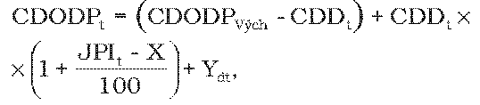

# § 20

(1) Maximálna cena za dodávku plynu pre domácnosti CDODPt v eurách na jednotku množstva plynu pre jednotlivé roky regulačného obdobia nasledujúce po východiskovom roku sa vypočíta podľa vzorca

- kde

- CDODP Vých je maximálna východisková cena za dodávku plynu pre domácnosti v eurách na jednotku množstva plynu vo východiskovom roku,

- CDDt je hodnota nákladov obchodnej činnosti dodávateľa plynu v eurách na jednotku množstva plynu určená podľa § 19 ods. 2,

- JPIt je aritmetický priemer zverejnených hodnôt ukazovateľa „jadrová inflácia“ za obdobie posledných 12 mesiacov predchádzajúcich predloženiu návrhu ceny podľa osobitného predpisu,7) uvedených na webovom sídle Štatistického úradu Slovenskej republiky v časti „Jadrová a čistá inflácia – oproti rovnakému obdobiu minulého roku v percentách“,

- X je faktor efektivity v každom roku regulačného obdobia, ktorého hodnota je 3,5 %,

- Ydtje súčet hodnôt

- a) rozdielu plánovanej nákupnej ceny plynu v eurách na jednotku množstva plynu v roku t a plánovanej nákupnej ceny plynu v eurách na jednotku množstva plynu v roku t-1,

- b) rozdielu plánovanej ceny za prístup do prepravnej siete a prepravu plynu v eurách na jednotku množstva plynu v roku t a plánovanej ceny za prístup do prepravnej siete a prepravu plynu v eurách na jednotku množstva plynu v roku t-1,

- c) rozdielu plánovanej ceny za prístup do distribučnej siete a distribúciu plynu v eurách na jednotku množstva plynu v roku t a plánovanej ceny za prístup do distribučnej siete a distribúciu plynu v eurách na jednotku množstva plynu v roku t-1,

- d) rozdielu plánovanej ceny za uskladňovanie plynu v eurách na jednotku množstva plynu v roku t a plánovanej ceny za uskladňovanie plynu v eurách na jednotku množstva plynu v roku t-1, so zohľadnením výnosov zo sekundárnych obchodov v rámci uskladňovania plynu dodávateľom plynu podľa uzatvorených zmlúv na uskladňovanie plynu na rok t-1,

- e) mimoriadnych nákladov regulovaného subjektu na plnenie povinností vyplývajúcich zo všeobecne záväzných právnych predpisov, ktoré majú vplyv na náklady súvisiace s dodávkou plynu pre domácnosti v eurách na jednotku množstva plynu na rok t.

(2) Hodnota Ydtsa odôvodňuje analýzami v predloženom návrhu ceny.

(3) Pri návrhu ceny za dodávku plynu pre domácnosti sa použijú ustanovenia odseku 1 a § 18 ods. 4 a 5. Ak hodnota rozdielu JPIta X je nižšia ako 0, pri výpočte sa použije hodnota tohto rozdielu rovnajúca sa 0.
