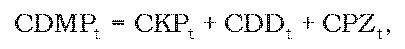
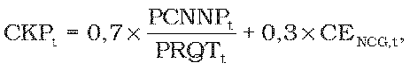

# § 22 Spôsob výpočtu maximálnej ceny za dodávku plynu malému podniku

(1) Maximálna cena za dodávku plynu malému podniku CDMPtv eurách na jednotku množstva plynu na rok t sa vypočíta podľa vzorca

- kde

- CKPt sú náklady na nákup plynu v eurách na jednotku množstva plynu na rok t a vypočítajú sa podľa vzorca

- kde

- PCNNPt sú celkové plánované náklady v eurách na nákup plynu na rok t vyplývajúce zo všetkých zmlúv o nákupe plynu pre zabezpečenie zmluvných dodávok plynu pre všetkých odberateľov plynu vrátane krátkodobých zmlúv na obchodných miestach Európskej únie,

- PRQTt je celkové plánované množstvo nakúpeného plynu pre zabezpečenie dodávky plynu pre všetkých odberateľov plynu na rok t,

- CENCG,t je aritmetický priemer denných cien zverejnených burzou EEX (European Energy Exchange) na jej webovom sídle, produktu NCG Natural Gas Year Futures Cal-t v eurách na jednotku množstva plynu za obdobie deviatich kalendárnych mesiacov predchádzajúcich mesiacu, v ktorom sa predkladá návrh ceny,

- CDDt sú náklady obchodnej činnosti dodávateľa plynu pre malý podnik v eurách na jednotku množstva plynu na rok t a vypočítajú sa ako podiel celkových plánovaných ekonomicky oprávnených nákladov podľa § 4 ods. 1 okrem nákladov uvedených v § 4 ods. 1 písm. a) až c) a ods. 2 obchodnej činnosti dodávateľa plynu na dodávku plynu pre odberateľov plynu kategórie malý podnik v eurách na celkové plánované množstvo dodaného plynu pre odberateľov plynu kategórie malý podnik na rok t; do plánovaných ekonomicky oprávnených nákladov obchodnej činnosti, ktorá je zabezpečovaná regulovaným subjektom, iným ako regulovaným subjektom alebo subjektom, ktorý je alebo bol súčasťou vertikálne integrovaného podniku,26) je možné zarátať len primerané náklady, výpočet plánovaných nákladov obchodnej činnosti dodávateľa plynu na dodávku plynu pre malé podniky bude dodávateľom plynu predložený ako súčasť návrhu ceny spolu s odôvodnením výpočtu jednotlivých nákladových položiek,

- CPZt je najvyššia miera primeraného zisku, ktorý je možné zahrnúť do maximálnej ceny za dodávku plynu malému podniku, ktorého hodnota je maximálne 10 % z CKPt, najviac však 3 eurá za 1 MWh alebo 0,03178 eura na objemovú jednotku.

(2) K maximálnym cenám podľa § 21 ods. 6 druhej vety sa dodávateľom plynu pripočíta podľa cenového rozhodnutia úradu na rok t cena za prístup do prepravnej siete a prepravu plynu a cena za prístup do distribučnej siete a distribúciu plynu a neregulovaná cena za prístup do zásobníka a uskladňovanie plynu.

(3) Ak je dodávateľom plynu malému podniku regulovaný subjekt, do ktorého distribučnej siete je pripojených menej ako 100 000 odberných miest, súčasťou nákladov na prístup do distribučnej siete a distribúciu plynu sú aj náklady na prístup do distribučnej siete a distribúciu plynu distribučnou sieťou tohto regulovaného subjektu.
