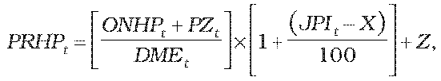
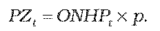
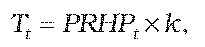

# § 9 Spôsob výpočtu pevnej ceny za využívanie hydroenergetického potenciálu a výšky primeraného zisku

(1) Na určenie pevnej ceny za využívanie hydroenergetického potenciálu sa vypočíta priemerná cena za využívanie hydroenergetického potenciálu v eurách na jednotku dodanej mechanickej energie v roku t podľa vzorca

- ak (JPI - X) < 0, na účely výpočtu priemernej ceny sa hodnota rozdielu JPI a X rovná nule,

- kde

- PRHPt je priemerná cena za využívanie hydroenergetického potenciálu v eurách na jednotku dodanej mechanickej energie v roku t,

- ONHPt sú ekonomicky oprávnené náklady v eurách na využívanie hydroenergetického potenciálu schválené alebo určené úradom vo výpočte ceny na rok t-1,

- DMEt je množstvo dodanej mechanickej energie v jednotkách množstva mechanickej energie, vypočítané z množstva predpokladanej vyrobenej elektrickej energie pri predpokladanej 97 % účinnosti energetických zariadení, schválené alebo určené úradom vo výpočte ceny na rok t-1,

- JPIt je aritmetický priemer zverejnených hodnôt ukazovateľa „jadrová inflácia“ za posledných 12 mesiacov predchádzajúcich mesiacu, v ktorom sa návrh ceny predkladá, uvedených na webovom sídle Štatistického úradu Slovenskej republiky v časti „Jadrová a čistá inflácia - oproti rovnakému obdobiu minulého roku v percentách“,

- X je faktor efektivity; pre regulačné obdobie vo výške 3,5 %,

- PZt je maximálna výška primeraného zisku v eurách vypočítaná podľa odseku 2,

- Z je hodnota zmeny v eurách na jednotku dodanej mechanickej energie, ktorá sa použije vo výpočte, ak sa postupuje v cenovom konaní o zmene rozhodnutia podľa § 17 ods. 2 písm. d) zákona; hodnota zmeny vyjadruje zmenu ekonomických parametrov, ktoré ovplyvňujú ekonomicky oprávnené náklady regulovaného subjektu, z ktorých sa vychádzalo pri výpočte priemernej ceny za využívanie hydroenergetického potenciálu v eurách na jednotku dodanej mechanickej energie a odôvodňuje sa analýzami v predloženom návrhu na zmenu cenového rozhodnutia.

(2) Maximálna výška primeraného zisku za využívanie hydroenergetického potenciálu v eurách na rok t sa vypočíta podľa vzorca

(3) Pevná cena za využívanie hydroenergetického potenciálu sa predkladá ako tarifa pre jednotlivé skupiny využívateľov hydroenergetického potenciálu.

(4) Tarify pre jednotlivé skupiny využívateľov hydroenergetického potenciálu sa vypočítajú podľa vzorca

- kde

- Tt je tarifa za využívanie hydroenergetického potenciálu v eurách na jednotku dodanej mechanickej energie v roku t,

- k je koeficient rozloženia ekonomicky oprávnených nákladov a primeraného zisku medzi jednotlivé skupiny využívateľov hydroenergetického potenciálu vodného toku určený podľa odseku 5.

(5) Skupiny využívateľov hydroenergetického potenciálu sa členia podľa inštalovaného výkonu vodných elektrární a koeficient rozloženia nákladov k sa ustanovuje takto:

- a) od 100 kW do 1 000 kW k = 0,30,

- b) od 1 001 kW do 10 000 kW k = 0,50,

- c) nad 10 000 kW k = 1,02.

(6) Návrh taríf za využívanie hydroenergetického potenciálu na rok t sa predkladá tak, aby ich vážený priemer prepočítaný na jednotku dodanej mechanickej energie neprekročil priemernú cenu za využívanie hydroenergetického potenciálu vypočítanú podľa odseku 1.
