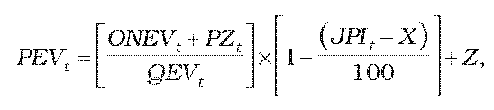
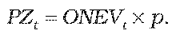

# § 10 Spôsob výpočtu pevnej ceny za odber energetickej vody a výšky primeraného zisku

(1) Pevná cena za odber energetickej vody v eurách na objemovú jednotku v roku t sa vypočíta podľa vzorca

- ak (JPI - X) < 0, na účely výpočtu pevnej ceny sa hodnota rozdielu JPI a X rovná nule,

- kde

- PEVt je pevná cena za odber energetickej vody v eurách na objemovú jednotku v roku t,

- ONEVt sú ekonomicky oprávnené náklady v eurách na odber energetickej vody schválené alebo určené úradom vo výpočte ceny na rok t-1,

- PZt je maximálna výška primeraného zisku v eurách určená podľa odseku 2,

- QEVt je množstvo odobratej energetickej vody v objemových jednotkách schválené alebo určené úradom vo výpočte ceny na rok t-1,

- JPIt je aritmetický priemer zverejnených hodnôt ukazovateľa „jadrová inflácia“ za posledných 12 mesiacov predchádzajúcich mesiacu, v ktorom sa návrh ceny predkladá, uvedených na webovom sídle Štatistického úradu Slovenskej republiky v časti „Jadrová a čistá inflácia - oproti rovnakému obdobiu minulého roku v percentách“,

- X je faktor efektivity; pre regulačné obdobie vo výške 3,5 %,

- Z je hodnota zmeny v eurách na objemovú jednotku, ktorá sa použije vo výpočte, ak sa postupuje v cenovom konaní o zmene rozhodnutia podľa § 17 ods. 2 písm. d) zákona; hodnota zmeny vyjadruje zmenu ekonomických parametrov, ktoré ovplyvňujú ekonomicky oprávnené náklady regulovaného subjektu, z ktorých sa vychádzalo pri určení pevnej ceny za odber energetickej vody v eurách na objemovú jednotku a odôvodňuje sa analýzami v predloženom návrhu na zmenu cenového rozhodnutia.

(2) Maximálna výška primeraného zisku za odber energetickej vody v eurách na rok t sa vypočíta podľa vzorca

