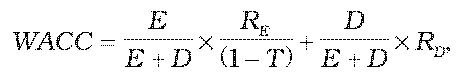
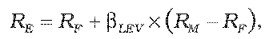
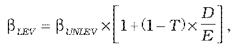

# § 5 Spôsob určenia výšky primeraného zisku

(1) Primeraný zisk sa určí ako súčin hodnoty regulačnej bázy aktív a primeranej miery výnosnosti regulačnej bázy aktív. Regulačná báza aktív (RAB) je hodnota aktív slúžiacich na vykonávanie regulovaných činností a určí sa na základe ich účtovnej hodnoty. Reálna miera výnosnosti regulačnej bázy aktív (WACC) pred zdanením v percentách na dve desatinné miesta na regulačné obdobie je vypočítaná podľa vzorca

kde

T je sadzba dane z príjmov na rok t,

E je vlastné imanie v eurách k 31. decembru 2010,

D sú cudzie zdroje v eurách k 31. decembru 2010,

RE je reálna cena vlastného kapitálu a vlastných zdrojov vypočítaná podľa vzorca

kde

RF je výnosnosť bezrizikového aktíva, prepočítaný priemerný výnos päť a viacročných štátnych dlhopisov emitovaných na slovenskom trhu za roky 2007 až 2011; na rok 2012 určená vo výške 4,01 %,

βLEV je vážený koeficient , ktorý definuje citlivosť akcie spoločnosti na riziko trhu so zohľadnením sadzby dane z príjmov a podielu cudzích zdrojov vypočítaný podľa vzorca

kde

βUNLEV je nevážený koeficient bez vplyvu sadzby dane z príjmov a podielu cudzích zdrojov; na rok 2012 určený vo výške 0,30 a pre ďalšie roky regulačného obdobia určený úradom v intervale od 0,30 do 0,65,

D/E je pomer cudzích zdrojov ku vlastnému imaniu; na rok 2012 určený vo výške 60 % v prospech cudzieho kapitálu,

(RM - RF) je celková riziková prémia; na rok 2012 určená vo výške 3,00 % a na ďalšie roky regulačného obdobia určená úradom v intervale od 3 % do 6 %,

RM je výkonnosť tržného portfólia určená na rok 2012 vo výške 7,01 %,

RD je reálna cena cudzích zdrojov, prepočítaná priemerná výška úverov poskytnutých nefinančným spoločnostiam na obdobie päť a viac rokov s výškou úveru nad 1 000 000 eur; na rok 2012 určená vo výške 5,13 %.

Reálna miera výnosnosti regulačnej bázy aktív (WACC) pred zdanením je na rok 2012 úradom vypočítaná vo výške 6,04 %. Hodnoty parametrov na ďalšie roky, ktoré slúžia na výpočet reálnej miery výnosnosti regulačnej bázy aktív (WACC) pred zdanením sú zverejnené na webovom sídle úradu do 30. júna príslušného kalendárneho roku.

(2) Primeraný zisk pri výrobe, distribúcii a dodávke pitnej vody verejným vodovodom pre regulovaný subjekt, ktorého dodávka pitnej vody v roku t nepresiahne 1 000 000 m3, je ustanovený v § 8 ods. 3 a pri odvedení a čistení odpadovej vody verejnou kanalizáciou pre regulovaný subjekt, ktorého množstvo odvedenej odpadovej vody v roku t nepresiahne 1 000 000 m3, je ustanovený v § 9 ods. 3.

(3) Faktor efektivity X pre regulované činnosti na regulačné obdobie má hodnotu 3,5 %.
