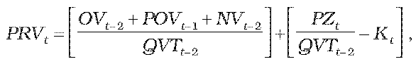
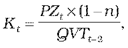
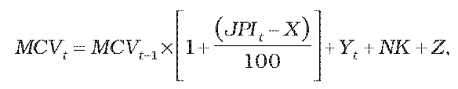
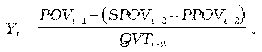

# § 8 Spôsob výpočtu maximálnej ceny za výrobu, distribúciu a dodávku pitnej vody a výšky primeraného zisku

(1) Na určenie maximálnej ceny za výrobu a dodávku pitnej vody, maximálnej ceny za výrobu a distribúciu pitnej vody, maximálnej ceny za dodávku pitnej vody alebo maximálnej ceny za výrobu a dodávku pitnej vody pre skupinu odberateľov2) v eurách na objemovú jednotku na prvý rok regulačného obdobia sa vypočíta priemerná cena podľa vzorca

kde

PRVt je priemerná cena za výrobu, distribúciu a dodávku pitnej vody v eurách na objemovú jednotku,

OVt-2 sú odpisy hmotného majetku a nehmotného majetku používaného na výrobu, distribúciu a dodávku pitnej vody a nájomné za prenájom hmotného majetku a nehmotného majetku v eurách za rok t-2 podľa § 4 ods. 1 písm. e),

POVt-1 je hodnota odpisov v eurách z nového hmotného majetku a nehmotného majetku používaného na výrobu, distribúciu a dodávku pitnej vody zohľadňujúca technickú dobu životnosti majetku skutočne zaradeného do 30. júna a majetku, ktorý sa plánuje zaradiť do 31. decembra do účtovníctva v roku t-1 najviac vo výške 2 % jeho obstarávacej ceny; to platí aj pre prevádzkové spoločnosti, ktoré si takýto majetok prenajímajú, pričom hodnota POVt-1 sa preukazuje nájomnou zmluvou,

NVt-2 sú skutočné oprávnené prevádzkové náklady v eurách na výrobu, distribúciu a dodávku pitnej vody v roku t-2 okrem OVt-2,

QVTt-2 je skutočné množstvo dodanej pitnej vody v objemových jednotkách pre všetkých odberateľov2) v roku t-2 vrátane vlastnej spotreby,

PZt je výška primeraného zisku v eurách vypočítaná podľa odseku 2, pričom najvyššia miera primeraného zisku je 0,10 eura na 1 m3 skutočného množstva dodanej pitnej vody v roku t-2 vrátane vlastnej spotreby, alebo podľa odseku 3; pri výpočte ceny za dodávku pitnej vody sa uplatní najviac polovica hodnoty PZt,

Kt je faktor využitia kapacity vodárenského majetku používaného na výrobu, distribúciu a dodávku pitnej vody podľa odseku 4.

(2) Výška primeraného zisku PZt v eurách sa vypočíta podľa vzorca

PZt= RAB2010x WACCt,

kde

RAB2010 je účtovná hodnota (zostatková cena) hmotného majetku a nehmotného majetku v eurách v roku 2010 používaného na regulovanú činnosť podľa prílohy č.14.

(3) Výška primeraného zisku PZt pre regulovaný subjekt, ktorého dodávka pitnej vody verejným vodovodom nepresiahne 1 000 000 m3, je maximálne 0,05 eura na 1 m3 skutočného množstva dodanej pitnej vody v roku t-2 vrátane vlastnej spotreby.

(4) Hodnota faktora využitia vodárenského majetku používaného na výrobu, distribúciu a dodávku pitnej vody v eurách na objemovú jednotku sa vypočíta podľa vzorca

kde

n je koeficient využitia projektovanej kapacity vodárenského majetku používaného na výrobu, distribúciu a dodávku pitnej vody, ktorý sa vypočíta ako priemer podielov skutočne využívanej kapacity a celkovej projektovanej kapacity jednotlivého vodárenského majetku podľa prílohy č. 17. Vypočítaná hodnota sa matematicky zaokrúhli na dve desatinné miesta.

(5) Maximálna cena za výrobu a dodávku pitnej vody MCVt v eurách na objemovú jednotku sa navrhuje tak, aby vážený priemer maximálnej ceny za výrobu a dodávku pitnej vody a maximálnej ceny za výrobu a distribúciu pitnej vody prepočítaný na objemovú jednotku neprekročil priemernú cenu na rok t vypočítanú podľa odseku 1. Maximálna cena za dodávku pitnej vody sa navrhuje najviac do výšky vypočítanej priemernej ceny. Pri návrhu maximálnej ceny sa prihliada na sociálne, environmentálne a ekonomické dôsledky úhrady za vodohospodárske služby, ako aj na geografické podmienky a klimatické podmienky príslušného regiónu.

(6) Ak sa regulovaným subjektom dodáva voda inému regulovanému subjektu, návrh maximálnej ceny za výrobu a distribúciu pitnej vody sa predkladá tak, že maximálna cena za výrobu a distribúciu pitnej vody je cena znížená o priemerné náklady spojené s dodávkou pitnej vody konečným odberateľom.2)

(7) Návrh maximálnej ceny pre jednotlivé skupiny odberateľov2) sa predkladá tak, aby maximálne ceny zohľadňovali ekonomicky oprávnené náklady jednotlivých skupín odberateľov2) a výšku primeraného zisku.

(8) Ak sa návrh ceny na určenie maximálnej ceny predkladá prvýkrát, vypočíta sa priemerná cena za výrobu, distribúciu a dodávku pitnej vody v eurách na objemovú jednotku na rok t podľa odseku 1, pričom sa na výpočet použijú plánované údaje na rok t a návrh maximálnej ceny sa predkladá podľa odsekov 5 až 7.

(9) Maximálna cena za výrobu a dodávku pitnej vody, maximálna cena za výrobu a distribúciu pitnej vody, maximálna cena za dodávku pitnej vody alebo maximálna cena za výrobu a dodávku pitnej vody pre skupinu odberateľov2) v eurách na objemovú jednotku na ďalšie roky regulačného obdobia sa vypočíta podľa vzorca

ak (JPI – X) t je maximálna cena za výrobu a dodávku pitnej vody, maximálna cena za výrobu a distribúciu pitnej vody, maximálna cena za dodávku pitnej vody alebo maximálna cena za výrobu a dodávku pitnej vody pre skupinu odberateľov2) v eurách na objemovú jednotku na rok t,

MCVt–1 je maximálna cena za výrobu a dodávku pitnej vody, maximálna cena za výrobu a distribúciu pitnej vody, maximálna cena za dodávku pitnej vody alebo maximálna cena za výrobu a dodávku pitnej vody pre skupinu odberateľov2) v eurách na objemovú jednotku schválená alebo určená v cenovom rozhodnutí na rok t-1, ktorá zohľadňuje ekonomicky oprávnené náklady a primeraný zisk,

JPIt je aritmetický priemer zverejnených hodnôt ukazovateľa „jadrová inflácia“ za posledných 12 mesiacov predchádzajúcich mesiacu, v ktorom sa návrh ceny predkladá, uvedených na webovom sídle Štatistického úradu Slovenskej republiky v časti „Jadrová a čistá inflácia - oproti rovnakému obdobiu minulého roku v percentách“,

X je faktor efektivity podľa § 5 ods. 4,

Ytje faktor investičného rozvoja v eurách na objemovú jednotku vypočítaný podľa odseku 10.

NK je medziročná zmena faktora využitia kapacity vodárenského majetku používaného na výrobu, distribúciu a dodávku pitnej vody v eurách na objemovú jednotku (Kt–1 – Kt).

Z je hodnota zmeny v eurách na objemovú jednotku, ktorá sa vo výpočte použije, ak sa postupuje v cenovom konaní o zmene rozhodnutia podľa § 17 ods. 2 písm. d) zákona; hodnota zmeny vyjadruje zmenu ekonomických parametrov, ktoré ovplyvňujú prevádzkové náklady NV regulovaného subjektu, z ktorých sa vychádzalo pri určení maximálnej ceny za výrobu a dodávku pitnej vody, za výrobu a distribúciu pitnej vody, za dodávku pitnej vody alebo za výrobu a dodávku pitnej vody pre skupinu odberateľov2) v eurách na objemovú jednotku a odôvodňuje sa analýzami v predloženom návrhu na zmenu cenového rozhodnutia.

(10) Faktor investičného rozvoja Yt je prioritne určený na podporu investícií do vodárenského majetku používaného na výrobu, distribúciu a dodávku pitnej vody. Vypočíta sa podľa vzorca

kde

SPOVt–2 je hodnota odpisov z hmotného majetku a nehmotného majetku používaného na výrobu, distribúciu a dodávku pitnej vody skutočne zaradeného v účtovníctve v roku t–2 najviac vo výške 2 % jeho obstarávacej ceny,

PPOVt–2 je hodnota odpisov z hmotného majetku a nehmotného majetku používaného na výrobu, distribúciu a dodávku pitnej vody plánovaného zaradiť do účtovníctva v roku t-2 najviac vo výške 2 % jeho obstarávacej ceny,

QVTt–2 je skutočné množstvo dodanej pitnej vody v objemových jednotkách pre všetkých odberateľov2) v roku t-2 vrátane vlastnej spotreby.
