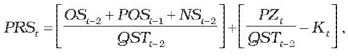
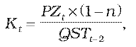
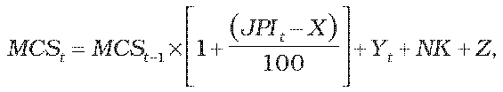
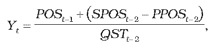

# § 9 Spôsob výpočtu maximálnej ceny za odvádzanie a čistenie odpadovej vody a výšky primeraného zisku

(1) Na určenie maximálnej ceny za odvádzanie a čistenie odpadovej vody, maximálnej ceny za odvádzanie odpadovej vody, maximálnej ceny za čistenie odpadovej vody alebo maximálnej ceny za odvádzanie a čistenie odpadovej vody pre skupinu producentov3) v eurách na objemovú jednotku na prvý rok regulačného obdobia sa vypočíta priemerná cena podľa vzorca

kde

PRSt je priemerná cena za odvádzanie a čistenie odpadovej vody v eurách na objemovú jednotku,

OSt–2 sú odpisy hmotného majetku a nehmotného majetku a nájomné za prenájom hmotného majetku a nehmotného majetku používaného na odvádzanie a čistenie odpadovej vody v eurách za rok t–2 podľa § 4 ods. 1 písm. e),

POSt–1 je hodnota odpisov v eurách z nového hmotného a nehmotného majetku používaného na odvádzanie a čistenie odpadovej vody zohľadňujúca technickú dobu životnosti majetku skutočne zaradeného do 30. júna a majetku, ktorý sa plánuje zaradiť do 31. decembra do účtovníctva v roku t–1 najviac vo výške 2 % jeho obstarávacej ceny; to platí aj pre prevádzkové spoločnosti, ktoré si takýto majetok prenajímajú, pričom hodnota POSt–1 sa preukazuje nájomnou zmluvou,

NSt–2 sú skutočné oprávnené prevádzkové náklady v eurách na odvádzanie a čistenie odpadovej vody v roku t–2 okrem OSt–2,

QSTt–2 je skutočné množstvo odvedenej a čistenej odpadovej vody v objemových jednotkách pre všetkých producentov3) v roku t–2,

PZt je výška primeraného zisku v eurách vypočítaná podľa odseku 2, pričom najvyššia miera primeraného zisku je 0,13 eura na 1 m3 skutočného množstva odvedenej odpadovej vody v roku t–2 vrátane vlastnej produkcie, alebo vypočítaná podľa odseku 3; pri výpočte ceny za čistenie odpadovej vody sa uplatní najviac polovica hodnoty PZt,

Ktje faktor využitia kapacity vodárenského majetku používaného na odvádzanie a čistenie odpadovej vody vypočítaný podľa odseku 4.

(2) Výška primeraného zisku PZt sa vypočíta podľa vzorca

PZt = RAB2010 × WACCt,

kde

RAB2010 je účtovná hodnota (zostatková cena) hmotného majetku a nehmotného majetku v eurách v roku 2010 používaného na odvádzanie a čistenie odpadovej vody podľa prílohy č. 14.

(3) Výška primeraného zisku PZtpre regulovaný subjekt, ktorého odvedené a čistené množstvo odpadovej vody verejnou kanalizáciou nepresiahne 1 000 000 m3, je maximálne 0,07 eura za 1m3 skutočného množstva odvedenej odpadovej vody v roku t–2 vrátane vlastnej produkcie.

(4) Hodnota faktora využitia vodárenského majetku používaného na odvádzanie a čistenie odpadovej vody v eurách na objemovú jednotku sa vypočíta podľa vzorca

kde

n je koeficient využitia projektovanej kapacity vodárenského majetku používaného na odvádzanie a čistenie odpadovej vody, ktorý sa vypočíta ako priemer podielov skutočne využívanej kapacity a celkovej projektovanej kapacity jednotlivého vodárenského majetku podľa prílohy č. 17. Vypočítaná hodnota sa matematicky zaokrúhli na dve desatinné miesta.

(5) Maximálna cena za odvádzanie a čistenie odpadovej vody MCSt sa navrhuje tak, aby vážený priemer maximálnej ceny za odvádzanie a čistenie odpadovej vody a maximálnej ceny za čistenie odpadovej vody prepočítaný na objemovú jednotku neprekročil priemernú cenu na rok t vypočítanú podľa odseku 1. Maximálna cena za odvádzanie odpadovej vody alebo za čistenie odpadovej vody sa navrhuje najviac do výšky vypočítanej priemernej ceny. Pri návrhu maximálnej ceny sa prihliada na sociálne, environmentálne a ekonomické dôsledky úhrady za vodohospodárske služby, ako aj na geografické podmienky a klimatické podmienky príslušného regiónu.

(6) Ak sa regulovaným subjektom čistí odpadová voda odvádzaná od iného regulovaného subjektu, návrh maximálnej ceny za čistenie odpadovej vody sa predkladá úradu tak, že maximálna cena za odvádzanie a čistenie odpadovej vody je cena znížená o priemerné náklady spojené s odvádzaním odpadovej vody od konečných producentov.3)

(7) Maximálne ceny za odvádzanie a čistenie odpadovej vody pre jednotlivé skupiny producentov3) v eurách na objemovú jednotku sa navrhujú tak, aby zohľadňovali ekonomicky oprávnené náklady jednotlivých skupín producentov3) a výšku primeraného zisku.

(8) Ak sa predkladá návrh ceny na určenie maximálnej ceny za odvádzanie a čistenie odpadovej vody, za odvádzanie odpadovej vody, za čistenie odpadovej vody alebo za odvádzanie a čistenie odpadovej vody pre skupinu producentov3) prvýkrát, vypočíta sa priemerná cena za odvádzanie a čistenie odpadovej vody v eurách na objemovú jednotku na rok t podľa odseku 1, pričom sa na výpočet použijú plánované údaje na rok t a návrh maximálnej ceny sa predkladá podľa odsekov 5 až 7.

(9) Maximálna cena za odvádzanie a čistenie odpadovej vody, maximálna cena za odvádzanie odpadovej vody, maximálna cena za čistenie odpadovej vody alebo maximálna cena za odvádzanie a čistenie odpadovej vody pre skupinu producentov3) v eurách na objemovú jednotku na ďalšie roky regulačného obdobia sa vypočíta podľa vzorca

ak (JPI – X) t je maximálna cena za odvádzanie a čistenie odpadovej vody, maximálna cena za odvádzanie odpadovej vody, maximálna cena za čistenie odpadovej vody alebo maximálna cena za odvádzanie a čistenie odpadovej vody pre skupinu producentov3) v eurách na objemovú jednotku na rok t,

MCSt–1 je maximálna cena za odvádzanie a čistenie odpadovej vody, maximálna cena za odvádzanie odpadovej vody, maximálna cena za čistenie odpadovej vody alebo maximálna cena za odvádzanie a čistenie odpadovej vody pre skupinu producentov3) v eurách na objemovú jednotku, schválená alebo určená v cenovom rozhodnutí na rok t–1, ktorá zohľadňuje ekonomicky oprávnené náklady a primeraný zisk,

JPIt je aritmetický priemer zverejnených hodnôt ukazovateľa „jadrová inflácia“ za posledných 12 mesiacov predchádzajúcich mesiacu, v ktorom sa návrh ceny predkladá, uvedených na webovom sídle Štatistického úradu Slovenskej republiky v časti „Jadrová a čistá inflácia - oproti rovnakému obdobiu minulého roku v percentách“,

X je faktor efektivity podľa § 5 ods. 4,

Yt je faktor investičného rozvoja v eurách na objemovú jednotku vypočítaný podľa odseku 10.

NK je medziročná zmena faktora využitia kapacity vodárenského majetku používaného na odvádzanie a čistenie odpadovej vody v eurách na objemovú jednotku (Kt–1 – Kt).

Z je hodnota zmeny v eurách na objemovú jednotku, ktorá sa vo výpočte použije, ak sa postupuje v cenovom konaní o zmene rozhodnutia podľa § 17 ods. 2 písm. d) zákona; hodnota zmeny vyjadruje zmenu ekonomických parametrov, ktoré ovplyvňujú prevádzkové náklady NS regulovaného subjektu a z ktorých sa vychádzalo pri určení maximálnej ceny za odvádzanie a čistenie odpadovej vody, za odvádzanie odpadovej vody, za čistenie odpadovej vody alebo za odvádzanie a čistenie odpadovej vody pre skupinu producentov3) v eurách na objemovú jednotku a odôvodňuje sa analýzami v predloženom návrhu na zmenu cenového rozhodnutia.

(10) Faktor investičného rozvoja Y je prioritne určený na podporu investícií do vodárenského majetku používaného na odvádzanie a čistenie odpadovej vody. Vypočíta sa podľa vzorca

kde

SPOSt–2 je hodnota odpisov z hmotného majetku a nehmotného majetku používaného na odvádzanie a čistenie odpadovej vody skutočne zaradeného v účtovníctve v roku t–2 najviac vo výške 2 % jeho obstarávacej ceny,

PPOSt–2 je hodnota odpisov z hmotného majetku a nehmotného majetku používaného na odvádzanie a čistenie odpadovej vody plánovaného zaradiť do účtovníctva v roku t–2 najviac vo výške 2 % jeho obstarávacej ceny,

QSTt–2 je skutočné množstvo odvedenej a čistenej odpadovej vody v objemových jednotkách pre všetkých producentov3) v roku t–2.
