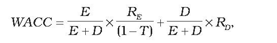
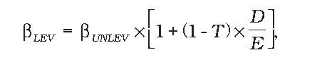

# § 5 Spôsob určenia výšky primeraného zisku

(1) Primeraný zisk zohľadňuje rozsah potrebných investícií na zabezpečenie dlhodobej, spoľahlivej, bezpečnej a efektívnej prevádzky sústavy, primeranú návratnosť prevádzkových aktív a stimuláciu stabilného dlhodobého podnikania.

(2) Výška primeraného zisku za prístup do prenosovej sústavy a prenos elektriny prevádzkovateľom prenosovej sústavy a za prístup do distribučnej sústavy a distribúciu elektriny prevádzkovateľom regionálnej distribučnej sústavy pre regulovaný subjekt, ktorý distribuuje elektrinu distribučnou sústavou v roku t, do ktorej je v roku t-1 pripojených viac ako 100 000 odberných miest, je určená ako miera výnosnosti regulačnej bázy aktív pred zdanením na regulačné obdobie,

kde

WACC je určená reálna miera výnosnosti regulačnej bázy aktív pred zdanením na regulačné obdobie vypočítaná podľa vzorca

pre východiskový rok je miera výnosnosti regulačnej bázy aktív WACC 6,04 %,

kde

T je sadzba dane z príjmov na rok t,

E je vlastné imanie v eurách k 31. decembru 2010,

D sú cudzie zdroje v eurách k 31. decembru 2010,

RD je reálna cena cudzích zdrojov; na východiskový rok je vo výške 5,13 % pri prepočítanej priemernej výške úverov poskytnutých nefinančným spoločnostiam na obdobie piatich a viac rokov s výškou úveru nad jeden milión eur,

RE je reálna cena vlastného kapitálu a vlastných zdrojov vypočítaná podľa vzorca

RE = RF + βLEV x (RM - RF),

kde

RF je výnosnosť bezrizikového aktíva; na východiskový rok je vo výške 4,01 % pri prepočítanom priemernom výnose päťročných a viacročných štátnych dlhopisov emitovaných na slovenskom trhu za roky 2007 až 2011,

βLEV je vážený koeficient ß, ktorý definuje citlivosť akcie spoločnosti na riziko trhu so zohľadnením sadzby dane z príjmov a podielu cudzích zdrojov, vypočítaný podľa vzorca

kde

βUNLEV je nevážený koeficient ß bez vplyvu sadzby dane z príjmov a podielu cudzích zdrojov na východiskový rok vo výške 0,30; pre ďalšie roky sa určuje v intervale od 0,30 do 0,65,

T je sadzba dane z príjmov na rok t,

D/E je pomer cudzích zdrojov k vlastnému imaniu; na východiskový rok je určený vo výške 60 % v prospech cudzieho kapitálu,

RMje výkonnosť trhového portfólia; na východiskový rok sa určuje vo výške 7,01 %,

(RM – RF) je celková riziková prémia pre východiskový rok určená vo výške 3 %; pre ďalšie roky sa určuje v intervale od 3 % do 6 %.

(3) Hodnoty parametrov pre ďalšie roky, ktoré slúžia na výpočet miery výnosnosti regulačnej bázy aktív WACC sa zverejnia na webovom sídle do 30. júna kalendárneho roku.
