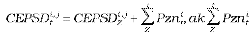
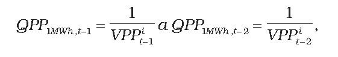

# § 8 Cena elektriny pre stanovenie doplatku na rok t pre výrobcu elektriny, ktorý má na rok predchádzajúci roku t určenú alebo schválenú cenu elektriny pre stanovenie doplatku

(1) Cena elektriny pre stanovenie doplatku na rok t v eurách na jednotku množstva elektriny za elektrinu vyrobenú i-tou technológiou j-tého zariadenia výrobcu elektriny CEPSDi,jt sa pre výrobcu elektriny vypočíta podľa vzorca

 je menej ako nula, potom CEPSDti,j = CEPSDZi,j

kde

- a) CEPSDi,jZ je určená alebo schválená cena elektriny pre stanovenie doplatku na rok Z predchádzajúci roku t vyrobenej i-tou technológiou j-tého zariadenia výrobcu elektriny na základe roku uvedenia zariadenia výrobcu elektriny do prevádzky alebo poslednej uplatnenej rekonštrukcie alebo modernizácie v eurách na jednotku množstva elektriny,

- b) Pznit je príplatok50) v eurách na jednotku množstva elektriny na rok t uplatňovaný v hodnote podľa tabuľky č. 1; Pznit sa vypočíta podľa odseku 3,

- c) rok Z je rok uvedenia zariadenia výrobcu elektriny do prevádzky alebo rok poslednej uplatnenej rekonštrukcie alebo modernizácie.

- Tabuľka č. 1

- Technológia výroby elektriny | Primárne palivo | Príplatok Pznit v eur/MWh | | | |

- | | 2012 | | | 2013 | 2014

- z obnoviteľných zdrojov energie | Biomasa | | | | |

- | Biokvapalina – rastlinný olej | 17,75 | | | |

- | bioplyn | | | | |

- | biometán | | | | |

- vysoko účinnou kombinovanou výrobou | zemný plyn | 3,77 | | | |

- | vykurovací olej | 4,64 | | | | 4,28

- | hnedé uhlie | | | | | 0,67

- | čierne uhlie | | | | |

- | energeticky využiteľné plyny vznikajúce pri hutníckej výrobe ocele | | | | |

(2) Ak má výrobca elektriny na rok predchádzajúci roku t určenú alebo schválenú cenu elektriny pre stanovenie doplatku CEPSDi,jZ a ak si uplatňuje na rok t cenu elektriny pre stanovenie doplatku na základe rekonštrukcie alebo modernizácie, táto cena elektriny pre stanovenie doplatku na rok t sa určí podľa § 7 ods. 12 alebo 13.

(3) Príplatok Pznit v eurách na jednotku množstva elektriny na rok t pre i-té technológie výroby elektriny s primárnymi palivami podľa tabuľky č. 1 zohľadňujúci vývoj ceny primárneho paliva i-tej technológie na výrobu elektriny z obnoviteľných zdrojov energie alebo vývoj ceny primárneho paliva z neobnoviteľného zdroja energie i-tej technológie na výrobu elektriny vysoko účinnou kombinovanou výrobou sa vypočíta podľa vzorca

Pznit = NCPPit-1 x QPPi1MWh, t-1 - NCPPit-2 x QPPi1MWh, t-2,

kde

kde

- a) NCPPit-1je úradom určená nákupná cena primárneho paliva pre i-tú technológiu výroby elektriny v eurách na jednotku množstva v roku t-1,

- b) QPPi1 MWh,t-1 je množstvo primárneho paliva zodpovedajúceho 1 MWh i-tej technológie výroby elektriny v jednotkách množstva na megawatthodinu v roku t-1,

- c) VPPit-1je úradom určená výhrevnosť primárneho paliva pre i-tú technológiu výroby elektriny v megawatthodinách na jednotku množstva v roku t-1,

- d) NCPPit-2je určená nákupná cena primárneho paliva pre i-tú technológiu výroby elektriny v eurách na jednotku množstva v roku t-2,

- e) QPPi1 MWh,t-2 je množstvo primárneho paliva zodpovedajúceho 1 MWh i-tej technológie výroby elektriny v jednotkách množstva na megawatthodinu v roku t-2,

- f) VPPit-2je úradom určená výhrevnosť primárneho paliva pre i-tú technológiu výroby elektriny v megawatthodinách na jednotku množstva v roku t-2.

(4) Pznitsa uplatní na jeden rok, ak je hodnota zmeny väčšia ako 8 % zo súčinu nákupnej ceny NCPPit-2 a množstva primárneho paliva QPPi1 MWh,t-2 určených podľa odseku 3.
