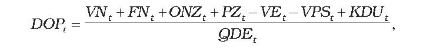
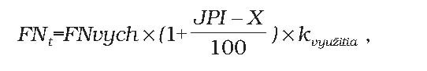
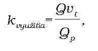
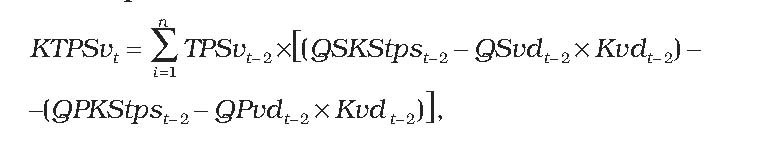

# § 11 Výroba elektriny z domáceho uhlia

(1) Súčasťou návrhu ceny sú

- a) návrh cien alebo taríf za výrobu elektriny z domáceho uhlia, vrátane ich štruktúry pre rok t, ktoré sa budú uplatňovať pre účastníkov trhu s elektrinou, vrátane podmienok ich pridelenia,

- b) údaje potrebné na preverenie cien za rok t-2,

- c) plán investícií a plán odpisov za regulovanú činnosť v rokoch t, t+1 a t+2,

- d) výpočty a údaje podľa tohto paragrafu, týkajúce sa výroby elektriny z domáceho uhlia,

- e) znaleckým posudkom potvrdené údaje preukazujúce inštalovaný výkon zariadení na výrobu elektriny, ktoré môžu vyrábať elektrinu spaľovaním domáceho uhlia s uvedením potenciálneho množstva elektriny, ktorú je možné na tomto zariadení vyrobiť,

- f) doklad preukazujúci schválenie návrhu ceny najvyšším orgánom obchodnej spoločnosti alebo družstva alebo spoločníkmi verejnej obchodnej spoločnosti alebo spoločníkmi komanditnej spoločnosti regulovaného subjektu,

- g) potvrdenie nie staršie ako tri mesiace preukazujúce, že voči regulovanému subjektu nie sú evidované

  - 1. daňové nedoplatky podľa osobitného predpisu26) správcom dane,

  - 2. nedoplatky poistného na zdravotné poistenie,

  - 3. nedoplatky na poistnom na sociálne poistenie a povinných príspevkoch na starobné dôchodkové sporenie,

- h) údaje o inštalovanom výkone technologického zariadenia, ktoré je určené na výrobu elektriny z domáceho uhlia,

- i) ďalšie podklady potrebné na správne posúdenie návrhu ceny.

(2) Podklady podľa odseku 1 písm. a), b) a d) sa predkladajú aj v elektronickej podobe.

(3) Ustanovenia o návrhu ceny sa primerane vzťahujú aj na návrh na zmenu cenového rozhodnutia.

(4) Na základe rozhodnutia ministerstva hospodárstva o uložení povinnosti vo všeobecnom hospodárskom záujme vyrábať elektrinu z domáceho uhlia sa u výrobcu elektriny uplatní za každú megawatthodinu elektriny dodanej do sústavy, ktorá bola preukázateľne vyrobená z domáceho uhlia, pevná cena DOPt v eurách za megawatthodinu vypočítaná podľa vzorca

kde

- a) VNt sú plánované schválené alebo určené variabilné náklady na výrobu elektriny z domáceho uhlia v eurách na rok t; VNt sa vypočítajú podľa vzorca

VNt = Nhu ,t + NEK , t + NOVN ,t,

kde

- 1. NHU,t sú len ekonomicky oprávnené plánované náklady na nákup domáceho hnedého uhlia a náklady na obstaranie mazutu, ktoré zodpovedajú množstvu mazutu, ktorého energetický obsah zodpovedá najviac 1 % energetického obsahu domáceho hnedého uhlia určeného na základe jeho skutočnej výhrevnosti,

- 2. NEK,t sú ekonomicky oprávnené plánované náklady na nákup emisných kvót,

- 3. NOVN,t sú ekonomicky oprávnené plánované náklady v súlade s § 4 ods. 1 písm. d),

- b) FNt sú plánované schválené alebo určené fixné náklady bez odpisov nových zariadení na výrobu elektriny z domáceho uhlia v eurách na rok t; najviac vo výške podľa vzorca

kde

- 1. FNvych je schválená alebo určená východisková hodnota fixných nákladov maximálne do 37 300 000 eur,

- 2. JPIt je aritmetický priemer indexov jadrovej inflácie za obdobie od júla roku t-2 do júna roku t-1, zverejnených štatistickým úradom,

- 3. X je faktor efektivity v každom roku regulačného obdobia, ktorého hodnota je 3,5; ak je hodnota rozdielu JPIta X nižšia ako 0, na účely výpočtu pevnej ceny na výrobu elektriny z domáceho uhlia na rok t sa hodnota rozdielu rovná 0,

- 4. kvyužitia je koeficient, ktorý sa vypočíta podľa vzorca

kde

Qvt je plánované množstvo elektriny vyrobené z hnedého uhlia na základe plnenia povinnosti vo všeobecnom hospodárskom záujme,

Qp je projektované množstvo elektriny, ktoré môže zdroj vyrobiť z hnedého uhlia,

- c) ONZt sú plánované schválené alebo určené odpisy nových zariadení na rok t v eurách; faktor ONZt sa na rok 2012 rovná nule,

- d) PZt je plánovaný primeraný zisk regulovaného subjektu v eurách na rok t určený podľa vzorca

PZt = (VNt + FNt + ONZt) x WACC,

kde

WACC je miera výnosnosti regulačnej bázy aktív na regulačné obdobie rokov 2012 až 2016 určená podľa § 5 ods. 2 a 3,

- e) VEt sú plánované výnosy z dodávky vyrobenej elektriny z domáceho uhlia v eurách na rok t vypočítané podľa vzorca

VEt = (QVt - QTt - QREt ,KL) x CEt + QREt ,KL x CREt ,KL + QREt ,ZA x CREt ,ZA,

kde

- 1. QVt je plánované množstvo elektriny vyrobenej z domáceho uhlia v jednotkách množstva elektriny na rok t,

- 2. QTt je plánované množstvo vlastnej spotreby elektriny pri výrobe elektriny z domáceho uhlia v jednotkách množstva elektriny na rok t,

- 3. QREt,KL je plánované množstvo dodávky kladnej regulačnej elektriny vyrobenej z domáceho uhlia v jednotkách množstva elektriny na rok t,

- 4. CEt je plánovaná vážená priemerná cena celkovej dodávky elektriny, minimálne však vo výške ceny elektriny na straty podľa osobitného predpisu,53) okrem dodávky regulačnej elektriny regulovaného subjektu v eurách na jednotku množstva elektriny na rok t,

- 5. CREt,KL je plánovaná vážená priemerná cena dodávky kladnej regulačnej elektriny vyrobenej z domáceho uhlia v eurách na jednotku množstva elektriny na rok t,

- 6. QREt,ZA je plánované množstvo dodávky zápornej regulačnej elektriny poskytnutej zariadením na výrobu elektriny z domáceho uhlia v jednotkách množstva elektriny na rok t,

- 7. CREt,ZA je plánovaná vážená priemerná cena dodávky zápornej regulačnej elektriny poskytnutej zariadením na výrobu elektriny z domáceho uhlia v eurách na jednotku množstva elektriny na rok t,

- f) VPSt je plánovaný výnos v eurách z poskytovania podporných služieb zariadením na výrobu elektriny z domáceho uhlia na rok t,

- g) QDEt je elektrina vyrobená z domáceho uhlia v jednotkách množstva elektriny dodaná dodávateľom elektriny podľa odseku 1,

- h) KDUt je faktor vyrovnania nákladov a výnosov výroby elektriny z domáceho uhlia regulovaného subjektu v eurách na rok t vypočítaný podľa odseku 5.

(5) Faktor vyrovnania nákladov a výnosov výroby elektriny z domáceho uhlia KDUt v eurách na rok t sa vypočíta podľa vzorca

KDUt = SVNt-2 - VNt-2 + SFNt-2 - FNt-2 + SONZt-2 - ONZt-2 + SPZt-2 - PZt-2 -(SVEt-2 - VEt-2) - (SVPSt-2 - VPSt-2) - KTPSvt

kde

- a) SVNt-2 sú skutočné schválené alebo určené variabilné náklady na výrobu elektriny z domáceho uhlia v eurách na rok t-2,

- b) VNt-2 sú plánované schválené alebo určené variabilné náklady na výrobu elektriny z domáceho uhlia v eurách na rok t-2,

- c) SFNt-2 sú skutočné schválené alebo určené fixné náklady na výrobu elektriny z domáceho uhlia v eurách na rok t-2,

- d) FNt-2 sú plánované schválené alebo určené fixné náklady na výrobu elektriny z domáceho uhlia v eurách na rok t-2,

- e) SONZt-2 sú skutočné schválené alebo určené odpisy nových zariadení na rok t-2 v eurách; SONZt-2 sa na účely výpočtu KDUtna roky t = 2012, 2013 a 2014 rovná nule,

- f) ONZt-2 sú plánované schválené alebo určené odpisy nových zariadení na rok t-2 v eurách; ONZt-2 sa na účely výpočtu KDUtna roky t = 2012, 2013 a 2014 rovná nule,

- g) SPZt-2 je skutočný primeraný zisk regulovaného subjektu v eurách na rok t-2 určený podľa vzorca

SPZt-2 = (SVNt-2 + SFNt-2 +SONZt-2) x WACC,

kde

WACC je miera výnosnosti regulačnej bázy aktív na regulačné obdobie rokov 2012 až 2016 určená podľa § 5 ods. 2 a 3,

- h) PZt-2 je plánovaný primeraný zisk regulovaného subjektu v eurách na rok t-2 určený podľa vzorca

PZt-2 = (VNt-2 + FNt-2 + ONZt-2) x WACC,

- i) SVEt-2 sú skutočné výnosy z dodávky vyrobenej elektriny z domáceho uhlia v eurách na rok t-2 vypočítané podľa vzorca

SVEt-2 = (SQVt-2 - SQTt-2 - SQREt-2,KL) x SCEt-2 + SQREt-2,KL x SCREt-2,KL + SQREt-2,ZA X SCREt-2,ZA,

kde

- 1. SQVt-2 je skutočné množstvo elektriny vyrobenej z domáceho uhlia v jednotkách množstva elektriny na rok t-2,

- 2. SQTt-2 je skutočné množstvo vlastnej spotreby elektriny pri výrobe elektriny z domáceho uhlia v jednotkách množstva elektriny na rok t-2,

- 3. SQREt-2,KL je skutočné množstvo dodávky kladnej regulačnej elektriny vyrobenej z domáceho uhlia v jednotkách množstva elektriny na rok t-2,

- 4. SCEt-2je skutočná vážená priemerná cena celkovej dodávky elektriny okrem dodávky regulačnej elektriny regulovaného subjektu v eurách na jednotku množstva elektriny na rok t-2, od obdobia t-2 rovný roku 2014 minimálne vo výške ceny elektriny na straty podľa osobitného predpisu,52)

- 5. SCREt-2,KL je skutočná vážená priemerná cena dodávky kladnej regulačnej elektriny vyrobenej z domáceho uhlia v eurách na jednotku množstva elektriny na rok t-2,

- 6. SQREt-2,ZA je skutočné množstvo dodávky zápornej regulačnej elektriny poskytnutej zariadením na výrobu elektriny z domáceho uhlia v jednotkách množstva elektriny na rok t-2,

- 7. SCREt-2,ZA je skutočná vážená priemerná cena dodávky zápornej regulačnej elektriny poskytnutej zariadením na výrobu elektriny z domáceho uhlia v eurách na jednotku množstva elektriny na rok t-2,

- j) VEt-2 sú plánované výnosy z dodávky vyrobenej elektriny z domáceho uhlia v eurách na rok t-2 vypočítané podľa vzorca

VEt-2 = (QVt-2 -QTt-2 - QREt-2,KL) x CEt-2 + QREt-2,KL x CREt-2,KL + QREt-2,ZA x CREt-2ZA,

kde

- 1. QVt-2 je plánované množstvo elektriny vyrobenej z domáceho uhlia v jednotkách množstva elektriny na rok t-2,

- 2. QTt-2 je plánované množstvo vlastnej spotreby elektriny pri výrobe elektriny z domáceho uhlia v jednotkách množstva elektriny na rok t-2,

- 3. QREt-2,KL je plánované množstvo dodávky kladnej regulačnej elektriny vyrobenej z domáceho uhlia v jednotkách množstva elektriny na rok t-2,

- 4. CEt-2 je plánovaná vážená priemerná cena celkovej dodávky elektriny okrem dodávky regulačnej elektriny regulovaného subjektu v eurách na jednotku množstva elektriny na rok t-2, od obdobia t-2 rovný roku 2014 minimálne vo výške ceny elektriny na straty podľa osobitného predpisu,52)

- 5. CREt-2,KL je plánovaná vážená priemerná cena dodávky kladnej regulačnej elektriny vyrobenej z domáceho uhlia v eurách na jednotku množstva elektriny na rok t-2,

- 6. QREt-2,ZA je plánované množstvo dodávky zápornej regulačnej elektriny poskytnutej zariadením na výrobu elektriny z domáceho uhlia v jednotkách množstva elektriny na rok t-2,

- 7. CREt-2,ZA je plánovaná vážená priemerná cena dodávky zápornej regulačnej elektriny poskytnutej zariadením na výrobu elektriny z domáceho uhlia v eurách na jednotku množstva elektriny na rok t-2,

- k) SVPSt-2 je skutočný výnos v eurách z poskytovania podporných služieb zariadením na výrobu elektriny z domáceho uhlia na rok t-2,

- l) VPSt-2 je plánovaný výnos v eurách z poskytovania podporných služieb zariadením na výrobu elektriny z domáceho uhlia na rok t-2,

- m) KTPSvt je korekcia výnosov z platieb na základe tarify za prevádzkovanie systému výrobcu elektriny, ktorý na základe rozhodnutia ministerstva hospodárstva o uložení povinnosti vo všeobecnom hospodárskom záujme vyrába v roku t elektrinu z domáceho uhlia v eurách v roku t-2; pre roky 2013 až 2015 sa rovná nule a pre roky 2016 a nasledujúce sa vypočíta podľa vzorca

kde

- 1. TPSvt-2 je tarifa za prevádzkovanie systému určená rozhodnutím úradu pre výrobcu elektriny, ktorý na základe rozhodnutia ministerstva hospodárstva o uložení povinnosti vo všeobecnom hospodárskom záujme vyrába v roku t elektrinu z domáceho uhlia, v eurách na jednotku množstva elektriny na rok t-2, vypočítaná podľa § 18 ods. 4,

- 2. QSKStpst-2 je celková skutočná koncová spotreba elektriny na vymedzenom území na rok t-2, na ktorú sa uplatňujú tarify za prevádzkovanie systému,

- 3. QSvdt-2 je celkový skutočný objem elektriny v jednotkách množstva elektriny v roku t-2 odobratej koncovými odberateľmi elektriny priamo pripojenými do prenosovej sústavy s dobou ročného využitia maxima v roku t-4 vyššou ako 6800 hodín a súčasne pomernou odchýlkou subjektu zúčtovania menšou ako 0,025; dobou ročného využitia maxima sa rozumie podiel celkového ročného odobratého množstva elektriny v roku t-4 a rezervovanej kapacity určenej ako aritmetický priemer mesačných maxím štvrťhodinového výkonu za mesiace november roku t-6 až február roku t-5,

- 4. Kvdt-2 je koeficient zvýhodnenia odberového diagramu pre individuálne sadzby taríf koncových odberateľov elektriny priamo pripojených do prenosovej sústavy na rok t-2, ktorého hodnota je 0,95,

- 5. QPKStpst-2 je celková plánovaná koncová spotreba elektriny na vymedzenom území na rok t-2, na ktorú sa uplatňujú tarify za prevádzkovanie systému,

- 6. QPvdt-2 je celkový plánovaný objem elektriny v jednotkách množstva elektriny v roku t-2 odobratej koncovými odberateľmi elektriny priamo pripojenými do prenosovej sústavy s dobou ročného využitia maxima v roku t-4 vyššou ako 6800 hodín a súčasne pomernou odchýlkou subjektu zúčtovania menšou ako 0,025; dobou ročného využitia maxima sa rozumie podiel celkového ročného preneseného množstva elektriny v roku t-4 a rezervovanej kapacity určenej ako aritmetický priemer mesačných maxím štvrťhodinového výkonu za mesiace november roku t-6 až február roku t-5.
