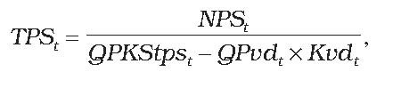
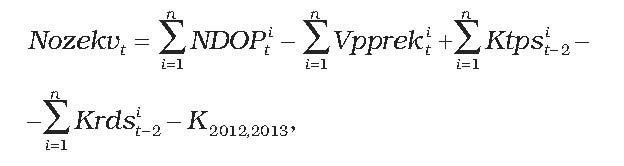
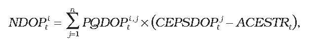
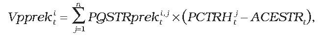
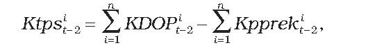
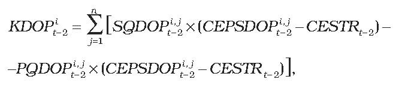
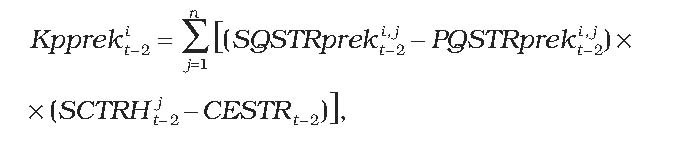

## Tarifa za prevádzkovanie systému

# § 12 Spôsob výpočtu tarify za prevádzkovanie systému, postup a podmienky uplatňovania tarify

(1) Tarifa za prevádzkovanie systému TPStsa určí ako podiel plánovaných nákladov na prevádzkovanie systému vypočítaných podľa odseku 2 a celkovej plánovanej koncovej spotreby elektriny na vymedzenom území,54) na ktorú sa uplatňujú tarify za prevádzkovanie systému, a vypočíta sa podľa vzorca

kde

- a) NPSt sú plánované náklady na prevádzkovanie systému,

- b) QPKStpst je celková plánovaná koncová spotreba elektriny na vymedzenom území na rok t, na ktorú sa uplatňujú tarify za prevádzkovanie systému,

- c) QPvdt je celkový plánovaný objem elektriny v jednotkách množstva elektriny v roku t odobratej koncovými odberateľmi elektriny priamo pripojenými do prenosovej sústavy s dobou ročného využitia maxima v roku t-2 vyššou ako 6800 hodín a súčasne pomernou odchýlkou subjektu zúčtovania menšou ako 0,025; dobou ročného využitia maxima sa rozumie podiel celkového ročného preneseného množstva elektriny v roku t-2 a rezervovanej kapacity určenej ako aritmetický priemer mesačných maxím štvrťhodinového výkonu za mesiace november roku t-4 až február roku t-3; splnenie podmienok zvýhodnenia odberového diagramu na rok t sa preukazuje znaleckým posudkom, ktorý sa predkladá prevádzkovateľovi prenosovej sústavy, organizátorovi krákodobého trhu s elektrinou a úradu, a to tými koncovými odberateľmi priamo pripojenými do prenosovej sústavy, u ktorých je predpoklad splnenia týchto podmienok v roku t,

- d) Kvdt je koeficient zvýhodnenia odberového diagramu pre individuálne sadzby taríf koncových odberateľov elektriny priamo pripojených do prenosovej sústavy na rok t, ktorého hodnota je 0,95.

(2) Plánované náklady na prevádzkovanie systému sa vypočítajú podľa vzorca

NPSt = DOPt x QDEt + Nozekvt + PNOTt + Noktet - KPSt,

kde

- a) DOPt je pevná cena elektriny vyrobenej z domáceho uhlia v eurách za megawatthodinu,

- b) QDEt je elektrina vyrobená z domáceho uhlia v jednotkách množstva elektriny dodaná dodávateľom elektriny,

- c) Nozekvt sú celkové plánované náklady na nákup elektriny vyrobenej z obnoviteľných zdrojov energie a vysoko účinnou kombinovanou výrobou prevádzkovateľa sústavy v roku t,

- d) PNOTt sú schválené alebo určené plánované náklady v eurách zohľadňujúce alikvotnú časť nákladov na organizovanie a vyhodnotenie krátkodobého trhu s elektrinou v eurách na rok t,

- e) Noktet sú náklady na výkon ostatných činností organizátora krátkodobého trhu s elektrinou v roku t,

- f) KPSt je korekcia v eurách na rok t zohľadňujúca náklady a výnosy prevádzkovateľa prenosovej sústavy z platieb za prevádzkovanie systému v roku t-2.

(3) Celkové plánované náklady na nákup elektriny vyrobenej z obnoviteľných zdrojov energie a vysoko účinnou kombinovanou výrobou prevádzkovateľa sústavy v roku t sa vypočítajú podľa vzorca

kde

- a) NDOPit sú plánované náklady na doplatok pre výrobcov elektriny z obnoviteľných zdrojov energie a vysoko účinnou kombinovanou výrobou vynaložené i-tým prevádzkovateľom regionálnej distribučnej sústavy v roku t, ktoré sa vypočítajú podľa vzorca

- 

- kde

  - 1. PQDOPit je plánované množstvo elektriny, na ktoré možno uplatniť doplatok, vyrobenej v roku t v j-tom zariadení na výrobu elektriny výrobcov elektriny z obnoviteľných zdrojov energie a vysoko účinnou kombinovanou výrobou, ktorí sú pripojení do i-tej regionálnej distribučnej sústavy alebo na vymedzenom území ktorej sa nachádzajú, v jednotkách množstva elektriny,

  - 2. CEPSDOPit je cena elektriny pre stanovenie doplatku pre zariadenie na výrobu elektriny výrobcov elektriny z obnoviteľných zdrojov energie a vysoko účinnou kombinovanou výrobou v eurách na jednotku množstva elektriny na rok t,

  - 3. ACESTRt je cena elektriny na straty podľa osobitného predpisu55) určená ako aritmetický priemer cien elektriny základného pásma na účely pokrytia strát prevádzkovateľov regionálnych distribučných sústav bez nákladov na odchýlku; výška ceny elektriny základného pásma na účely pokrytia strát prevádzkovateľa regionálnej distribučnej sústavy v eurách na jednotku množstva elektriny na rok t je vypočítaná podľa § 28 ods. 3 písm. b) prvého bodu,

- b) Vpprekit je plánovaný výnos za predaj elektriny prevyšujúcej potreby pokrytia strát i-tým prevádzkovateľom regionálnej distribučnej sústavy v roku t, ktorý sa vypočíta podľa vzorca

- 

- kde

  - 1. PQSTRprekitj je plánované množstvo elektriny v jednotkách množstva elektriny v j-tej hodine roku t prekúpené i-tým prevádzkovateľom regionálnej distribučnej sústavy v súvislosti s odberom elektriny i-tého prevádzkovateľa regionálnej distribučnej sústavy zo zariadení výrobcov elektriny s právom na podporu na účely pokrytia strát elektriny v distribučnej sústave; PQSTRprekitj sa vypočíta ako rozdiel v j-tej hodine roku t plánovaného diagramu na pokrytie strát elekriny v i-tej regionálnej distribučnej sústave a plánovaného diagramu odberu elektriny i-tého prevádzkovateľa regionálnej distribučnej sústavy zo zariadení výrobcov elektriny s právom na podporu, ak je tento rozdiel kladný, PQSTRprekitj sa rovná nule,

  - 2. PCTRHjt je plánovaná určená cena elektriny v eurách na jednotku množstva elektriny na rok t v j-tej hodine roku t; PCTRHjt sa vypočíta pre každú hodinu každého dňa na rok t ako aritmetický priemer cien elektriny príslušných hodín v dňoch v období od 1. apríla roku t – 1 do 30. septembra roku t – 1 pri dennom obchodovaní v obchodnej oblasti, v rámci ktorej je denný trh s elektrinou organizovaný organizátorom krátkodobého trhu s elektrinou; od 1. marca 2013 je táto cena minimálne vo výške ceny elektriny na straty podľa osobitného predpisu,55)

- c) Ktpsit-2 je korekcia nákladov vynaložených na nákup elektriny od výrobcov elektriny z obnoviteľných zdrojov energie a vysoko účinnou kombinovanou výrobou vynaložené prevádzkovateľmi regionálnych distribučných sústav v roku t – 2,

- d) Krdsit-2 je korekcia výnosov z platieb na základe tarify za prevádzkovanie systému prevádzkovateľov regionálnych distribučných sústav v roku t – 2,

- e) K2012,2013 je korekcia nákladov prevádzkovateľa regionálnej distribučnej sústavy súvisiacich s prevzatím zodpovednosti za odchýlku za zariadenia na výrobu elektriny z obnoviteľných zdrojov energie a vysoko účinnej kombinovanej výroby elektriny a tepla, nákladov súvisiacich s dokupom elektriny, nákladov a výnosov súvisiacich s tarifou za prevádzkovanie systému fakturovanej odberateľom a samovýrobcom za roky 2012 a 2013, pre ostatné roky je rovná 0.

(4) Korekcia nákladov vynaložených na prevádzkovanie systému v roku t sa vypočíta podľa vzorca

kde

- a) KDOPit-2 je korekcia nákladov na doplatok pre výrobcov elektriny z obnoviteľných zdrojov energie a vysoko účinnou kombinovanou výrobou vynaložené i-tým prevádzkovateľom regionálnej distribučnej sústavy v roku t-2,

- b) Kpprekit-2 je korekcia výnosu získaného za predaj elektriny prevyšujúcej potreby pokrytia strát i-tým prevádzkovateľom regionálnej distribučnej sústavy v roku t-2.

(5) Korekcia nákladov na doplatok pre výrobcov elektriny z obnoviteľných zdrojov energie a vysoko účinnou kombinovanou výrobou vynaložené i-tým prevádzkovateľom regionálnej distribučnej sústavy v roku t sa vypočíta podľa vzorca

kde

- a) SQDOPi,jt-2je skutočné množstvo elektriny, na ktoré je možné uplatniť doplatok, vyrobenej v j-tom zariadení na výrobu elektriny výrobcov z obnoviteľných zdrojov energie a vysoko účinnou kombinovanou výrobou, ktorí sú pripojení do i-tej regionálnej distribučnej sústavy alebo na vymedzenom území ktorej sa nachádzajú v jednotkách množstva elektriny v roku t-2,

- b) PQDOPi,jt-2je plánované množstvo elektriny, na ktoré je možné uplatniť doplatok, vyrobenej v j-tom zariadení na výrobu elektriny výrobcov z obnoviteľných zdrojov energie a vysoko účinnou kombinovanou výrobou, ktorí sú pripojení do i-tej regionálnej distribučnej sústavy alebo na vymedzenom území ktorej sa nachádzajú v jednotkách množstva elektriny v roku t-2,

- c) CEPSDOPi,jt-2 je cena elektriny pre stanovenie doplatku pre zariadenie výrobcu elektriny z obnoviteľných zdrojov energie a vysoko účinnou kombinovanou výrobou v eurách na jednotku množstva elektriny na rok t-2,

- d) CESTRt-2 je cena elektriny na účely pokrytia strát i-tého prevádzkovateľa regionálnej distribučnej sústavy vrátane nákladov na odchýlku schválená alebo určená cenovým rozhodnutím za prístup do distribučnej sústavy a distribúciu elektriny v eurách na jednotku množstva elektriny na rok t-2.

(6) Korekcia výnosu získaného za predaj elektriny prevyšujúcej potreby pokrytia strát i-tým prevádzkovateľom regionálnej distribučnej sústavy v roku t sa vypočíta podľa vzorca

kde

- a) SQSTRpreki,jt-2je skutočné množstvo elektriny v jednotkách množstva elektriny v j-tej hodine roku t-2 prekúpené i-tým prevádzkovateľom regionálnej distribučnej sústavy v súvislosti s odberom elektriny i-tého prevádzkovateľa regionálnej distribučnej sústavy zo zariadení výrobcov elektriny s právom na podporu na účely pokrytia strát distribučnej sústavy; SQSTRpreki,jt-2 sa vypočíta ako rozdiel v j-tej hodine roku t skutočného diagramu na pokrytie strát v i-tej regionálnej distribučnej sústave a skutočného diagramu odberu elektriny i-tého prevádzkovateľa regionálnej distribučnej sústavy zo zariadení výrobcov elektriny s právom na podporu, ak je tento rozdiel kladný, SQSTRpreki,jt-2 sa rovná nule,

- b) PQSTRpreki,jt-2je plánované množstvo elektriny v jednotkách množstva elektriny v j-tej hodine roku t-2 prekúpené i-tým prevádzkovateľom regionálnej distribučnej sústavy v súvislosti s odberom elektriny i-tého prevádzkovateľa regionálnej distribučnej sústavy zo zariadení výrobcov elektriny s právom na podporu na účely pokrytia strát distribučnej sústavy; PQSTRpreki,jt-2 sa vypočíta ako rozdiel v j-tej hodine roku t plánovaného diagramu na pokrytie strát v i-tej regionálnej distribučnej sústave a plánovaného diagramu odberu elektriny i-tého prevádzkovateľa regionálnej distribučnej sústavy zo zariadení výrobcov elektriny s právom na podporu, ak je tento rozdiel kladný, PQSTRpreki,jt-2 sa rovná nule,

- c) SCTRHjt-2 je skutočná určená cena elektriny v eurách na jednotku množstva elektriny na rok t-2 v j-tej hodine roku t-2; SCTRHjt-2 sa rovná pre každú hodinu roka t-2 váženému priemeru cien elektriny príslušnej hodiny roka t-2, za ktoré boli odpredané jednotlivé časti množstva SQSTRprekjt-2na obdobie roku t-2, od 1. marca 2013 je táto cena minimálne vo výške ceny elektriny na straty podľa osobitného predpisu;55) prekúpené množstvo elektriny SQSTRpreki,jt-2i-tým prevádzkovateľom regionálnej distribučnej sústavy v súvislosti s odberom elektriny i-tého prevádzkovateľa regionálnej distribučnej sústavy zo zariadení výrobcov elektriny s právom na podporu na účely pokrytia strát distribučnej sústavy sa umožňuje odpredať na ročnej báze vo forme štandardného produktu ročného základného pásma s rovnakou hodnotou množstva elektriny v každej hodine roka t-2 a v dennom obchodovaní v obchodnej oblasti, v rámci ktorej je denný trh s elektrinou organizovaný organizátorom krátkodobého trhu s elektrinou.

(7) Korekcia výnosov z platieb na základe tarify za prevádzkovanie systému i-tého prevádzkovateľa regionálnej distribučnej sústavy v roku t-2 sa pre roky 2014 a 2015 vypočíta podľa vzorca

Krdsit-2 = (TPSt-2 + TPSit-2) x (SQKit-2 - QKit-2) + TPSt-2 x (SQZdot-2 + SQVdot-2 -QZdot-2 - QVdot-2),

kde

- a) TPSt-2 je tarifa za prevádzkovanie systému určená cenovým rozhodnutím pre koncových odberateľov elektriny a prevádzkovateľov miestnej distribučnej sústavy, ktorí sú pripojení do regionálnej distribučnej sústavy regulovaného subjektu, v eurách na jednotku množstva elektriny v roku t-2,

- b) TPSit-2je tarifa za prevádzkovanie systému určená cenovým rozhodnutím pre i-tého prevádzkovateľa regionálnej distribučnej sústavy v eurách na jednotku množstva elektriny na rok t-2,

- c) SQKit-2je celkový skutočný objem elektriny v jednotkách množstva elektriny odobratý prevádzkovateľmi miestnej distribučnej sústavy a koncovými odberateľmi elektriny z distribučnej sústavy regulovaného subjektu vrátane prevádzkovateľov miestnej distribučnej sústavy a odberateľov elektriny pripojených v rámci prevádzky preukázateľne oddelenej od sústavy Slovenskej republiky v roku t-2,

- d) QKit-2 je celkový plánovaný objem elektriny v jednotkách množstva elektriny, ktorý odoberú prevádzkovatelia miestnej distribučnej sústavy a koncoví odberatelia elektriny z distribučnej sústavy regulovaného subjektu vrátane prevádzkovateľov miestnej distribučnej sústavy a odberateľov elektriny pripojených v rámci prevádzky preukázateľne oddelenej od sústavy Slovenskej republiky v roku t-2,

- e) SQZdot-2je celkový skutočný objem elektriny distribuovanej prevádzkovateľmi miestnej distribučnej sústavy, ktorá je priamo pripojená do regionálnej distribučnej sústavy regulovaného subjektu, vyrobenej vo vlastnom zariadení na výrobu elektriny prevádzkovateľa miestnej distribučnej sústavy alebo v inom zariadení na výrobu elektriny pripojených do tejto miestnej distribučnej sústavy a dodanej odberateľom elektriny v tejto miestnej distribučnej sústave alebo spotrebovanej pre vlastnú spotrebu v tejto miestnej distribučnej sústave okrem vlastnej spotreby elektriny pri výrobe elektriny v jednotkách množstva elektriny v roku t-2,

- f) SQVdot-2je celkový skutočný objem elektriny vyrobenej v zariadení na výrobu elektriny výrobcov elektriny pripojených priamo do regionálnej distribučnej sústavy regulovaného subjektu a dodanej týmito výrobcami elektriny odberateľom elektriny bez použitia regionálnej distribučnej sústavy alebo spotrebovanej pre vlastnú spotrebu týchto výrobcov elektriny v mieste umiestnenia zariadenia na výrobu elektriny okrem vlastnej spotreby elektriny pri výrobe elektriny v jednotkách množstva elektriny v roku t-2,

- g) QZdot-2je celkový plánovaný objem elektriny distribuovanej prevádzkovateľmi miestnej distribučnej sústavy, ktorá je priamo pripojená do distribučnej sústavy regulovaného subjektu, vyrobenej vo vlastnom zariadení na výrobu elektriny prevádzkovateľa miestnej distribučnej sústavy alebo v inom zariadení na výrobu elektriny pripojených do tejto miestnej distribučnej sústavy a dodanej odberateľom elektriny v tejto miestnej distribučnej sústave alebo spotrebovanej pre vlastnú spotrebu v tejto miestnej distribučnej sústave okrem vlastnej spotreby elektriny pri výrobe elektriny v jednotkách množstva elektriny v roku t-2,

- h) QVdot-2je celkový plánovaný objem elektriny vyrobenej v zariadení na výrobu elektriny výrobcov elektriny pripojených priamo do regionálnej distribučnej sústavy regulovaného subjektu a dodanej týmito výrobcami elektriny odberateľom elektriny bez použitia regionálnej distribučnej sústavy alebo spotrebovanej pre vlastnú spotrebu týchto výrobcov elektriny v mieste umiestnenia zariadenia na výrobu elektriny okrem vlastnej spotreby elektriny pri výrobe elektriny v jednotkách množstva elektriny v roku t-2.

(8) Korekcia výnosov z platieb na základe tarify za prevádzkovanie systému i-tého prevádzkovateľa regionálnej distribučnej sústavy v roku t-2 sa pre rok 2016 a nasledujúce vypočíta podľa vzorca

Krdsit-2 = TPSdsit-2 x [(QSKStpst-2 - QSvdt-2 x Kvdt-2) - (QPKStpst-2 - QPvdt-2 x Kvdt-2)],

kde

- a) TPSdsit-2 je tarifa za prevádzkovanie systému určená rozhodnutím pre i-tého prevádzkovateľa regionálnej distribučnej sústavy v eurách na jednotku množstva elektriny na rok t-2,

- b) QSKStpst-2 je celková skutočná koncová spotreba elektriny na vymedzenom území na rok t-2, na ktorú sa uplatňujú tarify za prevádzkovanie systému,

- c) QSvdt-2 je celkový skutočný objem elektriny v jednotkách množstva elektriny v roku t-2 odobratej koncovými odberateľmi elektriny priamo pripojenými do prenosovej sústavy s dobou ročného využitia maxima v roku t-4 vyššou ako 6800 hodín a súčasne pomernou odchýlkou subjektu zúčtovania menšou ako 0,025; dobou ročného využitia maxima sa rozumie podiel celkového ročného odobratého množstva elektriny v roku t-4 a rezervovanej kapacity určenej ako aritmetický priemer mesačných maxím štvrťhodinového výkonu za mesiace november roku t-6 až február roku t-5,

- d) Kvdt-2 je koeficient zvýhodnenia odberového diagramu pre individuálne sadzby taríf koncových odberateľov elektriny priamo pripojených do prenosovej sústavy na rok t-2, ktorého hodnota je 0,95,

- e) QPKStpst-2 je celková plánovaná koncová spotreba elektriny na vymedzenom území na rok t-2, na ktorú sa uplatňujú tarify za prevádzkovanie systému,

- f) QPvdt-2 je celkový plánovaný objem elektriny v jednotkách množstva elektriny v roku t-2 odobratej koncovými odberateľmi elektriny priamo pripojenými do prenosovej sústavy s dobou ročného využitia maxima v roku t-4 vyššou ako 6800 hodín a súčasne pomernou odchýlkou subjektu zúčtovania menšou ako 0,025; dobou ročného využitia maxima sa rozumie podiel celkového ročného odobratého množstva elektriny v roku t-4 a rezervovanej kapacity určenej ako aritmetický priemer mesačných maxím štvrťhodinového výkonu za mesiace november roku t-6 až február roku t-5.

(9) Korekcia v eurách na rok t KPSt zohľadňujúca náklady a výnosy prevádzkovateľa prenosovej sústavy z platieb za prevádzkovanie systému v roku t-2 sa vypočíta podľa vzorca

KPSt = VtpsPPSt-2 - NtpsPPSt-2 + KPSPPSt-2,

kde

- a) VtpsPPSt-2 sú celkové výnosy z platieb na základe taríf za prevádzkovanie systému v roku t-2,

- b) NtpsPPSt-2 sú celkové náklady z platieb na základe taríf za prevádzkovanie systému v roku t-2,

- c) KPSPPSt-2 je korekcia v eurách na rok t-2 KPSt-2 zohľadňujúca náklady a výnosy prevádzkovateľa prenosovej sústavy z platieb za prevádzkovanie systému v roku t-4.

(10) Pre odberateľa elektriny priamo pripojeného do prenosovej sústavy sa uplatňuje tarifa za prevádzkovanie systému TPSt v eurách na jednotku množstva elektriny za prenesenú elektrinu vrátane elektriny vyrobenej v jeho vlastnom zariadení na výrobu elektriny a spotrebovanej na vlastnú spotrebu elektriny tohto odberateľa elektriny alebo dodanej iným odberateľom elektriny bez použitia prenosovej sústavy okrem vlastnej spotreby elektriny pri výrobe elektriny, ktorá nie je odobratá z nadradenej sústavy.

(11) Pre odberateľa elektriny pripojeného do regionálnej distribučnej sústavy sa uplatňuje tarifa za prevádzkovanie systému TPStza distribuovanú elektrinu vrátane elektriny vyrobenej v jeho vlastnom zariadení na výrobu elektriny a spotrebovanej na vlastnú spotrebu elektriny tohto odberateľa elektriny alebo dodanej iným odberateľom elektriny bez použitia regionálnej distribučnej sústavy okrem vlastnej spotreby elektriny pri výrobe elektriny, ktorá nie je odobratá z nadradenej sústavy.

(12) Pre odberateľa elektriny pripojeného do miestnej distribučnej sústavy sa uplatňuje tarifa za prevádzkovanie systému TPStza všetku elektrinu odobratú z nadradenej sústavy a distribuovanú odberateľom elektriny pripojeným do tejto miestnej distribučnej sústavy vrátane elektriny vyrobenej vo vlastnom zariadení na výrobu elektriny alebo v inom zariadení na výrobu elektriny pripojených do tejto miestnej distribučnej sústavy a spotrebovanej na vlastnú spotrebu elektriny alebo dodanej odberateľom elektriny bez použitia nadradenej sústavy okrem vlastnej spotreby elektriny pri výrobe elektriny, ktorá nie je odobratá z nadradenej distribučnej sústavy.

(13) Pre odberateľa elektriny, ktorý odoberá elektrinu od výrobcu elektriny bez použitia prenosovej sústavy alebo distribučnej sústavy, sa výrobcom elektriny uplatňuje tomuto odberateľovi elektriny tarifa za prevádzkovanie systému TPSt na celé množstvo takto odobratej elektriny. Ak výrobca nie je subjektom zúčtovania, uhradia sa platby uplatnené u odberateľa elektriny účastníkovi trhu, ktorý za výrobcu prevzal zodpovednosť za odchýlku.

(14) Tarifa za prevádzkovanie systému sa neuplatňuje na straty elektriny v sústave, za vlastnú spotrebu prevádzkovateľa sústavy pri prevádzkovaní sústavy, za vlastnú spotrebu elektriny pri výrobe elektriny, ktorá nie je odobratá z nadradenej sústavy ani za spotrebu elektriny na prečerpávanie v prečerpávacích vodných elektrárňach.

(15) Na účely cenovej regulácie sa do 30. apríla roku t predkladajú prevádzkovateľmi prenosovej sústavy a distribučných sústav a výrobcami elektriny údaje o skutočných množstvách elektriny v roku t-1, očakávaných množstvách elektriny v roku t a plánovaných množstvách elektriny na rok t+1 prepravenej koncovým odberateľom elektriny vrátane údajov o množstve elektriny vyrobenej vo vlastnom zariadení na výrobu elektriny, v inom zariadení na výrobu elektriny a údaje o spotrebe takto vyrobenej elektriny spotrebovanej na vlastnú spotrebu elektriny, dodanej odberateľom elektriny bez použitia prenosovej alebo regionálnej distribučnej sústavy, vlastnej spotrebe elektriny pri výrobe elektriny, ako aj údaje o skutočných nákladoch a skutočných výnosoch za prevádzkovanie systému v roku t-1.
