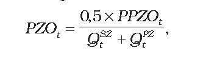
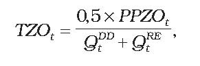

# § 15 Postup určenia tarify za zúčtovanie, vyhodnotenie a vysporiadanie odchýlok

(1) Pre subjekty zúčtovania sa uplatňujú tarify za zúčtovanie, vyhodnotenie a vysporiadanie odchýlok v štvrťhodinovom rozlíšení, kde maximálny výnos PPZOt z týchto platieb v eurách v roku t sa vypočíta podľa vzorca

PPZOt = PNZOt + PVAt + INVZOt - KZOt,

kde

- a) PNZOtsú schválené alebo určené plánované prevádzkové náklady súvisiace so zúčtovaním, vyhodnotením a vysporiadaním odchýlok zúčtovateľa odchýlok v eurách v roku t,

- b) PVAt je primeraný zisk za zúčtovanie, vyhodnotenie a vysporiadanie odchýlok v roku t v eurách vypočítaný podľa vzorca

PVAt = AR x 0,065

kde

AR sú schválené alebo určené regulované aktíva využívané v súvislosti so zúčtovaním, s vyhodnotením a vysporiadaním odchýlok k 31. decembru roku t-1,

- c) INVZOt je faktor investícií v eurách v roku t, ktorého hodnota sa vypočíta podľa vzorca

INVZOt = SOzot-2 - POzot-2,

kde

- 1. SOzot-2sú skutočné schválené alebo určené odpisy v eurách zo skutočnej hodnoty schválených alebo určených investícií v eurách zaradených do regulovaných aktív nevyhnutne využívaných v súvislosti so zúčtovaním, s vyhodnotením a vysporiadaním odchýlok v roku t-2,

- 2. POzot-2sú plánované schválené alebo určené odpisy v eurách z plánovanej hodnoty schválených alebo určených investícií v eurách zaradených do regulovaných aktív nevyhnutne využívaných v súvislosti so zúčtovaním, s vyhodnotením a vysporiadaním odchýlok v roku t-2,

- d) KZOt je fakor vyrovnania v eurách na rok t; KZOt sa vypočíta sa podľa vzorca

KZOt = PZOt-2 x (SQSZt-2 + SQPZt-2 - QSZt-2 - QPZt-2) + TZOt-2 x (SQDDt-2 + SQREt-2 - QDDt-2 - QREt-2),

kde

- a) PZOt-2 je ročná fixná platba za prístup do systému zúčtovania, vyhodnotenia a vysporiadania odchýlok v eurách v roku t-2 určená pre subjekt zúčtovania odchýlok, ktorý si zvolil režim vlastnej zodpovednosti za odchýlku a ktorý má uzavretú zmluvu o zúčtovaní, vyhodnotení a vysporiadaní odchýlok, a pre subjekt, ktorý poskytuje podporné služby, ale má prenesenú zodpovednosť za odchýlku na inú bilančnú skupinu,

- b) SQSZt-2 je skutočný počet subjektov zúčtovania odchýlok v roku t-2, ktoré si zvolili režim vlastnej zodpovednosti za odchýlku a ktoré majú uzavretú zmluvu o zúčtovaní, vyhodnotení a vysporiadaní odchýlok,

- c) SQPZt-2 je skutočný počet subjektov v roku t-2, ktoré poskytujú podporné služby, ale majú prenesenú zodpovednosť za odchýlku na inú bilančnú skupinu,

- d) QSZt-2 je predpokladaný počet subjektov zúčtovania odchýlok v roku t-2, ktoré si zvolili režim vlastnej zodpovednosti za odchýlku a ktoré majú uzavretú zmluvu o zúčtovaní, vyhodnotení a vysporiadaní odchýlok,

- e) QPZt-2 je predpokladaný počet subjektov v roku t-2, ktoré poskytujú podporné služby, ale majú prenesenú zodpovednosť za odchýlku na inú bilančnú skupinu,

- f) TZOt-2 je tarifa za zúčtovanie, vyhodnotenie a vysporiadanie odchýlok v eurách za jednotku množstva elektriny v roku t-2 určená pre subjekt zúčtovania odchýlok, ktorý si zvolil režim vlastnej zodpovednosti za odchýlku a ktorý má uzavretú zmluvu o zúčtovaní, vyhodnotení a vysporiadaní odchýlok, a pre subjekt, ktorý poskytuje podporné služby, ale má prenesenú zodpovednosť za odchýlku na inú bilančnú skupinu,

- g) SQDDt-2 je celkový skutočný objem dohodnutého množstva elektriny, ktorý sa vypočíta ako suma zmluvnej dodávky a zmluvného odberu vrátane plánovaných cezhraničných prenosov, bilančných skupín subjektov zúčtovania odchýlok, ktoré si zvolili režim vlastnej zodpovednosti za odchýlku a ktoré majú uzavretú zmluvu o zúčtovaní, vyhodnotení a vysporiadaní odchýlok, podľa denných diagramov v jednotkách množstva elektriny v roku t-2,

- h) SQREt-2 je celkový skutočný objem poskytnutej regulačnej elektriny subjektov, ktoré poskytujú podporné služby, ale majú prenesenú zodpovednosť za odchýlku na inú bilančnú skupinu, v jednotkách množstva elektriny v roku t-2,

- i) QDDt-2 je celkový plánovaný objem dohodnutého množstva elektriny, ktorý sa vypočíta ako suma zmluvnej dodávky a zmluvného odberu vrátane plánovaných cezhraničných prenosov, bilančných skupín subjektov zúčtovania odchýlok, ktoré si zvolili režim vlastnej zodpovednosti za odchýlku a ktoré majú uzavretú zmluvu o zúčtovaní, vyhodnotení a vysporiadaní odchýlok, podľa denných diagramov v jednotkách množstva elektriny v roku t-2,

- j) QREt-2 je celkový plánovaný objem poskytnutej regulačnej elektriny subjektov, ktoré poskytujú podporné služby, ale majú prenesenú zodpovednosť za odchýlku na inú bilančnú skupinu, v jednotkách množstva elektriny v roku t-2.

(2) Ročná fixná platba za prístup do systému zúčtovania, vyhodnotenia a vysporiadania odchýlok PZOt v eurách v roku t určená pre subjekt zúčtovania odchýlok, ktorý si zvolil režim vlastnej zodpovednosti za odchýlku a ktorý má uzavretú zmluvu o zúčtovaní, vyhodnotení a vysporiadaní odchýlok, a pre subjekt, ktorý poskytuje podporné služby, ale má prenesenú zodpovednosť za odchýlku na inú bilančnú skupinu, sa vypočíta podľa vzorca

kde

- a) PPZOt je maximálny povolený výnos v eurách za zúčtovanie, vyhodnotenie a vysporiadanie odchýlok v roku t,

- b) QtSZ je predpokladaný počet subjektov zúčtovania v roku t, ktoré si zvolili režim vlastnej zodpovednosti za odchýlku a ktoré majú uzavretú zmluvu o zúčtovaní, vyhodnotení a vysporiadaní odchýlok,

- c) QtPZ je predpokladaný počet subjektov v roku t, ktoré poskytujú podporné služby, ale majú prenesenú zodpovednosť za odchýlku na inú bilančnú skupinu.

(3) Tarifa za zúčtovanie, vyhodnotenie a vysporiadanie odchýlok TZOt v eurách za jednotku množstva elektriny v roku t určená pre subjekt zúčtovania odchýlok, ktorý si zvolil režim vlastnej zodpovednosti za odchýlku a ktorý má uzavretú zmluvu o zúčtovaní, vyhodnotení a vysporiadaní odchýlok, a pre subjekt, ktorý poskytuje podporné služby, ale má prenesenú zodpovednosť za odchýlku na inú bilančnú skupinu, sa vypočíta podľa vzorca

kde

- a) PPZOt je maximálny povolený výnos v eurách za zúčtovanie, vyhodnotenie a vysporiadanie odchýlok v roku t,

- b) QtDD je celkový plánovaný objem dohodnutého množstva elektriny, ktorý sa vypočíta ako suma zmluvnej dodávky a zmluvného odberu vrátane plánovaných cezhraničných prenosov elektriny, bilančných skupín subjektov zúčtovania odchýlok, ktoré si zvolili režim vlastnej zodpovednosti za odchýlku a ktoré majú uzavretú zmluvu o zúčtovaní, vyhodnotení a vysporiadaní odchýlok, podľa denných diagramov v jednotkách množstva elektriny v roku t,

- c) QtRE je celkový plánovaný objem poskytnutej regulačnej elektriny subjektov, ktoré poskytujú podporné služby, ale majú prenesenú zodpovednosť za odchýlku na inú bilančnú skupinu, v jednotkách množstva elektriny v roku t.

(4) Pre subjekty zúčtovania, ktoré si zvolili režim vlastnej zodpovednosti za odchýlku a ktoré majú uzavretú zmluvu o zúčtovaní, vyhodnotení a vysporiadaní odchýlok, a pre subjekty, ktoré poskytujú podporné služby, ale majú prenesenú zodpovednosť za odchýlku na inú bilančnú skupinu, sa uplatňuje ročná fixná platba za prístup do systému zúčtovania, vyhodnotenia a vysporiadania odchýlok PZOt podľa odseku 2 v eurách v roku t.

(5) Pre subjekty zúčtovania, ktoré si zvolili režim vlastnej zodpovednosti za odchýlku a ktoré majú uzavretú zmluvu o zúčtovaní, vyhodnotení a vysporiadaní odchýlok, sa uplatňuje tarifa za zúčtovanie, vyhodnotenie a vysporiadanie odchýlok TZOt podľa odseku 3 k jednotke množstva elektriny dohodnutého množstva elektriny ich bilančných skupín podľa denných diagramov v roku t.

(6) Pre subjekty, ktoré poskytujú podporné služby, ale majú prenesenú zodpovednosť za odchýlku na inú bilančnú skupinu, sa uplatňuje tarifa za zúčtovanie, vyhodnotenie a vysporiadanie odchýlok TZOt podľa odseku 3 k jednotke množstva elektriny objemu poskytnutej regulačnej elektriny určeného prevádzkovateľom prenosovej sústavy v roku t.
