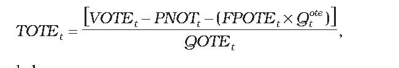
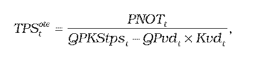
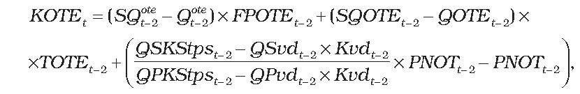

# § 16 Postup určenia cien za organizovanie a vyhodnotenie krátkodobého trhu s elektrinou

(1) Pre subjekty zúčtovania, ktoré majú s organizátorom krátkodobého trhu s elektrinou uzatvorenú zmluvu o prístupe a podmienkach účasti na organizovanom krátkodobom trhu s elektrinou, sa uplatňujú tarify za organizovanie a vyhodnotenie krátkodobého trhu s elektrinou, pričom úradom schválený alebo určený maximálny výnos VOTEt z týchto platieb a z alikvotnej časti výnosu z tarify za prevádzkovanie systému v eurách v roku t sa vypočíta podľa vzorca

VOTEt = PNOTEt + PVAt + INVOTEt - KOTEt,

kde

- a) PNOTEtsú schválené alebo určené plánované prevádzkové náklady súvisiace s organizovaním a vyhodnotením krátkodobého trhu s elektrinou v eurách na rok t,

- b) PVAt je primeraný zisk za organizovanie a vyhodnotenie krátkodobého trhu s elektrinou v roku t v eurách vypočítaný podľa vzorca

PVAt = AR x 0,065

kde

AR sú schválené alebo určené regulované aktíva využívané v súvislosti s organizovaním a vyhodnotením krátkodobého trhu s elektrinou k 31. decembru roku t-1,

- c) INVOTEt je faktor investícií v eurách v roku t, ktorého hodnota sa vypočíta podľa vzorca

INVOTEt = SOotet-2 - POotet-2,

kde

- 1. SOotet-2 sú skutočné schválené alebo určené odpisy v eurách zo skutočnej hodnoty schválených alebo určených investícií v eurách zaradených do regulovaných aktív nevyhnutne využívaných v súvislosti s organizovaním a vyhodnotením krátkodobého trhu s elektrinou v roku t-2,

- 2. POotet-2 sú plánované schválené alebo určené odpisy v eurách z plánovanej hodnoty schválených alebo určených investícií v eurách zaradených do regulovaných aktív nevyhnutne využívaných v súvislosti s organizovaním a vyhodnotením krátkodobého trhu s elektrinou v roku t-2,

- d) KOTEt je faktor vyrovnania v eurách v roku t vypočítaný podľa odsekov 3 a 4.

(2) Tarifa za organizovanie a vyhodnotenie krátkodobého trhu s elektrinou TOTEt schválená alebo určená cenovým rozhodnutím na rok t v eurách za jednotku množstva elektriny nakúpenej a predanej účastníkom krátkodobého trhu s elektrinou sa vypočíta podľa vzorca

kde

- a) VOTEt je schválený alebo určený maximálny výnos podľa odseku 1,

- b) PNOTt sú schválené alebo určené plánované náklady v eurách zohľadňujúce alikvotnú časť nákladov na organizovanie a vyhodnotenie krátkodobého trhu s elektrinou v eurách na rok t; PNOTt sa uplatňujú z tarify za prevádzkovanie systému a alikvotná časť tarify za prevádzkovanie systému na organizovanie a vyhodnotenie krátkodobého trhu s elektrinou organizátora krátkodobého trhu s elektrinou v eurách v roku t sa vypočíta podľa vzorca

kde

- 1. QPKStpst

- je celková plánovaná koncová spotreba elektriny na vymedzenom území v roku t, na ktorú sa uplatňujú tarify za prevádzkovanie systému,

- 2. QPvdt

- je celkový plánovaný objem elektriny v jednotkách množstva elektriny v roku t odobratej koncovými odberateľmi elektriny priamo pripojenými do prenosovej sústavy s dobou ročného využitia maxima v roku t-2 vyššou ako 6 800 hodín a súčasne pomernou odchýlkou subjektu zúčtovania menšou ako 0,025; dobou ročného využitia maxima sa rozumie podiel celkového ročného preneseného množstva elektriny v roku t-2 a rezervovanej kapacity určenej ako aritmetický priemer mesačných maxím štvrťhodinového výkonu za mesiace november roku t-4 až február roku t-3,

- 3. Kvdt

- je koeficient zvýhodnenia odberového diagramu pre individuálne sadzby taríf koncových odberateľov elektriny priamo pripojených do prenosovej sústavy na rok t, ktorého hodnota je 0,95,

- c) FPOTEt je schválená alebo určená ročná fixná platba v eurách určená na rok t cenovým rozhodnutím uplatneným subjektu zúčtovania, ktorý je účastníkom organizovaného krátkodobého trhu s elektrinou,

- d) Qtote je plánovaný počet účastníkov organizovaného krátkodobého trhu s elektrinou v roku t,

- e) QOTEt je plánované množstvo elektriny v jednotkách množstva elektriny na rok t nakúpenej a predanej účastníkmi krátkodobého trhu s elektrinou.

(3) Faktor vyrovnania KOTEt v eurách v roku t sa na roky 2014 až 2015 vypočíta podľa vzorca

KOTEt = (SQotet-2 - Qotet-2) x FPOTEt-2 + (SQOTEt-2 - QOTEt-2) x TOTEt-2 + (SQKpot-2 - QKpot-2) x TPSotet-2,

kde

- a) SQotet-2 je skutočný počet účastníkov organizovaného krátkodobého trhu s elektrinou v roku t-2,

- b) Qotet-2 je plánovaný počet účastníkov organizovaného krátkodobého trhu s elektrinou v roku t-2,

- c) FPOTEt-2 je ročná fixná platba v eurách určená na rok t-2 cenovým rozhodnutím pre subjekt zúčtovania, ktorý je účastníkom organizovaného krátkodobého trhu s elektrinou,

- d) SQOTEt-2 je skutočné množstvo elektriny v jednotkách množstva elektriny v roku t-2 nakúpenej a predanej účastníkom krátkodobého trhu s elektrinou,

- e) QOTEt-2 je plánované schválené množstvo elektriny v jednotkách množstva elektriny na rok t-2 nakúpenej na krátkodobom trhu s elektrinou,

- f) TOTEt-2 je tarifa za organizovanie a vyhodnotenie krátkodobého trhu s elektrinou schválená alebo určená cenovým rozhodnutím na rok t-2 v eurách za jednotku množstva elektriny nakúpenej na krátkodobom trhu s elektrinou,

- g) SQKpot-2 je skutočné množstvo elektriny odobratej koncovými odberateľmi elektriny, ktorí sú priamo pripojení do prenosovej sústavy, v jednotkách množstva elektriny v roku t-2,

- h) QKpot-2 je celkový plánovaný objem elektriny odobratej koncovými odberateľmi elektriny, ktorí sú priamo pripojení do prenosovej sústavy v jednotkách množstva elektriny na rok t-2,

- i) TPSotet-2 je tarifa za prevádzkovanie systému určená rozhodnutím pre organizátora krátkodobého trhu s elektrinou na rok t-2.

(4) Faktor vyrovnania KOTEt v eurách v roku t sa od roku 2016 vypočíta podľa vzorca

kde

- a) QSKStpst-2 je celková skutočná koncová spotreba elektriny na vymedzenom území za rok t-2, na ktorú sa uplatňujú tarify za prevádzkovanie systému,

- b) QSvdt-2 je celkový skutočný objem elektriny v jednotkách množstva elektriny v roku t-2 odobratej koncovými odberateľmi elektriny priamo pripojenými do prenosovej sústavy s dobou ročného využitia maxima v roku t-4 vyššou ako 6800 hodín a súčasne pomernou odchýlkou subjektu zúčtovania menšou ako 0,025; dobou ročného využitia maxima sa rozumie podiel celkového ročného odobratého množstva elektriny v roku t-4 a rezervovanej kapacity určenej ako aritmetický priemer mesačných maxím štvrťhodinového výkonu za mesiace november roku t-6 až február roku t-5,

- c) Kvdt-2 je koeficient zvýhodnenia odberového diagramu pre individuálne sadzby taríf koncových odberateľov elektriny priamo pripojených do prenosovej sústavy na rok t-2, ktorého hodnota je 0,95,

- d) QPKStpst-2 je celková plánovaná koncová spotreba elektriny na vymedzenom území na rok t-2, na ktorú sa uplatňujú tarify za prevádzkovanie systému,

- e) QPvdt-2 je celkový plánovaný objem elektriny v jednotkách množstva elektriny v roku t-2 odobratej koncovými odberateľmi elektriny priamo pripojenými do prenosovej sústavy s dobou ročného využitia maxima v roku t-4 vyššou ako 6800 hodín a súčasne pomernou odchýlkou subjektu zúčtovania menšou ako 0,025; dobou ročného využitia maxima sa rozumie podiel celkového ročného odobratého množstva elektriny v roku t-4 a rezervovanej kapacity určenej ako aritmetický priemer mesačných maxím štvrťhodinového výkonu za mesiace november roku t-6 až február roku t-5,

- f) PNOTt-2 sú schválené alebo určené plánované náklady v eurách zohľadňujúce alikvotnú časť nákladov na organizovanie a vyhodnotenie krátkodobého trhu s elektrinou v eurách na rok t-2.
