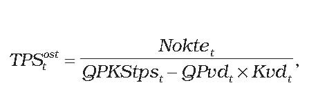

# § 17 Zohľadnenie nákladov za výkon ostatných činností organizátora krátkodobého trhu s elektrinou

(1) Celkové plánované náklady a zisk za výkon ostatných činností organizátora krátkodobého trhu s elektrinou v roku t Noktet sa vypočítajú podľa vzorca

Noktet = PNt + POt + RABt x WACC x KDZ + FINVPt - KOTt,

kde

- a) PNt, sú schválené alebo určené plánované ekonomicky oprávnené prevádzkové ročné náklady súvisiace so správou, zberom a sprístupňovaním nameraných údajov a s centrálnou fakturáciou taríf vykonávanou organizátorom krátkodobého trhu s elektrinou v eurách v roku t,

- b) POt sú plánované schválené alebo určené odpisy v eurách na rok t súvisiace s regulovanou činnosťou z plánovanej hodnoty regulačnej bázy aktív nevyhnutne využívanej pre regulovanú činnosť v roku t,

- c) RABt je schválená alebo určená hodnota regulačnej bázy aktív využívanej v súvislosti so správou, zberom a sprístupňovaním nameraných údajov, s centrálnou fakturáciou taríf vykonávanou organizátorom krátkodobého trhu s elektrinou k 31. decembru roku t-1,

- d) WACC je miera výnosnosti regulačnej bázy aktív na roky 2014 až 2016 určená podľa § 5 ods. 2 a 3,

- e) KDZ je koeficient miery využitia disponibilných zdrojov do investícií súvisiacich s regulovanou činnosťou; KDZ je na roky 2012 až 2014 rovný jednej a na roky 2015 a 2016 sa určí v intervale od 0,90 do 1,00,

- f) FINVPt je faktor investícií v eurách na rok t; FINVPtsa na rok 2014 a 2015 rovná nule a na rok 2016 sa vypočíta podľa vzorca

FINVPt = SOt-2 - POt-2

kde

- 1. SOt-2 sú skutočné schválené alebo určené odpisy v eurách zo skutočnej hodnoty schválených alebo určených investícií v eurách zaradených do hodnoty regulačnej bázy aktív nevyhnutne využívaných pre regulovanú činnosť v období roku t-2,

- 2. POt-2 sú plánované schválené alebo určené odpisy v eurách z plánovanej hodnoty schválených alebo určených investícií v eurách zaradených do hodnoty regulačnej bázy aktív nevyhnutne využívaných pre regulovanú činnosť v období roku t-2,

- g) KOTt je korekcia organizátora krátkodobého trhu s elektrinou v eurách, ktorá sa vypočíta podľa odseku 3.

(2) Celkové plánované náklady a zisk za výkon ostatných činnosti organizátora krátkodobého trhu s elektrinou v roku t Noktet sa uplatňujú z tarify za prevádzkovanie systému. Alikvotná časť tarify za prevádzkovanie systému na zabezpečenie ostatných činností organizátora krátkodobého trhu s elektrinou v eurách v roku t sa vypočíta podľa vzorca

kde

- a) QPKStpstje celková plánovaná koncová spotreba elektriny na vymedzenom území v roku t, na ktorú sa uplatňujú tarify za prevádzkovanie systému,

- b) QPvdt je celkový plánovaný objem elektriny v jednotkách množstva elektriny v roku t odobratej koncovými odberateľmi elektriny priamo pripojenými do prenosovej sústavy s dobou ročného využitia maxima v roku t-2 vyššou ako 6800 hodín a súčasne pomernou odchýlkou subjektu zúčtovania menšou ako 0,025; dobou ročného využitia maxima sa rozumie podiel celkového ročného preneseného množstva elektriny v roku t-2 a rezervovanej kapacity určenej ako aritmetický priemer mesačných maxím štvrťhodinového výkonu za mesiace november roku t-4 až február roku t-3,

- c) Kvdt je koeficient zvýhodnenia odberového diagramu pre individuálne sadzby taríf koncových odberateľov elektriny priamo pripojených do prenosovej sústavy na rok t, ktorého hodnota je 0,95.

(3) Korekcia organizátora krátkodobého trhu s elektrinou v eurách sa vypočíta podľa vzorca

KOTt = SVTPSostt-2 - PVTPSostt-2,

kde

- a) SVTPSostt-2 sú skutočné výnosy z alikvotnej časti tarify za prevádzkovanie systému na zabezpečenie ostatných činností organizátora krátkodobého trhu s elektrinou v eurách v roku t-2,

- b) PVTPSostt-2 sú plánované výnosy z alikvotnej časti tarify za prevádzkovanie systému na zabezpečenie ostatných činností organizátora krátkodobého trhu s elektrinou v eurách v roku t-2.
