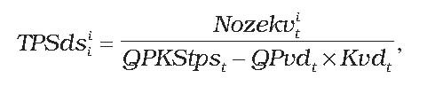
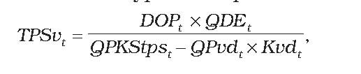
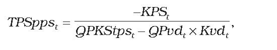

# § 18 Podmienky uplatňovania tarify za prevádzkovanie systému účastníkmi trhu s elektrinou

(1) Náklady na prevádzkovanie systému NPSsz sa organizátorom krátkodobého trhu s elektrinou vyúčtujú všetkým subjektom zúčtovania s vlastnou zodpovednosťou za odchýlku55) daňovým dokladom mesačne k 15. dňu nasledujúceho mesiaca a sú vypočítané podľa vzorca

NPSszi = TPSt x (QSKStpsszi - QSvdit x Kvdt),

kde

- a) QSKStpsszi je skutočná celková koncová spotreba elektriny i-tého subjektu zúčtovania s vlastnou zodpovednosťou za odchýlku, na ktorú sa uplatňujú tarify za prevádzkovanie systému,

- b) QSvdti je celkový skutočný objem elektriny v jednotkách množstva elektriny odobratej koncovými odberateľmi elektriny, ktorí patria do bilančnej skupiny i-tého subjektu zúčtovania s vlastnou zodpovednosťou za odchýlku a sú priamo pripojení do prenosovej sústavy s dobou ročného využitia maxima v roku t-2 vyššou ako 6800 hodín a súčasne pomernou odchýlkou subjektu zúčtovania menšou ako 0,025; dobou ročného využitia maxima sa rozumie podiel celkového ročného odobratého množstva elektriny v roku t-2 a rezervovanej kapacity určenej ako aritmetický priemer mesačných maxím štvrťhodinového výkonu za mesiace november roku t-4 až február roku t-3,

- c) Kvdt je koeficient zvýhodnenia odberového diagramu pre individuálne sadzby taríf koncových odberateľov elektriny priamo pripojených do prenosovej sústavy na rok t, ktorého hodnota je 0,95.

(2) Náklady na prevádzkovanie systému sa neúčtujú za celkovú koncovú spotrebu elektriny na prečerpávanie v prečerpávacích vodných elektrárňach ani malým výrobcom elektriny, ktorí nepodnikajú v energetike podľa osobitného predpisu.56)

(3) Ak prevádzkovateľ regionálnej distribučnej sústavy, do ktorej sú pripojení jednotliví výrobcovia elektriny z obnoviteľných zdrojov energie a vysoko účinnou kombinovanou výrobou a od ktorých prevádzkovateľ regionálnej distribučnej sústavy nakupuje elektrinu na krytie strát a ktorým vypláca doplatok k cene elektriny vyrobenej z obnoviteľných zdrojov energie a vysoko účinnou kombinovanou výrobou, vyúčtujú sa organizátorovi krátkodobého trhu s elektrinou mesačne vždy k 15. dňu nasledujúceho mesiaca náklady spojené s nákupom elektriny od týchto výrobcov elektriny NPSdsi podľa vzorca

NPSdsi = TPSdsit x (QSKStpst - QSvdt x Kvdt),

kde

- a) TPSdsit je tarifa za prevádzkovanie systému určená rozhodnutím pre i-tého prevádzkovateľa regionálnej distribučnej sústavy v eurách na jednotku množstva elektriny na rok t, ktorá sa vypočíta sa podľa vzorca

kde

- 1. Nozekvit sú celkové plánované náklady na nákup elektriny vyrobenej z obnoviteľných zdrojov energie a vysoko účinnou kombinovanou výrobou i-tého prevádzkovateľa sústavy v roku t,

- 2. QPKStpst je celková plánovaná koncová spotreba elektriny na vymedzenom území na rok t, na ktorú sa uplatňujú tarify za prevádzkovanie systému,

- 3. QPvdt je celkový plánovaný objem elektriny v jednotkách množstva elektriny v roku t odobratej koncovými odberateľmi elektriny priamo pripojenými do prenosovej sústavy s dobou ročného využitia maxima v roku t-2 vyššou ako 6800 hodín a súčasne pomernou odchýlkou subjektu zúčtovania menšou ako 0,025; dobou ročného využitia maxima sa rozumie podiel celkového ročného preneseného množstva elektriny v roku t-2 a rezervovanej kapacity určenej ako aritmetický priemer mesačných maxím štvrťhodinového výkonu za mesiace november roku t-4 až február roku t-3,

- 4. Kvdt je koeficient zvýhodnenia odberového diagramu pre individuálne sadzby taríf koncových odberateľov elektriny priamo pripojených do prenosovej sústavy na rok t, ktorého hodnota je 0,95,

- b) QSKStpst je celková skutočná koncová spotreba elektriny na vymedzenom území za uplynulé obdobie, na ktorú sa uplatňujú tarify za prevádzkovanie systému,

- c) QSvdt je celkový skutočný objem elektriny v jednotkách množstva elektriny za uplynulé obdobie odobratej koncovými odberateľmi elektriny priamo pripojenými do prenosovej sústavy s dobou ročného využitia maxima v roku t-2 vyššou ako 6800 hodín a súčasne pomernou odchýlkou subjektu zúčtovania menšou ako 0,025; dobou ročného využitia maxima sa rozumie podiel celkového ročného odobratého množstva elektriny v roku t-2 a rezervovanej kapacity určenej ako aritmetický priemer mesačných maxím štvrťhodinového výkonu za mesiace november roku t-4 až február roku t-3,

- d) Kvdt je koeficient zvýhodnenia odberového diagramu pre individuálne sadzby taríf koncových odberateľov elektriny priamo pripojených do prenosovej sústavy na rok t, ktorého hodnota je 0,95.

(4) Ak výrobca elektriny, ktorý na základe rozhodnutia ministerstva hospodárstva o uložení povinnosti vo všeobecnom hospodárskom záujme vyrába v roku t elektrinu z domáceho uhlia, vyúčtuje sa organizátorovi krátkodobého trhu s elektrinou mesačne vždy k 15. dňu nasledujúceho mesiaca platba NPSv podľa vzorca

NPSv= TPSvt x (QSKStpst - Qsvdt x Kvdt),

kde

- a) TPSvt je tarifa za prevádzkovanie systému určená rozhodnutím úradu pre výrobcu elektriny, ktorý na základe rozhodnutia ministerstva hospodárstva o uložení povinnosti vo všeobecnom hospodárskom záujme vyrába v roku t elektrinu z domáceho uhlia, v eurách na jednotku množstva elektriny na rok t, ktorá sa vypočíta sa podľa vzorca

kde

- 1. DOPt je pevná cena elektriny vyrobenej z domáceho uhlia v eurách za megawatthodinu pre rok t,

- 2. QDEt je objem elektriny určený rozhodnutím ministerstva hospodárstva o uložení povinnosti vo všeobecnom hospodárskom záujme vyrábať elektrinu z domáceho uhlia a dodávať elektrinu vyrobenú z domáceho uhlia na rok t,

- 3. QPKStpst je celková plánovaná koncová spotreba elektriny na vymedzenom území na rok t, na ktorú sa uplatňujú tarify za prevádzkovanie systému,

- 4. QPvdt je celkový plánovaný objem elektriny v jednotkách množstva elektriny v roku t odobratej koncovými odberateľmi elektriny priamo pripojenými do prenosovej sústavy s dobou ročného využitia maxima v roku t-2 vyššou ako 6 800 hodín a súčasne pomernou odchýlkou subjektu zúčtovania menšou ako 0,025; dobou ročného využitia maxima sa rozumie podiel celkového ročného preneseného množstva elektriny v roku t-2 a rezervovanej kapacity určenej ako aritmetický priemer mesačných maxím štvrťhodinového výkonu za mesiace november roku t-4 až február roku t-3,

- 5. Kvdt je koeficient zvýhodnenia odberového diagramu pre individuálne sadzby taríf koncových odberateľov elektriny priamo pripojených do prenosovej sústavy na rok t, ktorého hodnota je 0,95,

- b) QSKStpst je celková skutočná koncová spotreba elektriny na vymedzenom území za uplynulé obdobie, na ktorú sa uplatňujú tarify za prevádzkovanie systému,

- c) QSvdt je celkový skutočný objem elektriny v jednotkách množstva elektriny za uplynulé obdobie odobratej koncovými odberateľmi elektriny priamo pripojenými do prenosovej sústavy s dobou ročného využitia maxima v roku t-2 vyššou ako 6800 hodín a súčasne pomernou odchýlkou subjektu zúčtovania menšou ako 0,025; dobou ročného využitia maxima sa rozumie podiel celkového ročného odobratého množstva elektriny v roku t-2 a rezervovanej kapacity určenej ako aritmetický priemer mesačných maxím štvrťhodinového výkonu za mesiace november roku t-4 až február roku t-3,

- d) Kvdt je koeficient zvýhodnenia odberového diagramu pre individuálne sadzby taríf koncových odberateľov elektriny priamo pripojených do prenosovej sústavy na rok t, ktorého hodnota je 0,95.

(5) Náklady spojené s korekciou prevádzkovateľa prenosovej sústavy z platieb za prevádzkovanie systému NKPSpps zohľadňujúce náklady a výnosy prevádzkovateľa prenosovej sústavy z platieb za prevádzkovanie systému za rok t-2 sa vyúčtujú organizátorovi krátkodobého trhu s elektrinou mesačne vždy k 15. dňu nasledujúceho mesiaca podľa vzorca

NKPSpps = TPSppst x (QSKStpst - QSvdt x Kvdt),

kde

- a) TPSppst je tarifa za prevádzkovanie systému určená rozhodnutím úradu pre prevádzkovateľa prenosovej sústavy, v eurách na jednotku množstva elektriny na rok t, ktorá sa vypočíta sa podľa vzorca

kde

- 1. KPSt je korekcia v eurách na rok t KPSt zohľadňujúca náklady a výnosy prevádzkovateľa prenosovej sústavy z platieb za prevádzkovanie systému v roku t-2,

- 2. QPKStpst je celková plánovaná koncová spotreba elektriny na vymedzenom území na rok t, na ktorú sa uplatňujú tarify za prevádzkovanie systému,

- 3. QPvdt je celkový plánovaný objem elektriny v jednotkách množstva elektriny v roku t odobratej koncovými odberateľmi elektriny priamo pripojenými do prenosovej sústavy s dobou ročného využitia maxima v roku t-2 vyššou ako 6800 hodín a súčasne pomernou odchýlkou subjektu zúčtovania menšou ako 0,025; dobou ročného využitia maxima sa rozumie podiel celkového ročného preneseného množstva elektriny v roku t-2 a rezervovanej kapacity určenej ako aritmetický priemer mesačných maxím štvrťhodinového výkonu za mesiace november roku t-4 až február roku t-3,

- 4. Kvdt je koeficient zvýhodnenia odberového diagramu pre individuálne sadzby taríf koncových odberateľov elektriny priamo pripojených do prenosovej sústavy na rok t, ktorého hodnota je 0,95,

- b) QSKStpst je celková skutočná koncová spotreba elektriny na vymedzenom území za uplynulé obdobie, na ktorú sa uplatňujú tarify za prevádzkovanie systému,

- c) QSvdt je celkový skutočný objem elektriny v jednotkách množstva elektriny za uplynulé obdobie odobratej koncovými odberateľmi elektriny priamo pripojenými do prenosovej sústavy s dobou ročného využitia maxima v roku t-2 vyššou ako 6 800 hodín a súčasne pomernou odchýlkou subjektu zúčtovania menšou ako 0,025; dobou ročného využitia maxima sa rozumie podiel celkového ročného odobratého množstva elektriny v roku t-2 a rezervovanej kapacity určenej ako aritmetický priemer mesačných maxím štvrťhodinového výkonu za mesiace november roku t-4 až február roku t-3,

- d) Kvdt je koeficient zvýhodnenia odberového diagramu pre individuálne sadzby taríf koncových odberateľov elektriny priamo pripojených do prenosovej sústavy na rok t, ktorého hodnota je 0,95.
