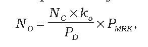

# § 42 Pripojenie odberateľa elektriny alebo výrobcu elektriny do distribučnej sústavy do napäťovej úrovne od 52 kV vrátane do 110 kV

(1) Maximálna cena za pripojenie NO pri pripojení od 52 kV vrátane do 110 kV distribučnej sústavy alebo pri zvýšení maximálnej rezervovanej kapacity v od 52 kV vrátane do 110 kV distribučnej sústave zahrnuje náklady na výstavbu požadovaného elektroenergetického zariadenia prevádzkovateľa distribučnej sústavy a všetky nevyhnutné úpravy elektroenergetických zariadení v od 52 kV vrátane do 110 kV distribučnej sústave a v prenosovej sústave a vypočíta sa podľa vzorca

kde

- a) Ncsú celkové náklady prevádzkovateľa distribučnej sústavy na výstavbu pripojenia a súvisiace úpravy v distribučnej sústave a prenosovej sústave v eurách,

- b) PMRK je maximálna rezervovaná kapacita pripojenia žiadateľa v megawattoch,

- c) PD je disponibilná kapacita na pripojenie vytvorená nevyhnutnými úpravami energetických zariadení v distribučnej sústave prevádzkovateľa distribučnej sústavy súvisiacimi s pripojením žiadateľa do distribučnej sústavy v megawattoch,

- d) ko je koeficient výšky spoluúčasti žiadateľa o pripojenie; ak je žiadateľom odberateľ elektriny, hodnota koeficientu ko sa rovná 0,5, ak je žiadateľom výrobca elektriny hodnota koeficientu ko sa rovná jednej a ak je žiadateľom výrobca elektriny z obnoviteľných zdrojov energie alebo vysoko účinnou kombinovanou výrobou, ko sa rovná 0,98.

(2) Ak sa zvýši maximálna rezervovaná kapacita existujúceho odberateľa elektriny alebo výrobcu elektriny, potom pre výpočet podľa odseku 1 platí, že

- a) Ncje celkový náklad prevádzkovateľa distribučnej sústavy v eurách súvisiaci s pripojením žiadateľov na napäťovej úrovni od 52 kV vrátane do 110 kV za predchádzajúcich päť kalendárnych rokov,

- b) PDje celkový disponibilný výkon v megawattoch vytvorený nevyhnutnými úpravami elektroenergetických zariadení v sústave prevádzkovateľa distribučnej sústavy na základe žiadostí žiadateľov o pripojenie na napäťovej úrovni od 52 kV vrátane do 110 kV do distribučnej sústavy za predchádzajúcich päť kalendárnych rokov,

- c) PMRK je maximálna rezervovaná kapacita určená podľa § 41 ods. 4.

(3) Ak sa za predchádzajúcich päť kalendárnych rokov neuskutočnili nové pripojenia, použije sa na určenie ceny za pripojenie výpočet podľa odseku 1, kde

- 1. PMRKje maximálna rezervovaná kapacita určená podľa § 41 ods. 4,

- 2. Ncsú celkové náklady prevádzkovateľa distribučnej sústavy na zvýšenie maximálnej rezervovanej kapacity pripojenia a súvisiace úpravy v distribučnej sústave a prenosovej sústave v eurách.

(4) Ak sa elektroenergetické zariadenie odberateľa elektriny alebo výrobcu elektriny pripája do miestnej distribučnej sústavy alebo pri zvýšení maximálnej rezervovanej kapacity existujúceho odberateľa elektriny alebo výrobcu elektriny v miestnej distribučnej sústave a pripojenie vyvolá náklady na pripojenie v regionálnej distribučnej sústave a v prenosovej sústave, maximálna cena za pripojenie zahrnuje náklady na pripojenie požadovaného elektroenergetického zariadenia u prevádzkovateľa miestnej distribučnej sústavy a vyvolané náklady na pripojenie v regionálnej distribučnej sústave a v prenosovej sústave. Maximálna cena za pripojenie do miestnej distribučnej sústavy, do ktorej je elektroenergetické zariadenie odberateľa elektriny alebo výrobcu elektriny pripojené, sa uhrádza odberateľom elektriny alebo výrobcom elektriny prevádzkovateľovi miestnej distribučnej sústavy.

(5) Ak sa zariadenie na výrobu elektriny výrobcu elektriny pripája do miestnej distribučnej sústavy, ktorá je pripojená do regionálnej distribučnej sústavy, alebo sa mení maximálna rezervovaná kapacita existujúceho zariadenia na výrobu elektriny výrobcu elektriny pripojeného do miestnej distribučnej sústavy, ktorá je pripojená do regionálnej distribučnej sústavy, prevádzkovateľ miestnej distribučnej sústavy uzatvára s prevádzkovateľom regionálnej distribučnej sústavy, do ktorej je miestna distribučná sústava prevádzkovateľa miestnej distribučnej sústavy pripojená, zmluvu o pripojení do regionálnej distribučnej sústavy s maximálnou rezervovanou kapacitou vo výške celkového inštalovaného výkonu takého zariadenia na výrobu elektriny maximálne však do výšky rezervovanej kapacity, ktorú je technicky možné dodať do regionálnej distribučnej sústavy.

(6) Maximálna cena za pripojenie pre prevádzkovateľa regionálnej distribučnej sústavy, do ktorej je miestna distribučná sústava pripojená, sa uhrádza prevádzkovateľom miestnej distribučnej sústavy, do ktorej sa elektroenergetické zariadenie odberateľa elektriny alebo výrobcu elektriny pripája. Maximálna cena za pripojenie sa vypočíta podľa odseku 1, pričom pre výpočet platí, že Ncsú celkové preukázateľne vyvolané náklady prevádzkovateľa regionálnej distribučnej sústavy na zvýšenie maximálnej rezervovanej kapacity pripojenia a súvisiace úpravy v prenosovej sústave v eurách.
