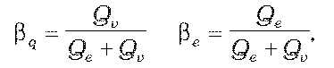
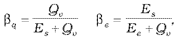
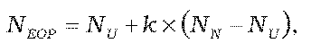
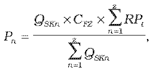

# § 4 Rozsah, štruktúra a výška ekonomicky oprávnených nákladov

(1) Ekonomicky oprávnenými nákladmi sú

- a) obstarávacie náklady na zabezpečenie potrebného množstva priameho materiálu, ktorý slúži na výrobu tepla alebo potrebného množstva nakupovaného tepla; do návrhu ceny je ich maximálna výška určená podľa ukazovateľov energetickej účinnosti určených pri poslednom overovaní hospodárnosti sústav tepelných zariadení pred podaním návrhu ceny, výhrevnosti paliva a ceny paliva alebo nakupovaného tepla; pri výrobe tepla z obnoviteľných zdrojov energie je cena za jednotkový energetický obsah v palive v eurách/kWh v určenej cene alebo schválenej cene tepla záväzná,

- b) technologické náklady, náklady na elektrinu, dopravu paliva, technologické hmoty a technologickú vodu, náklady na palivo na vlastnú spotrebu tepla súvisiacu s výrobou tepla, ktorá nie je súčasťou ukazovateľa energetickej účinnosti,2)

- c) osobné náklady,3) ktorých maximálna výška na účely kalkulácie ekonomicky oprávnených nákladov je určená podľa odseku 8 písm. b),

- d) náklady na plnenie povinností podľa osobitných predpisov;4) pri poplatkoch za znečisťovanie ovzdušia len poplatky za znečisťujúce látky vypustené do ovzdušia pri dodržaní podmienok a požiadaviek podľa osobitného zákona5) a pri skleníkových plynoch náklady maximálne do výšky vypočítanej podľa odsekov 15 a 16,

- e) náklady na overenie hospodárnosti prevádzky sústavy tepelných zariadení po odberné miesto v termínoch podľa osobitného predpisu,6)

- f) odpisy obstaraného nového hmotného majetku a nehmotného majetku,7) pričom pri hmotnom majetku sa za ekonomicky oprávnené náklady považujú odpisy najviac do výšky rovnomerných odpisov hmotného majetku,8)

- g) odpisy obstaraného už prevádzkovaného hmotného majetku a nehmotného majetku7) vo výške rovnomerných odpisov8) z jeho kúpnej ceny maximálne do výšky rovnomerných odpisov zo všeobecnej hodnoty hmotného majetku určenej znaleckým posudkom pre hmotný majetok a nehmotný majetok zaradený do účtovníctva regulovaného subjektu po 15. júli 2011,

- h) odpisy obstaraného už prevádzkovaného hmotného majetku a nehmotného majetku,7) pričom pri hmotnom majetku sa považujú za ekonomicky oprávnené náklady odpisy najviac do výšky rovnomerných odpisov hmotného majetku 8) zaradeného do účtovníctva pred 15. júlom 2011,

- i) náklady na obstaranie hmotného majetku, ktorý má samostatné prevádzkové určenie, dobu použiteľnosti dlhšiu ako jeden rok, jeho obstarávacia cena je nižšia ako vstupná cena podľa osobitného predpisu9) a je používaný výhradne na regulovanú činnosť,

- j) nájomné za prenájom hmotného majetku a nehmotného majetku, o ktorom vlastník účtuje a ktorý sa používa výhradne na regulovanú činnosť, najviac do výšky 28 eur/kW regulačného príkonu z prenajatého zariadenia na výrobu a rozvod tepla,

- k) nájomné za prenájom nehnuteľnosti alebo jej časti, v ktorej je na podlahovej ploche umiestnené tepelné zariadenie vo vlastníctve alebo v nájme regulovaného subjektu, ktoré sa používa výhradne na regulovanú činnosť, najviac vo výške 35 eur/m2 podlahovej plochy/rok; nájomné za prenájom nehnuteľnosti alebo jej časti súvisiacej s výrobou a dodávkou tepla a ostatných priestorov alebo plôch na skládku paliva a popola najviac vo výške 15 eur/m2 plochy/rok,

- l) náklady na opravy a údržbu tepelných zariadení vrátane osobných nákladov3) zamestnancov vykonávajúcich opravu a údržbu tepelných zariadení okrem nákladov na technické zhodnotenie hmotného majetku a nehmotného majetku podľa osobitného predpisu;10) náklady na plánované generálne opravy môžu byť rozložené rovnomerne počas nasledujúcich piatich rokov, ak tieto náklady regulovaný subjekt uvedie v návrhu ceny tepla,

- m) úrok z úveru poskytnutého bankou alebo pobočkou zahraničnej banky11) (ďalej len „banka“) na nákup hmotného majetku alebo nehmotného majetku, ktorý sa používa výhradne na regulovanú činnosť, alebo z prevádzkového úveru na prefinancovanie nákladov na nákup paliva,

- n) úrok z úveru poskytnutého inou právnickou osobou ako bankou na nákup hmotného majetku alebo nehmotného majetku, ktorý sa používa výhradne na regulovanú činnosť, alebo z prevádzkového úveru na prefinancovanie nákladov na nákup paliva do výšky priemerného úroku vypočítaného z porovnateľných úverov aspoň troch bánk v roku t,

- o) náklady na investície realizované v rámci projektu verejno-súkromného partnerstva rovnomerne rozložené v jednotlivých rokoch po dobu trvania projektu verejno-súkromného partnerstva, ak projekt trvá najmenej šesť rokov.

(2) Ekonomicky oprávnenými nákladmi nie sú

- a) sankcie,

- b) náklady spojené s nevyužitými výrobnými kapacitami; nevyužitými výrobnými kapacitami sú zariadenia na výrobu tepla, ktoré nie je potrebné prevádzkovať na zabezpečenie zmluvne dohodnutého ročného množstva tepla dodávaného z iného zariadenia na výrobu tepla v tej istej sústave tepelných zariadení,

- c) odpisy nevyužívaného dlhodobého hmotného majetku, odpisy „goodwill“ a odpisy hmotného majetku a nehmotného majetku vylúčeného z odpisovania,12)

- d) tantiémy a odmeny členov štatutárnych orgánov a iných orgánov regulovaného subjektu za výkon funkcie, ktorí nie sú v pracovnoprávnom vzťahu s regulovaným subjektom,

- e) platby poistného za poistenie zodpovednosti za škody spôsobené členmi štatutárnych orgánov a členmi iných orgánov regulovaného subjektu,

- f) príspevky na doplnkové dôchodkové sporenie,13) príspevky na životné poistenie a príspevky na účelové sporenie zamestnanca platené zamestnávateľom,

- g) odstupné a odchodné presahujúce výšku ustanovenú osobitným predpisom,14)

- h) príspevky na stravovanie zamestnancov nad rozsah ustanovený osobitným predpisom,15)

- i) cestovné náhrady nad rozsah ustanovený osobitným predpisom,16)

- j) tvorba sociálneho fondu nad rozsah ustanovený osobitným predpisom,17)

- k) náklady na poskytovanie ochranných pracovných prostriedkov nad rozsah ustanovený osobitným predpisom,18)

- l) dobrovoľné poistenie osôb,

- m) manká a škody na majetku vrátane škody zo zníženia cien nevyužiteľných zásob a likvidácie zásob,

- n) náklady vyplývajúce z chýb vo výpočtoch, v kalkulačných prepočtoch alebo v účtovníctve, duplicitne účtované náklady,

- o) náklady na reprezentáciu a dary,

- p) odmeny a dary pri životných jubileách a pri odchode do dôchodku,

- q) náklady na starostlivosť o zdravie zamestnancov a na vlastné zdravotnícke zariadenia nad rozsah ustanovený osobitným predpisom,19)

- r) príspevky a náklady na rekreačné, regeneračné, rekondičné a ozdravné pobyty, ak povinnosť ich uhrádzania neustanovuje osobitný predpis,20)

- s) náklady na údržbu a prevádzku školiacich a rekreačných zariadení a iných zariadení, ktoré nesúvisia s regulovanou činnosťou,

- t) daň z nehnuteľnosti platená za školiace a rekreačné zariadenia,

- u) štipendiá poskytnuté študentom a žiakom stredných odborných škôl,

- v) odpis nedobytnej pohľadávky,

- w) tvorba rezerv nad rozsah ustanovený osobitným predpisom,21)

- x) rozdiely zo zmien použitých účtovných metód a účtovných zásad,22)

- y) tvorba opravných položiek,

- z) náklady vynaložené na odstránenie nedostatkov zistených pri kolaudačnom konaní,

- aa) náklady spojené s prípravou a zabezpečením nerealizovanej investičnej výstavby,

- ab) straty z predaja dlhodobého majetku a zásob,

- ac) zostatková cena predaného alebo vyradeného hmotného majetku a nehmotného majetku,

- ad) náklady na reklamu alebo propagáciu uskutočňovanú formou podpory športových, kultúrnych a zábavných podujatí a iných činností,

- ae) spotreba pohonných látok nad rozsah ustanovený osobitným predpisom,23)

- af) náklady na palivo a nakupované teplo súvisiace s nehospodárnou výrobou a rozvodom tepla z dôvodu nedodržania normatívnych ročných účinností, ktoré boli východiskom na určenie alebo schválenie maximálnej ceny tepla,

- ag) odpisy z časti obstarávacej hodnoty hmotného majetku, ktorá bola obstaraná z prostriedkov Európskej únie, zo štátneho rozpočtu, bezodplatným prevodom hmotného majetku alebo investíciou v rámci projektu verejno-súkromného partnerstva,

- ah) nájomné za prenájom hmotného majetku a nehmotného majetku obstaraného finančným prenájmom,

- ai) nájomné za prenájom hmotného majetku a nehmotného majetku odpredaného a následne prenajatého pôvodnému vlastníkovi alebo za opätovný prenájom prenajatého hmotného majetku a nehmotného majetku,

- aj) ostatné náklady, ktoré nie sú uvedené v odseku 1.

(3) Na účely výroby, distribúcie a dodávky tepla sa ekonomicky oprávnené náklady členia na

- a) variabilné náklady, ktoré zahŕňajú náklady na palivo, alebo variabilné náklady na nákup tepla,

- b) ostatné variabilné náklady, ktoré zahŕňajú náklady na dopravu paliva, náklady na elektrinu, technologickú vodu, technologické hmoty, náklady na odvoz a likvidáciu popola a náklady na nákup emisných kvót podľa odseku 1 písm. d),

- c) regulovanú zložku fixných nákladov, ktorá zahŕňa osobné náklady vrátane odvodov do poistných fondov okrem osobných nákladov3) zamestnancov vykonávajúcich opravu a údržbu, spotrebu materiálu a energie, cestovné, stravné a ostatné služby, náklady na dane a poplatky, prevádzkové náklady, odpisy hmotného majetku a nehmotného majetku, ktoré nepriamo súvisia s výrobou a rozvodom tepla, a finančné náklady,

- d) ostatné fixné náklady, ktoré zahŕňajú fixné náklady na nákup tepla, poistenie majetku, dane, nájomné, revízie a zákonné prehliadky, poplatky za znečistenie podľa odseku 1 písm. d), náklady na overenie účtovnej závierky audítorom, odpisy hmotného majetku a nehmotného majetku priamo súvisiaceho s výrobou a rozvodom tepla, náklady na údržbu a opravy priamo súvisiace s výrobou a rozvodom tepla, úroky z investičného a prevádzkového úveru, odpisy a opravy spoločných zariadení súvisiacich s výrobou a rozvodom tepla.

(4) Ak regulovaný subjekt vykonáva aj neregulovanú činnosť, do regulovanej zložky fixných nákladov sa zahrnú spoločné náklady na vykonávanie regulovanej činnosti podľa § 2 písm. c) štvrtého bodu zákona a neregulovanej činnosti, najviac do výšky zodpovedajúcej pomeru dosiahnutých výnosov alebo tržieb z regulovanej činnosti k celkovým výnosom alebo tržbám v roku t-2.

(5) Náklady každého zdroja, množstvo vyrobeného tepla na každom zdroji, ako aj náklady súvisiace s distribúciou tepla príslušnej sústavy tepelných zariadení sa sledujú osobitne.

(6) Ekonomicky oprávnené náklady na výrobu tepla zariadením na kombinovanú výrobu24) sa určia tak, že k osobitným nákladom na výrobu tepla zariadením na kombinovanú výrobu (príloha č. 1) sa pripočíta vypočítaná časť spoločných nákladov kombinovanej výroby elektriny a tepla (príloha č. 2) prislúchajúca výrobe tepla podľa odseku 7, pričom koeficientom delenia sa vynásobia náklady v jednotlivých položkách (príloha č. 3). Do osobitných nákladov na výrobu tepla zariadením na kombinovanú výrobu sa zahrnú len náklady zariadení, ktoré by neboli inštalované, keby sa vyrábala len elektrina, napríklad čerpadlá vykurovacej vody, čerpadlá kondenzátu pary na vykurovanie, redukčné stanice. Spoločné množstvo paliva pri výrobe elektriny a tepla zariadením na kombinovanú výrobu elektriny a tepla sa určí z účinnosti výroby elektriny a množstva vyrobenej elektriny, ak sa elektrina a teplo vyrábajú plynovou turbínou alebo spaľovacím motorom, alebo zo súčtu normatívneho množstva paliva na dodávku tepla a množstva paliva na výrobu elektriny vypočítaného z množstva vyrobenej elektriny a merného množstva tepla potrebného na výrobu elektriny (kWh/GJ), ak sa elektrina vyrába protitlakovou parnou turbínou, kondenzačnou parnou turbínou s odberom pary vrátane Organického Rankinovho cyklu.

(7) Časť spoločných nákladov kombinovanej výroby elektriny a tepla prislúchajúca výrobe tepla sa určí tak, aby tieto náklady neboli vyššie ako pri delení spoločných nákladov kombinovanej výroby elektriny a tepla energetickou metódou; spoločné náklady kombinovanej výroby elektriny a tepla nezahŕňajú náklady zariadení, ktoré by neboli inštalované, keby sa nevyrábala elektrina, napríklad generátor, parná turbína vrátane kondenzátora, čerpadlá turbínového kondenzátu, chladiace čerpadlá, chladiace veže a potrubia, vyvedenie a transformácia vyrobenej elektriny. Koeficienty delenia nákladov pripadajúce na výrobu tepla βq a na výrobu elektriny βe energetickou metódou sa vypočítajú

- a) pri výrobe elektriny protitlakovou parnou turbínou alebo kondenzačnou parnou turbínou s odberom pary podľa vzorcov

- 

- kde

- Qe je teplo spotrebované na výrobu elektriny v megawatthodinách,

- Qv je využiteľné teplo na dodávku tepla v megawatthodinách,

- b) pri výrobe elektriny plynovou turbínou alebo spaľovacím motorom podľa vzorcov

- 

- kde

- Es je svorková výroba elektriny v megawatthodinách,

- Qv je využiteľné teplo v megawatthodinách.

(8) Maximálna výška

- a) variabilných nákladov na nákup paliva a variabilných nákladov na nákup tepla sa určí podľa ukazovateľov energetickej účinnosti určených pri poslednom overovaní hospodárnosti sústav tepelných zariadení pred podaním návrhu ceny, výhrevnosti paliva a ceny paliva alebo nakupovaného tepla a vypočíta sa podľa vzorca

- 

- ak NN < NU, potom NEOP = NN,

- kde

- NEOP sú ročné ekonomicky oprávnené náklady v skutočnej variabilnej cene tepla,

- NU sú ročné náklady fakturované dodávateľom paliva alebo tepla,

- NN sú ročné náklady na nákup paliva alebo na nákup tepla určené podľa ukazovateľov energetickej účinnosti určených pri poslednom overovaní hospodárnosti sústav tepelných zariadení pred podaním návrhu ceny, výhrevnosti paliva a ceny paliva alebo nakupovaného tepla,

- k je korekčný koeficient a pre rok 2014 k = 0,80, pre rok 2015 k = 0,64 a pre rok 2016 k = 0,52,

- b) regulovanej zložky fixných nákladov pre každý návrh ceny sa určí v rozsahu prílohy č. 4 podľa celkového regulačného príkonu všetkých odberných zariadení v kilowattoch

  - 1. do 300 kW vrátane, maximálne 215 eur/kW,

  - 2. nad 300 kW do 3 500 kW vrátane, maximálne 50 eur/kW,

  - 3. nad 3 500 kW do 5 200 kW vrátane, maximálne 175 000 eur + 38,50 eura/kW za každý ďalší kilowatt nad 3 500 kW,

  - 4. nad 5 200 kW do 13 000 kW vrátane, maximálne 240 450 eur + 37 eur/kW za každý ďalší kilowatt nad 5 200 kW,

  - 5. nad 13 000 kW do 21 000 kW vrátane, maximálne 529 050 eur + 31 eur/kW za každý ďalší kilowatt nad 13 000 kW,

  - 6. nad 21 000 kW, maximálne 777 050 eur + 27,3 eura/kW za každý ďalší kilowatt nad 21 000 kW.

(9) Maximálna výška ceny

- a) zemného plynu na rok t v eurách/kWh je

- CZPt = 1,20 x CENCGt x ka

- kde

- CENCGt je aritmetický priemer denných cien zverejnených burzou EEX (European Energy Exchange) na jej webovom sídle produktu NCG Natural Gas Year futures Cal-t v eurách na jednotku množstva plynu za obdobie od 1. januára roku t-1 do 31. júla roku t-1,

- ka je korekčný koeficient,

- b) za jednotkový energetický obsah drevnej štiepky na rok t v eurách/kWh je

- Cštiepka = je 0,027 x kb,

- kde

- kb je korekčný koeficient,

- c) za jednotkový energetický obsah peliet na rok t v eurách/kWh je

- Cpelety = 0,045 x kc,

- kde

- kc je korekčný koeficient,

- d) za jednotkový energetický obsah slamy na rok t v eurách/kWh je

- Cslama = 0,026 x kd,

- kde

- kd je korekčný koeficient,

- e) za jednotkový energetický obsah uhlia na rok t v eurách/kWh je

- Cuhlie = 0,022 x ke,

- kde

- ke je korekčný koeficient.

(10) Hodnoty korekčných koeficientov ka, kb, kc, kd a ke na rok t sa uverejnia na webovom sídle do 31. júla roku t-1. Hodnoty korekčných koeficientov ka, kb, kc, kd a ke na rok t sa môžu úradom zmeniť, ak sa zmení cena paliva, z ktorej sa vychádzalo pri ich určení o viac ako 5 %.

(11) Ekonomicky oprávneným nákladom je náklad na palivo so zmluvne dohodnutou cenou vo výške podľa odseku 9 pre rok t počas celého trvania platnosti zmluvnej ceny.

(12) Pri výrobe tepla z obnoviteľných zdrojov energie, a to zo slnečnej energie a geotermálnej energie alebo z elektriny vyrobenej zo slnečnej energie, sa do variabilných nákladov zahrnie najmenej 30 % z ekonomicky oprávnených celkových nákladov; ostatné náklady tvoria fixné náklady.

(13) Po skončení roku t sa celkový objem ekonomicky oprávnených fixných nákladov a primeraného zisku na dodávku tepla môže prerozdeliť medzi jednotlivých odberateľov podľa skutočne dodaného množstva tepla v roku t podľa vzorca

kde

Pn je platba príslušného odberateľa v eurách,

RPtje fakturovaný regulačný príkon príslušnému odberateľovi v roku t v kilowattoch,

CFZ je fixná zložka maximálnej ceny tepla v eurách za kilowatt,

QSKn je skutočná dodávka tepla príslušnému odberateľovi v roku t v kilowatthodinách,

z je počet odberateľov, ktorí majú dohodnuté prerozdelenie fixných nákladov a primeraného zisku, bez odberateľov tepla, ktorí si vyrábajú časť tepla samostatne, a odberateľov, ktorí odobrané teplo ďalej dodávajú odberateľom za schválenú alebo určenú cenu.

(14) Ak má regulovaný subjekt dohodnutý pre výpočet regulačného príkonu podľa § 7 ods. 3 aj iný počet hodín ako 5 300, prerozdelenie ekonomicky oprávnených fixných nákladov sa vykoná pre každú skupinu odberateľov s rovnakým počtom hodín na výpočet regulačného príkonu primerane podľa odseku 13.

(15) Ekonomicky oprávnené náklady na nákup emisných kvót sa určia ako rozdiel nákladov na emisné kvóty vypočítané z výroby tepla s najlepšou dostupnou technológiou (BAT) a bezodplatne pridelených emisných kvót. Nakúpené emisné kvóty sa do ekonomicky oprávnených nákladov zahrnú v poradí od najnižšej ceny emisných kvót. Náklady na emisné kvóty s technológiou BAT sa vypočítajú z vyrobeného tepla, emisných faktorov pre palivá, čistej výhrevnosti použitých palív a účinnosti používaných technológií

- a) 0,85 pre kotol spaľujúci uhlie,

- b) 0,80 pre kotol spaľujúci ťažký vykurovací olej,

- c) 0,90 pre kotol spaľujúci zemný plyn,

- d) 0,70 pre kotol spaľujúci biomasu,

- e) 0,75 pre spaľovací motor a plynovú turbínu.

(16) Ak sa teplo vyrába rôznymi technológiami, náklady na emisné kvóty s BAT sú súčtom nákladov vypočítaných z vyrobeného tepla podľa spotreby jednotlivých palív, emisných faktorov pre palivá, čistej výhrevnosti použitých palív a účinností pre jednotlivé technológie podľa odseku 15.

(17) Ekonomicky oprávnenými nákladmi sú náklady, ktoré sa preukazujú účtovnými dokladmi, a náklady na nákup paliva, nákup tepla a regulovanej zložky fixných nákladov, ktorých výška sa vypočíta podľa odseku 8, a náklady na plánované generálne opravy podľa § 4 ods.1 písm. l).
