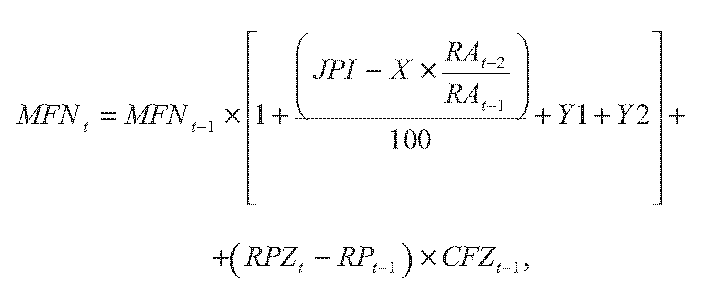
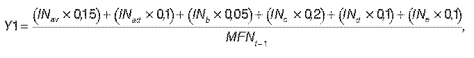
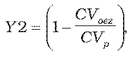

# § 5 Rozsah investícií súvisiacich s regulovanou činnosťou

(1) Maximálna výška celkových ekonomicky oprávnených fixných nákladov regulovaného subjektu na rok t sa vypočíta podľa vzorca

ak RAt-2/RAt-1 > 1, na výpočet maximálnej výšky ekonomicky oprávnených fixných nákladov sa použije hodnota RAt-2/RAt-1 = 1,

ak RAt-2=RAt-1, na výpočet maximálnej výšky ekonomicky oprávnených fixných nákladov sa použije hodnota (JPI - X x RAt-2/RAt-1) = 0,

ak (JPI - X x RAt-2/RAt-1) < 0, na výpočet maximálnej výšky ekonomicky oprávnených fixných nákladov sa použije hodnota (JPI - X x RAt-2/RAt-1) = 0,

ak (RPZt - RPt-1) < 0, na výpočet maximálnej výšky ekonomicky oprávnených fixných nákladov sa použije hodnota (RPZt - RPt-1) = 0,

kde

MFNt je maximálna výška ekonomicky oprávnených fixných nákladov okrem nákladov na nákup tepla v eurách za výrobu, distribúciu a dodávku tepla na rok t bez primeraného zisku,

MFNt-1 je výška fixných nákladov okrem nákladov na nákup tepla v eurách za výrobu, distribúciu a dodávku tepla schválená alebo určená v cenovom rozhodnutí na rok t-1 bez primeraného zisku,

JPI je aritmetický priemer hodnôt jadrovej inflácie za obdobie od júla roku t-2 do júna roku t-1 zverejnených Štatistickým úradom Slovenskej republiky v percentách,

X je faktor efektivity využívania nákladov na výrobu, distribúciu a dodávku tepla v percentách; jeho hodnota na regulačné obdobie je 3,50 %,

RAt-1 je predpokladaná výška neobežných aktív súvisiacich s regulovanou činnosťou v roku t-1,

RAt-2 sú neobežné aktíva súvisiace s regulovanou činnosťou v roku t-2,

RPZt je regulačný príkon odberných zariadení z roku t-1, do ktorých bude dodávateľ tepla dodávať teplo aj v roku t, a regulačný príkon odberných zariadení, ktoré v roku t dodávateľovi pribudnú,

RPt-1 je regulačný príkon odberných zariadení v cene tepla v roku t-1,

CFZt-1 je cena fixnej zložky maximálnej ceny tepla v roku t-1,

Y1 je faktor investičného rozvoja v tepelnej energetike, ktorý zohľadňuje náklady v roku t na

- a) investičný rozvoj, ak ich cieľom bude zvýšenie účinnosti sústavy tepelných zariadení alebo zníženie prevádzkových nákladov pri výrobe tepla alebo distribúcii tepla,

- b) ekologizáciu zariadenia na výrobu tepla,

- c) plánovanú generálnu opravu zariadenia na výrobu tepla,

- d) odstránenie poruchy spôsobenej živelnou pohromou alebo haváriou,

- e) odstránenie poruchy, havárie alebo udalosti zavinenej treťou osobou, ktorej včasné neodstránenie by malo za následok ohrozenie zdravia osôb alebo vznik veľkých materiálnych škôd,

Y2 je faktor investičného rozvoja v tepelnej energetike, ktorý zohľadňuje náklady na výstavbu zariadenia na výrobu tepla alebo jeho časti, v ktorom sa ako palivo budú využívať obnoviteľné zdroje energie, ktoré regulovaný subjekt realizuje v roku t.

(2) Faktor investičného rozvoja Y1 sa vypočíta podľa vzorca

kde

INav sú náklady na investičný rozvoj, ak ich cieľom bude zefektívnenie výroby tepla, a to zvýšením účinnosti alebo znížením prevádzkových nákladov; pri kombinovanej výrobe elektriny a tepla sa náklady na investičný rozvoj INav vypočítajú z celkových nákladov na investičný rozvoj zariadenia na výrobu elektriny a tepla vynásobených koeficientom delenia nákladov ,

INad sú náklady na investičný rozvoj, ak ich cieľom bude zefektívnenie distribúcie tepla,

INb sú náklady na ekologizáciu zariadenia na výrobu tepla,

INc sú náklady na plánovanú generálnu opravu,

INd sú náklady na odstránenie porúch spôsobených živelnými pohromami alebo nepredvídateľnými haváriami,

INe sú náklady na odstránenie porúch, havárií a udalostí zavinených tretími osobami, ktorých včasné neodstránenie by malo za následok ohrozenie zdravia osôb alebo vznik veľkých materiálnych škôd.

(3) Faktor investičného rozvoja Y2 sa vypočíta podľa vzorca

ak CVoez/CVp > 1, potom Y2 = 0,

kde

CVoez je prepočítaná cena variabilnej zložky maximálnej ceny tepla pri spaľovaní obnoviteľných zdrojov energie na projektovaný stav po ukončení výstavby,

CVp je prepočítaná cena variabilnej zložky maximálnej ceny tepla s cenou zemného plynu v čase predloženia návrhu ceny.

(4) Do faktorov investičného rozvoja Y1 a Y2 podľa odseku 1 zariadení možno zahrnúť aj náklady na investície vlastníka tepelného zariadenia na prenajatom tepelnom zariadení.

(5) Na jednom zariadení na výrobu tepla nemožno uplatniť súčasne faktor investičného rozvoja Y1 na zefektívnenie výroby tepla a faktor investičného rozvoja Y2 na výstavbu tepelného zdroja alebo jeho časti, v ktorom sa ako palivo budú využívať obnoviteľné energetické zdroje.
