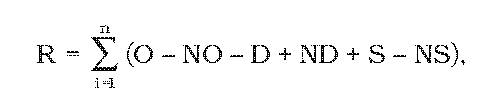

Príloha č. 8 k vyhláške č. 24/2013 Z. z.

- VYHODNOTENIE A ZÚČTOVANIE ROZDIELOV MEDZI NOMINAČNÝMI A NAMERANÝMI HODNOTAMI ODBERU ELEKTRINY A DODÁVKY ELEKTRINY PRI ODBERNÝCH MIESTACH A ODOVZDÁVACÍCH MIESTACH NEVYBAVENÝCH PRIEBEHOVÝM MERANÍM

  - (1) Vyhodnotenie a zúčtovanie rozdielov medzi nominačnými a nameranými hodnotami odberu a dodávky elektriny u odberných a odovzdávacích miest nevybavených priebehovým meraním (ďalej len „zúčtovanie rozdielov“) vykonáva organizátor krátkodobého trhu s elektrinou.

  - (2) Zúčtovania rozdielov sa zúčastňujú

    - a) subjekty zúčtovania, ktoré majú vo svojej bilančnej skupine odberné miesta alebo odovzdávacie miesta s meraním typu C,

    - b) subjekty zúčtovania, ktoré prevzali zodpovednosť za odchýlku prevádzkovateľov distribučných sústav pri nákupe elektriny na krytie strát elektriny v sústave,

    - c) prevádzkovatelia distribučných sústav, ktorí používajú v svojich sústavách merania typu C,

    - d) organizátor krátkodobého trhu s elektrinou,

  - (3) Zúčtovanie rozdielov podľa odseku 1 zabezpečuje organizátor krátkodobého trhu s elektrinou oddelene od procesu zúčtovania odchýlok ako

    - a) mesačné zúčtovanie rozdielov, ktoré sa vykonáva v termíne mesačného zúčtovania odchýlok,

    - b) konečné zúčtovanie rozdielov, ktoré sa vykonáva v termíne konečného zúčtovania odchýlok.

  - (4) Organizátor krátkodobého trhu s elektrinou vyhodnotí rozdiely medzi nominačnými a nameranými hodnotami odberu elektriny a dodávky elektriny u odberných miest a odovzdávacích miest nevybavených priebehovým meraním podľa nasledujúceho vzorca

  - 

    - kde

    - R – hodnota rozdielov v odbere a dodávke elektriny,

    - O – odber elektriny na odbernom mieste určený na základe nameraného odberu elektriny za obdobie medzi dvoma poslednými odpočtami a hodnôt typového diagramu odberu priradeného danému odbernému alebo odovzdávaciemu miestu,

    - NO – nominačný údaj o odbere elektriny použitý pre zúčtovanie odchýlok pre dané odberné a odovzdávacie miesto za obdobie medzi dvoma poslednými odpočtami,

    - D – dodávka elektriny na odovzdávacom mieste určená na základe nameranej dodávky elektriny za obdobie medzi dvoma poslednými odpočtami a hodnôt typového diagramu odberu priradeného danému odovzdávaciemu miestu,

    - ND – nominačný údaj o dodávke elektriny použitý pre zúčtovanie odchýlok pre dané odovzdávacie miesto za obdobie medzi dvoma poslednými odpočtami,

    - S – hodnota strát elektriny v sústave, určená organizátorom krátkodobého trhu s elektrinou na základe údajov poskytnutých prevádzkovateľom sústavy, ak sú straty elektriny v sústave v bilančnej skupine subjektu zúčtovania,

    - NS – nominačný údaj o stratách elektriny v sústave použitý pre zúčtovanie odchýlok, ak sú straty elektriny v sústave v bilančnej skupine subjektu zúčtovania, za rovnaké obdobie ako hodnota strát S.

  - (5) Organizátor krátkodobého trhu s elektrinou vyhodnotí údaje podľa odseku 4 oddelene pre jednotlivé subjekty zúčtovania za jednotlivé sústavy.

  - (6) Organizátor krátkodobého trhu s elektrinou vykoná zúčtovanie rozdielov na základe údajov podľa odseku 4 a vyrovnávacej ceny elektriny pre zúčtovanie rozdielov. Vyrovnávacia cena elektriny pre zúčtovanie rozdielov sa stanoví vo výške úradom stanovenej ceny pre nákup elektriny na krytie strát v príslušnej sústave pre príslušné obdobie.

  - (7) Ak je výsledkom vyhodnotenia rozdielov podľa odseku 6 kladná hodnota, subjekt zúčtovania pri vyrovnaní platbu uhradí organizátorovi krátkodobého trhu s elektrinou. Ak je výsledkom vyhodnotenia rozdielov podľa odseku 6 záporná hodnota, organizátor krátkodobého trhu s elektrinou pri vyrovnaní platbu uhradí subjektu zúčtovania.

  - (8) Organizátor krátkodobého trhu s elektrinou v prevádzkovom poriadku určí spôsob zúčtovania rozdielov pri zmene vyrovnávacej ceny v priebehu vyhodnocovaného obdobia.

  - (9) Na zúčtovanie rozdielov za vyrovnávaciu cenu organizátor krátkodobého trhu s elektrinou vystavuje subjektom zúčtovania samostatné daňové doklady vo vlastnom mene a na vlastný účet.

  - (10) Organizátor krátkodobého trhu s elektrinou vykoná finančné vyrovnanie podľa odseku 7 pre všetky bilančné skupiny subjektov zúčtovania vrátane subjektov zúčtovania, ktoré prevzali zodpovednosť za odchýlku pri nákupe elektriny na krytie strát v sústave.

  - (11) Organizátor krátkodobého trhu s elektrinou oznámi subjektu zúčtovania mesačné súhrnné množstvá elektriny pre vyrovnanie v MWh, v členení podľa jednotlivých príslušných prevádzkovateľoch sústav.

  - (12) Subjekt zúčtovania môže reklamovať mesačné zúčtovanie rozdielov do 20 dní odo dňa poskytnutia mesačného zúčtovania rozdielov organizátorovi krátkodobého trhu s elektrinou. Organizátor krátkodobého trhu s elektrinou postúpi reklamáciu mesačného zúčtovania rozdielov subjektu zúčtovania na príslušných prevádzkovateľov sústav, ktorí preveria reklamované hodnoty a do 15 dní od prijatia reklamácie zašlú vyjadrenie a hodnoty pre konečné zúčtovanie rozdielov organizátorovi krátkodobého trhu s elektrinou. Ak bola reklamácia mesačného zúčtovania rozdielov uznaná, organizátor krátkodobého trhu s elektrinou zohľadní výsledok reklamácie v konečnom zúčtovaní rozdielov. Organizátor krátkodobého trhu s elektrinou oznámi subjektom zúčtovania konečné zúčtovanie rozdielov v deň vykonania konečného zúčtovania rozdielov. Na základe konečného zúčtovania rozdielov organizátor krátkodobého trhu s elektrinou alebo subjekt zúčtovania vyhotoví do piatich dní dobropisy alebo ťarchopisy k vysporiadaným platbám podľa odseku 10.

  - (13) Organizátor krátkodobého trhu uverejňuje po ukončení mesiaca na svojom webovom sídle mesačné súhrnné množstvá pre vyrovnanie pre jednotlivé sústavy.

  - (14) Ak subjekt zúčtovania neuhradí organizátorovi krátkodobého trhu s elektrinou vyrovnávaciu platbu, organizátor krátkodobého trhu s elektrinou je oprávnený použiť finančnú zábezpeku subjektu zúčtovania na uhradenie záväzku, najskôr v prvý pracovný deň po splatnosti neuhradenej faktúry; zároveň bezodkladne vyzve subjekt zúčtovania, aby do troch pracovných dní od prevedenia platby z finančnej zábezpeky doplnil finančnú zábezpeku do výšky pokrývajúcej deklarovaný objem obchodov.
