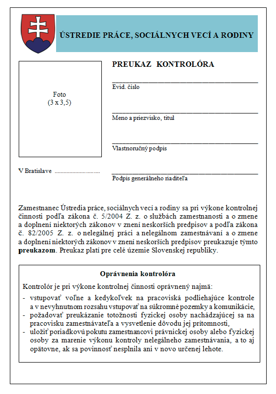
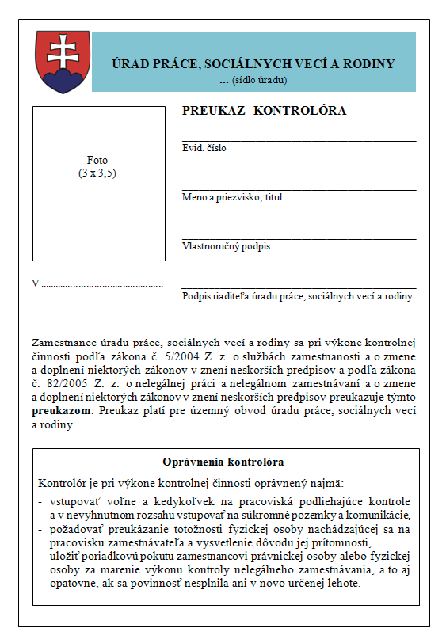

# Čl. II

Zákon č. 5/2004 Z. z. o službách zamestnanosti a o zmene a doplnení niektorých zákonov v znení zákona č. 191/2004 Z. z., zákona č. 365/2004 Z. z., zákona č. 585/2004 Z. z., zákona č. 614/2004 Z. z., zákona č. 1/2005 Z. z., zákona č. 82/2005 Z. z., zákona č. 528/2005 Z. z., zákona č. 573/2005 Z. z., zákona č. 310/2006 Z. z., zákona č. 693/2006 Z. z., zákona č. 561/2007 Z. z., zákona č. 139/2008 Z. z., zákona č. 233/2008 Z. z., zákona č. 263/2008 Z. z., zákona č. 460/2008 Z. z., zákona č. 562/2008 Z. z., zákona č. 49/2009 Z. z., zákona č. 108/2009 Z. z., zákona č. 266/2009 Z. z., zákona č. 463/2009 Z. z., zákona č. 594/2009 Z. z., zákona č. 52/2010 Z. z., zákona č. 136/2010 Z. z., zákona č. 373/2010 Z. z., zákona č. 120/2011 Z. z., zákona č. 223/2011 Z. z., zákona č. 231/2011 Z. z., zákona č. 257/2011 Z. z., zákona č. 468/2011 Z. z., zákona č. 324/2012 Z. z. a zákona č. 96/2013 Z. z. sa mení a dopĺňa takto:

- 1. § 12 sa dopĺňa písmenom ah), ktoré znie:

- „ah) vydávať preukaz kontrolóra, ktorého vzor je uvedený v prílohe č. 1a písm. A.“.

- 2. V § 13 sa odsek 1 dopĺňa písmenom am), ktoré znie:

- „am) vydávať preukaz kontrolóra, ktorého vzor je uvedený v prílohe č. 1a písm. B.“.

- 3. Poznámka pod čiarou k odkazu 62 sa dopĺňa touto citáciou:

- „Zákon č. 82/2005 Z. z. v znení neskorších predpisov.“.

- 4. V § 68 ods. 3 sa za slovo „zákona“ vkladajú slová „a osobitného predpisu18a)“.

- 5. V § 68 ods. 4 písm. a) sa vypúšťajú slová „nelegálnej práce a nelegálneho zamestnávania“.

- 6. V § 68 sa za odsek 4 vkladá nový odsek 5, ktorý znie:

- „(5)

- Zamestnanec ústredia alebo úradu vykonávajúci kontrolnú činnosť podľa odseku 3 sa pri výkone tejto kontrolnej činnosti preukazuje preukazom kontrolóra, ktorý nesmie vydať z rúk; na požiadanie umožní do neho nahliadnuť.“.

- Doterajšie odseky 5 až 8 sa označujú ako odseky 6 až 9.“.

- 7. V § 68a ods. 1 písm. b) sa slová „nelegálne zamestnávanie“ nahrádzajú slovami „porušenie zákazu nelegálneho zamestnávania“ a na konci sa bodka nahrádza čiarkou a pripájajú sa tieto slová: „a ak ide o nelegálne zamestnávanie dvoch a viac fyzických osôb súčasne, najmenej 5 000 eur.“.

- 8. Pred prílohu č. 1 sa vkladá príloha č. 1a, ktorá znie:

- „Príloha č. 1a k zákonu č. 5/2004 Z. z.

- VZOR PREUKAZU KONTROLÓRA

- A. Vzor preukazu kontrolóra ústredia

- 

- B. Vzor preukazu kontrolóra úradu“.

- 
