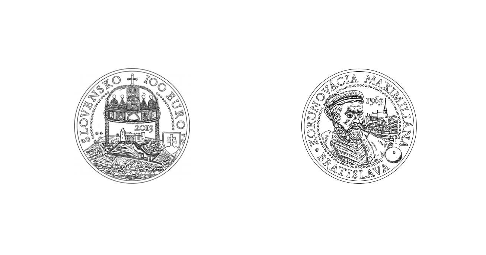

## 316

OZNÁMENIE

Národnej banky Slovenska

zo 17. septembra 2013

## o vydaní zlatých zberateľských euromincí v nominálnej hodnote 100 eur pri príležitosti 450. výročia korunovácie Maximiliána v Bratislave

1. Úvodné ustanovenia

- a) Národná banka Slovenska podľa § 17h ods. 1 zákona Národnej rady Slovenskej republiky č. 566/1992 Zb. o Národnej banke Slovenska v znení neskorších predpisov a podľa § 1 ods. 2 písm. d) zákona Národnej rady Slovenskej republiky č. 1/1993 Z. z. o Zbierke zákonov Slovenskej republiky v znení zákona č. 275/2002 Z. z. oznamuje, že pri príležitosti 450. výročia korunovácie Maximiliána v Bratislave vydáva do obehu zlaté zberateľské euromince v nominálnej hodnote 100 eur (ďalej len „zberateľská eurominca“).

- b) Zberateľská eurominca má štatút zákonného platidla len v Slovenskej republike.

- c) Zberateľská eurominca sa razí zo zliatiny obsahujúcej 900 dielov zlata, 75 dielov striebra a 25 dielov medi; jej hmotnosť je 9,5 g a priemer 26 mm. Pri razbe euromince je povolená horná a dolná odchýlka v priemere 0,1 mm; povolená horná odchýlka v hmotnosti je 0,08 g a v obsahu zlata 10/1000.

2. Vzhľad zberateľskej euromince

- a) Na líci zberateľskej euromince je vyobrazená uhorská kráľovská koruna, ktorá je po oboch stranách kompozične doplnená perlovcom. V spodnej časti mincového poľa je dobové vyobrazenie Bratislavského hradu. Pri pravom okraji zberateľskej euromince je štátny znak Slovenskej republiky. V opise zľava doprava je názov štátu „SLOVENSKO“ a označenie nominálnej hodnoty „100 EURO“. Letopočet „2013“ je umiestnený pod uhorskou kráľovskou korunou. Značka Mincovne Kremnica, štátny podnik, ktorú tvorí skratka „MK“ umiestnená medzi dvoma razidlami, a štylizované iniciálky mena a priezviska autora výtvarného návrhu zberateľskej euromince Karola Lička „KL“ sú umiestnené v ľavej časti mincového poľa vedľa uhorskej kráľovskej koruny.

- b) Na rube zberateľskej euromince je vyobrazený portrét kráľa Maximiliána, ktorý je kompozične doplnený dobovým vyobrazením korunovačného Dómu svätého Martina, korunovačným jablkom a po obvode perlovcom. Vedľa portrétu je umiestnený letopočet korunovácie „1563“. V opise zľava doprava sú nápisy „KORUNOVÁCIA MAXIMILIÁNA“ a „BRATISLAVA“, ktoré sú od seba oddelené grafickou značkou.

- c) Hrana zberateľskej euromince je vrúbkovaná.

Štát vydania: Slovenská republika

Začiatok vydávania: november 2013

Jozef Makúch v. r.
