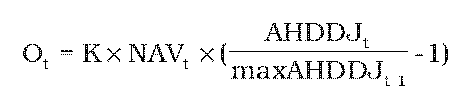

# Čl. I

Zákon č. 650/2004 Z. z. o doplnkovom dôchodkovom sporení a o zmene a doplnení niektorých zákonov v znení zákona č. 747/2004 Z. z., zákona č. 584/2005 Z. z., zákona č. 310/2006 Z. z., zákona č. 209/2007 Z. z., zákona č. 555/2007 Z. z., zákona č. 659/2007 Z. z., zákona č. 449/2008 Z. z., zákona č. 186/2009 Z. z., zákona č. 557/2009 Z. z. a zákona č. 520/2011 Z. z. sa mení a dopĺňa takto:

- 1. V § 2 odsek 2 znie:

- „(2)

- Účelom doplnkového dôchodkového sporenia je umožniť účastníkovi získať doplnkový dôchodkový príjem

- a)

- v starobe,

- b)

- pri skončení výkonu práce

- 1.

- zaradenej na základe rozhodnutia orgánu štátnej správy na úseku verejného zdravotníctva do tretej kategórie alebo štvrtej kategórie podľa osobitného predpisu,1)

- 2.

- zamestnancom, ktorý je umelec vykonávajúci profesiu tanečníka bez ohľadu na štýl a techniku v divadlách a súboroch, alebo zamestnancom, ktorý je hudobný umelec vykonávajúci profesiu hráča na dychový nástroj.“.

- Poznámka pod čiarou k odkazu 1 znie:

- „1)

- § 31 zákona č. 355/2007 Z. z. o ochrane, podpore a rozvoji verejného zdravia a o zmene a doplnení niektorých zákonov.“.

- 2. V § 2 sa vypúšťajú odseky 4 a 5.

- 3. § 3 vrátane nadpisu znie:

- 㤠3

- Zamestnanec

- (1)

- Zamestnanec podľa tohto zákona je zamestnanec podľa osobitného predpisu.1a)

- (2)

- Zamestnanec podľa tohto zákona nie je príslušník Policajného zboru, Slovenskej informačnej služby, Národného bezpečnostného úradu, Zboru väzenskej a justičnej stráže,1b) Hasičského a záchranného zboru,1c) Horskej záchrannej služby,1d) colník,1e) profesionálny vojak,1f) vojak mimoriadnej služby,1g) ktorých sociálne zabezpečenie je upravené osobitným predpisom.1h)“.

- Poznámky pod čiarou k odkazom 1a až 1h znejú:

- „1a)

- § 4 zákona č. 461/2003 Z. z. o sociálnom poistení v znení neskorších predpisov.

- 1b)

- Zákon č. 73/1998 Z. z. o štátnej službe príslušníkov Policajného zboru, Slovenskej informačnej služby, Zboru väzenskej a justičnej stráže Slovenskej republiky a Železničnej polície v znení neskorších predpisov.

- 1c)

- Zákon č. 315/2001 Z. z. o Hasičskom a záchrannom zbore v znení neskorších predpisov.

- 1d)

- Zákon č. 544/2002 Z. z. o Horskej záchrannej službe v znení neskorších predpisov.

- 1e)

- Zákon č. 200/1998 Z. z. o štátnej službe colníkov a o zmene a doplnení niektorých ďalších zákonov v znení neskorších predpisov.

- 1f)

- Zákon č. 346/2005 Z. z. o štátnej službe profesionálnych vojakov ozbrojených síl Slovenskej republiky a o zmene a doplnení niektorých zákonov v znení neskorších predpisov.

- 1g)

- Zákon č. 570/2005 Z. z. o brannej povinnosti a o zmene a doplnení niektorých zákonov v znení neskorších predpisov.

- 1h)

- Zákon č. 328/2002 Z. z. o sociálnom zabezpečení policajtov a vojakov a o zmene a doplnení niektorých zákonov v znení neskorších predpisov.“.

- 4. Poznámka pod čiarou k odkazu 2 znie:

- „2)

- § 7 ods. 1 a 2 zákona č. 461/2003 Z. z. v znení neskorších predpisov.“.

- 5. V § 5 odsek 2 znie:

- „(2)

- Zamestnávateľ je povinný uzatvoriť zamestnávateľskú zmluvu do 30 dní odo dňa, keď zamestnanec začal vykonávať prácu podľa § 2 ods. 2 písm. b). Zamestnanec, ktorý vykonáva prácu podľa § 2 ods. 2 písm. b), je povinný uzatvoriť do 30 dní od začatia výkonu tejto práce účastnícku zmluvu. Ak zanikne účastnícka zmluva zamestnanca vykonávajúceho prácu podľa § 2 ods. 2 písm. b), je tento zamestnanec povinný uzatvoriť novú účastnícku zmluvu do 30 dní.“.

- 6. § 6b vrátane nadpisu znie:

- 㤠6b

- Hostiteľský členský štát doplnkovej dôchodkovej spoločnosti a hostiteľský členský štát zamestnaneckej dôchodkovej spoločnosti

- (1)

- Hostiteľský členský štát doplnkovej dôchodkovej spoločnosti je Island, Lichtenštajnsko, Nórsko a členský štát Európskej únie iný ako Slovenská republika, na ktorého území doplnková dôchodková spoločnosť vykonáva činnosť alebo má zámer vykonávať činnosť (ďalej len „hostiteľský členský štát“).

- (2)

- Hostiteľský členský štát zamestnaneckej dôchodkovej spoločnosti je členský štát Európskej únie, Island, Lichtenštajnsko a Nórsko, v ktorom nemá táto spoločnosť sídlo, ale vykonáva na území tohto štátu činnosť.“.

- 7. § 6e vrátane nadpisu znie:

- 㤠6e

- Dôchodkový plán

- Dôchodkový plán je všeobecne záväzný právny predpis hostiteľského členského štátu, zmluva alebo dokument, ktoré sú záväzné pre doplnkovú dôchodkovú spoločnosť a upravujú najmä druhy dôchodkových dávok a podmienky ich poskytovania doplnkovou dôchodkovou spoločnosťou na území hostiteľského členského štátu.“.

- 8. V § 7 ods. 2 sa za slovami „účastníckej zmluvy“ vypúšťa čiarka a slová „dávkového plánu“.

- 9. V § 7 odsek 3 znie:

- „(3)

- Za diskrimináciu z dôvodu pohlavia sa nepovažuje určenie rozdielnej výšky príspevkov zamestnávateľa, ktorého cieľom je vyrovnať výšku dávok alebo ich takmer vyrovnať pre obe pohlavia.“.

- 10. § 8 sa vypúšťa.

- 11. Druhá časť sa vypúšťa.

- 12. V § 12 ods. 2 prvá veta znie: „Za zamestnanca, ktorý vykonáva prácu podľa § 2 ods. 2 písm. b) a má uzatvorenú účastnícku zmluvu, platí príspevky zamestnávateľ, a to od prvého dňa výkonu práce podľa § 2 ods. 2 písm. b).“.

- 13. V § 12 sa vypúšťajú odseky 3 a 4.

- Doterajší odsek 5 sa označuje ako odsek 3.

- 14. § 13 vrátane nadpisu znie:

- 㤠13

- Výška príspevkov a spôsob platenia príspevkov

- (1)

- Príspevky sa platia na účet v banke alebo v pobočke zahraničnej banky určený výlučne na účely prijímania platieb od účastníkov a zamestnávateľov do okamihu identifikácie účastníka, ktorého sa platba týka (ďalej len „účet nepriradených platieb“).

- (2)

- Zamestnávateľ je povinný elektronicky zasielať doplnkovej dôchodkovej spoločnosti rozpis príspevkov za zamestnancov, ktorí sú účastníkmi, v lehote dohodnutej v zamestnávateľskej zmluve. Ak zamestnávateľ platí príspevky za zamestnanca, ktorý vykonáva prácu podľa § 2 ods. 2 písm. b), je povinný tieto platby v rozpise označiť spôsobom, ktorý vyjadruje skutočnosť, že ide o zamestnanca, ktorý vykonáva prácu podľa § 2 ods. 2 písm. b) a umožní jej osobitnú evidenciu, ako aj označiť obdobie, za ktoré platí príspevky.

- (3)

- Zamestnávateľ uvedený v § 12 ods. 2 platí príspevky vo výške a spôsobom dohodnutými v zamestnávateľskej zmluve, najmenej však vo výške 2 % z

- a)

- vymeriavacieho základu zamestnanca na platenie poistného na dôchodkové poistenie podľa osobitného predpisu,4)

- b)

- príjmu zúčtovaného na výplatu, ak ide o zamestnanca, ktorý nie je povinne dôchodkovo poistený.“.

- Poznámka pod čiarou k odkazu 4 znie:“.

- „4)

- § 138, 139b a 139c zákona č. 461/2003 Z. z. v znení neskorších predpisov.“.

- 15. V § 14 ods. 2 sa slová „v účastníckej zmluve nedohodne inak“ nahrádzajú slovami „na tom so zamestnancom dohodol“.

- 16. V § 15 písmeno d) znie:

- „d)

- predčasný výber.“.

- 17. V § 16 odsek 1 znie:

- „(1)

- Účastníkovi, ktorý požiada doplnkovú dôchodkovú spoločnosť o vyplácanie doplnkového starobného dôchodku, sa tento dôchodok vypláca, ak

- a)

- mu vznikol nárok na výplatu starobného dôchodku podľa osobitného predpisu,5)

- b)

- mu vznikol nárok na výplatu predčasného starobného dôchodku podľa osobitného predpisu5a) alebo

- c)

- dovŕšil 62 rokov veku.“.

- Poznámky pod čiarou k odkazom 5 a 5a znejú:

- „5)

- Zákon č. 461/2003 Z. z. v znení neskorších predpisov.

- 5a)

- § 67 zákona č. 461/2003 Z. z. v znení neskorších predpisov.“.

- 18. V § 16 sa vypúšťajú odseky 2 a 3.

- Doterajšie odseky 4 až 8 sa označujú ako odseky 2 až 6.

- 19. V § 17 odsek 1 znie:

- „(1)

- Účastníkovi, ktorý požiada doplnkovú dôchodkovú spoločnosť o vyplácanie doplnkového výsluhového dôchodku, sa tento dôchodok vypláca, ak obdobie, za ktoré zamestnávateľ platil príspevky za tohto zamestnanca z dôvodu výkonu práce podľa § 2 ods. 2 písm. b), trvalo najmenej 10 rokov a účastník dovŕšil 55 rokov veku.“.

- 20. V § 17 sa vypúšťajú odseky 2 a 3.

- Doterajšie odseky 4 až 6 sa označujú ako odseky 2 až 4.

- 21. V § 17 odsek 2 znie:

- „(2)

- Dočasný doplnkový výsluhový dôchodok sa vypláca najmenej päť rokov.“.

- 22. V § 18 ods. 1 písm. c) sa vypúšťajú slová „podľa § 52“.

- 23. § 19 vrátane nadpisu znie:

- 㤠19

- Predčasný výber

- (1)

- Účastníkovi, ktorý nesplnil podmienky na vyplácanie dávok uvedených v § 15 písm. a) a b) a požiada o predčasný výber, vyplatí sa suma predčasného výberu zodpovedajúca súčinu aktuálnej hodnoty doplnkovej dôchodkovej jednotky zo dňa predchádzajúceho dňu určenému v žiadosti o vyplatenie predčasného výberu a počtu všetkých doplnkových dôchodkových jednotiek z príspevkov zaplatených účastníkom; podanie žiadosti o výplatu dávok podľa § 15 písm. a) a b) sa na tento účel nepovažuje za podmienku vyplácania dávok.

- (2)

- Vyplatením predčasného výberu účastnícka zmluva nezaniká.

- (3)

- Predčasný výber sa vyplatí iba raz v priebehu desiatich rokov trvania účastníckej zmluvy. Prvýkrát môže byť predčasný výber vyplatený najskôr po uplynutí desiatich rokov odo dňa uzatvorenia tejto účastníckej zmluvy.“.

- 24. V § 20 ods. 1 sa slová „a odstupné“ nahrádzajú slovami „a predčasný výber“ a na konci sa vypúšťajú slová „a určených v dávkovom pláne“.

- 25. V § 20 ods. 3 sa vypúšťajú slová „a určených v dávkovom pláne“.

- 26. V § 20 ods. 7 sa slová „dávkového plánu“ nahrádzajú slovami „účastníckej zmluvy“.

- 27. V § 22 ods. 2 písm. c) prvom bode sa na konci pripájajú tieto slová: „a poberateľov dávok“.

- 28. V § 22 ods. 2 písm. c) sa vypúšťa druhý bod a tretí bod.

- Doterajšie body 4 až 17 sa označujú ako body 2 až 15.

- 29. V § 22 ods. 2 písm. c) dvanástom bode sa nad slovom „sťažností“ vypúšťa odkaz „10)“.

- Poznámka pod čiarou k odkazu 10 sa vypúšťa.

- 30. V § 23 ods. 1 písmeno a) znie:

- „a)

- splatenie základného imania doplnkovej dôchodkovej spoločnosti podľa § 22 ods. 8, a to v hotovosti na bežnom účte alebo vkladovom účte vedenom v banke alebo v pobočke zahraničnej banky, ktorá spĺňa podmienky na výkon činnosti depozitára dôchodkových fondov (ďalej len „depozitár“) a s ktorou má zakladateľ uzatvorenú zmluvu podľa odseku 4 písm. g),“.

- 31. V § 23 ods. 1 písm. d) sa za slovo „zákona“ vkladá čiarka a slová „vedúceho zamestnanca vykonávajúceho funkciu riadenia rizík“.

- 32. V § 23 ods. 1 písm. i) sa vypúšťajú slová „a personálne predpoklady na činnosť doplnkovej dôchodkovej spoločnosti,“.

- 33. V § 23 ods. 1 sa za písmeno j) vkladá nové písmeno k), ktoré znie:

- „k)

- zakladateľ doplnkovej dôchodkovej spoločnosti nie je osobou, na ktorú bola vyhlásená nútená správa, ktorá vstúpila do likvidácie, na ktorej majetok bol vyhlásený konkurz alebo na ktorej majetok nebol vyhlásený konkurz pre nedostatok majetku, alebo osobou počas piatich rokov po skončení konkurzu vyhláseného na jej majetok, nie však skôr ako po jednom roku od vyrovnania jej záväzkov, ktoré sa viažu na konkurz,“.

- Doterajšie písmená k) až n) sa označujú ako písmená l) až o).“.

- 34. V § 23 ods. 1 písmeno n) znie:

- „n)

- odborná spôsobilosť a dôveryhodnosť členov predstavenstva a prokuristov depozitára a vedúcich zamestnancov depozitára, ktorí zabezpečujú výkon činnosti depozitára,“.

- 35. V § 23 ods. 1 sa vypúšťa písmeno o).

- 36. V § 23 ods. 3 písm. d) sa za slovo „zákona“ vkladá čiarka a slová „vedúceho zamestnanca vykonávajúceho funkciu riadenia rizík“.

- 37. V § 23 ods. 3 písmená e) a f) znejú:

- „e)

- údaje o vecných predpokladoch a organizačných predpokladoch na činnosť doplnkovej dôchodkovej spoločnosti,

- f)

- meno, priezvisko, adresu trvalého pobytu a dátum narodenia členov predstavenstva a prokuristov depozitára a vedúcich zamestnancov depozitára, ktorí zabezpečujú výkon činnosti depozitára,“.

- 38. V § 23 ods. 3 písm. h) sa vypúšťajú slová „doplnkových dôchodkových fondov (ďalej len „depozitár“)“.

- 39. V § 23 ods. 4 úvodnej vete sa slovo „je“ nahrádza slovami „sú tieto dokumenty:“.

- 40. V § 23 ods. 4 písmená c) a d) znejú:

- „c)

- životopis a doklad o dosiahnutom vzdelaní a odbornej praxi osôb uvedených v odseku 3 písm. d), doklad preukazujúci ich bezúhonnosť nie starší ako tri mesiace a ich čestné vyhlásenie, že spĺňajú požiadavky ustanovené týmto zákonom,

- d)

- vyhlásenie zakladateľa doplnkovej dôchodkovej spoločnosti, že nie je osobou, na ktorú bola vyhlásená nútená správa, ktorá vstúpila do likvidácie, na ktorej majetok bol vyhlásený konkurz alebo na ktorej majetok nebol vyhlásený konkurz pre nedostatok majetku, alebo osobou počas piatich rokov po skončení konkurzu vyhláseného na jej majetok, nie však skôr ako po jednom roku od vyrovnania jej záväzkov, ktoré sa viažu na konkurz,“.

- 41. V § 23 ods. 4 písmeno h) znie:

- „h)

- životopis a doklad o dosiahnutom vzdelaní a odbornej praxi vedúcich zamestnancov depozitára, ktorí budú zabezpečovať výkon činnosti depozitára, doklad preukazujúci ich bezúhonnosť nie starší ako tri mesiace a ich čestné vyhlásenie, že spĺňajú požiadavky ustanovené týmto zákonom,“.

- 42. V § 23 ods. 4 písmená j) a k) znejú:

- „j)

- kľúčové informácie o príspevkovom doplnkovom dôchodkovom fonde (ďalej len „kľúčové informácie“),

- k)

- obchodný plán budúcej doplnkovej dôchodkovej spoločnosti najmenej na obdobie troch rokov nasledujúcich po roku, v ktorom bola podaná žiadosť o udelenie povolenia, ktorý obsahuje aj organizačnú štruktúru doplnkovej dôchodkovej spoločnosti,“.

- 43. V § 23 sa odsek 4 dopĺňa písmenami l) a m), ktoré znejú:

- „l)

- návrh vnútorných predpisov a postupov činnosti doplnkovej dôchodkovej spoločnosti na zabezpečenie plnenia pravidiel obozretného podnikania,

- m)

- návrh vnútorných predpisov a postupov činnosti doplnkovej dôchodkovej spoločnosti na zabezpečenie plnenia pravidiel činnosti pri správe doplnkového dôchodkového fondu.“.

- 44. V § 23 odsek 9 znie:

- „(9)

- Spôsob preukazovania splnenia podmienok podľa odseku 1 ustanoví Národná banka Slovenska opatrením, ktoré sa vyhlási v Zbierke zákonov Slovenskej republiky.“.

- 45. V § 23 ods. 10 sa na konci pripája táto veta: „Odbornou spôsobilosťou vedúceho zamestnanca vykonávajúceho funkciu riadenia rizík sa rozumie dosiahnutie vysokoškolského vzdelania druhého stupňa a najmenej trojročná prax v oblasti finančného trhu primeraná odbornej činnosti, ktorú má príslušný vedúci zamestnanec vykonávať.“.

- 46. V § 23 odsek 11 znie:

- „(11)

- Za dôveryhodnú fyzickú osobu sa na účely tohto zákona považuje bezúhonná fyzická osoba, ktorá

- a)

- nepôsobila v období jedného roka pred odobratím povolenia na vznik alebo činnosť vo funkcii uvedenej v odseku 3 písm. d) v doplnkovej dôchodkovej spoločnosti alebo vo funkcii vedúceho zamestnanca, člena štatutárneho orgánu alebo člena dozornej rady vo finančnej inštitúcii, ktorej bolo odobraté povolenie, a to počas posledných desiatich rokov,

- b)

- nepôsobila v období jedného roka pred nariadením alebo zavedením nútenej správy vo funkcii uvedenej v odseku 3 písm. d) v doplnkovej dôchodkovej spoločnosti spravujúcej doplnkové dôchodkové fondy, na ktoré bola nariadená nútená správa, nebola vedúcim zamestnancom alebo nepôsobila vo funkcii člena štatutárneho orgánu alebo člena dozornej rady vo finančnej inštitúcii, nad ktorou bola zavedená nútená správa, a to počas posledných desiatich rokov,

- c)

- nepôsobila v období jedného roka pred vyhlásením konkurzu alebo pred vstupom do likvidácie vo funkcii uvedenej v odseku 3 písm. d) v doplnkovej dôchodkovej spoločnosti alebo vo funkcii vedúceho zamestnanca, člena štatutárneho orgánu alebo člena dozornej rady vo finančnej inštitúcii, na ktorej majetok bol vyhlásený konkurz, alebo návrh na vyhlásenie konkurzu bol zamietnutý pre nedostatok majetku alebo ktorá vstúpila do likvidácie, a to počas posledných desiatich rokov,

- d)

- nemala počas posledných desiatich rokov právoplatne uloženú pokutu vyššiu ako 50 % zo sumy, ktorá sa jej mohla uložiť podľa tohto zákona alebo podľa osobitných predpisov,18)

- e)

- počas posledných desiatich rokov spoľahlivo, poctivo a bez porušenia všeobecne záväzných právnych predpisov vykonávala svoje funkcie alebo podnikala a so zreteľom na tieto skutočnosti poskytuje záruku, že bude spoľahlivo, poctivo a bez porušenia všeobecne záväzných právnych predpisov vykonávať navrhovanú funkciu vrátane plnenia povinností vyplývajúcich zo všeobecne záväzných právnych predpisov, zo stanov doplnkovej dôchodkovej spoločnosti alebo z iných vnútorných predpisov.“.

- Poznámka pod čiarou k odkazu 18 znie:

- „18)

- § 50 ods. 2 zákona č. 483/2001 Z. z. o bankách a o zmene a doplnení niektorých zákonov v znení neskorších predpisov.

- § 144 ods. 7 zákona č. 566/2001 Z. z. v znení neskorších predpisov.

- § 60 ods. 3 zákona č. 429/2002 Z. z. o burze cenných papierov v znení zákona č. 747/2004 Z. z.

- § 67 ods. 6 zákona č. 8/2008 Z. z.“.

- 47. V § 23 odsek 14 znie:

- „(14)

- Odborná spôsobilosť a dôveryhodnosť členov predstavenstva a prokuristov depozitára sa posudzuje podľa osobitného predpisu.20a)“.

- Poznámka pod čiarou k odkazu 20a znie:

- „20a)

- § 7 ods. 14 a 15 zákona č. 483/2001 Z. z. v znení neskorších predpisov.“.

- 48. § 23 sa dopĺňa odsekom 15, ktorý znie:

- „(15)

- Fyzickú osobu, ktorá pôsobila vo funkcii uvedenej v odseku 11 písm. a) až c), môže Národná banka Slovenska v konaní o udelení povolenia podľa odseku 2 uznať za dôveryhodnú fyzickú osobu, ak z povahy veci vyplýva, že z časového hľadiska pôsobenia vo funkciách uvedených v odseku 11 písm. a) až c) nemohla táto fyzická osoba ovplyvniť činnosť doplnkovej dôchodkovej spoločnosti alebo finančnej inštitúcie a spôsobiť následky uvedené v odseku 11 písm. a) až c).“.

- 49. V § 24 ods. 2 sa vypúšťa písmeno g).

- Doterajšie písmená h) a i) sa označujú ako písmená g) a h).

- 50. V § 24 ods. 2 sa vypúšťa písmeno h).

- 51. V § 24 ods. 3 tretej vete sa za slovo „udelením“ vkladá slovo „príslušného“, v štvrtej vete sa za slová „podľa § 23“ vkladajú slová „alebo § 26“ a vypúšťa sa posledná veta.

- 52. V § 24 ods. 8 sa slová „až k)“ nahrádzajú slovami „až l)“.

- 53. V § 25 ods. 1 písmeno c) znie:

- „c)

- dňom písomného vrátenia povolenia Národnej banke Slovenska po udelení predchádzajúceho súhlasu podľa § 26 ods. 1 písm. d),“.

- 54. V § 25 ods. 4 sa slová „udelenie predchádzajúceho súhlasu“ nahrádzajú slovami „vrátenie povolenia“.

- 55. V § 26 ods. 1 písm. a) sa za slovo „prekročenie“ vkladá slovo „priameho“.

- 56. V § 26 ods. 1 písmeno c) znie:

- „c)

- voľbu osôb navrhovaných za členov predstavenstva a členov dozornej rady a na vymenovanie vedúcich zamestnancov v priamej riadiacej pôsobnosti predstavenstva zodpovedných za riadenie investícií, vedúceho zamestnanca vykonávajúceho funkciu riadenia rizík, vedúceho zamestnanca riadiaceho útvar vnútornej kontroly a prokuristu; to neplatí, ak ide o opakované zvolenie tých istých osôb na bezprostredne nasledujúce funkčné obdobie,“.

- 57. V § 26 ods. 1 sa vypúšťa písmeno g).

- Doterajšie písmená h) až n) sa označujú ako písmená g) až m).

- 58. V § 26 ods. 1 sa vypúšťa písmeno h).

- Doterajšie písmená i) až m) sa označujú ako písmená h) až l).

- 59. V § 26 ods. 2 úvodnej vete sa slovo „vydanie“ nahrádza slovom „udelenie“.

- 60. V § 26 ods. 2 písm. d) sa slová „spoločnosť a“ nahrádzajú slovami „spoločnosť alebo“.

- 61. V § 26 ods. 2 písmeno f) znie:

- „f)

- odseku 1 písm. f) musí byť preukázané, že správa doplnkových dôchodkových fondov prechádza na doplnkovú dôchodkovú spoločnosť s platným povolením, prechodom správy doplnkového dôchodkového fondu nie sú ohrozené záujmy účastníkov a poberateľov dávok a musia byť zabezpečené predpoklady na vykonanie úkonov a činností podľa § 51; pri súčasnej zmene depozitára musia byť preukázané aj podmienky podľa § 23 ods. 1 písm. l) a n),“.

- 62. V § 26 ods. 2 sa vypúšťa písmeno g).

- Doterajšie písmená h) až n) sa označujú ako písmená g) až m).

- 63. V § 26 ods. 2 písmeno g) znie:

- „g)

- odseku 1 písm. g) musia byť splnené podmienky podľa § 23 ods. 1 písm. m),“.

- 64. V § 26 ods. 2 sa vypúšťa písmeno h).

- Doterajšie písmená i) až m) sa označujú ako písmená h) až l).

- 65. V § 26 ods. 2 písmená h) až l) znejú:

- „h)

- odseku 1 písm. h) musia byť splnené podmienky podľa § 37,

- i)

- odseku 1 písm. i) musia byť splnené podmienky podľa § 23 ods. 1 písm. l),

- j)

- odseku 1 písm. j) musia byť splnené podmienky podľa § 23 ods. 1 písm. m) a n) a predložený predbežný súhlas depozitára s výkonom činnosti depozitára pre nový doplnkový dôchodkový fond,

- k)

- odseku 1 písm. k) musia byť splnené podmienky podľa § 23 ods. 1 písm. m) a § 50,

- l)

- odseku 1 písm. l) musí byť preukázaná schopnosť doplnkovej dôchodkovej spoločnosti zabezpečiť výkon činností súvisiacich so zrušením doplnkového dôchodkového fondu.“.

- 66. V § 26 ods. 4 úvodnej vete sa slovo „vydanie“ nahrádza slovom „udelenie“.

- 67. V § 26 ods. 4 písm. a) sa za slovo „nadobudnúť“ vkladá slovo „priamy“.

- 68. V § 26 ods. 4 písm. b) sa slová „až k)“ nahrádzajú slovami „až i)“.

- 69. V § 26 ods. 4 písm. d) sa za slová „písm. e)“ vkladá slovo „spoločne“.

- 70. V § 26 ods. 4 písm. f) sa slová „písm. l)“ nahrádzajú slovami „písm. j)“.

- 71. V § 26 ods. 4 písm. g) sa slová „písm. m)“ nahrádzajú slovami „písm. k)“.

- 72. V § 26 ods. 4 písm. h) sa slová „písm. n)“ nahrádzajú slovami „písm. l)“.

- 73. V § 26 ods. 5 sa slová „všeobecne záväzný právny predpis, ktorý vydá Národná banka Slovenska“ nahrádzajú slovami „Národná banka Slovenska opatrením, ktoré sa vyhlási v Zbierke zákonov Slovenskej republiky“.

- 74. V § 26 ods. 7 prvej vete sa slovo „vydal“ nahrádza slovom „udelila“ a za prvú vetu sa vkladá nová druhá veta, ktorá znie: „Predloženie notárskej zápisnice podľa predchádzajúcej vety sa nevyžaduje, ak sa podľa Obchodného zákonníka nevyžaduje jej vyhotovenie.“.

- 75. V § 26 ods. 8 sa slovo „vydal“ nahrádza slovom „udelila“.

- 76. V § 27 ods. 1 písm. e) sa na konci pripájajú tieto slová: „a 32a“.

- 77. V § 28 ods. 1 sa za slovo „investícií“ vkladá čiarka a slová „vedúcim zamestnancom vykonávajúcim funkciu riadenia rizík“.

- 78. V § 28 ods. 4 sa slovo „ktorý“ nahrádza slovom „ktorí“.

- 79. V § 28 ods. 5 až 7 sa slová „odseku 1“ nahrádzajú slovami „odseku 4“.

- 80. V § 28 ods. 8 písm. b) sa slovo „riadenie“ nahrádza slovami „výkon funkcie riadenia“.

- 81. V § 29 ods. 1 sa vypúšťajú slová „dávkových plánov,“.

- 82. V § 29 ods. 3 sa za slovom „fondov“ vypúšťa čiarka a slová „dávkovými plánmi“.

- 83. Za § 29 sa vkladá § 29a, ktorý vrátane nadpisu znie:

- 㤠29a

- Funkcia riadenia rizík

- (1)

- Doplnková dôchodková spoločnosť je povinná zaviesť stálu a účinnú funkciu riadenia rizík.

- (2)

- Doplnková dôchodková spoločnosť je povinná vykonávať funkciu riadenia rizík nezávisle od funkcie riadenia investícií v doplnkovom dôchodkovom fonde.

- (3)

- Doplnková dôchodková spoločnosť je povinná prijať primerané opatrenia proti konfliktu záujmov s cieľom nezávislého riadenia rizík a aby postupy riadenia rizík spĺňali požiadavky podľa § 55 až 55e.

- (4)

- Funkcia riadenia rizík spočíva v zabezpečení najmä týchto úloh:

- a)

- vykonávanie politiky a postupov riadenia rizík,

- b)

- zabezpečovanie súladu s pravidlami obmedzenia a rozloženia rizika príslušného doplnkového dôchodkového fondu vrátane limitov pre celkové riziko a riziko protistrany podľa § 55a až 55d,

- c)

- poskytovanie odporúčaní predstavenstvu, ak ide o identifikáciu rizikového profilu každého spravovaného doplnkového dôchodkového fondu,

- d)

- predkladanie pravidelných správ predstavenstvu a dozornej rade o

- 1.

- súlade medzi aktuálnymi úrovňami rizík, ktorým je vystavený majetok v každom spravovanom doplnkovom dôchodkovom fonde, a rizikovým profilom schváleným pre príslušný doplnkový dôchodkový fond,

- 2.

- dodržiavaní limitov obmedzenia a rozloženia rizika každého spravovaného doplnkového dôchodkového fondu,

- 3.

- primeranosti a účinnosti postupu riadenia rizík, najmä o prijatí náležitých nápravných opatrení pri zistených nedostatkoch,

- e)

- poskytovanie pravidelných správ predstavenstvu, prokuristovi a vedúcemu zamestnancovi v priamej riadiacej pôsobnosti predstavenstva o aktuálnej úrovni rizika, ktoré podstupuje každý spravovaný doplnkový dôchodkový fond, a o každom skutočnom alebo predvídateľnom porušení limitov obmedzenia a rozloženia rizika s cieľom zabezpečiť prijatie včasných a primeraných opatrení,

- f)

- preskúmanie a podpora opatrení a postupov na oceňovanie finančných derivátov uzatvorených mimo regulovaného trhu podľa § 55e.

- (5)

- Doplnková dôchodková spoločnosť je povinná zabezpečiť osobe alebo osobám vykonávajúcim funkciu riadenia rizík primerané právomoci a prístup k všetkým potrebným informáciám nevyhnutným na plnenie úloh podľa odseku 4.“.

- 84. V § 31 ods. 3 sa na konci pripája táto veta: „Dokumentáciu týkajúcu sa účastníkov a poberateľov dávok je doplnková dôchodková spoločnosť povinná uchovávať najmenej päť rokov odo dňa zániku účastníckej zmluvy.“.

- 85. V § 32 odsek 1 znie:

- „(1)

- Doplnková dôchodková spoločnosť je povinná identifikovať jednotlivé druhy konfliktov záujmov, ktoré vznikajú v priebehu vykonávania jednotlivých činností pri správe doplnkových dôchodkových fondov a ktorých existencia môže poškodiť účastníkov a poberateľov dávok, a predchádzať konfliktu záujmov medzi

- a)

- doplnkovou dôchodkovou spoločnosťou, účastníkmi a poberateľmi dávok,

- b)

- účastníkmi a poberateľmi dávok alebo medzi účastníkmi navzájom,

- c)

- doplnkovou dôchodkovou spoločnosťou a skupinou s úzkymi väzbami,15) ktorej je súčasťou.“.

- 86. V § 32 sa za odsek 1 vkladajú nové odseky 2 až 4, ktoré znejú:

- „(2)

- Organizačná štruktúra doplnkovej dôchodkovej spoločnosti musí zabezpečovať minimalizáciu rizika poškodenia záujmov účastníkov a poberateľov dávok konfliktom záujmov podľa odseku 1.

- (3)

- Na účely zistenia konfliktov záujmov podľa odseku 1 sa berie do úvahy najmä, či člen predstavenstva, prokurista, vedúci zamestnanec v priamej riadiacej pôsobnosti predstavenstva, zamestnanec zodpovedný za riadenie investícií alebo osoba, ktorej bola zverená činnosť riadenia investícií (ďalej len „príslušná osoba“), doplnková dôchodková spoločnosť alebo osoba, ktorá je prepojená vzťahom priamej kontroly alebo nepriamej kontroly s touto doplnkovou dôchodkovou spoločnosťou, je v takej situácii, že doplnková dôchodková spoločnosť, príslušná osoba alebo osoba, ktorá je prepojená vzťahom priamej kontroly alebo nepriamej kontroly s touto doplnkovou dôchodkovou spoločnosťou,

- a)

- by mohla dosiahnuť finančný zisk alebo predísť finančnej strate na úkor doplnkového dôchodkového fondu,

- b)

- má záujem na výsledku služby alebo na výsledku činnosti poskytovanej doplnkovému dôchodkovému fondu alebo na výsledku obchodu uskutočneného na účet doplnkového dôchodkového fondu a tento záujem sa odlišuje od záujmu doplnkového dôchodkového fondu,

- c)

- má finančnú alebo inú motiváciu uprednostniť iného klienta alebo skupiny klientov pred záujmami doplnkového dôchodkového fondu,

- d)

- vykonáva rovnaké činnosti pre doplnkový dôchodkový fond a pre iného klienta alebo klientov, ktorí nie sú doplnkovým dôchodkovým fondom,

- e)

- získava alebo získa podľa § 34d v súvislosti s činnosťou spravovania doplnkových dôchodkových fondov od osoby, ktorá nie je doplnkovým dôchodkovým fondom, prospech v akejkoľvek forme, ktorý nie je obvyklou províziou alebo poplatkom za túto službu.

- (4)

- Doplnková dôchodková spoločnosť je povinná pri identifikovaní jednotlivých druhov konfliktov záujmov vziať do úvahy záujmy

- a)

- doplnkovej dôchodkovej spoločnosti vrátane záujmov vyplývajúcich z toho, že patrí do istej skupiny, alebo vyplývajúcich z vykonávania činností, záujmy účastníkov a poberateľov dávok a povinnosti doplnkovej dôchodkovej spoločnosti voči doplnkovému dôchodkovému fondu,

- b)

- účastníkov dvoch alebo viacerých spravovaných doplnkových dôchodkových fondov.“.

- Doterajšie odseky 2 až 13 sa označujú ako odseky 5 až 16.

- 87. V § 32 ods. 5 písmeno c) znie:

- „c)

- cenné papiere právnickej osoby, ktorej bolo zverené riadenie rizík alebo riadenie investícií podľa § 37, okrem podielových listov štandardných podielových fondov, cenných papierov európskych štandardných fondov, podielových listov špeciálnych podielových fondov alebo iných subjektov kolektívneho investovania.“.

- 88. V § 32 ods. 7 sa slová „osoba im blízka s výnimkou podielových listov otvorených podielových fondov a cenných papierov zahraničných subjektov kolektívneho investovania spĺňajúcich požiadavky práva Európskych spoločenstiev v oblasti kolektívneho investovania a podielových listov špeciálnych podielových fondov nehnuteľností;27)“ nahrádzajú slovami „osoba im blízka27) okrem prípadov, v ktorých doplnková dôchodková spoločnosť zabezpečí a preukáže, že takéto obchody sú výhradne v záujme účastníkov a poberateľov dávok;“.

- 89. V § 32 ods. 8 sa na konci pripája táto veta: „Doplnková dôchodková spoločnosť nesmie nakladať s majetkom na účte nepriradených platieb inak ako spôsobom ustanoveným týmto zákonom.“.

- 90. V § 32 ods. 11 sa vypúšťajú písmená c) a d).

- 91. Za § 32 sa vkladá § 32a, ktorý znie:

- 㤠32a

- (1)

- Doplnková dôchodková spoločnosť je povinná zaviesť, uplatňovať a dodržiavať účinné opatrenia pri konflikte záujmov. Tieto opatrenia musia byť určené v písomnej forme a musia byť primerané vzhľadom na veľkosť a organizáciu doplnkovej dôchodkovej spoločnosti a povahu, rozsah a zložitosť jej predmetu činností. Ak je doplnková dôchodková spoločnosť členom skupiny s úzkymi väzbami,15) v opatreniach musia byť zohľadnené všetky okolnosti, ktoré môžu viesť k vzniku konfliktu záujmov v dôsledku štruktúry a obchodných činností ostatných členov tejto skupiny a ktorých si je alebo by si mala byť doplnková dôchodková spoločnosť vedomá.

- (2)

- Opatrenia pri konflikte záujmov podľa odseku 1 musia byť

- a)

- identifikované okolnosti vo vzťahu k činnostiam v súvislosti so spravovaním doplnkových dôchodkových fondov doplnkovou dôchodkovou spoločnosťou alebo v jej mene, ktoré predstavujú konflikt záujmov alebo môžu viesť k vzniku konfliktu záujmov a ktoré znamenajú značné riziko poškodenia doplnkového dôchodkového fondu alebo jedného alebo viacerých účastníkov a poberateľov dávok,

- b)

- špecifikované postupy, ktoré sa majú dodržiavať,

- c)

- prijaté s cieľom zvládnuť tieto konflikty záujmov.

- (3)

- Postupy a opatrenia podľa odseku 2 písm. b) a c) musia zabezpečovať, že príslušné osoby vykonávajúce činnosti, ktoré predstavujú konflikty záujmov, vykonávajú tieto činnosti na takej úrovni nezávislosti, ktorá je primeraná veľkosti a činnostiam doplnkovej dôchodkovej spoločnosti a skupiny s úzkymi väzbami, 15) do ktorej patrí, ako aj súvisiacemu stupňu rizika pre účastníkov a poberateľov dávok, pričom takýmito opatreniami sa rozumejú

- a)

- účinné postupy na zamedzenie alebo kontrolu výmeny informácií medzi príslušnými osobami vykonávajúcimi činnosti súvisiace so správou doplnkových dôchodkových fondov, ktoré predstavujú riziko konfliktu záujmov, ak by výmena týchto informácií mohla poškodiť záujmy jedného alebo viacerých účastníkov a poberateľov dávok,

- b)

- osobitná kontrola príslušných osôb, medzi ktorých hlavné úlohy patrí spravovanie doplnkových dôchodkových fondov doplnkovou dôchodkovou spoločnosťou a poskytovanie služieb účastníkom a poberateľom dávok, ktorých záujmy môžu byť v konflikte alebo ktoré zastupujú iné záujmy, ktoré môžu byť v konflikte, vrátane záujmov doplnkovej dôchodkovej spoločnosti,

- c)

- odstránenie akejkoľvek priamej spojitosti medzi odmeňovaním príslušných osôb, ktoré vykonávajú hlavne jednu činnosť, a odmeňovaním či príjmami vytváranými inými príslušnými osobami vykonávajúcimi hlavne inú činnosť, ak zo vzťahu medzi týmito činnosťami môže vzniknúť konflikt záujmov,

- d)

- opatrenia, ktoré zamedzujú alebo obmedzujú možnosti iných osôb neprimerane ovplyvňovať spôsob, akým príslušná osoba vykonáva činnosti spojené so spravovaním doplnkových dôchodkových fondov doplnkovou dôchodkovou spoločnosťou,

- e)

- opatrenia na zamedzenie alebo kontrolu súbežnej alebo postupnej účasti príslušnej osoby na rôznych činnostiach súvisiacich so spravovaním doplnkových dôchodkových fondov doplnkovou dôchodkovou spoločnosťou, ak táto účasť môže poškodiť riadne zvládnutie konfliktov záujmov.

- (4)

- Ak opatrenia a postupy podľa odseku 3 nezaručujú potrebnú úroveň nezávislosti, doplnková dôchodková spoločnosť je povinná prijať také alternatívne opatrenia alebo dodatočné opatrenia alebo postupy, ktoré sú na tieto účely potrebné a primerané.

- (5)

- Národná banka Slovenska môže doplnkovej dôchodkovej spoločnosti nariadiť prijať alternatívne opatrenia alebo dodatočné opatrenia alebo postupy na účely podľa odseku 4.“.

- 92. V § 33 ods. 6 sa slová „Všeobecne záväzný právny predpis, ktorý vydá Národná banka Slovenska, ustanoví“ nahrádzajú slovami „Národná banka Slovenska ustanoví opatrením, ktoré sa vyhlási v Zbierke zákonov Slovenskej republiky,“.

- 93. V § 34 ods. 2 písm. a) sa vypúšťajú slová „dávkových plánov,“.

- 94. V § 34 ods. 2 písmeno b) znie:

- „b)

- konať pri výkone svojej činnosti čestne, v súlade so zásadami poctivého obchodného styku, v najlepšom záujme účastníkov a poberateľov dávok a v záujme ich ochrany,“.

- 95. V § 34 ods. 2 písmeno d) znie:

- „d)

- mať a účinne využívať zdroje a postupy potrebné na správny výkon svojej činnosti a uplatňovať vo vzťahu k účastníkom a poberateľom dávok princíp rovnakého zaobchádzania.“.

- 96. V § 34 ods. 2 sa vypúšťajú písmená e) až g).

- 97. V § 34 odseky 3 a 4 znejú:

- „(3)

- Povinnosťou konať v najlepšom záujme účastníkov a poberateľov dávok a v záujme ich ochrany podľa odseku 2 písm. a) a b) sa rozumie najmä

- a)

- vyhýbať sa konfliktu záujmov, najmä konfliktu so záujmami účastníkov a poberateľov dávok, a ak sa nemožno vyhnúť konfliktu záujmov, uprednostniť záujmy účastníkov a poberateľov dávok pred svojimi záujmami a záujmami akcionárov doplnkovej dôchodkovej spoločnosti alebo pred záujmami iných osôb a v prípade konfliktu záujmov zabezpečiť rovnaké a spravodlivé zaobchádzanie so všetkými účastníkmi a poberateľmi dávok,

- b)

- zabezpečiť primerané, správne a transparentné modely a systémy oceňovania majetku a záväzkov v doplnkovom dôchodkovom fonde; na žiadosť Národnej banky Slovenska je doplnková dôchodková spoločnosť povinná preukázať, že majetok a záväzky v doplnkovom dôchodkovom fonde boli ocenené presne,

- c)

- konať takým spôsobom, aby sa zabránilo účtovaniu neprimeraných alebo neúčelných nákladov na ťarchu majetku v doplnkovom dôchodkovom fonde.

- (4)

- Povinnosťou konať s odbornou starostlivosťou podľa odseku 2 písm. c) sa rozumie najmä

- a)

- zabezpečiť dostatočnú mieru starostlivosti pri výbere a nepretržitom sledovaní majetku a rizík, ktorým je vystavený majetok v doplnkovom dôchodkovom fonde, v najlepšom záujme účastníkov a poberateľov dávok,

- b)

- zabezpečiť, aby osoby zodpovedné za riadenie investícií mali primerané znalosti a vedomosti o aktívach, do ktorých je možné majetok v doplnkovom dôchodkovom fonde investovať, podľa investičnej politiky určenej v príslušnom štatúte doplnkového dôchodkového fondu,

- c)

- pri vykonávaní politiky riadenia rizík podľa § 55, a ak je to primerané po zohľadnení povahy plánovanej investície, pripraviť predpovede a vykonať analýzy, ktoré posúdia vplyv predmetnej investície na zloženie majetku v doplnkovom dôchodkovom fonde a likviditu, a to ešte pred vykonaním investície; analýzy sa musia vykonať iba na základe aktuálnych informácií.“.

- 98. V § 34 sa za odsek 4 vkladá nový odsek 5, ktorý znie:

- „(5)

- Doplnková dôchodková spoločnosť je povinná prijať a dodržiavať vnútorný akt riadenia o opatreniach a postupoch súvisiacich s odbornou starostlivosťou a zaviesť účinné opatrenia, ktorými zabezpečí, že prijímané investičné rozhodnutia pri nakladaní s majetkom v doplnkovom dôchodkovom fonde budú vykonané v súlade s investičnou politikou a jej cieľmi, investičnou stratégiou a limitmi rizík príslušného doplnkového dôchodkového fondu.“.

- Doterajšie odseky 5 až 15 sa označujú ako odseky 6 až 16.

- 99. V § 34 odseky 7 a 8 znejú:

- „(7)

- Národná banka Slovenska môže ustanoviť opatrením, ktoré sa vyhlási v Zbierke zákonov Slovenskej republiky, podrobnosti o tom, čo sa rozumie konaním v najlepšom záujme účastníkov a poberateľov dávok podľa odseku 2 písm. a) a b) a o tom, čo sa rozumie konaním s odbornou starostlivosťou podľa odseku 2 písm. c), a spôsob preukazovania týchto konaní doplnkovou dôchodkovou spoločnosťou.

- (8)

- Doplnková dôchodková spoločnosť je povinná vykonávať činnosť tak, aby nedochádzalo k narušeniu bezpečnosti finančného systému, uplatňovať primerané opatrenia a postupy na zabránenie nekalých praktík, o ktorých sa dá dôvodne predpokladať, že ovplyvnia stabilitu trhu, a nesmie vykonávať manipuláciu s trhom.30)“.

- Poznámka pod čiarou k odkazu 30 znie:

- „30)

- § 131a zákona č. 566/2001 Z. z. v znení neskorších predpisov.“.

- 100. V § 34 ods. 9 sa za slovom „zákona“ čiarka nahrádza slovom „a“ a vypúšťajú sa slová „a z dávkového plánu“.

- 101. V § 34 ods. 10 sa slová „odseku 7“ nahrádzajú slovami „odseku 9“.

- 102. V § 34 ods. 13 a 14 sa slová „odseku 10“ nahrádzajú slovami „odseku 12“.

- 103. V § 34 ods. 15 sa slová „odsekov 10 až 12“ nahrádzajú slovami „odsekov 12 až 14“.

- 104. Za § 34 sa vkladajú § 34a až 34d, ktoré vrátane nadpisov znejú:

- 㤠34a

- Vykonávanie rozhodnutí o nakladaní s majetkom v doplnkovom dôchodkovom fonde

- (1)

- Doplnková dôchodková spoločnosť je povinná pri vykonávaní rozhodnutí o nakladaní s majetkom v doplnkovom dôchodkovom fonde a pri spravovaní majetku v doplnkovom dôchodkovom fonde konať v najlepšom záujme účastníkov a poberateľov dávok.

- (2)

- Doplnková dôchodková spoločnosť je povinná na účely odseku 1 prijať také opatrenia, aby dosiahla najlepší možný výsledok pre účastníkov a poberateľov dávok pri zohľadnení ceny, nákladov, rýchlosti a pravdepodobnosti vykonania a vyrovnania obchodu, veľkosti a povahy pokynu alebo iných okolností týkajúcich sa vykonania pokynu.

- (3)

- Dôležitosť okolností podľa odseku 2 sa určuje na základe

- a)

- investičných cieľov, investičnej politiky a rizík podľa rizikového profilu doplnkového dôchodkového fondu,

- b)

- charakteristiky pokynu,

- c)

- charakteristiky finančných nástrojov, ktoré sú predmetom pokynu,

- d)

- charakteristiky miest výkonu, kde môže byť pokyn postúpený.

- (4)

- Doplnková dôchodková spoločnosť je povinná zaviesť a dodržiavať účinné opatrenia na splnenie povinnosti ustanovenej v odseku 2, a to najmä zaviesť a dodržiavať politiku, ktorá jej umožní dosiahnuť najlepší možný výsledok podľa odseku 1 pri vykonávaní pokynov pri nakladaní s majetkom v doplnkovom dôchodkovom fonde.

- (5)

- Doplnková dôchodková spoločnosť je povinná sledovať účinnosť svojich opatrení a politík na vykonávanie pokynov na účely identifikácie a nápravy nedostatkov. Politika vykonávania pokynov sa musí aktualizovať aspoň raz ročne a vždy pri podstatných zmenách, ktoré majú vplyv na schopnosť doplnkovej dôchodkovej spoločnosti získať najlepší možný výsledok pre účastníkov a poberateľov dávok ňou spravovaného doplnkového dôchodkového fondu.

- (6)

- Doplnková dôchodková spoločnosť je povinná sprístupniť účastníkom a poberateľom dávok informácie o svojich politikách vykonávania pokynov a o ich podstatných zmenách.

- (7)

- Doplnková dôchodková spoločnosť je povinná preukázať, že vykonala pokyny v súvislosti so správou doplnkového dôchodkového fondu v súlade so svojou politikou vykonávania pokynov.

- § 34b

- Zadávanie pokynov na nakladanie s majetkom v doplnkovom dôchodkovom fonde na vykonanie iným osobám

- (1)

- Doplnková dôchodková spoločnosť je povinná konať v najlepšom záujme účastníkov a poberateľov dávok aj vtedy, ak zadáva pokyny na nakladanie s majetkom v doplnkovom dôchodkovom fonde v súvislosti so správou doplnkového dôchodkového fondu na vykonanie iným osobám.

- (2)

- Doplnková dôchodková spoločnosť je podľa odseku 1 povinná prijať také opatrenia, aby získala najlepší možný výsledok pre účastníkov a poberateľov dávok pri zohľadnení okolností podľa § 34a ods. 2. Dôležitosť týchto okolností sa určuje podľa § 34a ods. 3.

- (3)

- Doplnková dôchodková spoločnosť je povinná zaviesť a dodržiavať politiku, ktorá jej umožní splnenie povinnosti podľa odseku 2. Táto politika musí určiť pre každý druh finančného nástroja osoby, ktorým môže doplnková dôchodková spoločnosť zadať pokyny. Doplnková dôchodková spoločnosť môže uzavrieť s inými osobami dohody o vykonaní pokynu, len ak tieto dohody umožnia doplnkovej dôchodkovej spoločnosti dodržať povinnosti podľa tohto zákona pri zadávaní pokynov na nakladanie s majetkom v doplnkovom dôchodkovom fonde na vykonanie iným osobám. Doplnková dôchodková spoločnosť môže uzavrieť dohody o vykonaní pokynu inou osobou, len ak táto osoba má zavedenú politiku vykonávania pokynov minimálne na úrovni požiadaviek podľa § 34a.

- (4)

- Doplnková dôchodková spoločnosť je povinná sprístupniť účastníkom a poberateľom dávok informácie o politike pri zadávaní pokynov na vykonanie inej osobe a informácie o podstatných zmenách v tejto politike.

- (5)

- Doplnková dôchodková spoločnosť je povinná sledovať účinnosť politiky zadávania pokynov na vykonanie iným osobám, najmä kvalitu vykonávania pokynov zo strany osôb, ktoré sú uvedené v tejto politike, na účely identifikácie a nápravy nedostatkov. Politika zadávania pokynov na vykonanie iným osobám sa musí aktualizovať aspoň raz ročne a vždy pri podstatných zmenách, ktoré majú vplyv na schopnosť doplnkovej dôchodkovej spoločnosti dosahovať najlepší možný výsledok pre účastníkov a poberateľov dávok v súvislosti so správou doplnkového dôchodkového fondu.

- (6)

- Doplnková dôchodková spoločnosť je povinná preukázať, že zadávala pokyny na nakladanie s majetkom v doplnkovom dôchodkovom fonde v súvislosti so správou doplnkového dôchodkového fondu na vykonanie iným osobám v súlade s odsekom 3.

- § 34c

- Spojenie a alokácia pokynov

- (1)

- Doplnková dôchodková spoločnosť môže spájať pokyny súvisiace so správou doplnkového dôchodkového fondu s pokynmi súvisiacimi so správou iných ňou spravovaných doplnkových dôchodkových fondov a s pokynmi obchodov na vlastný účet doplnkovej dôchodkovej spoločnosti, len ak

- a)

- nie je pravdepodobné, že spojenie pokynov a obchodov bude celkovo nevýhodné pre niektorý doplnkový dôchodkový fond, ktorého pokyny majú byť spojené,

- b)

- má zavedenú a účinne dodržiava politiku alokácie pokynov, ktorá zabezpečuje spravodlivú alokáciu spojených pokynov a obchodov za dostatočne presných podmienok, najmä ako objem a cena určujú alokáciu a podmienky zaobchádzania s čiastočne vykonanými pokynmi.

- (2)

- Ak doplnková dôchodková spoločnosť spája pokyn súvisiaci so správou doplnkového dôchodkového fondu s jedným alebo viacerými pokynmi súvisiacimi so správou iných doplnkových dôchodkových fondov a spojený pokyn bol čiastočne vykonaný, je povinná alokovať súvisiace obchody v súlade so svojou politikou alokácie pokynov.

- (3)

- Doplnková dôchodková spoločnosť, ktorá spojila obchody na vlastný účet s jedným pokynom alebo viacerými pokynmi súvisiacimi so správou doplnkových dôchodkových fondov, nesmie alokovať súvisiace obchody spôsobom, ktorý poškodzuje doplnkový dôchodkový fond.

- (4)

- Ak doplnková dôchodková spoločnosť spája pokyn súvisiaci so správou doplnkových dôchodkových fondov s obchodom na vlastný účet a spojený pokyn bol čiastočne vykonaný, je povinná alokovať súvisiace obchody prednostne doplnkovému dôchodkovému fondu. Ak doplnková dôchodková spoločnosť preukáže, že bez tohto spojenia by pokyn nemohla vykonať za tak výhodných podmienok alebo vôbec, môže alokovať obchod na vlastný účet proporcionálne v súlade so svojou politikou alokácie pokynov.

- § 34d

- Stimuly

- (1)

- Za konanie doplnkovej dôchodkovej spoločnosti, ktoré je v rozpore s jej povinnosťou konať podľa § 34 ods. 2, sa považuje aj to, ak doplnková dôchodková spoločnosť alebo príslušná osoba v súvislosti s riadením investícií alebo administráciou pri správe doplnkového dôchodkového fondu hradí alebo prijíma poplatok alebo províziu, alebo poskytuje, alebo prijíma nepeňažné plnenie okrem

- a)

- poplatku, provízie alebo nepeňažného plnenia hradeného z majetku v doplnkovom dôchodkovom fonde alebo poskytnutých v prospech majetku v doplnkovom dôchodkovom fonde alebo poplatku, provízie alebo nepeňažného plnenia hradeného inou osobou alebo poskytnutých inej osobe konajúcej na účet doplnkového dôchodkového fondu,

- b)

- poplatku, provízie alebo nepeňažného plnenia hradeného inou osobou alebo poskytnutého inej osobe alebo poplatku, provízie alebo nepeňažného plnenia hradeného osobou alebo poskytnutého osobe konajúcej v mene tejto inej osoby, ak sú splnené tieto podmienky:

- 1.

- pred poskytnutím príslušnej služby musí doplnková dôchodková spoločnosť v štatúte príslušného doplnkového dôchodkového fondu jednoznačne, podrobne, presne a zrozumiteľným spôsobom uviesť informáciu o existencii, povahe a výške poplatku, provízie alebo nepeňažného plnenia alebo, ak ich výšku nemožno zistiť, o metóde jej výpočtu,

- 2.

- uhradenie poplatku, provízie alebo poskytnutie nepeňažného plnenia musí zvýšiť kvalitu príslušnej služby vo vzťahu, ku ktorej sa poplatok hradí, alebo vo vzťahu, ku ktorej sa nepeňažné plnenie poskytuje, a nesmie brániť plneniu povinnosti doplnkovej dôchodkovej spoločnosti konať v záujme účastníkov a poberateľov dávok,

- c)

- primeraného poplatku, ktorý umožní alebo je potrebný na poskytnutie príslušných služieb, najmä poplatok za úschovu, poplatok za vyrovnanie obchodu, poplatok organizátorom regulovaného trhu, poplatok orgánu dohľadu, správny poplatok alebo súdny poplatok a ktorý svojím charakterom nemôže viesť k rozporu s povinnosťami doplnkovej dôchodkovej spoločnosti konať podľa § 34 ods. 2.

- (2)

- Doplnková dôchodková spoločnosť je oprávnená na účely odseku 1 písm. b) prvého bodu poskytnúť účastníkovi alebo poberateľovi dávky hlavné podmienky dohody týkajúcej sa poplatkov, provízie alebo nepeňažného plnenia v súhrnnej forme, ak súčasne umožní účastníkovi alebo poberateľovi dávky získať podrobnejšie informácie na základe jeho žiadosti; táto povinnosť sa považuje za splnenú aj uvedením v štatúte príslušného doplnkového dôchodkového fondu. Národná banka Slovenska je oprávnená rozhodnutím pozastaviť alebo zrušiť toto oprávnenie poskytnúť hlavné podmienky dohody v súhrnnej forme, ak zistí, že doplnková dôchodková spoločnosť nevyhovela žiadosti účastníka alebo poberateľa dávky o získanie podrobnejšej informácie podľa predchádzajúcej vety.“.

- 105. V § 35 ods. 1 písm. b) sa za slová „majetku v“ vkladá slovo „príspevkovom“.

- 106. V § 35 ods. 1 sa vypúšťa písmeno d).

- 107. V § 35 sa vypúšťa odsek 3.

- Doterajší odsek 4 sa označuje ako odsek 3.

- 109. V nadpise § 35b sa za slová „majetku v“ vkladá slovo „príspevkovom“.

- 110. V § 35b ods. 1 celom texte sa za slová „majetku v“ vkladá slovo „príspevkovom“.

- 111. V § 35c ods. 1 sa slová „troch rokov“ nahrádzajú slovami „jedného roka“.

- 112. V § 35c odsek 2 znie:

- „(2)

- Doplnková dôchodková spoločnosť nemá nárok na odplatu za prestup účastníka do inej doplnkovej dôchodkovej spoločnosti, ak od uzatvorenia účastníckej zmluvy uplynul viac ako jeden rok.“.

- 113. § 35d sa vypúšťa.

- 114. V § 37 odsek 1 znie:

- „(1)

- Zakladateľ doplnkovej dôchodkovej spoločnosti alebo doplnková dôchodková spoločnosť môže po predchádzajúcom súhlase Národnej banky Slovenska podľa § 26 ods. 1 písm. h) na základe zmluvy o zverení činností33) zveriť jednu činnosť alebo viac činností uvedených v § 22 ods. 2 okrem činnosti uvedenej v § 22 ods. 2 písm. b), ktorú možno zveriť len právnickej osobe, ktorá je obchodníkom s cennými papiermi, správcovskou spoločnosťou, zahraničným obchodníkom s cennými papiermi, zahraničnou správcovskou spoločnosťou alebo inou zahraničnou osobou s povolením na riadenie portfólia podliehajúcou dohľadu v štáte, v ktorom má sídlo, a okrem činnosti uvedenej v § 22 ods. 2 písm. c) trinástom bode, inej fyzickej osobe alebo právnickej osobe, ktorá je oprávnená na výkon zverených činností. Zakladateľ doplnkovej dôchodkovej spoločnosti alebo doplnková dôchodková spoločnosť nesmie zveriť žiadnu z týchto činností inej doplnkovej dôchodkovej spoločnosti, depozitárovi alebo osobe, ktorej záujmy môžu byť v konflikte so záujmami doplnkovej dôchodkovej spoločnosti, účastníkov alebo poberateľov dávok.“.

- 115. V § 37 ods. 2 písm. a) sa slovo „informovaný“ nahrádza slovom „informovaná“ a na konci sa pripájajú slová: „a bol jej predložený návrh zmluvy o zverení činnosti“.

- 116. V § 37 ods. 5 prvá veta znie: „Doplnková dôchodková spoločnosť nesmie zveriť činnosti v takom rozsahu, že nebude schopná kontrolovať a vyvodzovať zodpovednosť za výkon zverených činností, alebo nebude schopná prijímať rozhodnutia týkajúce sa výkonu odborných činností.“.

- 117. § 37 sa dopĺňa odsekom 6, ktorý znie:

- „(6)

- Doplnková dôchodková spoločnosť je povinná

- a)

- pred uzatvorením zmluvy podľa odseku 1 na základe dostupných informácií overiť, či iná osoba podľa odseku 1 má vecné, personálne a organizačné predpoklady vykonávať zverenú činnosť spoľahlivo, profesionálne a účinne, a

- b)

- po uzatvorení zmluvy podľa odseku 1 prijať postupy na nepretržité hodnotenie výkonu zverenej činnosti inou osobou podľa odseku 1 najmä, ak ide o riziká spojené so zmluvou podľa odseku 1; na tento účel je doplnková dôchodková spoločnosť povinná vytvoriť dostatočné materiálno-technické a personálne predpoklady.“.

- 118. V § 37b ods. 2 písm. a) sa za slovom „sporenia“ vypúšťa čiarka a slová „dávkový plán“.

- 119. V § 37b ods. 5 prvej vete sa za slová „Slovenskej republiky“ vkladajú slová „(ďalej len „ministerstvo“)“.

- 120. V § 39 ods. 1 a 5 sa slová „písm. n)“ nahrádzajú slovami „písm. l)“.

- 121. V § 39 sa vypúšťa odsek 3.

- Doterajšie odseky 4 až 11 sa označujú ako odseky 3 až 10.

- 122. V § 39 ods. 9 písm. a) sa slová „odseku 9“ nahrádzajú slovami „odseku 8“.

- 123. V § 40 ods. 2 sa slová „ods. 5“ nahrádzajú slovami „ods. 4“.

- 124. V § 41 ods. 2 sa slová „vedený na bežnom účte určenom výlučne na účely prijímania platieb od účastníkov a zamestnávateľov do okamihu identifikácie účastníka, ktorého sa platba týka (ďalej len „účet nepriradených platieb“),“ nahrádzajú slovami „na účte nepriradených platieb“.

- 125. V § 42 ods. 1 sa vypúšťa tretia veta.

- 126. V § 43 odseky 2 a 3 znejú:

- „(2)

- Doplnková dôchodková spoločnosť nesmie vytvoriť iné doplnkové dôchodkové fondy ako tie, ktorých vytvorenie a správu Národná banka Slovenska povolila rozhodnutím o udelení povolenia alebo rozhodnutím o predchádzajúcom súhlase podľa § 26 ods. 1 písm. j).

- (3)

- Doplnková dôchodková spoločnosť, ktorá spravuje viac príspevkových doplnkových dôchodkových fondov, je povinná umožniť fyzickej osobe byť účastníkom v jednom alebo vo viacerých príspevkových doplnkových dôchodkových fondoch spravovaných tou istou doplnkovou dôchodkovou spoločnosťou a súčasne aj poberateľom dávky vo výplatnom doplnkovom dôchodkovom fonde tej istej doplnkovej dôchodkovej spoločnosti.“.

- 127. V § 43 ods. 4 sa za slovo „príspevkov“ vkladajú slová „a z výnosov z týchto príspevkov“.

- 128. V § 47 sa vypúšťajú odseky 5 a 6.

- Doterajšie odseky 7 až 9 sa označujú ako odseky 5 až 7.

- 129. V § 47 ods. 6 sa slová „všeobecne záväzným právnym predpisom“ nahrádzajú slovami „opatrením, ktoré sa vyhlási v Zbierke zákonov Slovenskej republiky“.

- 130. V § 48 ods. 2 sa slová „internetovej stránke“ nahrádzajú slovami „webovom sídle“.

- 131. V § 48 odsek 4 znie:

- „(4)

- Náležitosti štatútu, jeho rozsah, obsah a štruktúru informácií, ktoré má štatút obsahovať, ustanoví opatrenie, ktoré vydá Národná banka Slovenska po dohode s ministerstvom; opatrenie sa vyhlási v Zbierke zákonov Slovenskej republiky.“.

- 132. V § 48 ods. 6 sa vypúšťajú slová „uvedené v odseku 4 písm. e)“.

- 133. V poznámke pod čiarou k odkazu 34 sa citácia „Zákon č. 594/2003 Z. z. o kolektívnom investovaní a o zmene a doplnení niektorých zákonov“ nahrádza citáciou „Zákon č. 203/2011 Z. z. o kolektívnom investovaní v znení neskorších predpisov“.

- 134. V § 50 ods. 4 prvá veta znie: „Doplnková dôchodková spoločnosť je povinná informovať účastníkov o zámere zlúčiť príspevkové doplnkové dôchodkové fondy pred podaním žiadosti o udelenie predchádzajúceho súhlasu podľa § 26 ods. 1 písm. k) a do 30 dní odo dňa zlúčenia príspevkových doplnkových dôchodkových fondov informovať účastníkov v súlade s postupom určeným v štatúte na oboznamovanie účastníkov so zmenami štatútu o tomto zlúčení.“.

- 135. V § 51 ods. 1 písm. b) sa na konci pripájajú tieto slová: „na základe predchádzajúceho súhlasu Národnej banky Slovenska podľa § 26 ods. 1 písm. f)“.

- 136. V § 51 ods. 2 prvej vete sa za slovom „zlúčil“ vypúšťa čiarka a slová „a to ku dňu prechodu správy doplnkových dôchodkových fondov na preberajúcu doplnkovú dôchodkovú spoločnosť“.

- 137. V § 52 ods. 1 prvej vete sa slová „písm. n)“ nahrádzajú slovami „písm. l)“ a v druhej vete sa na konci pripájajú tieto slová: „spravované jednou doplnkovou dôchodkovou spoločnosťou“.

- 138. V § 52 odseky 3 a 4 znejú:

- „(3)

- Ku dňu bezprostredne predchádzajúcemu dňu nadobudnutia právoplatnosti rozhodnutia o predchádzajúcom súhlase Národnej banky Slovenska podľa § 26 ods. 1 písm. l) doplnková dôchodková spoločnosť zostaví mimoriadnu účtovnú závierku zrušovaného doplnkového dôchodkového fondu. Doplnková dôchodková spoločnosť zostaví otváraciu súvahu zrušovaného doplnkového dôchodkového fondu ku dňu nadobudnutia právoplatnosti tohto rozhodnutia. Po nadobudnutí právoplatnosti rozhodnutia o predchádzajúcom súhlase Národnej banky Slovenska podľa § 26 ods. 1 písm. l) je doplnková dôchodková spoločnosť povinná uzavrieť hospodárenie s majetkom v doplnkovom dôchodkovom fonde postupom podľa odseku 4. Národná banka Slovenska môže v záujme ochrany práv účastníkov a poberateľov dávok určiť, že túto činnosť vykoná depozitár alebo iná doplnková dôchodková spoločnosť.

- (4)

- Doplnková dôchodková spoločnosť alebo osoba určená podľa odseku 3 je do šiestich mesiacov od vzniku skutočností podľa odseku 3 povinná

- a)

- predať majetok v zrušovanom doplnkovom dôchodkovom fonde,

- b)

- zabezpečiť splatenie pohľadávok v prospech majetku v zrušovanom doplnkovom dôchodkovom fonde,

- c)

- vyrovnať všetky záväzky z hospodárenia s majetkom v zrušovanom doplnkovom dôchodkovom fonde,

- d)

- vyplatiť účastníkom a poberateľom dávok zrušovaného doplnkového dôchodkového fondu ich podiel na majetku v tomto fonde,

- e)

- zostaviť účtovnú závierku zrušovaného doplnkového dôchodkového fondu ku dňu bezprostredne nasledujúcemu po dni splnenia všetkých povinností podľa písmen a) až d).“.

- 139. V § 52 ods. 5 sa za slovo „účastníkov“ vkladajú slová „a poberateľov dávok“.

- 140. § 53 až 53e vrátane nadpisu nad § 53b znejú:

- 㤠53

- (1)

- Doplnková dôchodková spoločnosť je povinná investovať majetok v doplnkovom dôchodkovom fonde v súlade so zásadou obozretného podnikania, s pravidlami investovania podľa odsekov 2 až 6 len do druhov aktív podľa § 53a a v súlade s pravidlami na obmedzenie a rozloženie rizika v majetku v doplnkovom dôchodkovom fonde podľa § 53b.

- (2)

- Doplnková dôchodková spoločnosť je povinná investovať majetok v doplnkovom dôchodkovom fonde v najlepšom záujme účastníkov a poberateľov dávok. V prípade možného konfliktu záujmov je doplnková dôchodková spoločnosť povinná zabezpečiť, že majetok v doplnkovom dôchodkovom fonde investuje v najlepšom záujme účastníkov a poberateľov dávok.

- (3)

- Doplnková dôchodková spoločnosť je povinná investovať majetok v doplnkovom dôchodkovom fonde prevažne do aktív prijatých na obchodovanie na regulovanom trhu. Investovanie majetku v doplnkovom dôchodkovom fonde do aktív, ktoré nie sú prijaté na obchodovanie na regulovanom trhu, musí byť na obozretnej úrovni, pričom doplnková dôchodková spoločnosť je povinná pred takouto investíciou posúdiť všetky riziká súvisiace s touto investíciou a jej možný vplyv na výnosnosť majetku v doplnkovom dôchodkovom fonde. Doplnková dôchodková spoločnosť je povinná určiť vnútorné limity pre riziká spojené s investovaním majetku v doplnkovom dôchodkovom fonde, priebežne sledovať ich plnenie a prijať opatrenia, ak hrozí prekročenie týchto limitov.

- (4)

- Doplnková dôchodková spoločnosť je povinná majetok v doplnkovom dôchodkovom fonde náležite rozložiť takým spôsobom, aby nedošlo k nadmernému spoliehaniu sa na určitý druh aktív alebo určitého emitenta alebo neprimeranému vystaveniu sa riziku voči akémukoľvek druhu aktíva, emitentovi alebo skupine osôb alebo kumulácii rizík v majetku v doplnkovom dôchodkovom fonde ako celku. Doplnková dôchodková spoločnosť nesmie vystaviť majetok v doplnkovom dôchodkovom fonde neprimeranej koncentrácii rizika voči aktívam vydaným tým istým emitentom alebo skupinou emitentov patriacich do tej istej skupiny, a to priamou investíciou alebo nepriamou investíciou prostredníctvom iných nástrojov alebo produktov, ktorých podkladové aktíva sú vystavené riziku takého emitenta alebo skupiny emitentov. Ak investície do určitých druhov aktív preukazujú vysokú úroveň rizika, či už z dôvodu povahy aktíva alebo kvality emitenta, musia sa obmedziť na obozretnú úroveň.

- (5)

- Doplnková dôchodková spoločnosť nesmie obchádzať pravidlá a limity na obmedzenie a rozloženie rizika podľa § 53b takým spôsobom, že okrem priamych investícií majetku v doplnkovom dôchodkovom fonde do prevoditeľných cenných papierov a nástrojov peňažného trhu, vkladov v bankách podľa § 53a ods. 1 písm. b), derivátov podľa § 53a ods. 2 investuje zároveň majetok v doplnkovom dôchodkovom fonde aj do finančných nástrojov uvedených v § 53b ods. 9 alebo iných nástrojov, ktorých podkladové aktíva sú vystavené riziku voči tomu istému emitentovi, tej istej banke, tej istej protistrane alebo ich výnos je odvodený od rovnakých aktív, ako tvoria majetok v doplnkovom dôchodkovom fonde. Investovanie majetku v doplnkovom dôchodkovom fonde do iných nástrojov podľa prvej vety musí doplnková dôchodková spoločnosť zohľadniť aj na účely splnenia povinnosti podľa odseku 4.

- (6)

- Pri predaji alebo kúpe prevoditeľných cenných papierov a nástrojov peňažného trhu z majetku alebo do majetku v doplnkovom dôchodkovom fonde a uzatváraní obchodu s derivátom je doplnková dôchodková spoločnosť povinná predať alebo kúpiť tieto cenné papiere a nástroje peňažného trhu a uzatvoriť obchod s derivátom za najvýhodnejšiu cenu, ktorú bolo možné dosiahnuť na finančnom trhu v prospech majetku v doplnkovom dôchodkovom fonde.

- (7)

- Doplnková dôchodková spoločnosť nesmie predávať prevoditeľné cenné papiere a nástroje peňažného trhu ani ich poskytovať z majetku v doplnkovom dôchodkovom fonde na základe zmluvy s odkladacou podmienkou splatnosti kúpnej ceny po ich dodaní.

- (8)

- Doplnková dôchodková spoločnosť nesmie kupovať prevoditeľné cenné papiere a nástroje peňažného trhu ani ich nadobúdať do majetku v doplnkovom dôchodkovom fonde na základe zmluvy s odkladacou podmienkou ich dodania po ich zaplatení a nesmie poskytovať preddavok na ich nadobudnutie.

- (9)

- Doplnková dôchodková spoločnosť nesmie pri investovaní majetku v doplnkovom dôchodkovom fonde uskutočňovať nekrytý predaj finančných nástrojov. Nekrytým predajom finančných nástrojov je každý obchod, pri ktorom doplnková dôchodková spoločnosť vystavuje doplnkový dôchodkový fond riziku, že bude musieť kúpiť finančný nástroj za vyššiu cenu, než je cena, ktorá bola dohodnutá pri obchode, a tak mu vytvoriť stratu alebo vystaviť ho riziku, že nebude schopná dodať finančné nástroje, ktoré sa uzavretím obchodu zaviazala dodať.

- (10)

- Nekrytý predaj podľa odseku 9 zahŕňa aj predaj nakrátko. Predaj nakrátko vo vzťahu k akcii alebo dlhovému nástroju je každý predaj akcie alebo dlhového nástroja, ktorý nie je v čase uzatvorenia zmluvy o predaji majetku v doplnkovom dôchodkovom fonde, vrátane takého predaja, ak v čase uzatvorenia zmluvy o predaji majetku doplnková dôchodková spoločnosť vypožičala akciu alebo dlhový nástroj alebo uzavrela zmluvu o ich výpožičke do majetku v doplnkovom dôchodkovom fonde na účely ich dodania pri vyrovnaní obchodu. Predaj nakrátko nezahŕňa

- a)

- predaj majetku z doplnkového dôchodkového fondu na základe zmluvy o spätnom odkúpení uzatvorenou medzi doplnkovou dôchodkovou spoločnosťou a protistranou, v ktorej sa jedna strana zaviazala predať druhej strane cenný papier za dohodnutú cenu, pričom druhá strana sa zaviazala spätne predať tento cenný papier k neskoršiemu dátumu za inú dohodnutú cenu,

- b)

- prevod cenných papierov na základe zmluvy o pôžičke cenných papierov alebo

- c)

- uzavretie derivátovej zmluvy, na základe ktorej sa majú predať cenné papiere za dohodnutú cenu k istému dátumu v budúcnosti len vo forme finančného vyrovnania.

- (11)

- Doplnková dôchodková spoločnosť je povinná na žiadosť Národnej banky Slovenska hodnoverne preukázať splnenie povinností podľa odsekov 1 až 9; ak doplnková dôchodková spoločnosť tejto žiadosti nevyhovie, platí, že ich porušila.

- (12)

- Národná banka Slovenska môže ustanoviť opatrením, ktoré sa vyhlási v Zbierke zákonov Slovenskej republiky, podrobnosti o spôsobe plnenia povinností podľa odsekov 1 až 9 a 11 a spôsoby preukázania ich splnenia.

- § 53a

- (1)

- Majetok v doplnkovom dôchodkovom fonde je možné investovať do

- a)

- finančných nástrojov podľa osobitného predpisu,33a)

- b)

- vkladov v bankách so sídlom na území Slovenskej republiky alebo v zahraničných bankách so sídlom v členskom štáte Európskej únie, štáte, ktorý je zmluvnou stranou Dohody o Európskom hospodárskom priestore, alebo štáte, ktorý je členským štátom Organizácie pre hospodársku spoluprácu a rozvoj (ďalej len „členský štát“), alebo v nečlenskom štáte, ak nečlenský štát vyžaduje dodržiavanie pravidiel obozretného podnikania bánk, ktoré Národná banka Slovenska považuje za rovnocenné s pravidlami podľa osobitného predpisu36) alebo s pravidlami obozretného podnikania bánk členského štátu.

- (2)

- Majetok v doplnkovom dôchodkovom fonde sa nesmie investovať do iných derivátov ako do

- a)

- finančných derivátov, ktorých podkladovým nástrojom sú prevoditeľné cenné papiere37) a nástroje peňažného trhu,38) finančné indexy, úrokové miery, výmenné kurzy a meny, v ktorých môže byť investovaný majetok v doplnkovom dôchodkovom fonde v súlade s investičnou politikou uvedenou v jeho štatúte a ktoré sú obchodované na regulovaných trhoch, s ktorými je spojené právo na finančné vyrovnanie alebo uzatvárané mimo regulovaného trhu,

- b)

- derivátov obchodovaných na regulovanom trhu, na komoditnej burze podľa osobitného predpisu39) alebo inom regulovanom komoditnom trhu so sídlom v členskom štáte, s ktorými je spojené právo na finančné vyrovnanie a ktorých podkladovým aktívom sú komodity alebo komoditné indexy.

- (3)

- Majetok v doplnkovom dôchodkovom fonde sa nesmie investovať do podielových listov štandardných podielových fondov, cenných papierov európskych štandardných fondov, podielových listov špeciálnych podielových fondov alebo iných subjektov kolektívneho investovania, ktoré môžu podľa ich štatútov alebo obdobných dokumentov investovať viac ako 10 % hodnoty majetku do podielových listov iných podielových fondov alebo cenných papierov zahraničných subjektov kolektívneho investovania.

- (4)

- Majetok v doplnkovom dôchodkovom fonde sa nesmie použiť na poskytnutie pôžičiek, úverov, darov a na zabezpečenie záväzkov iných fyzických osôb alebo právnických osôb. Tým nie sú dotknuté ustanovenia odseku 1 písm. a) a § 53g.

- (5)

- Peňažné pôžičky alebo úvery v prospech majetku v doplnkovom dôchodkovom fonde je možné prijať len, ak je to v súlade so záujmami účastníkov a poberateľov dávok na účely zabezpečenia likvidity majetku v doplnkovom dôchodkovom fonde, a to len v nevyhnutnej sume a na nevyhnutný čas so splatnosťou do jedného roka od začiatku čerpania úveru alebo pôžičky.

- (6)

- Majetok vo výplatnom doplnkovom dôchodkovom fonde sa môže investovať do

- a)

- dlhopisov, dlhových cenných papierov alebo nástrojov peňažného trhu prijatých na obchodovanie na regulovaných trhoch,

- b)

- vkladov na bežných účtoch a na vkladových účtoch podľa odseku 1 písm. b),

- c)

- podielových listov štandardných podielových fondov, cenných papierov európskych štandardných fondov alebo cenných papierov iných zahraničných subjektov kolektívneho investovania investujúcich prevažne do dlhopisov a dlhových cenných papierov alebo nástrojov peňažného trhu,

- d)

- finančných derivátov podľa odseku 2 písm. a) na účely zabezpečenia alebo zníženia menového rizika alebo úrokového rizika, ak tieto obchody preukázateľne znižujú riziko straty vyplývajúce zo zmien výmenných kurzov alebo zo zmien úrokových mier a ich vplyvu na hodnotu majetku vo výplatnom dôchodkovom fonde.

- (7)

- Majetok vo výplatnom doplnkovom dôchodkovom fonde, ktorý nie je zabezpečený voči menovému riziku, môže tvoriť najviac 5 % čistej hodnoty majetku vo výplatnom doplnkovom dôchodkovom fonde.

- (8)

- V majetku v doplnkovom dôchodkovom fonde sa nesmú nachádzať akcie depozitára; ustanovenie § 53 ods. 5 sa nepoužije.

- Pravidlá na obmedzenie a rozloženie rizika v majetku v doplnkovom dôchodkovom fonde

- § 53b

- (1)

- Hodnota prevoditeľných cenných papierov a nástrojov peňažného trhu vydaných jedným emitentom nesmie tvoriť viac ako 5 % čistej hodnoty majetku v doplnkovom dôchodkovom fonde, ak v odsekoch 4, 6, 8, 9 a 10 nie je ustanovené inak.

- (2)

- Súčet menovitých hodnôt prevoditeľných cenných papierov a nástrojov peňažného trhu vo všetkých spravovaných doplnkových dôchodkových fondoch z jednej emisie nesmie tvoriť viac ako 30 % čistej hodnoty celej emisie; to neplatí pre cenné papiere a nástroje peňažného trhu vydané alebo zaručené členským štátom.

- (3)

- Vklady na bežných účtoch alebo na vkladových účtoch v jednej banke alebo pobočke zahraničnej banky podľa § 53a ods. 1 písm. b) nesmú tvoriť viac ako 20 % hodnoty majetku v doplnkovom dôchodkovom fonde.

- (4)

- Hodnota hypotekárnych záložných listov vydaných jednou bankou a dlhových cenných papierov vydaných jednou zahraničnou bankou so sídlom v členskom štáte alebo v nečlenskom štáte, ktorých menovitá hodnota vrátane výnosov je krytá pohľadávkami tejto banky z hypotekárnych úverov, nesmie tvoriť viac ako 25 % hodnoty majetku v doplnkovom dôchodkovom fonde.

- (5)

- Celková hodnota prevoditeľných cenných papierov a nástrojov peňažného trhu neprijatých na obchodovanie na regulovanom trhu nesmie tvoriť viac ako 10 % čistej hodnoty majetku v doplnkovom dôchodkovom fonde; tento limit sa nevzťahuje na investície podľa odseku 9.

- (6)

- Hodnota prevoditeľných cenných papierov a nástrojov peňažného trhu vydaných alebo zaručených jedným členským štátom, Európskou centrálnou bankou, Európskou úniou, Európskou investičnou bankou, Svetovou bankou, Európskou bankou pre obnovu a rozvoj alebo Medzinárodným menovým fondom nesmie tvoriť viac ako 35 % čistej hodnoty majetku v doplnkovom dôchodkovom fonde.

- (7)

- Riziko protistrany, ktorému je vystavený majetok v doplnkovom dôchodkovom fonde pri obchodoch s finančnými derivátmi uzatváranými mimo regulovaného trhu, nesmie prekročiť

- a)

- 10 % čistej hodnoty majetku v doplnkovom dôchodkovom fonde, ak je protistranou banka spĺňajúca podmienky podľa § 53a ods. 1 písm. b),

- b)

- 5 % čistej hodnoty majetku v doplnkovom dôchodkovom fonde, ak je protistranou iná osoba ako banka podľa písmena a).

- (8)

- Súčet investícií do prevoditeľných cenných papierov a nástrojov peňažného trhu podľa odseku 1 vydaných bankou spĺňajúcou podmienky podľa § 53a ods. 1 písm. b), hypotekárnych záložných listov podľa odseku 4 vydaných touto bankou, vkladov v tejto banke, a hodnoty rizika protistrany podľa odseku 7 písm. a), ktorou je táto banka, nesmie prekročiť 35 % čistej hodnoty majetku v doplnkovom dôchodkovom fonde.

- (9)

- Hodnota podielových listov

- a)

- jedného štandardného podielového fondu, cenných papierov jedného európskeho štandardného fondu nesmie prekročiť 20 % čistej hodnoty majetku v doplnkovom dôchodkovom fonde,

- b)

- jedného špeciálneho podielového fondu alebo cenných papierov iného subjektu kolektívneho investovania, ako je uvedené v písmene a), nesmie prekročiť 10 % čistej hodnoty majetku v doplnkovom dôchodkovom fonde.

- (10)

- Súčet investícií do podielových listov štandardných podielových fondov, cenných papierov európskych štandardných fondov, podielových listov špeciálnych podielových fondov alebo cenných papierov iných subjektov kolektívneho investovania spravovaných jednou správcovskou spoločnosťou nesmie prekročiť 40 % čistej hodnoty majetku v doplnkovom dôchodkovom fonde.

- (11)

- Súhrn peňažných prostriedkov podľa § 53a ods. 5 nesmie prekročiť 10 % čistej hodnoty majetku v doplnkovom dôchodkovom fonde ku dňu uzatvorenia zmlúv o pôžičkách a úveroch.

- (12)

- Na účely výpočtu limitov podľa odsekov 1 až 10 sa právnické osoby patriace do skupiny, za ktorú sa zostavuje konsolidovaná účtovná závierka podľa osobitného predpisu40) alebo podľa medzinárodných účtovných štandardov, považujú za jednu osobu. Ak ide o skupinu podľa prvej vety kontrolovanú finančnou inštitúciou, hodnota prevoditeľných cenných papierov a nástrojov peňažného trhu vydaných emitentmi podľa odseku 1 z takejto skupiny nesmie prekročiť 10 % čistej hodnoty majetku v doplnkovom dôchodkovom fonde.

- (13)

- Aktíva denominované v inej mene ako euro, ktoré tvoria majetok v doplnkovom dôchodkovom fonde a nie sú zabezpečené voči menovému riziku, nesmú prekročiť 30 % čistej hodnoty majetku v doplnkovom dôchodkovom fonde. Pri riadení menového rizika je doplnková dôchodková spoločnosť povinná zohľadniť aj investície do nástrojov, ktoré sú denominované v eurách, ak ich podkladové aktíva tvoria nástroje, ktoré sú denominované v inej mene ako euro.

- (14)

- Národná banka Slovenska môže schválením štatútu doplnkového dôchodkového fondu zvýšiť limit 30 % podľa odseku 13 na 60 %, ak podľa jeho štatútu je investičnou politikou doplnkového dôchodkového fondu vytvárať výnosy zo zmien výmenných kurzov.

- (15)

- Národná banka Slovenska môže ustanoviť opatrením, ktoré sa vyhlási v Zbierke zákonov Slovenskej republiky, spôsob zabezpečenia voči menovému riziku.

- § 53c

- (1)

- Doplnková dôchodková spoločnosť nesmie do svojho majetku a do majetku doplnkových dôchodkových fondov, ktoré spravuje, nadobudnúť akcie s hlasovacím právom, ktoré by doplnkovej dôchodkovej spoločnosti umožnili vykonávať významný vplyv nad riadením emitenta; na výpočet podielu na hlasovacích právach sa použije postup podľa Obchodného zákonníka.

- (2)

- Majetok a záväzky doplnkových dôchodkových fondov sa musia oceňovať každý pracovný deň.

- § 53d

- (1)

- Doplnková dôchodková spoločnosť môže uzatvoriť zmluvu o vkladovom účte podľa § 53a ods. 1 písm. b) s lehotou splatnosti

- a)

- nepresahujúcou 12 mesiacov,

- b)

- presahujúcou 12 mesiacov, iba ak je možné kedykoľvek túto zmluvu vypovedať bez výpovednej lehoty po uplynutí 12 mesiacov od uzatvorenia tejto zmluvy.

- (2)

- Doplnková dôchodková spoločnosť môže investovať do cenných papierov zahraničných subjektov kolektívneho investovania iných ako európskych štandardných podielových fondov, iba ak

- a)

- tento zahraničný subjekt kolektívneho investovania je otvorený, má udelené povolenie podľa právnych predpisov štátu, v ktorom je vytvorený, podlieha dohľadu, ktorý Národná banka Slovenska považuje za rovnocenný s dohľadom vykonávaným Národnou bankou Slovenska alebo orgánom členského štátu, a je zabezpečená spolupráca Národnej banky Slovenska s príslušnými orgánmi dohľadu,

- b)

- úroveň ochrany majiteľov cenných papierov tohto zahraničného subjektu kolektívneho investovania je rovnocenná s úrovňou ochrany podielnikov podľa osobitného predpisu,34) najmä pravidlá o oddelení majetku, požičiavania, vypožičiavania a o nekrytých predajoch,

- c)

- tento zahraničný subjekt kolektívneho investovania zverejňuje správy o hospodárení za kalendárny rok a správy o hospodárení za prvých šesť mesiacov kalendárneho roka umožňujúce hodnotenie jeho aktív a pasív, výnosov a jeho činnosti za obdobie, na ktoré sa vzťahuje príslušná správa.

- § 53e

- (1)

- Doplnková dôchodková spoločnosť pri investovaní majetku v doplnkovom dôchodkovom fonde do podielových listov štandardných podielových fondov, špeciálnych podielových fondov, podielových listov alebo cenných papierov európskych štandardných podielových fondov alebo iných zahraničných subjektov kolektívneho investovania nesmie platiť z majetku v doplnkovom dôchodkovom fonde, ktorý spravuje, žiadne poplatky ani náklady spojené s vydaním alebo vyplatením týchto podielových listov a cenných papierov, ktoré spravuje alebo pre ktoré vykonáva činnosti alebo funkcie zverené podľa § 37 správcovská spoločnosť alebo zahraničná správcovská spoločnosť, s ktorou doplnková dôchodková spoločnosť tvorí skupinu s úzkymi väzbami.15)

- (2)

- Ak doplnkový dôchodkový fond nadobúda podielové listy alebo cenné papiere uvedené v § 53b ods. 9, štatút doplnkového dôchodkového fondu musí obsahovať informáciu o maximálnej výške poplatkov za správu, ktoré môžu byť účtované tomuto doplnkovému dôchodkovému fondu. Výšku poplatkov podľa prvej vety za príslušný kalendárny rok uvedie doplnková dôchodková spoločnosť v ročnej správe o hospodárení s majetkom v doplnkovom dôchodkovom fonde.“.

- Poznámky pod čiarou k odkazom 36 až 40 znejú:

- „36)

- Zákon č. 483/2001 Z. z. v znení neskorších predpisov.

- 37)

- § 8 písm. m) zákona č. 566/2001 Z. z. v znení zákona č. 209/2007 Z. z.

- 38)

- § 8 písm. k) zákona č. 566/2001 Z. z. v znení zákona č. 209/2007 Z. z.

- 39)

- Zákon č. 92/2008 Z. z. o komoditnej burze a o doplnení zákona Národnej rady Slovenskej republiky č. 145/1995 Z. z. o správnych poplatkoch v znení neskorších predpisov v znení zákona č. 397/2008 Z. z.

- 40)

- § 22 zákona č. 431/2002 Z. z. v znení neskorších predpisov.“.

- 141. Za § 53e sa vkladajú § 53f a 53g, ktoré znejú:

- 㤠53f

- (1)

- Investície do derivátov môžu pri dodržaní pravidiel na obmedzenie a rozloženie rizika tvoriť časť investičnej politiky doplnkovej dôchodkovej spoločnosti pri nakladaní s majetkom v doplnkovom dôchodkovom fonde. Pri investovaní do finančných derivátov sa na účely výpočtu limitov podľa § 53b zarátavajú aj hodnoty podkladových nástrojov týchto finančných derivátov; to neplatí pre finančné deriváty, ktorých podkladovým nástrojom sú finančné indexy spĺňajúce podmienky podľa osobitného predpisu.40a)

- (2)

- Protistranou pri obchodoch s derivátmi uzatváranými mimo regulovaného trhu musí byť finančná inštitúcia, ktorá podlieha dohľadu nad obozretným podnikaním; v štatúte doplnkového dôchodkového fondu musia byť uvedené kategórie finančných inštitúcií, ktoré môžu byť protistranou pri obchodoch s derivátmi uzatvorenými mimo regulovaného trhu.

- (3)

- Deriváty uzatvárané mimo regulovaného trhu sa musia denne oceňovať a toto ocenenie sa musí overovať spôsobmi podľa § 55e; musí ich byť možné kedykoľvek predať, speňažiť alebo uzavrieť prostredníctvom iného obchodu za ich trhovú cenu na základe podnetu doplnkovej dôchodkovej spoločnosti.

- (4)

- Celkové riziko týkajúce sa derivátov podľa § 53a ods. 2, ktorému je doplnkový dôchodkový fond vystavený, nesmie prekročiť čistú hodnotu majetku v doplnkovom dôchodkovom fonde. Pri výpočte celkového rizika podľa prvej vety sa zohľadňuje aktuálna hodnota podkladových nástrojov derivátov, riziko protistrany, predpokladané budúce pohyby finančného trhu a zostávajúci čas do uzavretia pozícií vo finančných derivátoch.

- (5)

- Celkové riziko týkajúce sa derivátov podľa § 53a ods. 2 písm. b), ktorému je doplnkový dôchodkový fond vystavený, nesmie prekročiť 20 % čistej hodnoty majetku v doplnkovom dôchodkovom fonde.

- (6)

- Ak prevoditeľný cenný papier alebo nástroj peňažného trhu obsahuje derivát, tento derivát sa musí zohľadniť pri dodržiavaní limitov a obmedzení podľa tohto zákona.

- (7)

- Ak v majetku v doplnkovom dôchodkovom fonde je finančný derivát, ktorý vyžaduje dodanie podkladového finančného nástroja tohto derivátu alebo ak protistrana má právo žiadať jeho dodanie, doplnková dôchodková spoločnosť je povinná zabezpečiť v majetku v doplnkovom dôchodkovom fonde krytie, ktorým je dostatočný počet podkladových finančných nástrojov príslušného derivátu alebo dostatok peňažných prostriedkov alebo iných likvidných aktív, ktoré je možné použiť na kúpu dodávaného podkladového finančného nástroja, a je zabezpečené, že takú kúpu bude možné vykonať k požadovanému dátumu jeho dodania.

- (8)

- Doplnková dôchodková spoločnosť pri správe majetku v doplnkovom dôchodkovom fonde nesmie uzatvárať obchody s finančnými derivátmi, pri ktorých by sa podľa odseku 7 vyžadovalo krytie vo forme aktív, ktoré nie je možné nadobúdať do majetku v doplnkovom dôchodkovom fonde v súlade s investičnou politikou príslušného doplnkového dôchodkového fondu.

- (9)

- Národná banka Slovenska ustanoví opatrením, ktoré sa vyhlási v Zbierke zákonov Slovenskej republiky, spôsob krytia záväzkov súvisiacich s finančnými derivátmi v majetku v doplnkovom dôchodkovom fonde.

- § 53g

- (1)

- Ak je to uvedené v štatúte doplnkového dôchodkového fondu, je možné v prospech majetku alebo na ťarchu majetku v doplnkovom dôchodkovom fonde používať postupy a nástroje vzťahujúce sa na prevoditeľné cenné papiere a nástroje peňažného trhu, a to len na účel efektívneho riadenia investícií majetku v doplnkovom dôchodkovom fonde a za podmienok a limitov uvedených v štatúte doplnkového dôchodkového fondu.

- (2)

- Ak využívanie postupov a nástrojov podľa odseku 1 zahŕňa využívanie derivátov, limity uvedené v štatúte doplnkového dôchodkového fondu podľa odseku 1 musia byť v súlade s pravidlami obmedzenia a rozloženia rizika podľa tohto zákona a tieto deriváty musia spĺňať kritériá podľa tohto zákona a požiadavky na protistranu pri obchodoch s derivátmi podľa § 53f ods. 2.

- (3)

- Postupy a nástroje podľa odsekov 1 a 2 je možné využívať len v takom rozsahu, aby sa nezmenil spôsob investovania majetku v doplnkovom dôchodkovom fonde a jeho investičná politika a investičný cieľ určené štatútom doplnkového dôchodkového fondu, neprinášali ďalšie podstatné riziká v porovnaní s pôvodnou politikou rizík a ich využívanie musí byť v súlade s najlepším záujmom účastníkov a poberateľov dávok.

- (4)

- Všetky provízie a poplatky, ktoré doplnková dôchodková spoločnosť prijíma v súvislosti s používaním postupov a nástrojov podľa odseku 1 upravené o hodnoty priamych a nepriamych prevádzkových nákladov, patria do majetku v doplnkovom dôchodkovom fonde.

- (5)

- Ak doplnková dôchodková spoločnosť používa postupy a nástroje podľa odseku 1, je povinná zabezpečiť, aby riziká súvisiace s týmito činnosťami boli primerane ošetrené a riadené v rámci systému riadenia rizík príslušného doplnkového dôchodkového fondu.

- (6)

- Doplnková dôchodková spoločnosť, ktorá uzatvára obchody v rámci postupov a nástrojov podľa odseku 1, je povinná tieto operácie zohľadniť pri vypracovaní systému riadenia likvidity s cieľom zabezpečiť, aby bola schopná splniť všetky záväzky vyplývajúce z § 15 až 21.

- (7)

- Národná banka Slovenska ustanoví opatrením, ktoré sa vyhlási v Zbierke zákonov Slovenskej republiky,

- a)

- kritériá, ktoré musia spĺňať postupy a nástroje podľa odseku 1,

- b)

- podrobnosti o obsahu zmluvy o pôžičke cenného papiera, zmluvy o predaji a spätnom odkúpení cenného papiera a zmluvy o odkúpení a spätnom predaji cenného papiera, ktoré sa uzatvárajú v rámci využívania postupov a nástrojov podľa odseku 1.

- (8)

- Národná banka Slovenska môže ustanoviť opatrením, ktoré sa vyhlási v Zbierke zákonov Slovenskej republiky, podrobnosti týkajúce sa postupov a nástrojov podľa odseku 1.“.

- Poznámka pod čiarou k odkazu 40a znie:

- „40a)

- § 90 ods. 2 zákona č. 203/2011 Z. z.“.

- 142. § 54 a 55 vrátane nadpisu nad § 55 znejú:

- 㤠54

- (1)

- Limity a obmedzenia týkajúce sa majetku v doplnkovom dôchodkovom fonde uvedené v § 53a až 53f sa nepoužijú na obdobie prvých 12 mesiacov od nadobudnutia právoplatnosti rozhodnutia Národnej banky Slovenska o udelení povolenia alebo jeho zmeny týkajúcej sa správy doplnkového dôchodkového fondu.

- (2)

- Doplnková dôchodková spoločnosť môže po uplynutí lehoty podľa odseku 1 prekročiť limity a obmedzenia podľa § 53a až 53f len pri uplatnení predkupných práv na upisovanie vyplývajúce z cenných papierov alebo nástrojov peňažného trhu, ktoré sa nachádzajú v majetku v doplnkovom dôchodkovom fonde alebo pri zlúčení doplnkových dôchodkových fondov.

- (3)

- Ak dôjde k prekročeniu limitov a obmedzení uvedených v § 53a až 53f z dôvodov, ktoré doplnková dôchodková spoločnosť nemôže ovplyvniť, alebo v dôsledku uplatnenia predkupných práv podľa odseku 2, je doplnková dôchodková spoločnosť povinná oznámiť túto skutočnosť bez zbytočného odkladu Národnej banke Slovenska a vykonať opatrenia na zosúladenie s limitmi a obmedzeniami podľa tohto zákona. Tým nie je dotknutá povinnosť doplnkovej dôchodkovej spoločnosti postupovať podľa prvej vety aj pri vedomom porušení limitov a obmedzení podľa tohto zákona v dôsledku zanedbania odbornej starostlivosti. Transakcie uskutočňované na účely zosúladenia zloženia majetku v doplnkovom dôchodkovom fonde s limitmi a obmedzeniami podľa tohto zákona majú prednosť pred ostatnými transakciami. Povinnosť vykonať opatrenia podľa prvej a druhej vety nezaniká uložením sankcie podľa tohto zákona.

- (4)

- Národná banka Slovenska môže doplnkovej dôchodkovej spoločnosti určiť lehotu na zosúladenie zloženia majetku v doplnkovom dôchodkovom fonde s limitmi a obmedzeniami podľa tohto zákona. Tým nie je dotknuté právo Národnej banky Slovenska uložiť doplnkovej dôchodkovej spoločnosti sankciu za porušenie limitov a obmedzení uvedených v § 53a až 53f. Lehotu určenú podľa prvej vety môže Národná banka Slovenska opakovane predĺžiť na žiadosť doplnkovej dôchodkovej spoločnosti podanú najneskôr desať pracovných dní pred uplynutím lehoty na zosúladenie zloženia majetku v doplnkovom dôchodkovom fonde, ak je to v záujme ochrany účastníkov a poberateľov dávok.

- (5)

- Doplnková dôchodková spoločnosť je povinná bez zbytočného odkladu informovať Národnú banku Slovenska, ak čistá hodnota majetku v doplnkovom dôchodkovom fonde klesla o jednu tretinu oproti priemernej čistej hodnote majetku v doplnkovom dôchodkovom fonde za posledných šesť po sebe nasledujúcich mesiacov.

- Riadenie rizík

- § 55

- (1)

- Doplnková dôchodková spoločnosť je povinná pri správe majetku v doplnkovom dôchodkovom fonde

- a)

- zriadiť a udržiavať systém riadenia rizík umožňujúci

- 1.

- včasné identifikovanie, priebežné meranie a riadenie všetkých významných rizík, ktorým sú alebo ktorým by mohli byť vystavené doplnkové dôchodkové fondy, ktoré spravuje,

- 2.

- priebežné sledovanie a meranie rizika pozícií a ich vplyv na celkové riziko spojené s investovaním majetku v doplnkovom dôchodkovom fonde,

- 3.

- priebežné sledovanie, meranie a zabezpečenie dodržiavania limitu celkového rizika týkajúce sa derivátov podľa § 53f ods. 4 a 5,

- 4.

- riadny výkon funkcie riadenia rizík podľa § 29a,

- b)

- používať postupy na presné a spoľahlivé ocenenie finančných derivátov uzatváraných mimo regulovaného trhu.

- (2)

- Na účely tohto zákona sa rozlišuje najmä

- a)

- kreditné riziko, ktoré znamená riziko straty pre doplnkový dôchodkový fond vyplývajúce z toho, že dlžník alebo iná zmluvná strana si nesplní svoje záväzky; kreditné riziko zahŕňa aj riziko protistrany, ktoré znamená riziko straty pre doplnkový dôchodkový fond vyplývajúce zo skutočnosti, že protistrana v rámci uzatvoreného obchodu si nesplní svoje záväzky pred konečným vyrovnaním peňažných tokov v rámci obchodu,

- b)

- trhové riziko, ktoré znamená riziko straty pre doplnkový dôchodkový fond vyplývajúce zo zmeny trhovej hodnoty pozícií v majetku v doplnkovom dôchodkovom fonde spôsobenej zmenami v premenlivých trhových faktoroch, ako sú úrokové sadzby, devízové kurzy, ceny akcií a komodít alebo zhoršenie úverovej spoľahlivosti emitenta,

- c)

- operačné riziko, ktoré znamená riziko straty pre doplnkový dôchodkový fond vyplývajúce z neprimeraných vnútorných postupov a zlyhaní v súvislosti s osobami a so systémami doplnkovej dôchodkovej spoločnosti alebo z vonkajších udalostí a zahŕňa právne riziko a dokumentačné riziko a riziko vyplývajúce z postupov obchodovania, vysporiadania a oceňovania vykonávaných v mene doplnkového dôchodkového fondu.

- (3)

- Na účely zabezpečenia povinností podľa odseku 1 je doplnková dôchodková spoločnosť povinná zaviesť, uplatňovať a udržiavať primeranú a zdokumentovanú politiku riadenia rizík, v ktorej identifikuje riziká, ktorým sú alebo ktorým by mohli byť vystavené doplnkové dôchodkové fondy, ktoré spravuje.

- (4)

- Politika riadenia rizík musí obsahovať najmä také postupy, ktoré sú nevyhnutné na to, aby doplnková dôchodková spoločnosť mohla pre každý doplnkový dôchodkový fond, ktorý spravuje, posúdiť vystavenie doplnkového dôchodkového fondu rizikám podľa odseku 2, ako aj vystavenie doplnkového dôchodkového fondu všetkým ostatným významným rizikám. Na účely riadenia rizík sa za významné riziká považujú také riziká, ktoré môžu byť očakávané s primeranou pravdepodobnosťou, že sa dotknú záujmov účastníkov a poberateľov dávok.

- (5)

- Doplnková dôchodková spoločnosť je povinná v politike riadenia rizík vymedziť najmä

- a)

- postupy, nástroje a opatrenia, ktoré umožnia doplnkovej dôchodkovej spoločnosti plnenie povinností podľa odsekov 10 až 12 a podľa § 55a, a

- b)

- rozdelenie zodpovedností súvisiacich s riadením rizík v rámci doplnkovej dôchodkovej spoločnosti.

- (6)

- Doplnková dôchodková spoločnosť je povinná zabezpečiť, aby politika riadenia rizík podľa odsekov 3 až 5 vymedzovala podmienky, obsah a pravidelnosť správ o výkone funkcie riadenia rizík podávaných vrcholovému manažmentu a dozornej rade.

- (7)

- Doplnková dôchodková spoločnosť je povinná pri plnení povinností podľa odsekov 3 až 6 zohľadniť povahu, rozsah a zložitosť svojej činnosti a doplnkových dôchodkových fondov, ktoré spravuje.

- (8)

- Doplnková dôchodková spoločnosť je povinná posudzovať, sledovať a pravidelne preskúmavať

- a)

- primeranosť a účinnosť politiky riadenia rizík, ako aj postupov, nástrojov a opatrení podľa odsekov 10 až 12 a podľa § 55a,

- b)

- mieru, do akej doplnková dôchodková spoločnosť dodržiava politiku riadenia rizík a postupy, nástroje a opatrenia podľa odsekov 10 až 12 a podľa § 55a,

- c)

- primeranosť a účinnosť opatrení prijatých na riešenie akýchkoľvek nedostatkov pri výkone postupov riadenia rizík.

- (9)

- Doplnková dôchodková spoločnosť je povinná bez zbytočného odkladu oznámiť Národnej banke Slovenska každú podstatnú zmenu v systéme riadenia rizík.

- (10)

- Doplnková dôchodková spoločnosť je povinná prijať primerané a účinné postupy, nástroje a opatrenia na

- a)

- priebežné meranie a riadenie rizík, ktorým sú vystavené alebo ktorým by mohli byť vystavené doplnkové dôchodkové fondy, ktoré spravuje,

- b)

- zabezpečenie dodržiavania limitov celkového rizika a rizika protistrany.

- (11)

- Postupy, nástroje a opatrenia podľa odseku 10 musia byť primerané vzhľadom na povahu, rozsah a zložitosť činnosti doplnkovej dôchodkovej spoločnosti a doplnkových dôchodkových fondov, ktoré spravuje, a musia byť v súlade s rizikovými profilmi týchto doplnkových dôchodkových fondov.

- (12)

- Na účely zabezpečenia povinností podľa odseku 10 je doplnková dôchodková spoločnosť povinná

- a)

- zaviesť také opatrenia a postupy na meranie rizík, ktoré sú nevyhnutné na zabezpečenie toho, aby riziká spojené s pozíciami portfólia a ich vplyv na celkový rizikový profil boli presne merané na základe riadnych a spoľahlivých údajov a aby opatrenia a postupy na meranie rizík boli náležitým spôsobom zdokumentované,

- b)

- vykonávať spätné testovanie s cieľom preskúmať funkčnosť opatrení na meranie rizík, ktoré zahŕňa predpovede a odhady založené na príslušných modeloch, ak doplnková dôchodková spoločnosť meria trhové riziko alebo vypočítava celkové riziko týkajúce sa derivátov podľa § 53f ods. 4 a 5 spôsobom podľa § 55a ods. 1 písm. b),

- c)

- vykonávať pravidelné stresové testy a analýzy scenárov s cieľom zohľadniť riziká vyplývajúce z potenciálnych zmien trhových podmienok, ktoré by mohli mať nepriaznivý vplyv na spravovaný doplnkový dôchodkový fond, ak doplnková dôchodková spoločnosť meria trhové riziko alebo vypočítava celkové riziko týkajúce sa derivátov podľa § 53f ods. 4 a 5 spôsobom podľa § 55a ods. 1 písm. b),

- d)

- zaviesť, uplatňovať a udržiavať zdokumentovaný systém vnútorných limitov týkajúci sa opatrení používaných na riadenie a kontrolu príslušných rizík pre každý doplnkový dôchodkový fond, zohľadňujúci všetky riziká, ktoré môžu byť významné pre príslušný doplnkový dôchodkový fond, a zabezpečujúci súlad s rizikovým profilom príslušného doplnkového dôchodkového fondu,

- e)

- zabezpečiť, aby aktuálna úroveň rizík zodpovedala systému vnútorných limitov podľa písmena d) príslušného doplnkového dôchodkového fondu,

- f)

- zaviesť, uplatňovať a udržiavať primerané postupy, ktoré pri skutočnom alebo predpokladanom porušení systému vnútorných limitov podľa písmena d) zabezpečia včasné nápravné opatrenia v najlepšom záujme účastníkov a poberateľov dávok a v záujme ich ochrany.

- (13)

- Národná banka Slovenska môže ustanoviť opatrením, ktoré sa vyhlási v Zbierke zákonov Slovenskej republiky,

- a)

- ďalšie riziká, ktoré sa rozlišujú na účely riadenia rizík,

- b)

- podrobnosti o

- 1.

- systéme riadenia rizík pri správe majetku v doplnkovom dôchodkovom fonde,

- 2.

- vykonávaní spätného testovania podľa odseku 12 písm. b),

- 3.

- vykonávaní stresového testovania podľa odseku 12 písm. c),

- 4.

- kvalitatívnych a kvantitatívnych požiadavkách na stresové testovanie podľa tretieho bodu.“.

- 143. Za § 55 sa vkladajú § 55a až 55e, ktoré vrátane nadpisov znejú:

- 㤠55a

- Výpočet celkového rizika týkajúceho sa finančných derivátov

- (1)

- Doplnková dôchodková spoločnosť je povinná vypočítavať celkové riziko týkajúce sa derivátov podľa § 53f ods. 4 a 5 ako

- a)

- dodatočné riziko a pákový efekt, ktoré sú generované používaním derivátov, a to vrátane cenných papierov obsahujúcich derivát podľa § 53f ods. 6, ktoré podľa § 53f ods. 4 nesmú prekročiť čistú hodnotu majetku v doplnkovom dôchodkovom fonde a podľa § 53f ods. 5 nesmie prekročiť 20 % čistej hodnoty majetku v doplnkovom dôchodkovom fonde alebo

- b)

- trhové riziko majetku v doplnkovom dôchodkovom fonde.

- (2)

- Doplnková dôchodková spoločnosť je povinná celkové riziko týkajúce sa derivátov vypočítavať minimálne raz za pracovný deň.

- (3)

- Ak doplnková dôchodková spoločnosť vypočítava celkové riziko ako riziko podľa odseku 1 písm. a), je povinná vypočítavať celkové riziko záväzkovým prístupom podľa § 55b. Ak doplnková dôchodková spoločnosť vypočítava celkové riziko ako riziko podľa odseku 1 písm. b), je povinná vypočítavať celkové riziko prístupom hodnoty v riziku podľa § 55c; hodnotou v riziku sa rozumie ukazovateľ maximálnej očakávanej straty na danej úrovni spoľahlivosti v konkrétnom časovom období.

- (4)

- Doplnková dôchodková spoločnosť je povinná zabezpečiť, aby metóda zvolená na meranie celkového rizika podľa odseku 3 bola vhodná pre príslušný doplnkový dôchodkový fond, pričom je povinná zohľadniť investičnú stratégiu príslušného doplnkového dôchodkového fondu, druhy a zložitosť derivátov v majetku v príslušnom doplnkovom dôchodkovom fonde a ich podiel na majetku v príslušnom doplnkovom dôchodkovom fonde.

- (5)

- Ak doplnková dôchodková spoločnosť pri správe doplnkového dôchodkového fondu podľa § 53g používa postupy a nástroje zahrňujúce zmluvu o predaji a spätnom odkúpení a zmluvu o odkúpení a spätnom predaji alebo zmluvu o pôžičke cenných papierov, ktorých cieľom je zvýšenie pákového efektu alebo úrovne trhového rizika, doplnková dôchodková spoločnosť je povinná zohľadniť tieto operácie pri výpočte celkového rizika podľa § 53f ods. 4 a 5.

- § 55b

- Záväzkový prístup

- (1)

- Ak doplnková dôchodková spoločnosť používa na výpočet celkového rizika podľa § 53f ods. 4 a 5 príslušného doplnkového dôchodkového fondu záväzkový prístup, je povinná tento prístup uplatniť na všetky pozície v derivátoch, vrátane cenných papierov obsahujúcich derivát podľa § 53f ods. 6, a to bez ohľadu na to, či sú použité ako súčasť investičnej politiky doplnkového dôchodkového fondu na účely zníženia rizika alebo na účely efektívneho riadenia investícií majetku v doplnkovom dôchodkovom fonde podľa § 53g.

- (2)

- Pri výpočte celkového rizika podľa § 53f ods. 4 a 5 záväzkovým prístupom je doplnková dôchodková spoločnosť povinná každú pozíciu v deriváte konvertovať na trhovú hodnotu ekvivalentnej pozície v podkladovom nástroji tohto derivátu.

- (3)

- Ak použitie derivátov nevytvára dodatočné zvýšenie úrovne rizika v majetku v doplnkovom dôchodkovom fonde, doplnková dôchodková spoločnosť nemusí pozíciu v podkladovom nástroji takého derivátu zahrnúť do záväzkov.

- (4)

- Doplnková dôchodková spoločnosť môže pri výpočte celkového rizika zohľadniť opatrenia o zabezpečení pred rizikom straty a opatrenia o vzájomnom započítaní, len ak tieto opatrenia prihliadajú na zjavné a významné riziká a vedú k jasnému zníženiu úrovne rizika.

- (5)

- Ak doplnková dôchodková spoločnosť použije záväzkový prístup, do výpočtu celkového rizika nemusí zahrnúť záväzky z prijatých pôžičiek a úverov podľa § 53a ods. 5 a § 53b ods. 11.

- (6)

- Ak možno podľa štatútu doplnkového dôchodkového fondu v prospech majetku alebo na ťarchu majetku v doplnkovom dôchodkovom fonde používať postupy a nástroje vzťahujúce sa na prevoditeľné cenné papiere a nástroje peňažného trhu na účel efektívneho riadenia investícií majetku v doplnkovom dôchodkovom fonde a použitie týchto postupov a nástrojov vytvára ďalšie pákové efekty prostredníctvom reinvestovania zábezpeky, použitie týchto postupov a nástrojov je doplnková dôchodková spoločnosť povinná zohľadniť pri výpočte celkového rizika záväzkovým prístupom.

- (7)

- Národná banka Slovenska ustanoví opatrením, ktoré sa vyhlási v Zbierke zákonov Slovenskej republiky,

- a)

- metódy konverzie pozícií v derivátoch podľa odseku 2 pre jednotlivé druhy derivátov,

- b)

- kritériá na určenie derivátov, ktoré nevytvárajú dodatočné zvýšenie úrovne rizika v majetku v doplnkovom dôchodkovom fonde podľa odseku 3,

- c)

- spôsoby zohľadnenia opatrení na zabezpečenie pred rizikom straty a opatrení na vzájomné započítanie podľa odseku 4 pri výpočte celkového rizika záväzkovým prístupom,

- d)

- spôsoby zohľadnenia postupov a nástrojov podľa odseku 6 pri výpočte celkového rizika záväzkovým prístupom.

- (8)

- Národná banka Slovenska môže ustanoviť opatrením, ktoré sa vyhlási v Zbierke zákonov Slovenskej republiky, podrobnosti o výpočte celkového rizika záväzkovým prístupom.

- § 55c

- Prístup hodnoty v riziku

- (1)

- Ak doplnková dôchodková spoločnosť používa na výpočet celkového rizika podľa § 53f ods. 4 a 5 príslušného doplnkového dôchodkového fondu prístup hodnoty v riziku, je povinná tento prístup uplatniť na všetky pozície v majetku v doplnkovom dôchodkovom fonde.

- (2)

- Doplnková dôchodková spoločnosť je povinná pri používaní prístupu hodnoty v riziku určovať podľa § 55 ods. 12 písm. d) limit maximálnej hodnoty v riziku v súlade s jeho definovaným rizikovým profilom.

- (3)

- Pri používaní prístupu hodnoty v riziku je doplnková dôchodková spoločnosť povinná primerane k rizikovému profilu a investičnej stratégii príslušného doplnkového dôchodkového fondu použiť na výpočet celkového rizika metódu relatívnej hodnoty v riziku alebo metódu absolútnej hodnoty v riziku.

- (4)

- Na žiadosť Národnej banky Slovenska je doplnková dôchodková spoločnosť povinná preukázať, že metóda zvolená podľa odseku 3 je pre príslušný doplnkový dôchodkový fond primeraná. Rozhodnutie doplnkovej dôchodkovej spoločnosti o používaní príslušnej metódy, jeho podkladové predpoklady a zdôvodnenie musia byť riadne zdokumentované.

- (5)

- Metóda zvolená podľa odseku 3 musí byť používaná nepretržite.

- (6)

- Národná banka Slovenska ustanoví opatrením, ktoré sa vyhlási v Zbierke zákonov Slovenskej republiky,

- a)

- spôsob výpočtu celkového rizika metódou relatívnej hodnoty v riziku,

- b)

- spôsob výpočtu celkového rizika metódou absolútnej hodnoty v riziku,

- c)

- kvantitatívne a kvalitatívne požiadavky pre prístup hodnoty v riziku,

- d)

- maximálny limit, ktorý sa nemôže prekročiť pri používaní metódy absolútnej hodnoty v riziku.

- (7)

- Národná banka Slovenska môže ustanoviť opatrením, ktoré sa vyhlási v Zbierke zákonov Slovenskej republiky, podrobnosti o výpočte celkového rizika prístupom hodnoty v riziku.

- § 55d

- Riziko protistrany

- (1)

- Doplnková dôchodková spoločnosť je povinná zabezpečiť, že riziko protistrany vyplývajúce z finančných derivátov uzavretých mimo regulovaného trhu nepresiahne limity podľa § 53b.

- (2)

- Pri výpočte rizika príslušnej protistrany podľa § 53b ods. 7 je doplnková dôchodková spoločnosť povinná použiť kladné trhové ocenenie finančného derivátu uzavretého mimo regulovaného trhu s príslušnou protistranou.

- (3)

- Doplnková dôchodková spoločnosť môže vzájomne započítať pozície vo finančných derivátoch v majetku v príslušnom doplnkovom dôchodkovom fonde s rovnakou protistranou, len ak je schopná vymáhať dohody o vzájomnom započítaní uzavreté s protistranou v mene doplnkového dôchodkového fondu. Vzájomné započítanie je možné iba vo vzťahu k finančným derivátom uzavretým mimo regulovaného trhu s rovnakou protistranou a nie je možné vo vzťahu k iným pozíciám v majetku v príslušnom doplnkovom dôchodkovom fonde s rovnakou protistranou.

- (4)

- Doplnková dôchodková spoločnosť môže znížiť riziko protistrany podľa § 53b ods. 7 prostredníctvom prijatia zábezpeky. Prijatá zábezpeka musí byť dostatočne likvidná, aby mohla byť rýchlo predaná za cenu, ktorá sa blíži k jej oceneniu pred predajom.

- (5)

- Doplnková dôchodková spoločnosť je povinná pri výpočte rizika protistrany podľa § 53b ods. 7 zohľadniť zábezpeku, ak doplnková dôchodková spoločnosť poskytuje v mene doplnkového dôchodkového fondu zábezpeku protistrane v rámci finančného derivátu uzavretého mimo regulovaného trhu. Poskytnutú zábezpeku môže doplnková dôchodková spoločnosť zohľadniť v čistej výške, len ak je doplnková dôchodková spoločnosť schopná vymáhať dohody o vzájomnom započítaní uzavreté s touto protistranou v mene doplnkového dôchodkového fondu.

- (6)

- Doplnková dôchodková spoločnosť je povinná vypočítavať limity podľa § 53b výhradne podľa záväzkového prístupu na základe pozícií v podkladových nástrojoch vyplývajúcich z použitia finančných derivátov.

- (7)

- Doplnková dôchodková spoločnosť je povinná zahrnúť do výpočtu limitu podľa § 53b ods. 8 každú pozíciu voči riziku protistrany, ktorému je vystavený majetok v doplnkovom dôchodkovom fonde pri obchodoch s finančnými derivátmi uzatváranými mimo regulovaného trhu.

- (8)

- Národná banka Slovenska ustanoví opatrením, ktoré sa vyhlási v Zbierke zákonov Slovenskej republiky,

- a)

- požiadavky na zábezpeku, prostredníctvom ktorej doplnková dôchodková spoločnosť môže znížiť riziko protistrany,

- b)

- pravidlá na výpočet limitov podľa § 53b.

- § 55e

- Postupy na oceňovanie derivátov uzatváraných mimo regulovaného trhu

- (1)

- Doplnková dôchodková spoločnosť je povinná zabezpečiť overenie ocenenia pozícií vo finančných derivátoch uzavretých mimo regulovaného trhu v majetku v doplnkovom dôchodkovom fonde; tým nie sú dotknuté ustanovenia § 53a ods. 2 a § 53f ods. 2 a 3. Predmetom overenia podľa prvej vety je zistenie, či sú pozície vo finančných derivátoch ocenené reálnou hodnotou, ktorá sa nezakladá iba na trhových kotáciách protistrán vo finančných derivátoch uzatváraných mimo regulovaného trhu.

- (2)

- Pri ocenení finančného derivátu musí

- a)

- ako základ ocenenia slúžiť spoľahlivá aktuálna trhová hodnota nástroja alebo, ak taká hodnota nie je k dispozícii, model oceňovania s využitím adekvátnej uznávanej metodológie,

- b)

- overovanie oceňovania podľa odseku 1 vykonávať

- 1.

- osoba, ktorá je nezávislá od protistrany finančného derivátu uzavretého mimo regulovaného trhu, a to v primeraných časových intervaloch a takým spôsobom, aby toto overenie mohla doplnková dôchodková spoločnosť skontrolovať, alebo

- 2.

- útvar v rámci doplnkovej dôchodkovej spoločnosti, ktorý je nezávislý od útvaru zodpovedného za riadenie investícií a ktorý je na taký účel primerane vybavený.

- (3)

- Na účely odseku 1 je doplnková dôchodková spoločnosť povinná zaviesť, uplatňovať a udržiavať opatrenia a postupy, ktoré zabezpečia vhodné, transparentné a reálne oceňovanie pozícií vo finančných derivátoch uzatváraných mimo regulovaného trhu v majetku v doplnkovom dôchodkovom fonde. Opatrenia a postupy podľa prvej vety je doplnková dôchodková spoločnosť povinná riadne zdokumentovať.

- (4)

- Doplnková dôchodková spoločnosť je povinná zabezpečiť primerané, presné a nezávislé zistenie reálnej hodnoty finančných derivátov uzatváraných mimo regulovaného trhu.

- (5)

- Opatrenia a postupy podľa odseku 3 musia byť primerané a proporčné vzhľadom na povahu a zložitosť príslušných finančných derivátov uzatváraných mimo regulovaného trhu.

- (6)

- Ak sa na opatreniach a postupoch týkajúcich sa oceňovania derivátov uzatváraných mimo regulovaného trhu zúčastňujú iné osoby, doplnková dôchodková spoločnosť je povinná dodržiavať vo vzťahu k týmto iným osobám povinnosti podľa § 37 ods. 6.

- (7)

- Doplnková dôchodková spoločnosť je povinná na účely zabezpečenia povinností podľa odsekov 1 až 5 vymedziť pre funkciu riadenia rizík podľa § 29a konkrétne úlohy a zodpovednosti vo vzťahu k týmto povinnostiam.“.

- 144. V § 56 ods. 1 sa za slovo „fonde“ vkladajú slová „a majetok na účte nepriradených platieb“.

- 145. V § 56a ods. 9 sa na konci pripája táto veta: „Ustanovenia prvej a druhej vety sa primerane vzťahujú aj na majetok na účte nepriradených platieb.“.

- 146. V § 56b ods. 1 sa na konci pripája táto veta: „Depozitár je povinný viesť pre doplnkovú dôchodkovú spoločnosť jeden účet nepriradených platieb.“.

- 147. V § 56b odsek 3 znie:

- „(3)

- Majetok na účte nepriradených platieb nie je majetkom doplnkovej dôchodkovej spoločnosti. Poplatky depozitárovi za vedenie účtu nepriradených platieb a za poskytovanie platobných služieb znáša doplnková dôchodková spoločnosť.“.

- 148. V § 56b ods. 11 sa za slovo „fondoch“ vkladajú slová „a s majetkom na účte nepriradených platieb“.

- 149. V § 56c ods. 5 sa za slovo „spoločnosti“ vkladá čiarka a slová „o účte nepriradených platieb“.

- 150. V § 56e sa vypúšťajú slová „nachádzajúci sa“ a slová „podľa § 56b ods. 3“.

- 151. Nadpis ôsmej časti znie:

- „ÚČASTNÍCKA ZMLUVA A ZAMESTNÁVATEĽSKÁ ZMLUVA“.

- 152. V § 57 odseky 2 až 5 znejú:

- „(2)

- V účastníckej zmluve sa doplnková dôchodková spoločnosť zaväzuje umožniť účastníkovi platiť príspevky za podmienok dohodnutých v tejto zmluve a zaväzuje sa účastníkovi vyplácať dávky alebo previesť majetok zodpovedajúci aktuálnej hodnote osobného účtu účastníka do poisťovne,7) ak si účastník zvolil vyplácanie doživotného doplnkového starobného dôchodku alebo doživotného doplnkového výsluhového dôchodku.

- (3)

- Účastnícka zmluva musí obsahovať

- a)

- obchodné meno a sídlo doplnkovej dôchodkovej spoločnosti, identifikačné číslo, označenie obchodného registra, do ktorého je zapísaná, a číslo zápisu,

- b)

- meno, priezvisko, adresu trvalého pobytu a dátum narodenia účastníka,

- c)

- názov príspevkového doplnkového dôchodkového fondu, ktorý si účastník zvolil,

- d)

- vyhlásenie doplnkovej dôchodkovej spoločnosti o splnení povinnosti podľa odseku 4,

- e)

- dátum a miesto uzatvorenia účastníckej zmluvy,

- f)

- podpisy zmluvných strán.

- (4)

- Pred uzatvorením účastníckej zmluvy je doplnková dôchodková spoločnosť povinná oboznámiť záujemcu o doplnkové dôchodkové sporenie so štatútom doplnkového dôchodkového fondu, kľúčovými informáciami a podmienkami vyplácania dávok podľa tohto zákona.

- (5)

- Účastnícka zmluva zaniká len

- a)

- vyplatením poslednej splátky dočasného doplnkového starobného dôchodku alebo dočasného doplnkového výsluhového dôchodku,

- b)

- vyplatením jednorazového vyrovnania podľa § 18 ods. 1,

- c)

- prevodom majetku zodpovedajúceho aktuálnej hodnote osobného účtu účastníka do poisťovne, ak účastník požiada o vyplácanie doživotného doplnkového starobného dôchodku alebo doživotného doplnkového výsluhového dôchodku,

- d)

- na základe rozhodnutia súdu,

- e)

- zrušením osobného účtu účastníka podľa § 64 ods. 2,

- f)

- odstúpením od účastníckej zmluvy uzatvorenej na diaľku podľa osobitného predpisu,41h)

- g)

- uplynutím obdobia dvoch rokov odo dňa jej uzatvorenia, počas ktorého nebol v prospech účastníckej zmluvy zaplatený žiadny príspevok alebo

- h)

- uplynutím obdobia dvoch rokov, počas ktorého hodnota osobného účtu bola nulová.“.

- Poznámka pod čiarou k odkazu 41h znie:

- „41h)

- Zákon č. 266/2005 Z. z. o ochrane spotrebiteľa pri finančných službách na diaľku a o zmene a doplnení niektorých zákonov v znení neskorších predpisov.“.

- 153. V § 57 sa za odsek 5 vkladajú nové odseky 6 a 7, ktoré znejú:

- „(6)

- Účastnícka zmluva nezaniká z dôvodov uvedených v odseku 5 písm. a) až c) účastníkovi, ktorý je zamestnancom, počas výkonu práce podľa § 2 ods. 2 písm. b).

- (7)

- Účastnícka zmluva nesmie podmieňovať práva účastníka ani povinnosti doplnkovej dôchodkovej spoločnosti skutočnosťami, ktoré sťažujú alebo znemožňujú uplatňovanie práv účastníka priznaných týmto zákonom a inými všeobecne záväznými právnymi predpismi. Účastnícka zmluva nesmie upravovať podmienky vyplácania dávok.“.

- Doterajší odsek 6 sa označuje ako odsek 8.

- 154. V § 58 odsek 1 znie:

- „(1)

- Zamestnávateľskou zmluvou sa zamestnávateľ zaväzuje platiť a odvádzať príspevky za podmienok, vo výške, v lehote splatnosti a spôsobom určeným touto zmluvou za svojich zamestnancov, ktorí sú účastníkmi, a plniť ďalšie povinnosti, ktoré mu vyplývajú zo zamestnávateľskej zmluvy, a doplnková dôchodková spoločnosť sa zaväzuje plniť povinnosti, ktoré jej vyplývajú zo zamestnávateľskej zmluvy voči zamestnávateľovi.“.

- 155. V § 58 sa za odsek 1 vkladá nový odsek 2, ktorý znie:

- „(2)

- Ak zamestnávateľ má uzatvorenú zamestnávateľskú zmluvu, ale nemá uzatvorenú zamestnávateľskú zmluvu s doplnkovou dôchodkovou spoločnosťou, s ktorou má uzatvorenú účastnícku zmluvu jeho zamestnanec, je povinný uzatvoriť zamestnávateľskú zmluvu s touto doplnkovou dôchodkovou spoločnosťou, a to do 30 dní odo dňa, v ktorom sa zamestnávateľ o tejto skutočnosti dozvedel. Ak má zamestnanec uzatvorených viacero účastníckych zmlúv, zamestnávateľ platí príspevky len raz, a to na účet nepriradených platieb doplnkovej dôchodkovej spoločnosti, ktorá je zmluvnou stranou účastníckej zmluvy, ktorú si jeho zamestnanec zvolil.“.

- Doterajšie odseky 2 až 4 sa označujú ako odseky 3 až 5.

- 156. V § 58 ods. 3 sa vypúšťa písmeno e).

- Doterajšie písmená f) až h) sa označujú ako písmená e) až g).

- 157. § 60 sa vypúšťa.

- 158. V § 61 odsek 1 znie:

- „(1)

- Doplnková dôchodková spoločnosť zriadi a vedie jeden osobný účet pre každú uzatvorenú účastnícku zmluvu na účely evidencie počtu doplnkových dôchodkových jednotiek. Ak je fyzická osoba účastníkom vo viacerých doplnkových dôchodkových fondoch, doplnková dôchodková spoločnosť vedie pre tohto účastníka jeden osobný účet. Ak je fyzická osoba účastníkom a súčasne poberateľom dávky, doplnková dôchodková spoločnosť zriadi a vedie takému účastníkovi jeden osobný účet účastníka a jeden osobný účet poberateľa dávky pre jednu účastnícku zmluvu. Evidenciu počtu doplnkových dôchodkových jednotiek na osobnom účte vedie doplnková dôchodková spoločnosť oddelene od osobných účtov ostatných účastníkov a poberateľov dávok.“.

- 159. V § 61 ods. 2 písm. c) sa slová „do ktorého platia príspevky účastník a zamestnávateľ“ nahrádzajú slovami „ktorý si účastník zvolil“.

- 160. V § 61 ods. 2 písm. d) a e) sa vypúšťajú slová „ods. 1“.

- 161. V § 61 ods. 3 úvodnej vete sa slová „podľa odseku 2 písm. h) týkajúce sa pripísania doplnkových dôchodkových jednotiek“ nahrádzajú slovami „osobitne v členení na doplnkové dôchodkové fondy, ak si účastník zvolil platenie príspevkov do viacerých doplnkových dôchodkových fondov,“.

- 162. V § 61 ods. 5 prvej vete sa vypúšťajú slová „alebo poberateľovi dávky“.

- 163. V § 61 odseky 6 až 8 znejú:

- „(6)

- Výpis z osobného účtu účastníka podľa odseku 5 zasiela doplnková dôchodková spoločnosť účastníkovi na poslednú známu adresu trvalého pobytu v listinnej forme, ak sa s účastníkom nedohodne na inej adrese alebo inej forme zasielania tohto výpisu.

- (7)

- Obsah, formu a štruktúru výpisu z osobného účtu účastníka a poberateľa dávky ustanoví opatrenie, ktoré vydá ministerstvo po dohode s Národnou bankou Slovenska; opatrenie sa vyhlási uverejnením jeho úplného znenia v Zbierke zákonov Slovenskej republiky.

- (8)

- Doplnková dôchodková spoločnosť je povinná zabezpečiť pre každého účastníka a poberateľa dávky bezplatný pasívny elektronický prístup k jeho osobnému účtu.“.

- 164. V § 61 sa vypúšťa odsek 9.

- Doterajšie odseky 10 a 11 sa označujú ako odseky 9 a 10.

- 165. V § 62 odsek 2 znie:

- „(2)

- Ak dôjde k identifikácii účastníka, ktorého sa platba týka, do 90 dní od pripísania príspevku na účet nepriradených platieb, pripíše doplnková dôchodková spoločnosť účastníkovi doplnkové dôchodkové jednotky zodpovedajúce výške príspevku a výnosu z neho na jeho osobný účet najneskôr k prvému pracovnému dňu, ktorý nasleduje po dni identifikácie účastníka. Za deň identifikácie platby od účastníka sa považuje pracovný deň, v ktorom sa stali doplnkovej dôchodkovej spoločnosti známe všetky povinné náležitosti tejto platby. Na určenie počtu doplnkových dôchodkových jednotiek podľa prvej vety sa použije aktuálna hodnota doplnkovej dôchodkovej jednotky príslušného doplnkového dôchodkového fondu platná k prvému pracovnému dňu, ktorý nasleduje po dni identifikácie účastníka. Ak nedôjde k identifikácii účastníka, ktorého sa platba týka, do 90 dní od pripísania príspevku na účet nepriradených platieb, doplnková dôchodková spoločnosť bez zbytočného odkladu vráti príspevok a výnos z neho tomu, od koho ich dostala.“.

- 166. V § 63 odsek 1 znie:

- „(1)

- Účastník môže prestúpiť z jedného príspevkového doplnkového dôchodkového fondu do iného príspevkového doplnkového dôchodkového fondu spravovaného tou istou doplnkovou dôchodkovou spoločnosťou alebo zmeniť pomer rozloženia majetku v príspevkových doplnkových dôchodkových fondoch spravovaných tou istou doplnkovou dôchodkovou spoločnosťou na základe zmeny účastníckej zmluvy; taký prestup alebo takú zmenu pomeru rozloženia majetku doplnková dôchodková spoločnosť účastníkovi nespoplatňuje.“.

- 167. V § 63 ods. 3 sa slová „osobného účtu účastníka“ nahrádzajú slovami „majetku účastníka vo výstupnom doplnkovom dôchodkovom fonde“.

- 168. V § 63 ods. 4 sa slová „aktuálnej hodnoty osobného účtu“ nahrádzajú slovami „aktuálnej hodnoty majetku vo výstupnom doplnkovom dôchodkovom fonde“.

- 169. § 63 sa dopĺňa odsekom 5, ktorý znie:

- „(5)

- Ak účastník požiada o zmenu pomeru rozloženia majetku v príspevkových doplnkových dôchodkových fondoch spravovaných tou istou doplnkovou dôchodkovou spoločnosťou, dňom zmeny pomeru rozloženia majetku je deň nasledujúci po dni, v ktorom bola doplnkovej dôchodkovej spoločnosti doručená žiadosť účastníka o túto zmenu. Doplnková dôchodková spoločnosť je povinná do piatich pracovných dní odo dňa zmeny pomeru rozloženia majetku podľa prvej vety zosúladiť pomer rozloženia majetku v príspevkových doplnkových dôchodkových fondoch na osobnom účte účastníka s pomerom rozloženia majetku uvedenom v žiadosti. Zmena pomeru majetku podľa prvej vety a druhej vety nezakladá zmenu pomeru pripisovania budúcich príspevkov a výnosov z týchto príspevkov. Ak deň zmeny pomeru rozloženia majetku pripadne na sobotu alebo deň pracovného pokoja, použije sa odsek 3 posledná veta rovnako.“.

- 170. V § 64 ods. 3 sa slová „bežný účet príspevkového doplnkového dôchodkového fondu určený doplnkovou dôchodkovou spoločnosťou“ nahrádzajú slovami „účet nepriradených platieb doplnkovej dôchodkovej spoločnosti“.

- 171. V § 65 odsek 1 znie:

- „(1)

- Doplnková dôchodková spoločnosť je povinná na svojom webovom sídle zverejňovať najmä

- a)

- informácie podľa § 42 ods. 1,

- b)

- rozhodnutie o predchádzajúcom súhlase podľa § 26 ods. 1 písm. k) a kľúčové informácie o príspevkovom doplnkovom dôchodkovom fonde, s ktorým sa zlúčili zanikajúce príspevkové doplnkové dôchodkové fondy,

- c)

- aktuálne znenia štatútov doplnkových dôchodkových fondov,

- d)

- údaj o čistej hodnote majetku v každom spravovanom doplnkovom dôchodkovom fonde za predchádzajúci pracovný deň,

- e)

- údaj o aktuálnej hodnote doplnkovej dôchodkovej jednotky v každom spravovanom doplnkovom dôchodkovom fonde za predchádzajúci pracovný deň,

- f)

- vývoj hodnoty doplnkovej dôchodkovej jednotky a čistej hodnoty majetku v doplnkovom dôchodkovom fonde spolu s ich grafickým zobrazením za obdobie od zavedenia doplnkovej dôchodkovej jednotky v doplnkovom dôchodkovom fonde,

- g)

- kľúčové informácie podľa § 66,

- h)

- aktuálne údaje o akcionároch doplnkovej dôchodkovej spoločnosti s uvedením

- 1.

- obchodného mena, sídla a percentuálneho podielu na hlasovacích právach a na základnom imaní doplnkovej dôchodkovej spoločnosti, ak ide o právnickú osobu,

- 2.

- mena, priezviska, adresy trvalého pobytu a percentuálneho podielu na hlasovacích právach a na základnom imaní doplnkovej dôchodkovej spoločnosti, ak ide o fyzickú osobu,

- i)

- informácie o osobách, ktorým doplnková dôchodková spoločnosť zverila výkon činnosti podľa § 37 a v akom rozsahu,

- j)

- ročnú správu o hospodárení s vlastným majetkom doplnkovej dôchodkovej spoločnosti spolu s účtovnou závierkou a výrokom audítora, ročnú správu o hospodárení s majetkom v doplnkových dôchodkových fondoch spolu s účtovnou závierkou a výrokom audítora, polročnú správu o hospodárení s vlastným majetkom doplnkovej dôchodkovej spoločnosti a polročnú správu o hospodárení s majetkom v doplnkových dôchodkových fondoch.“.

- 172. V § 65 sa vypúšťajú odseky 2 až 5.

- Doterajšie odseky 6 až 17 sa označujú ako odseky 2 až 13.

- 173. V § 65 ods. 2 sa slová „svojej internetovej stránke“ nahrádzajú slovami „svojom webovom sídle“.

- 174. V § 65 odsek 3 znie:

- „(3)

- Doplnková dôchodková spoločnosť je povinná aktualizovať údaje na svojom webovom sídle najmenej raz za mesiac, ak tento zákon neustanovuje inak. Mesačné správy podľa odseku 2 je doplnková dôchodková spoločnosť povinná vyhotoviť vždy k poslednému pracovnému dňu kalendárneho mesiaca a uverejniť na svojom webovom sídle do desiateho dňa nasledujúceho kalendárneho mesiaca. Na webovom sídle doplnkovej dôchodkovej spoločnosti musí byť zverejnený dátum poslednej aktualizácie a neaktuálne údaje na tomto webovom sídle musia byť zachované a verejnosti prístupné.“.

- 175. V § 65 sa za odsek 3 vkladá nový odsek 4, ktorý znie:

- „(4)

- Správy, údaje a informácie, ktoré doplnková dôchodková spoločnosť zverejňuje na svojom webovom sídle, je povinná zverejniť tak, aby boli prístupné bez obmedzenia, bezplatne, aby mali podobu dátového súboru alebo textového súboru, ktorý je vhodný na stiahnutie v bežne používanom formáte a boli dostupné nepretržite až do zániku doplnkovej dôchodkovej spoločnosti. Prevádzka na webovom sídle doplnkovej dôchodkovej spoločnosti môže byť z dôvodu technickej údržby alebo skvalitňovania systémov obmedzená alebo vylúčená na čas nevyhnutne potrebný pre vykonávanú údržbu.“.

- Doterajšie odseky 4 až 13 sa označujú ako odseky 5 až 14.

- 176. V § 65 ods. 5 písm. a) a b) sa slovo „troch“ nahrádza slovom „štyroch“.

- 177. V § 65 sa vypúšťajú odseky 6 a 7.

- Doterajšie odseky 8 až 14 sa označujú ako odseky 6 až 12.

- 178. V § 65 odseky 6 až 8 znejú:

- „(6)

- Ak nie je v lehote podľa odseku 5 písm. a) a b) účtovná závierka overená audítorom, je doplnková dôchodková spoločnosť povinná správu audítora sprístupniť spôsobom podľa odseku 5 bez zbytočného odkladu od jej doručenia.

- (7)

- Správy podľa odseku 5 musia obsahovať objektívne informácie o vývoji hospodárenia s majetkom v doplnkovom dôchodkovom fonde a jeho výsledkoch a o vývoji hospodárenia s vlastným majetkom doplnkovej dôchodkovej spoločnosti.

- (8)

- Obsah, rozsah, členenie, termíny, formu, spôsob, postup, metodiku a miesto predkladania správ podľa odseku 5 Národnej banke Slovenska ustanoví Národná banka Slovenska opatrením, ktoré sa vyhlási v Zbierke zákonov Slovenskej republiky.“.

- 179. V § 65 sa vypúšťajú odseky 9 až 11.

- Doterajší odsek 12 sa označuje ako odsek 9.

- 180. § 66 vrátane nadpisu znie:

- 㤠66

- Kľúčové informácie

- (1)

- Doplnková dôchodková spoločnosť je povinná zostaviť o každom spravovanom príspevkovom doplnkovom dôchodkovom fonde kľúčové informácie, ktorých obsah, štruktúru, formu, podmienky a spôsob ich priebežnej aktualizácie a lehoty na ich zverejnenie ustanoví opatrenie, ktoré vydá ministerstvo po dohode s Národnou bankou Slovenska; opatrenie sa vyhlási uverejnením jeho úplného znenia v Zbierke zákonov Slovenskej republiky.

- (2)

- Kľúčové informácie musia byť zostavené bez použitia odbornej terminológie, musia byť pravdivé, zrozumiteľné, v súlade s príslušnými časťami štatútu doplnkového dôchodkového fondu a účastníckej zmluvy a nesmú byť zavádzajúce.

- (3)

- Doplnková dôchodková spoločnosť je povinná bezplatne poskytnúť kľúčové informácie záujemcovi o doplnkové dôchodkové sporenie, a to v dostatočnom časovom predstihu pred uzatvorením účastníckej zmluvy.

- (4)

- Doplnková dôchodková spoločnosť je povinná bezplatne poskytnúť finančnému agentovi42) na požiadanie kľúčové informácie o každom príspevkovom doplnkovom dôchodkovom fonde, ktorý spravuje. Finančný agent42) je povinný bezplatne poskytnúť kľúčové informácie záujemcovi o doplnkové dôchodkové sporenie, a to v dostatočnom časovom predstihu pred uzatvorením účastníckej zmluvy.

- (5)

- Doplnková dôchodková spoločnosť je povinná aktualizovať kľúčové informácie najmenej raz ročne a každú ich zmenu oznámiť bez zbytočného odkladu Národnej banke Slovenska.“.

- Poznámka pod čiarou k odkazu 42 znie:

- „42)

- § 6 zákona č. 186/2009 Z. z. v znení zákona č. 129/2010 Z. z.“.

- 181. V § 67 odsek 1 znie:

- „(1)

- Doplnková dôchodková spoločnosť je povinná predložiť Národnej banke Slovenska

- a)

- najneskôr do štyroch mesiacov po uplynutí účtovného obdobia ročnú správu o hospodárení s vlastným majetkom za predchádzajúci kalendárny rok a ročné správy o hospodárení s majetkom v spravovaných doplnkových dôchodkových fondoch za predchádzajúci kalendárny rok,

- b)

- najneskôr do dvoch mesiacov po skončení polovice účtovného obdobia polročnú správu o hospodárení s vlastným majetkom za prvý polrok bežného kalendárneho roka a polročné správy o hospodárení s majetkom v spravovaných doplnkových dôchodkových fondoch za prvý polrok bežného kalendárneho roka,

- c)

- najneskôr do jedného mesiaca po skončení kalendárneho štvrťroka údaje o výške vlastných zdrojov a ich štruktúre,

- d)

- bez zbytočného odkladu po schválení zmeny stanov nové znenie stanov a do desiatich pracovných dní od vyhotovenia aj notársku zápisnicu z rokovania valného zhromaždenia, na ktorom bola schválená zmena stanov.“.

- 182. V § 67 sa za odsek 1 vkladá nový odsek 2, ktorý znie:

- „(2)

- Doplnková dôchodková spoločnosť je povinná predložiť Národnej banke Slovenska spolu s polročnými správami podľa odseku 1 písm. b) aj polročnú účtovnú závierku.“.

- Doterajšie odseky 2 až 9 sa označujú ako odseky 3 až 10.

- 183. V § 67 ods. 5 sa slová „podľa odsekov 2 a 3“ nahrádzajú slovami „podľa odsekov 3 a 4“.

- 184. V § 67 ods. 6 sa slová „všeobecne záväzným právnym predpisom“ nahrádzajú slovami „opatrením, ktoré sa vyhlási v Zbierke zákonov Slovenskej republiky“.

- 185. V § 67 ods. 7 sa slová „všeobecným záväzným právnym predpisom“ nahrádzajú slovami „opatrením, ktoré sa vyhlási v Zbierke zákonov Slovenskej republiky“.

- 186. § 67 sa dopĺňa odsekom 11, ktorý znie:

- „(11)

- Doplnková dôchodková spoločnosť je povinná vypracúvať a predkladať Národnej banke Slovenska údaje a informácie potrebné na výkon dohľadu vo forme výkazov, hlásení, prehľadov a správ, ustanoveným spôsobom a v ustanovených termínoch. Štruktúru, rozsah, obsah, formu, členenie, termíny, spôsob, postup a miesto predkladania vrátane metodiky na ich vypracúvanie ustanoví Národná banka Slovenska opatrením, ktoré sa vyhlási v Zbierke zákonov Slovenskej republiky.“.

- 187. V § 67a sa slová „zamestnancov uvedených v § 5 ods. 2“ nahrádzajú slovami „zamestnanca vykonávajúceho prácu podľa § 2 ods. 2 písm. b)“.

- 188. Za § 67a sa vkladá § 67b, ktorý vrátane nadpisu znie:

- 㤠67b

- Informačné povinnosti doplnkovej dôchodkovej spoločnosti voči ministerstvu

- Doplnková dôchodková spoločnosť je povinná na žiadosť predkladať ministerstvu údaje potrebné na účely plnenia úloh ministerstva v oblasti doplnkového dôchodkového sporenia, okrem osobných údajov, a to v rozsahu, štruktúre, termíne a spôsobom určenými ministerstvom.“.

- 189. V § 69 ods. 2 sa za slovo „fondoch“ vkladajú slová „a na účte nepriradených platieb“.

- 190. V § 70 ods. 1 písm. h) sa za slovom „spoločnosť“ čiarka nahrádza slovom „a“ a vypúšťajú sa slová „alebo finančný agent v sektore doplnkového dôchodkového sporenia“.

- 191. V § 70 ods. 2 písm. b) sa za slovom „fondu“ vypúšťa čiarka a slová „dávkového plánu“.

- 192. V § 70 ods. 3 sa slová „práce, ktoré sú na základe rozhodnutia orgánu na ochranu zdravia zaradené do kategórie 3 alebo 4, a zamestnanca, ktorý vykonáva práce tanečného umelca alebo hráča na dychový nástroj,“ nahrádzajú slovami „prácu podľa § 2 ods. 2 písm. b)“.

- 193. V § 71 ods. 1 úvodnej vete sa vypúšťajú slová „v dávkovom pláne,“.

- 194. V § 71 ods. 1 písm. m) sa za slovo „fonde“ vkladajú slová „a s majetkom na účte nepriradených platieb“.

- 195. V § 71 ods. 2 sa za slovo „investícií“ vkladá čiarka a slová „vedúcemu zamestnancovi vykonávajúcemu funkciu riadenia rizík“ a vypúšťajú sa slová „dávkového plánu,“.

- 196. V § 71 ods. 4 sa za prvú vetu vkladá nová druhá veta, ktorá znie: „Premlčacie lehoty podľa prvej vety sa prerušujú, keď nastala skutočnosť zakladajúca prerušenie lehoty podľa osobitného zákona,45b) pričom od prerušenia premlčania začína plynúť nová premlčacia lehota.“ a na konci sa pripája táto veta: „Nedostatky v činnosti doplnkovej dôchodkovej spoločnosti, nad ktorou sa vykonáva dohľad podľa tohto zákona, uvedené v protokole o vykonanom dohľade na mieste sa považujú za zistené odo dňa skončenia príslušného dohľadu na mieste podľa osobitného zákona.45c)“.

- Poznámky pod čiarou k odkazom 45b a 45c znejú:

- „45b)

- § 19 ods. 4 zákona č. 747/2004 Z. z. v znení neskorších predpisov.

- 45c)

- § 10 ods. 5 zákona č. 747/2004 Z. z.“.

- 197. V § 71 ods. 9 sa za slovo „investícií“ vkladá čiarka a slová „vedúcim zamestnancom vykonávajúcim funkciu riadenia rizík“.

- 198. V § 73 ods. 2 sa na konci pripája táto veta: „Povinnosť podľa prvej vety nevzniká, ak doplnková dôchodková spoločnosť má jedného akcionára.“.

- 199. V § 74 ods. 3 písm. a) sa na konci pripájajú tieto slová: „a majetkom na účte nepriradených platieb“.

- 200. § 75 vrátane nadpisu znie:

- 㤠75

- Pozastavenie nakladania s majetkom v doplnkovom dôchodkovom fonde a s majetkom na účte nepriradených platieb

- Ak Národná banka Slovenska pozastaví nakladanie s majetkom v doplnkovom dôchodkovom fonde a s majetkom na účte nepriradených platieb podľa § 71 ods. 1 písm. m), dňom doručenia rozhodnutia môže doplnková dôchodková spoločnosť nakladať s majetkom v doplnkovom dôchodkovom fonde a s majetkom na účte nepriradených platieb a vykonávať inú činnosť podľa tohto zákona len v rozsahu určenom v tomto rozhodnutí.“.

- 201. V § 78 ods. 2 sa slová „Ministerstvu práce, sociálnych vecí a rodiny Slovenskej republiky“ nahrádzajú slovom „ministerstvu“.

- 202. V § 84a sa vypúšťajú slová „o doplnkovom dôchodkovom sporení“.

- 203. Za § 87m sa vkladajú § 87n a 87o, ktoré vrátane nadpisu nad § 87n znejú:

- „Prechodné ustanovenia k úpravám účinným od 1. januára 2014

- § 87n

- (1)

- Účastnícke zmluvy a zamestnávateľské zmluvy uzatvorené pred 1. januárom 2014 sa považujú za účastnícke zmluvy a zamestnávateľské zmluvy podľa zákona účinného od 1. januára 2014 a práva a povinnosti z nich zostávajú zachované okrem úpravy týkajúcej sa zániku účastníckej zmluvy zamestnanca vykonávajúceho prácu podľa § 2 ods. 2 písm. b).

- (2)

- Ustanovenia dávkového plánu, ktorý je súčasťou účastníckej zmluvy uzatvorenej pred 1. januárom 2014, sú po 31. decembri 2013 neplatné, ak

- a)

- sú v rozpore so zásadou rovnakého zaobchádzania,

- b)

- sa netýkajú dávok; ustanovenia dávkového plánu, ktoré sa týkajú dávok, sa po 31. decembri 2013 nesmú zmeniť,

- c)

- sú v rozpore s § 87f.

- (3)

- Konania začaté a právoplatne neskončené pred 1. januárom 2014 sa dokončia podľa zákona účinného od 1. januára 2014 a osobitného zákona,9) ak v ďalšej vete nie je ustanovené inak; pritom na lehoty, ktoré sa pred 1. januárom 2014 neskončili, platia ustanovenia zákona účinného od 1. januára 2014 a osobitného zákona.45b)Konania o žiadostiach o predchádzajúci súhlas na zmenu dávkového plánu začaté a právoplatne neskončené pred 1. januárom 2014 sa zastavia. Nedostatky zistené v činnosti osôb, ku ktorým došlo pred 1. januárom 2014 sa posudzujú aj po 31. decembri 2013 podľa zákona účinného do 31. decembra 2013. Právne účinky úkonov, ktoré v konaní nastali pred 1. januárom 2014, zostávajú zachované.

- (4)

- Doplnková dôchodková spoločnosť je povinná zosúladiť štatút doplnkového dôchodkového fondu s ustanoveniami zákona účinného od 1. januára 2014 najneskôr do 31. decembra 2014. Ustanovenia štatútu doplnkového dôchodkového fondu týkajúce sa odplaty za odstupné, sú v tejto časti neplatné.

- (5)

- Doplnková dôchodková spoločnosť je povinná zostaviť kľúčové informácie uvedené v § 66 najneskôr do 31. decembra 2014; doplnková dôchodková spoločnosť je povinná do zostavenia kľúčových informácií plniť povinnosti súvisiace s informačným prospektom podľa zákona účinného do 31. decembra 2013.

- (6)

- Do okamihu zániku poslednej účastníckej zmluvy uzatvorenej podľa predpisov účinných do 31. decembra 2013

- a)

- je kontrolou aj kontrola dodržiavania dávkových plánov,

- b)

- je predmetom dohľadu aj dodržiavanie dávkových plánov,

- c)

- je doplnková dôchodková spoločnosť povinná vykonávať činnosti podľa § 34 ods. 2 písm. a) aj pri dodržiavaní dávkových plánov,

- d)

- sa na porušenie povinnosti alebo obchádzanie povinnosti uvedenej v dávkovom pláne vzťahujú ustanovenia § 71 ods. 1 a 2 zákona účinného do 31. decembra 2013.

- (7)

- Doplnková dôchodková spoločnosť je povinná zaviesť pasívny elektronický prístup k osobnému účtu účastníka a osobnému účtu poberateľa dávky podľa § 61 ods. 8 najneskôr do 31. decembra 2014.

- (8)

- Doplnková dôchodková spoločnosť je povinná umožniť platenie príspevkov na účet nepriradených platieb najneskôr do 30. júna 2014. Depozitár je povinný zriadiť pre doplnkovú dôchodkovú spoločnosť účet nepriradených platieb najneskôr do 30. júna 2014. Do zriadenia účtu nepriradených platieb sa na spôsob platenia a pripisovania príspevkov a na prevod majetku medzi doplnkovými dôchodkovými fondmi vzťahujú ustanovenia zákona účinného do 31. decembra 2013.

- (9)

- Doplnková dôchodková spoločnosť je povinná zosúladiť zloženie majetku v doplnkovom dôchodkovom fonde s ustanoveniami zákona účinného od 1. januára 2014 najneskôr do 31. decembra 2014. Na žiadosť doplnkovej dôchodkovej spoločnosti môže Národná banka Slovenska lehotu podľa prvej vety primerane predĺžiť.

- (10)

- Doplnková dôchodková spoločnosť má právo na odplatu za odstupné vo výške určenej podľa dávkového plánu, ak v ňom je určená, inak vo výške určenej podľa zákona účinného do 31. decembra 2013, ak odstupné bolo vyplatené na základe účastníckej zmluvy uzatvorenej pred 1. januárom 2014. Suma zodpovedajúca rozdielu medzi aktuálnou hodnotou osobného účtu účastníka, ktorému bolo vyplatené odstupné podľa prvej vety, a súčtom odstupného podľa prvej vety a odplaty za odstupné podľa prvej vety sa považuje za kladný výnos príspevkového doplnkového dôchodkového fondu, z ktorého bolo účastníkovi vyplatené odstupné.

- § 87o

- (1)

- V roku 2014 odplata za správu

- a)

- príspevkového doplnkového dôchodkového fondu nesmie za jeden rok správy presiahnuť 1,80 % z priemernej ročnej čistej hodnoty majetku v príspevkovom doplnkovom dôchodkovom fonde,

- b)

- výplatného doplnkového dôchodkového fondu nesmie za jeden rok správy presiahnuť 0,90 % z priemernej ročnej čistej hodnoty majetku vo výplatnom doplnkovom dôchodkovom fonde.

- (2)

- V roku 2015 odplata za správu

- a)

- príspevkového doplnkového dôchodkového fondu nesmie za jeden rok správy presiahnuť 1,70 % z priemernej ročnej čistej hodnoty majetku v príspevkovom doplnkovom dôchodkovom fonde,

- b)

- výplatného doplnkového dôchodkového fondu nesmie za jeden rok správy presiahnuť 0,85 % z priemernej ročnej čistej hodnoty majetku vo výplatnom doplnkovom dôchodkovom fonde.

- (3)

- V roku 2016 odplata za správu

- a)

- príspevkového doplnkového dôchodkového fondu nesmie za jeden rok správy presiahnuť 1,60 % z priemernej ročnej čistej hodnoty majetku v príspevkovom doplnkovom dôchodkovom fonde,

- b)

- výplatného doplnkového dôchodkového fondu nesmie za jeden rok správy presiahnuť 0,80 % z priemernej ročnej čistej hodnoty majetku vo výplatnom doplnkovom dôchodkovom fonde.

- (4)

- V roku 2017 odplata za správu

- a)

- príspevkového doplnkového dôchodkového fondu nesmie za jeden rok správy presiahnuť 1,50 % z priemernej ročnej čistej hodnoty majetku v príspevkovom doplnkovom dôchodkovom fonde,

- b)

- výplatného doplnkového dôchodkového fondu nesmie za jeden rok správy presiahnuť 0,75 % z priemernej ročnej čistej hodnoty majetku vo výplatnom doplnkovom dôchodkovom fonde.

- (5)

- V roku 2018 odplata za správu

- a)

- príspevkového doplnkového dôchodkového fondu nesmie za jeden rok správy presiahnuť 1,40 % z priemernej ročnej čistej hodnoty majetku v príspevkovom doplnkovom dôchodkovom fonde,

- b)

- výplatného doplnkového dôchodkového fondu nesmie za jeden rok správy presiahnuť 0,70 % z priemernej ročnej čistej hodnoty majetku vo výplatnom doplnkovom dôchodkovom fonde.

- (6)

- V roku 2019 odplata za správu

- a)

- príspevkového doplnkového dôchodkového fondu nesmie za jeden rok správy presiahnuť 1,30 % z priemernej ročnej čistej hodnoty majetku v príspevkovom doplnkovom dôchodkovom fonde,

- b)

- výplatného doplnkového dôchodkového fondu nesmie za jeden rok správy presiahnuť 0,65 % z priemernej ročnej čistej hodnoty majetku vo výplatnom doplnkovom dôchodkovom fonde.

- (7)

- Ustanovenia § 87j ods. 5 až 9 sa od 1. januára 2014 nepoužijú.“.

- 204. V § 88 sa slová „právne akty Európskych spoločenstiev a Európskej únie“ nahrádzajú slovami „právne záväzné akty Európskej únie“.

- 205. Prílohy č. 1 a 2 vrátane nadpisov znejú:

- „Príloha č. 1 k zákonu č. 650/2004 Z. z. v znení zákona č. 318/2013 Z. z.

- VZOREC NA VÝPOČET VÝŠKY ODPLATY ZA ZHODNOTENIE MAJETKU V PRÍSPEVKOVOM DOPLNKOVOM DÔCHODKOVOM FONDE

- Vzorec na výpočet výšky odplaty za zhodnotenie majetku v príspevkovom doplnkovom dôchodkovom fonde:

- 

- Pri výpočte odplaty za zhodnotenie majetku v príspevkovom doplnkovom dôchodkovom fonde sa použijú tieto veličiny, funkcie a ich označenia:

- Ot | výška odplaty za zhodnotenie majetku v príspevkovom doplnkovom dôchodkovom fonde pre deň t

- NAVt | čistá hodnota majetku v príspevkovom doplnkovom dôchodkovom fonde platná pre deň t

- AHDDJt | aktuálna hodnota doplnkovej dôchodkovej jednotky platná pre deň t

- maxAHDDJt-1 | maximálna aktuálna hodnota doplnkovej dôchodkovej jednotky dosiahnutá po 1. januári 2010 do dňa t-1

- K | koeficient na určenie výšky odplaty za zhodnotenie majetku v príspevkovom doplnkovom dôchodkovom fonde, ktorý môže byť maximálne vo výške 0,10

- t | pracovný deň bezprostredne predchádzajúci dňu výpočtu odplaty za zhodnotenie majetku v príspevkovom doplnkovom dôchodkovom fonde.

- Príloha č. 2 k zákonu č. 650/2004 Z. z. v znení zákona č. 318/2013 Z. z.

- ZOZNAM PREBERANÝCH PRÁVNE ZÁVÄZNÝCH AKTOV EURÓPSKEJ ÚNIE

- 1.

- Smernica Rady 98/49/ES z 29. júna 1998 o zabezpečení doplnkových dôchodkových práv zamestnaných a samostatne zárobkovo činných osôb pohybujúcich sa v rámci Spoločenstva (Mimoriadne vydanie Ú. v. EÚ, kap. 5/zv. 3; Ú. v. ES L 209, 25. 7. 1998).

- 2.

- Smernica Rady 2000/43/ES z 29. júna 2000, ktorou sa zavádza zásada rovnakého zaobchádzania s osobami bez ohľadu na rasový alebo etnický pôvod (Mimoriadne vydanie Ú. v. EÚ, kap. 20/zv. 1; Ú. v. ES L 180, 19. 7. 2000).

- 3.

- Smernica Rady 2001/23/ES z 12. marca 2001 o aproximácii zákonov členských štátov týkajúcich sa zachovania práv zamestnancov pri prevodoch podnikov, závodov alebo častí podnikov alebo závodov (Mimoriadne vydanie Ú. v. EÚ, kap. 5/zv. 4; Ú. v. ES L 82, 22. 3. 2001).

- 4.

- Smernica Európskeho parlamentu a Rady 2003/41/ES z 3. júna 2003 o činnostiach a dohľade nad inštitúciami zamestnaneckého dôchodkového zabezpečenia (Mimoriadne vydanie Ú. v. EÚ, kap. 5/zv. 4; Ú. v. EÚ L 235, 23. 9. 2003) v znení smernice Európskeho parlamentu a Rady 2010/78/EÚ z 24. novembra 2010 (Ú. v. EÚ L 331, 15. 12. 2010) a smernice Európskeho parlamentu a Rady 2011/61/EÚ z 8. júna 2011 (Ú. v. EÚ L 174, 1. 7. 2011).

- 5.

- Smernica Európskeho parlamentu a Rady 2006/54/ES z 5. júla 2006 o vykonávaní zásady rovnosti príležitostí a rovnakého zaobchádzania s mužmi a ženami vo veciach zamestnania a povolania (prepracované znenie) (Ú. v. EÚ L 204, 26. 7. 2006).

- 6.

- Smernica Európskeho parlamentu a Rady 2008/94/ES z 22. októbra 2008 o ochrane zamestnancov pri platobnej neschopnosti ich zamestnávateľa (kodifikované znenie) (Ú. v. EÚ L 283, 28. 10. 2008).“.
