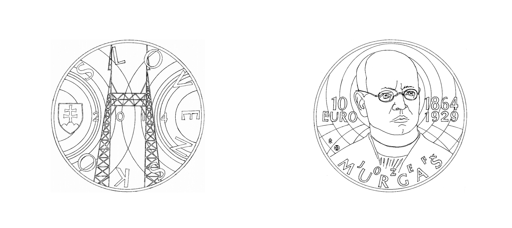

## 386

OZNÁMENIE

Národnej banky Slovenska

z 15. októbra 2013

## o vydaní strieborných zberateľských euromincí v nominálnej hodnote 10 eur pri príležitosti 150. výročia narodenia Jozefa Murgaša

1. Úvodné ustanovenia

- a) Národná banka Slovenska podľa § 17h ods. 1 zákona Národnej rady Slovenskej republiky č. 566/1992 Zb. o Národnej banke Slovenska v znení neskorších predpisov a podľa § 1 ods. 2 písm. d) zákona Národnej rady Slovenskej republiky č. 1/1993 Z. z. o Zbierke zákonov Slovenskej republiky v znení zákona č. 275/2002 Z. z. oznamuje, že pri príležitosti 150. výročia narodenia Jozefa Murgaša vydáva do obehu strieborné zberateľské euromince v nominálnej hodnote 10 eur (ďalej len „zberateľská eurominca“).

- b) Zberateľská eurominca má štatút zákonného platidla len v Slovenskej republike.

- c) Zberateľská eurominca sa razí zo zliatiny obsahujúcej 900 dielov striebra a 100 dielov medi; jej hmotnosť je 18 g a priemer 34 mm. Pri razbe zberateľskej euromince je povolená horná a dolná odchýlka v priemere 0,1 mm; povolená horná odchýlka v hmotnosti je 0,4 g a v obsahu striebra 10/1000.

2. Vzhľad zberateľskej euromince

- a) Na líci zberateľskej euromince je vyobrazený anténový stožiar signálu bezdrôtovej telegrafie vo Wilkes-Barre, ktorú Jozef Murgaš navrhol a pomocou nej uskutočnil prvé úspešné vysielanie. Anténový stožiar je kompozične doplnený vyobrazením rádiových vĺn. Pri ľavom okraji zberateľskej euromince je štátny znak Slovenskej republiky. V opise zľava doprava je názov štátu „SLOVENSKO“. Letopočet „2014“ je v strede mincového poľa.

- b) Na rube zberateľskej euromince je vyobrazený portrét Jozefa Murgaša, ktorý je kompozične doplnený líniami naznačujúcimi zemeguľu symbolizujúcu celosvetový dosah jeho vynálezov. V spodnej časti mincového poľa je v dvoch riadkoch v opise meno a priezvisko „JOZEF MURGAŠ“. Vľavo od portrétu je v dvoch riadkoch označenie nominálnej hodnoty mince „10 EURO“ a napravo od neho sú v dvoch riadkoch letopočty narodenia a úmrtia Jozefa Murgaša „1864 - 1929“. Štylizované iniciálky mena a priezviska autora výtvarného návrhu zberateľskej euromince akademického sochára Ivana Řeháka „IŘ“ a značka Mincovne Kremnica, štátny podnik, ktorú tvorí skratka „MK“ umiestnená medzi dvoma razidlami, sú pri ľavom okraji zberateľskej euromince.

- c) Na hrane zberateľskej euromince je nápis do hĺbky „• PRIEKOPNÍK BEZDRÔTOVEJ TELEGRAFIE“.

Štát vydania: Slovenská republika

Začiatok vydávania: január 2014

v z. Ján Tóth v. r.
