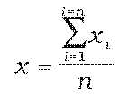
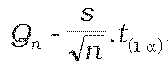
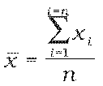
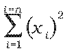
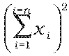
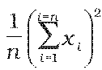
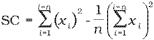
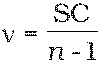
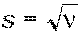

Príloha č. 2 k vyhláške č. 419/2013 Z. z.

- REFERENČNÁ METÓDA ŠTATISTICKEJ KONTROLY SKUTOČNÉHO OBSAHU VÝROBKU V SPOTREBITEĽSKÝCH BALENIACH

  - 1. Požiadavky na meranie skutočného obsahu spotrebiteľských balení

  - Skutočný obsah spotrebiteľských balení možno merať buď priamo vážením, alebo objemovými meradlami,

  - alebo ak ide o kvapaliny nepriamo, zistením hmotnosti a hustoty baleného výrobku.

    - Nezávisle od použitej metódy rozšírená kombinovaná štandardná neistota merania (k = 2) skutočného obsahu

    - spotrebiteľského balenia nesmie byť väčšia ako jedna pätina dovolenej zápornej chyby pre menovitú hmotnosť

    - alebo menovitý objem spotrebiteľského balenia.

  - 2. Požiadavky na kontrolu dávok spotrebiteľských balení

  - Kontrola je výberová a pozostáva z kontroly

    - a) skutočného obsahu každého spotrebiteľského balenia vo výbere,

    - b) pri ktorej sa zisťuje priemerný skutočný obsah spotrebiteľských balení vo výbere.

      - Dávka sa považuje za vyhovujúcu vtedy, ak výsledky obidvoch kontrol spĺňajú kritériá jej prijatia.

  - Pre každú z týchto kontrol sú možné dva varianty skúšania

    - a) nedeštruktívnou metódou, t. j. metódou bez otvorenia obalu,

    - b) deštruktívnou metódou, t. j. metódou vyžadujúcou otvorenie alebo porušenie obalu.

      - Deštruktívna metóda sa používa len vtedy, ak skúšku nemožno vykonať nedeštruktívnou metódou;

      - spravidla sa nepoužíva pri dávkach menších ako 100 kusov balení.

    - 2.1 Dávky spotrebiteľských balení

      - 2.1.1 Dávka, ktorá má byť kontrolovaná, musí obsahovať všetky spotrebiteľské balenia rovnakej menovitej

      - hmotnosti alebo menovitého objemu, toho istého typu a z toho istého výrobného cyklu, ktoré boli zabalené

      - na tom istom mieste. Veľkosť dávky je obmedzená množstvami uvedenými ďalej.

      - 2.1.2 Ak sa spotrebiteľské balenia kontrolujú na konci baliacej linky, počet balení v každej dávke sa musí

      - rovnať maximálnej hodinovej produkcii linky bez ohľadu na veľkosť dávky. V ostatných prípadoch dávka

      - môže obsahovať najviac 10 000 kusov.

      - 2.1.3 Ak je v dávke menej ako 100 kusov, pri skúške nedeštruktívnou metódou sa vykoná kontrola všetkých

      - kusov (stopercentná kontrola).

      - 2.1.4 Skôr, ako sa vykonajú skúšky uvedené v bodoch 2.2 a 2.3, je potrebné náhodne vybrať dostatočný

      - počet spotrebiteľských balení z dávky tak, aby bolo možné vykonať kontrolu, ktorá vyžaduje väčší rozsah

      - výberu. Na účely inej kontroly sa potrebný výber uskutoční náhodne z prvého výberu a balenia sa očíslujú.

      - Očíslovanie spotrebiteľských balení sa musí vykonať pred začiatkom meraní.

    - 2.2 Kontrola najmenšieho prijateľného obsahu spotrebiteľského balenia

      - Najmenší prijateľný obsah v spotrebiteľskom balení sa vypočíta odčítaním dovolenej zápornej chyby pre

      - príslušný obsah od menovitej hmotnosti alebo menovitého objemu spotrebiteľského balenia.

      - Spotrebiteľské balenia v dávke, ktorých skutočný obsah je menší ako najmenší prijateľný obsah, považujú

      - sa za chybné.

      - 2.2.1 Nedeštruktívna skúška

        - Nedeštruktívna skúška sa vykonáva podľa preberacieho plánu s dvoma výbermi uvedenými v tabuľke č. 1.

        - Počet kontrolovaných balení v prvom kroku sa musí rovnať rozsahu prvého výberu podľa preberacieho plánu.

      - Ak počet chybných kusov zistených v prvom výbere

        - a) je menší alebo sa rovná prvému kritériu prijatia, dávka sa považuje za vyhovujúcu na účely tejto kontroly,

        - b) je väčší alebo sa rovná prvému kritériu zamietnutia, dávka sa zamietne,

        - c) sa nachádza medzi prvým kritériom prijatia a prvým kritériom zamietnutia, kontroluje sa v druhom kroku

        - druhý výber, ktorého rozsah je uvedený v preberacom pláne.

      - Chybné kusy z prvého a druhého výberu sa spočítajú. Ak súčet chybných kusov je

        - a) menší alebo sa rovná druhému kritériu prijatia, dávka sa považuje za vyhovujúcu na účely tejto kontroly,

        - b) väčší alebo sa rovná druhému kritériu zamietnutia, dávka sa zamietne.

          - Dávka je vždy nevyhovujúca, ak nie je splnený predpoklad § 3 ods. 1 písm. c).

          - Tabuľka č. 1

        - Počet kusov v dávke | Výbery | | | Počet chybných kusov |

        - | Poradie, krok | Počet kusov | Súhrnný počet kusov | Kritérium prijatia | Kritérium zamietnutia

        - 100 – 500 | prvý | 30 | 30 | 1 | 3

        - | druhý | 30 | 60 | 4 | 5

        - 501 – 3 200 | prvý | 50 | 50 | 2 | 5

        - | druhý | 50 | 100 | 6 | 7

        - 3 201 a viac | prvý | 80 | 80 | 3 | 7

        - | druhý | 80 | 160 | 8 | 9

      - 2.2.2 Deštruktívna skúška

        - Deštruktívna skúška sa vykonáva podľa preberacieho plánu s jedným výberom a používa sa len pri dávke

        - 100 kusov a viac.

        - Počet kontrolovaných spotrebiteľských balení je 20.

        - Ak počet chybných kusov zistených vo výbere je menší alebo sa rovná kritériu prijatia, dávka sa považuje za

        - vyhovujúcu.

        - Ak počet chybných kusov zistených vo výbere je väčší alebo sa rovná kritériu zamietnutia, dávka sa zamietne.

        - Dávka je vždy nevyhovujúca, ak nie je splnený predpoklad § 3 ods. 1 písm. c).

      - Počet kusov v dávke | Počet kusov vo výbere | Počet chybných kusov |

      - | | Kritérium prijatia | Kritérium zamietnutia

      - akýkoľvek počet (≥ 100) | 20 | 1 | 2

    - 2.3 Kontrola priemerného skutočného obsahu jednotlivých spotrebiteľských balení v dávke

      - 2.3.1 Dávka spotrebiteľských balení sa považuje za vyhovujúcu na účely tejto kontroly, ak výberový priemer

      - 

        - skutočných obsahov xi celkového počtu n spotrebiteľských balení vo výbere je väčší ako hodnota

      - ,

        - kde znamená

        - Qn menovitá hmotnosť alebo menovitý objem obsahu spotrebiteľského balenia,

        - n počet balení vo výbere určenom na túto kontrolu,

        - s odhad smerodajnej odchýlky skutočných obsahov v dávke,

        - t(1 – ) Studentov t-faktor závislý od počtu stupňov voľnosti = n – 1 a pravdepodobnosti (1 – ) = 0,995.

      - 2.3.2 Ak xi je nameraná hodnota skutočného obsahu i-tého kusa výberu rozsahu n, potom výberový priemer

      - nameraných hodnôt sa vypočíta podľa rovnice

      - .

      - Odhad smerodajnej odchýlky s sa vypočíta takto:

        - a) suma štvorcov nameraných hodnôt:

        - ,

        - b) štvorec sumy nameraných hodnôt:

        - ,

          - potom

        - ,

        - c) korigovaný súčet:

        - ,

        - d) odhad rozptylu:

        - ,

        - Odhad smerodajnej odchýlky:

        - .

      - 2.3.3 Kritériá prijatia alebo zamietnutia dávok spotrebiteľských balení skúšaných pri tejto kontrole

        - 2.3.3.1 Kritériá nedeštruktívneho skúšania:

        - Počet kusov v dávke | Počet kusov vo výbere | Kritérium |

        - | | prijatia | zamietnutia

        - od 100 do 500 vrátane > 500 | 30 50 | x‾≥ Qn– 0,503s x‾ ≥ Qn– 0,379 s | x‾< Qn– 0,503s x‾ < Qn– 0,379s

        - 2.3.3.2 Kritériá deštruktívneho skúšania:

        - Počet kusov v dávke | Počet kusov vo výbere | Kritérium |

        - | | prijatia | zamietnutia

        - bez ohľadu na počet (≥ 100) | 20 | x‾≥ Qn– 0,640 s | x‾< Qn– 0,640s

  - 3. Kritériá porovnania účinnosti použitej kontroly vo vzťahu k referenčnej metóde

    - 3.1 Kritérium kontroly najmenšieho prijateľného obsahu spotrebiteľského balenia

      - Použitý preberací plán sa považuje za porovnateľný s preberacím plánom uvedeným v tejto prílohe vtedy, ak

      - súradnica na vodorovnej osi zodpovedajúca bodu 0,1 na zvislej osi operatívnej charakteristiky použitého

      - plánu (pravdepodobnosť prijatia dávky = 0,10) sa odlišuje o menej než 15 % od súradnice na vodorovnej osi

      - príslušného bodu operatívnej charakteristiky preberacieho plánu uvedeného v tejto prílohe.

      - 3.1.1 Kritérium kontroly priemerného skutočného obsahu jednotlivých spotrebiteľských balení v dávke

        - Použitý preberací plán sa považuje za porovnateľný s preberacím plánom uvedeným v tejto prílohe vtedy, ak

        - súradnica na vodorovnej osi zodpovedajúca bodu 0,1 na zvislej osi operatívnej charakteristiky použitého

        - plánu (pravdepodobnosť prijatia dávky = 0,10) sa odlišuje o menej než 0,05 od súradnice na vodorovnej osi

        - príslušného bodu operatívnej charakteristiky preberacieho plánu uvedeného v tejto prílohe, pričom na

        - vodorovnej osi operatívnej charakteristiky je hodnota [Qn – m]/s, kde m je skutočná stredná hodnota obsahu

        - spotrebiteľského balenia v dávke.
