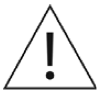

# Čl. I

Nariadenie vlády Slovenskej republiky č. 658/2005 Z. z., ktorým sa ustanovujú požiadavky na kozmetické výrobky v znení nariadenia vlády Slovenskej republiky č. 538/2006 Z. z., nariadenia vlády Slovenskej republiky č. 108/2007 Z. z., nariadenia vlády Slovenskej republiky č. 418/2007 Z. z., nariadenia vlády Slovenskej republiky č. 124/2008 Z. z., nariadenia vlády Slovenskej republiky č. 374/2008 Z. z., nariadenia vlády Slovenskej republiky č. 141/2009 Z. z., nariadenia vlády Slovenskej republiky č. 522/2009 Z. z., nariadenia vlády Slovenskej republiky č. 81/2010 Z. z., nariadenia vlády Slovenskej republiky č. 287/2010 Z. z., nariadenia vlády Slovenskej republiky č. 432/2011 Z. z. a nariadenia vlády Slovenskej republiky č. 187/2012 Z. z. sa mení a dopĺňa takto:

- 1. V § 18 sa za slovo „právne“ vkladá slovo „záväzné“ a vypúšťajú sa slová „Európskych Spoločenstiev a“.

- 2. V prílohe č. 2 sa dopĺňa referenčné číslo 1373, ktoré znie:

- „1373 N-(4-amino-2-nitrofenyl)alylamín (HC Red No. 16 **, CAS 160219-76-1) a jeho soli“.

- 3. V prílohe č. 3 časti 1 referenčné čísla 16 a 22 znejú:

- „

- Ref. číslo | Látka | O b m e d z e n i a | | | Podmienky použitia a upozornenia, ktoré musia byť uvedené na obale kozmetického výrobku

- | | Oblasťaplikácie/ použitia | Najvyššia prípustná koncentrácia v kozmetickom výrobku v hmotnostných percentách | Ďalšie obmedzenia a požiadavky |

- a | b | c | d | e | f

- 16 | 1-naftol 1-Naphtol ** CAS 90-15-3 EINEC 201-969-4 | Látka na farbenie vlasov v oxidačných výrobkoch na farbenie vlasov | | Po zmiešaní v oxidačných podmienkach najvyššia prípustná koncentrácia aplikovaná na vlasy nesmie prekročiť 2,0 % hm. | Uvedie sa zmiešavací pomer.  Farby na vlasy môžu vyvolať vážne alergické reakcie. Prečítajte si pokyny a dodržiavajte ich. Tento výrobok nie je určený pre osoby mladšie ako 16 rokov. Dočasné tetovanie čiernou henou môže zvýšiť riziko alergie. Nefarbite si vlasy, ak: – máte na tvári vyrážky alebo máte citlivú, podráždenú alebo poškodenú pokožku hlavy, – ste v minulosti zaznamenali reakciu po farbení vlasov, – ste v minulosti zaznamenali reakciu na dočasné tetovanie čiernou henou.

- 22 | Rezorcinol Resorcinol ** CAS 108-46-3 EINEC 203-585-2 | a) Látka na farbenie vlasov v oxidačných výrobkoch na farbenie vlasov 1. Všeobecné použitie 2. Profesionálne použitie | b) Vlasové lotiony a šampóny | a) Po zmiešaní v oxidačných podmienkach najvyššia prípustná koncentrácia aplikovaná na vlasy nesmie prekročiť 1,25 % hm. b) 0,5 % hm. | a) 1. Obsahuje resorcinol. Po použití vlasy dobre opláchnuť. Nepoužívať na farbenie obočia a mihalníc. Ak príde do kontaktu s očami, ihneď ich vypláchnuť vodou.  Farby na vlasy môžu vyvolať vážne alergické reakcie. Prečítajte si pokyny a dodržiavajte ich. Tento výrobok nie je určený pre osoby mladšie ako 16 rokov. Dočasné tetovanie čiernou henou môže zvýšiť riziko alergie. Nefarbite si vlasy, ak: – máte na tvári vyrážky alebo máte citlivú, podráždenú alebo poškodenú pokožku hlavy, – ste v minulosti zaznamenali reakciu po farbení vlasov, – ste v minulosti zaznamenali reakciu na dočasné tetovanie čiernou henou. Uvedie sa zmiešavací pomer. 2. Len na profesionálne použitie. Obsahuje resorcinol. Ak príde do kontaktu s očami, ihneď ich vypláchnuť vodou.  Farby na vlasy môžu vyvolať vážne alergické reakcie. Prečítajte si pokyny a dodržiavajte ich. Tento výrobok nie je určený pre osoby mladšie ako 16 rokov. Dočasné tetovanie čiernou henou môže zvýšiť riziko alergie. Nefarbite si vlasy, ak: – máte na tvári vyrážky alebo máte citlivú, podráždenú alebo poškodenú pokožku hlavy, – ste v minulosti zaznamenali reakciu po farbení vlasov, – ste v minulosti zaznamenali reakciu na dočasné tetovanie čiernou henou. Uvedie sa zmiešavací pomer. b) Obsahuje resorcinol.

- “.

- 4. V prílohe č. 3 časti 1 sa dopĺňajú referenčné čísla 253 až 278, ktoré znejú:

- „

- Ref. číslo | Látka | O b m e d z e n i a | | | Podmienky použitia a upozornenia, ktoré musia byť uvedené na obale kozmetického výrobku

- | | Oblasťaplikácie/ použitia | Najvyššia prípustná koncentrácia v kozmetickom výrobku v hmotnostných percentách | Ďalšie obmedzenia a požiadavky |

- a | b | c | d | e | f

- 253 | (4-(4-amóniofenyl) bis(2- hydroxyetyl) amónium-sulfát N,N-bis(2- -Hydroxyethyl)-p- -Phenyllenediamine Sulfate ** CAS 54381-16-7 EINEC 259-134-5 | Látka na farbenie vlasov v oxidačných výrobkoch na farbenie vlasov | | Po zmiešaní v oxidačných podmienkach najvyššia prípustná koncentrácia aplikovaná na vlasy nesmie prekročiť 2,5 % hm. vyjadrené v prepočte na sulfát. – Nepoužívať s nitrozačnými činidlami. – Najvyšší prípustný obsah nitrozamínov: 50µg/kg. – Skladovať v nádobách neobsahujúcich dusitany. |  Farby na vlasy môžu vyvolať vážne alergické reakcie. Prečítajte si pokyny a dodržiavajte ich. Tento výrobok nie je určený pre osoby mladšie ako 16 rokov. Dočasné tetovanie čiernou henou môže zvýšiť riziko alergie. Nefarbite si vlasy, ak: – máte na tvári vyrážky alebo máte citlivú, podráždenú alebo poškodenú pokožku hlavy, – ste v minulosti zaznamenali reakciu po farbení vlasov, – ste v minulosti zaznamenali reakciu na dočasné tetovanie čiernou henou. Uvedie sa zmiešavací pomer.

- 254 | 4-chlórbenzén-1,3diol 4-Chlororesorcinol ** CAS 95-88-5 EINEC 202-462-0 | Látka na farbenie vlasov v oxidačných výrobkoch na farbenie vlasov | | Po zmiešaní v oxidačných podmienkach najvyššia prípustná koncentrácia aplikovaná na vlasy nesmie prekročiť 2,5 % hm. |  Farby na vlasy môžu vyvolať vážne alergické reakcie. Prečítajte si pokyny a dodržiavajte ich. Tento výrobok nie je určený pre osoby mladšie ako 16 rokov. Dočasné tetovanie čiernou henou môže zvýšiť riziko alergie. Nefarbite si vlasy, ak: – máte na tvári vyrážky alebo máte citlivú, podráždenú alebo poškodenú pokožku hlavy, – ste v minulosti zaznamenali reakciu po farbení vlasov, – ste v minulosti zaznamenali reakciu na dočasné tetovanie čiernou henou. Uvedie sa zmiešavací pomer.

- 255 | Pyrimidíntetrayltetra-amín, soľ s kyselinou sírovou (1 : 1) Tetraaminopyrimi-dine Sulfate ** CAS 5392-28-9 EINEC 226-393-0 | a) Látka na farbenie vlasov v oxidačných výrobkoch na farbenie vlasov b) Látka na farbenie vlasov v neoxidačných výrobkoch na farbenie vlasov | b) 3,4 % hm. vyjadrené v prepočte na sulfát | a) Po zmiešaní v oxidačných podmienkach najvyššia prípustná koncentrácia aplikovaná na vlasy nesmie prekročiť 3,4 % hm. vyjadrené v prepočte na sulfát | a)  Farby na vlasy môžu vyvolať vážne alergické reakcie. Prečítajte si pokyny a dodržiavajte ich. Tento výrobok nie je určený pre osoby mladšie ako 16 rokov. Dočasné tetovanie čiernou henou môže zvýšiť riziko alergie. Nefarbite si vlasy, ak: – máte na tvári vyrážky alebo máte citlivú, podráždenú alebo poškodenú pokožku hlavy, – ste v minulosti zaznamenali reakciu po farbení vlasov, – ste v minulosti zaznamenali reakciu na dočasné tetovanie čiernou henou. Uvedie sa zmiešavací pomer.

- 256 | 3-(2-hdroxyetyl-4--fenyléndiamónium--sulfát Hydroxyethyl-p- -Phenylenediamine Sulfate ** CAS 93841-25-9 EINEC 298-995-1 | Látka na farbenie vlasov v oxidačných výrobkoch na farbenie vlasov | | Po zmiešaní v oxidačných podmienkach najvyššia prípustná koncentrácia aplikovaná na vlasy nesmie prekročiť 2,0 % hm. vyjadrené v prepočte na sulfát. |  Farby na vlasy môžu vyvolať vážne alergické reakcie. Prečítajte si pokyny a dodržiavajte ich. Tento výrobok nie je určený pre osoby mladšie ako 16 rokov. Dočasné tetovanie čiernou henou môže zvýšiť riziko alergie. Nefarbite si vlasy, ak: – máte na tvári vyrážky alebo máte citlivú, podráždenú alebo poškodenú pokožku hlavy, – ste v minulosti zaznamenali reakciu po farbení vlasov, – ste v minulosti zaznamenali reakciu na dočasné tetovanie čiernou henou. Uvedie sa zmiešavací pomer.

- 257 | Indol-5,6-diol Dihydroxyindole ** CAS 3131-52-0 EINEC 412-130-9 | a) Látka na farbenie vlasov v oxidačných výrobkoch na farbenie vlasov b) Látka na farbenie vlasov v neoxidačných výrobkoch na farbenie vlasov | b) 0,5 % hm. | a) Po zmiešaní v oxidačných podmienkach najvyššia prípustná koncentrácia aplikovaná na vlasy nesmie prekročiť 0,5 % hm. | a)  Farby na vlasy môžu vyvolať vážne alergické reakcie. Prečítajte si pokyny a dodržiavajte ich. Tento výrobok nie je určený pre osoby mladšie ako 16 rokov. Dočasné tetovanie čiernou henou môže zvýšiť riziko alergie. Nefarbite si vlasy, ak: – máte na tvári vyrážky alebo máte citlivú, podráždenú alebo poškodenú pokožku hlavy, – ste v minulosti zaznamenali reakciu po farbení vlasov, – ste v minulosti zaznamenali reakciu na dočasné tetovanie čiernou henou. Uvedie sa zmiešavací pomer. b)  Farby na vlasy môžu vyvolať vážne alergické reakcie. Prečítajte si pokyny a dodržiavajte ich. Tento výrobok nie je určený pre osoby mladšie ako 16 rokov. Dočasné tetovanie čiernou henou môže zvýšiť riziko alergie. Nefarbite si vlasy, ak: – máte na tvári vyrážky alebo máte citlivú, podráždenú alebo poškodenú pokožku hlavy, – ste v minulosti zaznamenali reakciu po farbení vlasov, – ste v minulosti zaznamenali reakciu na dočasné tetovanie čiernou henou.

- 258 | 5-amino-4-chlór- -2-metylfenol, hydrochlorid 5-Amino-4-Chloro--o-Cresol HCl ** CAS 110102-85-7 | Látka na farbenie vlasov v oxidačných výrobkoch na farbenie vlasov | | Po zmiešaní v oxidačných podmienkach najvyššia prípustná koncentrácia aplikovaná na vlasy nesmie prekročiť 1,5 % hm. v prepočte na hydrochlorid. |  Farby na vlasy môžu vyvolať vážne alergické reakcie. Prečítajte si pokyny a dodržiavajte ich. Tento výrobok nie je určený pre osoby mladšie ako 16 rokov. Dočasné tetovanie čiernou henou môže zvýšiť riziko alergie. Nefarbite si vlasy, ak: – máte na tvári vyrážky alebo máte citlivú, podráždenú alebo poškodenú pokožku hlavy, – ste v minulosti zaznamenali reakciu po farbení vlasov, – ste v minulosti zaznamenali reakciu na dočasné tetovanie čiernou henou. Uvedie sa zmiešavací pomer.

- 259 | Indol-6-ol 6-Hydroxyindole ** CAS 2380-86-1 EINEC 417-020-4 | Látka na farbenie vlasov v oxidačných výrobkoch na farbenie vlasov | | Po zmiešaní v oxidačných podmienkach najvyššia prípustná koncentrácia aplikovaná na vlasy nesmie prekročiť 0,5 % hm. |  Farby na vlasy môžu vyvolať vážne alergické reakcie. Prečítajte si pokyny a dodržiavajte ich. Tento výrobok nie je určený pre osoby mladšie ako 16 rokov. Dočasné tetovanie čiernou henou môže zvýšiť riziko alergie. Nefarbite si vlasy, ak: – máte na tvári vyrážky alebo máte citlivú, podráždenú alebo poškodenú pokožku hlavy, – ste v minulosti zaznamenali reakciu po farbení vlasov, – ste v minulosti zaznamenali reakciu na dočasné tetovanie čiernou henou. Uvedie sa zmiešavací pomer.

- 260 | Indolín-2,3-dión Isatin ** CAS 91-56-5 EINEC 202-077-8 | Látka na farbenie vlasov v neoxidačných výrobkoch na farbenie vlasov | 1,6 % hm. | |  Farby na vlasy môžu vyvolať vážne alergické reakcie. Prečítajte si pokyny a dodržiavajte ich. Tento výrobok nie je určený pre osoby mladšie ako 16 rokov. Dočasné tetovanie čiernou henou môže zvýšiť riziko alergie. Nefarbite si vlasy, ak: – máte na tvári vyrážky alebo máte citlivú, podráždenú alebo poškodenú pokožku hlavy, – ste v minulosti zaznamenali reakciu po farbení vlasov, – ste v minulosti zaznamenali reakciu na dočasné tetovanie čiernou henou.

- 261 | 2-aminopyridín-3--ol -2-Amino-3- Hydroxypyridine ** CAS 16867-03-1 EINEC 240-886-8 | Látka na farbenie vlasov v oxidačných výrobkoch na farbenie vlasov | | Po zmiešaní v oxidačných podmienkach najvyššia prípustná koncentrácia aplikovaná na vlasy nesmie prekročiť 1,0 % hm. |  Farby na vlasy môžu vyvolať vážne alergické reakcie. Prečítajte si pokyny a dodržiavajte ich. Tento výrobok nie je určený pre osoby mladšie ako 16 rokov. Dočasné tetovanie čiernou henou môže zvýšiť riziko alergie. Nefarbite si vlasy, ak: – máte na tvári vyrážky alebo máte citlivú, podráždenú alebo poškodenú pokožku hlavy, – ste v minulosti zaznamenali reakciu po farbení vlasov, – ste v minulosti zaznamenali reakciu na dočasné tetovanie čiernou henou. Uvedie sa zmiešavací pomer.

- 262 | (2-metyl-1-naftyl)--acetát 1-Acetoxy-2- -Methylnaphthalene ** CAS 5697-02-9 EINEC 454-690-7 | Látka na farbenie vlasov v oxidačných výrobkoch na farbenie vlasov | | Po zmiešaní v oxidačných podmienkach najvyššia prípustná koncentrácia aplikovaná na vlasy nesmie prekročiť 2,0 % hm. Ak výrobok na farbenie vlasov obsahuje 2-Methyl-1- naphtol a 1-Acetoxy-2- methylnaphtalene, potom najvyššia prípustná koncentrácia 2- Methyl-1-naphtolu aplikovaná na vlasy nesmie prekročiť 2,0% hm. |  Farby na vlasy môžu vyvolať vážne alergické reakcie. Prečítajte si pokyny a dodržiavajte ich. Tento výrobok nie je určený pre osoby mladšie ako 16 rokov. Dočasné tetovanie čiernou henou môže zvýšiť riziko alergie. Nefarbite si vlasy, ak: – máte na tvári vyrážky alebo máte citlivú, podráždenú alebo poškodenú pokožku hlavy, – ste v minulosti zaznamenali reakciu po farbení vlasov, – ste v minulosti zaznamenali reakciu na dočasné tetovanie čiernou henou. Uvedie sa zmiešavací pomer.

- 263 | 2-metyl-1-naftol 2-Methyl-1- -Naphthol ** CAS 7469-77-4 EINEC 231-265-2 | Látka na farbenie vlasov v oxidačných výrobkoch na farbenie vlasov | | Po zmiešaní v oxidačných podmienkach najvyššia prípustná koncentrácia aplikovaná na vlasy nesmie prekročiť 2,0 % hm. Ak výrobok na farbenie vlasov obsahuje 2-Methyl-1- naphtol a 1-Acetoxy-2- methylnaphtalene, potom najvyššia prípustná koncentrácia 2-Methyl-1- naphtolu aplikovaná na vlasy nesmie prekročiť 2,0 % hm. |  Farby na vlasy môžu vyvolať vážne alergické reakcie. Prečítajte si pokyny a dodržiavajte ich. Tento výrobok nie je určený pre osoby mladšie ako 16 rokov. Dočasné tetovanie čiernou henou môže zvýšiť riziko alergie. Nefarbite si vlasy, ak: – máte na tvári vyrážky alebo máte citlivú, podráždenú alebo poškodenú pokožku hlavy, – ste v minulosti zaznamenali reakciu po farbení vlasov, – ste v minulosti zaznamenali reakciu na dočasné tetovanie čiernou henou. Uvedie sa zmiešavací pomer.

- 264 | Dinátrium-5,7- -dinitro-8- -oxidonaftalén-2- -sulfonát Acid Yellow 1** CAS 846-70-8 EINEC 212-690-2 CI 10316 | a) Látka na farbenie vlasov v oxidačných výrobkoch na farbenie vlasov b) Látka na farbenie vlasov v neoxidačných výrobkoch na farbenie vlasov | b) 0,2 % hm. | a) Po zmiešaní v oxidačných podmienkach najvyššia prípustná koncentrácia aplikovaná na vlasy nesmie prekročiť 1,0 % hm. | a)  Farby na vlasy môžu vyvolať vážne alergické reakcie. Prečítajte si pokyny a dodržiavajte ich. Tento výrobok nie je určený pre osoby mladšie ako 16 rokov. Dočasné tetovanie čiernou henou môže zvýšiť riziko alergie. Nefarbite si vlasy, ak: – máte na tvári vyrážky alebo máte citlivú, podráždenú alebo poškodenú pokožku hlavy, – ste v minulosti zaznamenali reakciu po farbení vlasov, – ste v minulosti zaznamenali reakciu na dočasné tetovanie čiernou henou. Uvedie sa zmiešavací pomer. b)  Farby na vlasy môžu vyvolať vážne alergické reakcie. Prečítajte si pokyny a dodržiavajte ich. Tento výrobok nie je určený pre osoby mladšie ako 16 rokov. Dočasné tetovanie čiernou henou môže zvýšiť riziko alergie. Nefarbite si vlasy, ak: – máte na tvári vyrážky alebo máte citlivú, podráždenú alebo poškodenú pokožku hlavy, – ste v minulosti zaznamenali reakciu po farbení vlasov, – ste v minulosti zaznamenali reakciu na dočasné tetovanie čiernou henou.

- 265 | 4-nitrobenzén-1,2-diamín 4-Nitro-o- -Phenylenediamine ** CAS 99-56-9 EINEC 202-766-3 | Látka na farbenie vlasov v oxidačných výrobkoch na farbenie vlasov | | Po zmiešaní v oxidačných podmienkach najvyššia prípustná koncentrácia aplikovaná na vlasy nesmie prekročiť 0,5 % hm. |  Farby na vlasy môžu vyvolať vážne alergické reakcie. Prečítajte si pokyny a dodržiavajte ich. Tento výrobok nie je určený pre osoby mladšie ako 16 rokov. Dočasné tetovanie čiernou henou môže zvýšiť riziko alergie. Nefarbite si vlasy, ak: – máte na tvári vyrážky alebo máte citlivú, podráždenú alebo poškodenú pokožku hlavy, – ste v minulosti zaznamenali reakciu po farbení vlasov, – ste v minulosti zaznamenali reakciu na dočasné tetovanie čiernou henou. Uvedie sa zmiešavací pomer.

- 266 | 2-(4-amino-3- -nitroanilino) etanol HC Red No. 7 ** CAS 24905-87-1 EINEC 246-521-9 | Látka na farbenie vlasov v neoxidačných výrobkoch na farbenie vlasov | 0,1 % hm. | – Nepoužívať s nitrozačnými činidlami. – Najvyšší prípustný obsah nitrozamínov: 50µg/kg. Skladovať v nádobách neobsahujúcich dusitany. |  Farby na vlasy môžu vyvolať vážne alergické reakcie. Prečítajte si pokyny a dodržiavajte ich. Tento výrobok nie je určený pre osoby mladšie ako 16 rokov. Dočasné tetovanie čiernou henou môže zvýšiť riziko alergie. Nefarbite si vlasy, ak: – máte na tvári vyrážky alebo máte citlivú, podráždenú alebo poškodenú pokožku hlavy, – ste v minulosti zaznamenali reakciu po farbení vlasov, – ste v minulosti zaznamenali reakciu na dočasné tetovanie čiernou henou.

- 267 | 2-{[2-(2- -hydroxyetoxy)-4- -nitrofenyl]amino}etanol HC Yellow No. 4 ** CAS 59820-43-8 EINEC 428-840-7 | Látka na farbenie vlasov v neoxidačných výrobkoch na farbenie vlasov | 1,5 % hm. | – Nepoužívať s nitrozačnými činidlami. – Najvyšší prípustný obsah nitrozamínov: 50µg/kg. Skladovať v nádobách neobsahujúcich dusitany. |

- 268 | 2-[(2-nitrofenyl) amino]etanol HC Yellow No. 2 ** CAS 4926-55-0 EINEC 225-555-8 | a) Látka na farbenie vlasov v oxidačných výrobkoch na farbenie vlasov b) Látka na farbenie vlasov v oxidačných výrobkoch na farbenie vlasov | b) 1,0 % hm. | a) Po zmiešaní v oxidačných podmienkach najvyššia prípustná koncentrácia aplikovaná na vlasy nesmie prekročiť 0,75 % hm. a) a b) – Nepoužívať s nitrozačnými činidlami. – Najvyšší prípustný obsah nitrozamínov: 50µg/kg. Skladovať v nádobách neobsahujúcich dusitany. |  Farby na vlasy môžu vyvolať vážne alergické reakcie. Prečítajte si pokyny a dodržiavajte ich. Tento výrobok nie je určený pre osoby mladšie ako 16 rokov. Dočasné tetovanie čiernou henou môže zvýšiť riziko alergie. Nefarbite si vlasy, ak: – máte na tvári vyrážky alebo máte citlivú, podráždenú alebo poškodenú pokožku hlavy, – ste v minulosti zaznamenali reakciu po farbení vlasov, – ste v minulosti zaznamenali reakciu na dočasné tetovanie čiernou henou. Uvedie sa zmiešavací pomer.

- 269 | 4-[(2-nitrofenyl) amino]fenol HC Orange No. 1 ** CAS 54381-08-7 EINEC 259-132-4 | Látka na farbenie vlasov v neoxidačných výrobkoch na farbenie vlasov | 1,0% hm. | |

- 270 | N-fenyl-2- -nitrobenzén-1,4- -diamín HC Red No. 1 ** CAS 2784-89-6 EINEC 220-494-3 | Látka na farbenie vlasov v neoxidačných výrobkoch na farbenie vlasov | 1,0 % hm. | |  Farby na vlasy môžu vyvolať vážne alergické reakcie. Prečítajte si pokyny a dodržiavajte ich. Tento výrobok nie je určený pre osoby mladšie ako 16 rokov. Dočasné tetovanie čiernou henou môže zvýšiť riziko alergie. Nefarbite si vlasy, ak: – máte na tvári vyrážky alebo máte citlivú, podráždenú alebo poškodenú pokožku hlavy, – ste v minulosti zaznamenali reakciu po farbení vlasov, – ste v minulosti zaznamenali reakciu na dočasné tetovanie čiernou henou.

- 271 | 2-(5-metoxy-2- -nitrofenyl) etánamín, hydrochlorid HC Yellow No. 9 ** CAS 86419-69-4 EINEC 415-480-1 | Látka na farbenie vlasov v neoxidačných výrobkoch na farbenie vlasov | 0,5 % hm. vyjadrené v prepočte na hydrochlorid | Nepoužívať s nitrozačnými činidlami. – Najvyšší prípustný obsah nitrozamínov: 50µg/kg. Skladovať v nádobách neobsahujúcich dusitany. |

- 272 | N-[4-(4- -aminofenyldiazenyl)-3- metylfenyl]- -2,2’-iminodietanol HC Yellow No. 7 ** CAS 104226-21-3 EINEC 146-420-6 | Látka na farbenie vlasov v neoxidačných výrobkoch na farbenie vlasov | 0,25 % hm. | |

- 273 | 2-{[2-nitro-4- -(trifluórmetyl) fenyl]amino} etanol HC Yellow No. 13 ** CAS 10442-83-8 EINEC 443-760-2 | a) Látka na farbenie vlasov v oxidačných výrobkoch na farbenie vlasov b) Látka na farbenie vlasov v neoxidačných výrobkoch na farbenie vlasov | b) 2,5 % hm. | a) Po zmiešaní v oxidačných podmienkach najvyššia prípustná koncentrácia aplikovaná na vlasy nesmie prekročiť 2,5 % hm. a) a b) – Nepoužívať s nitrozačnými činidlami. – Najvyšší prípustný obsah nitrozamínov: 50µg/kg. Skladovať v nádobách neobsahujúcich dusitany. | a)  Farby na vlasy môžu vyvolať vážne alergické reakcie. Prečítajte si pokyny a dodržiavajte ich. Tento výrobok nie je určený pre osoby mladšie ako 16 rokov. Dočasné tetovanie čiernou henou môže zvýšiť riziko alergie. Nefarbite si vlasy, ak: – máte na tvári vyrážky alebo máte citlivú, podráždenú alebo poškodenú pokožku hlavy, – ste v minulosti zaznamenali reakciu po farbení vlasov, – ste v minulosti zaznamenali reakciu na dočasné tetovanie čiernou henou. Uvedie sa zmiešavací pomer.

- 274 | 3-[(1-fenyl-3- -metyl-5-oxo-4,5- -dihydro-1H- -pyrazol-4-yl) diazenyl]-N,N,N- -trimetylanilínium--chlorid Basic Yellow 57 ** CAS 68391-31-1 EINEC 269-943-5 | Látka na farbenie vlasov v neoxidačných výrobkoch na farbenie vlasov | 2,0 % hm. | |

- 275 | 2,2’-[[4-[(4- -aminofenyl) diazenyl]fenyl] imino]bisetanol Disperse Black 9 ** CAS 20721-50-0 EINEC 243-987-5 | Látka na farbenie vlasov v neoxidačných výrobkoch na farbenie vlasov | 0,3 % hm. zmes 2,2´-[4-4- aminofenyl) diazenyl]fenyl [imino]dietanolu a lignofosfátu v pomere 1 : 1 | |

- 276 | 1,4-bis(2,3- -dihydroxypropylamino) antracén-9,10- -dión HC Blue No. 14 ** CAS 99788-75-7 EINEC 421-470-7 | Látka na farbenie vlasov v neoxidačných výrobkoch na farbenie vlasov | 0,3 % hm. | – Nepoužívať s nitrozačnými činidlami. – Najvyšší prípustný obsah nitrozamínov: 50µg/kg. Skladovať v nádobách neobsahujúcich dusitany. |

- 277 | 2-[(4-metyl-2-nitro-fenyl)amino]etanol Hydroxyethyl-2- Nitro-p-Toluidine ** CAS 100418-33-5 EINEC 408-090-7 | a) Látka na farbenie vlasov v oxidačných výrobkoch na farbenie vlasov b) Látka na farbenie vlasov v neoxidačných výrobkoch na farbenie vlasov | b) 1,0 % hm. | a) Po zmiešaní v oxidačných podmienkach najvyššia prípustná koncentrácia aplikovaná na vlasy nesmie prekročiť 1,0 % hm. a) a b) – Nepoužívať s nitrozačnými činidlami. – Najvyšší prípustný obsah nitrozamínov: 50µg/kg. Skladovať v nádobách neobsahujúcich dusitany. | a)  Farby na vlasy môžu vyvolať vážne alergické reakcie. Prečítajte si pokyny a dodržiavajte ich. Tento výrobok nie je určený pre osoby mladšie ako 16 rokov. Dočasné tetovanie čiernou henou môže zvýšiť riziko alergie. Nefarbite si vlasy, ak: – máte na tvári vyrážky alebo máte citlivú, podráždenú alebo poškodenú pokožku hlavy, – ste v minulosti zaznamenali reakciu po farbení vlasov, – ste v minulosti zaznamenali reakciu na dočasné tetovanie čiernou henou. Uvedie sa zmiešavací pomer.

- 278 | N1-(2,3--dihydroxypropyl)--2-chlór-5- -nitrobenzén- -1,4-diamín + N1,N4-bis(2,3--dihydroxypropyl)--2-chlór-5- -nitrobenzén-1,4- -diamín HC Red No. 10 + HC Red No. 11 ** CAS 95576-89-9 + 95576-92- 4 | a) Látka na farbenie vlasov v oxidačných výrobkoch na farbenie vlasov b) Látka na farbenie vlasov v neoxidačných výrobkoch na farbenie vlasov | b) 2,0 % hm. | a) Po zmiešaní v oxidačných podmienkach najvyššia prípustná koncentrácia aplikovaná na vlasy nesmie prekročiť 1,0 % hm. a) a b) – Nepoužívať s nitrozačnými činidlami. – Najvyšší prípustný obsah nitrozamínov: 50µg/kg. Skladovať v nádobách neobsahujúcich dusitany. | a)  Farby na vlasy môžu vyvolať vážne alergické reakcie. Prečítajte si pokyny a dodržiavajte ich. Tento výrobok nie je určený pre osoby mladšie ako 16 rokov. Dočasné tetovanie čiernou henou môže zvýšiť riziko alergie. Nefarbite si vlasy, ak: – máte na tvári vyrážky alebo máte citlivú, podráždenú alebo poškodenú pokožku hlavy, – ste v minulosti zaznamenali reakciu po farbení vlasov, – ste v minulosti zaznamenali reakciu na dočasné tetovanie čiernou henou. Uvedie sa zmiešavací pomer.

- “.

- 5. V prílohe č. 3 časti 2 sa vypúšťajú referenčné čísla 10 a 50.

- 6. V prílohe č. 17 sa v názve za slovo „právne“ vkladá slovo „záväzné“ a vypúšťajú sa slová „Európskych spoločenstiev a“.

- 7. V prílohe č. 17 prvý bod znie:

- „Smernica Rady 76/768/EHS z 27. júla 1976 o aproximácii právnych predpisov členských štátov týkajúcich sa kozmetických výrobkov (Mimoriadne vydanie Ú. v. EÚ, kap. 13/zv. 3).“.

- 8. Príloha č. 17 sa dopĺňa bodom 75, ktorý znie:

- „75. Vykonávacia smernica Komisie 2012/21/EÚ z 2. augusta 2012, ktorou sa mení a dopĺňa smernica Rady 76/768/EHS o kozmetických výrobkoch s cieľom prispôsobiť jej prílohy II a III technickému pokroku (Ú. v. EÚ L 208, 3. 8. 2012).“.
