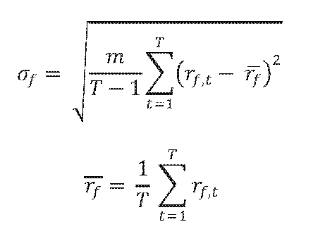
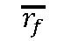

Príloha č. 2 k opatreniu č. 15/2014 Z. z.

- VÝPOČET SYNTETICKÉHO UKAZOVATEĽA RIZIKA

  - Výpočet syntetického ukazovateľa rizika

  - 1. Syntetický ukazovateľ rizika sa vypočíta na základe volatility výnosu príspevkového doplnkového dôchodkového fondu použitím týždenných výnosov príspevkového doplnkového dôchodkového fondu za obdobie posledných desať rokov, ak od zavedenia doplnkovej dôchodkovej jednotky a od vzniku príspevkového doplnkového dôchodkového fondu uplynulo aspoň desať rokov. Ak od zavedenia doplnkovej dôchodkovej jednotky alebo od vzniku príspevkového doplnkového dôchodkového fondu uplynulo menej ako desať rokov, použijú sa na výpočet volatility výnosu príspevkového doplnkového dôchodkového fondu výnosy príspevkového doplnkového dôchodkového fondu dostupné od vzniku príspevkového doplnkového dôchodkového fondu, najskôr však od zavedenia doplnkovej dôchodkovej jednotky. Volatilita výnosu príspevkového doplnkového dôchodkového fondu sa prepočíta na ročnú bázu a na základe tohto prepočtu sa príspevkový doplnkový dôchodkový fond priradí do príslušnej triedy rizika od 1 do 7. Syntetický ukazovateľ rizík sa aktualizuje, ak sa volatilita výnosu príspevkového doplnkového dôchodkového fondu dostane mimo aktuálnej kategórie v každom výpočte za posledné štyri mesiace. Ak sa volatilita výnosu príspevkového doplnkového dôchodkového fondu dostane do viac ako jednej kategórie odlišnej od aktuálnej kategórie, na aktualizáciu syntetického ukazovateľa rizík sa použije tá kategória, ktorej početnosť počas uplynulých štyroch mesiacov je najvyššia.

  - 2. Na výpočet volatility výnosu príspevkového doplnkového dôchodkového fondu pre potreby zaradenia príspevkového doplnkového dôchodkového fondu do príslušnej triedy rizika sa použijú tieto vzorce:

- 

- σf = volatilita výnosu príspevkového doplnkového dôchodkového fondu na ročnej báze

- = aritmetický priemer týždenných výnosov príspevkového doplnkového dôchodkového fondu za sledované obdobie

- rf,t = týždenné výnosy fondu v čase t merané v priebehu T období

- m = 52 (52 týždňov v roku)

- T = počet týždňov v sledovanom období

  - 3. Príspevkový doplnkový dôchodkový fond sa zaradí na základe vypočítanej volatility výnosu príspevkového doplnkového dôchodkového fondu do príslušnej triedy rizika podľa tejto tabuľky:

- Trieda rizík | Intervaly volatility (σf) |

- | rovnajúce sa alebo väčšie ako | menšie ako

- 1 | 0 % | 0,5 %

- 2 | 0,5 % | 2 %

- 3 | 2 % | 5 %

- 4 | 5 % | 10 %

- 5 | 10 % | 15 %

- 6 | 15 % | 25 %

- 7 | 25 % |

  - 4. Syntetický ukazovateľ rizika sa uvádza ako rad kategórií vo vzostupnom poradí od 1 do 7 zľava doprava, pričom tieto označujú rizikovosť a výnosnosť od najnižšej po najvyššiu. Na stupnici sa jasne uvedie, že nižšie riziko potenciálne znamená nižšiu výnosnosť a vyššie riziko potenciálne znamená vyššiu výnosnosť. Na rozlišovanie medzi jednotlivými kategóriami sa nepoužijú žiadne farby.
