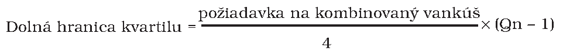
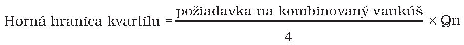

# Čl. I

Zákon č. 483/2001 Z. z. o bankách a o zmene a doplnení niektorých zákonov v znení zákona č. 430/2002 Z. z., zákona č. 510/2002 Z. z., zákona č. 165/2003 Z. z., zákona č. 603/2003 Z. z., zákona č. 215/2004 Z. z., zákona č. 554/2004 Z. z., zákona č. 747/2004 Z. z., zákona č. 69/2005 Z. z., zákona č. 340/2005 Z. z., zákona č. 341/2005 Z. z., zákona č. 214/2006 Z. z., zákona č. 644/2006 Z. z., zákona č. 209/2007 Z. z., zákona č. 659/2007 Z. z., zákona č. 297/2008 Z. z., zákona č. 552/2008 Z. z., zákona č. 66/2009 Z. z., zákona č. 186/2009 Z. z., zákona č. 276/2009 Z. z., zákona č. 492/2009 Z. z., zákona č. 129/2010 Z. z., zákona č. 46/2011 Z. z., zákona č. 130/2011 Z. z., zákona č. 314/2011 Z. z., zákona č. 394/2011 Z. z., zákona č. 520/2011 Z. z., zákona č. 547/2011 Z. z., zákona č. 234/2012 Z. z., zákona č. 352/2012 Z. z., zákona č. 132/2013 Z. z. a zákona č. 352/2013 Z. z. sa mení a dopĺňa takto:

- 1. V § 2 odsek 1 znie:

- „(1)

- Banka je právnická osoba so sídlom na území Slovenskej republiky založená ako akciová spoločnosť,1) ktorá je úverovou inštitúciou podľa osobitného predpisu1ab) a ktorá má bankové povolenie. Iná právna forma banky sa zakazuje.“.

- Poznámka pod čiarou k odkazu 1ab znie:

- „1ab)

- Čl. 4 ods. 1 bod 1 nariadenia Európskeho parlamentu a Rady (EÚ) č. 575/2013 z 26. júna 2013 o prudenciálnych požiadavkách na úverové inštitúcie a investičné spoločnosti a o zmene nariadenia (EÚ) č. 648/2012 (Ú. v. EÚ L 176, 27. 6. 2013).“.

- 2. V § 2 ods. 2 uvádzacej vete sa slová „činností uvedených v odseku 1“ nahrádzajú slovami „prijímania vkladov a poskytovania úverov“ a za slovo „ďalšie“ sa vkladá slovo „bankové“.

- 3. V § 2 odsek 3 znie:

- „(3)

- Bankové povolenie je povolenie podľa osobitného predpisu5a) vydané na vykonávanie bankových činností uvedených v odseku 2 v rozsahu a za podmienok uložených týmto povolením alebo ustanovených týmto zákonom a osobitnými predpismi.5b)“.

- Poznámky pod čiarou k odkazom 5a a 5b znejú:

- „5a)

- Čl. 4 ods. 1 bod 42 nariadenia (EÚ) č. 575/2013.

- 5b)

- Napríklad § 12 až 34 zákona č. 747/2004 Z. z. v znení neskorších predpisov.“.

- 4. V § 2 ods. 5 sa slová „odsekoch 1 a 2 (ďalej len „bankové činnosti“)“ nahrádzajú slovami „odseku 2“.

- 5. V § 2 odseky 7 a 8 znejú:

- „(7)

- Zahraničná banka je úverová inštitúcia podľa osobitného predpisu,1ab) ktorá je právnickou osobou so sídlom mimo územia Slovenskej republiky, ktorá vykonáva bankové činnosti a ktorá má oprávnenie na výkon týchto činností udelené v štáte, v ktorom má sídlo.

- (8)

- Pobočka zahraničnej banky je pobočka podľa osobitného predpisu,6a) ktorá je organizačnou zložkou zahraničnej banky umiestnenou na území Slovenskej republiky,7) ktorá priamo vykonáva najmä prijímanie vkladov a poskytovanie úverov; všetky pobočky zahraničnej banky zriadené v Slovenskej republike touto zahraničnou bankou so sídlom v členskom štáte Európskej únie alebo inom zmluvnom štáte Európskeho hospodárskeho priestoru (ďalej len „členský štát“) sa považujú z hľadiska oprávnenia vykonávať bankové činnosti za jednu jej pobočku.“.

- Poznámka pod čiarou k odkazu 6a znie:

- „6a)

- Čl. 4 ods. 1 bod 17 nariadenia (EÚ) č. 575/2013.“.

- 6. V § 5 písmená a) až c) znejú:

- „a)

- vkladom zverené peňažné prostriedky alebo iné návratné peňažné prostriedky od verejnosti, ktoré predstavujú záväzok voči vkladateľovi na ich výplatu,

- b)

- úverom dočasné poskytnutie peňažných prostriedkov na vlastný účet alebo dočasné poskytnutie peňažných prostriedkov v akejkoľvek forme vrátane faktoringu a forfajtingu,

- c)

- pobočkou banky pobočka podľa osobitného predpisu6a) umiestnená na území Slovenskej republiky alebo mimo územia Slovenskej republiky, ktorá priamo vykonáva najmä prijímanie vkladov a poskytovanie úverov,“.

- 7. V § 5 písmeno p) znie:

- „p)

- dobrovoľnými platbami dôchodkového zabezpečenia na účely zavádzania a uplatňovania zásad odmeňovania dobrovoľné platby podľa osobitného predpisu,13ba)“.

- Poznámka pod čiarou k odkazu 13ba znie:

- „13ba)

- Čl. 4 ods. 1 bod 73 nariadenia (EÚ) č. 575/2013.“.

- 8. § 5 sa dopĺňa písmenami t) až ac), ktoré znejú:

- „t)

- subjektom finančného sektora subjekt finančného sektora podľa osobitného predpisu,13e)

- u)

- regulovaným trhom regulovaný trh podľa osobitného predpisu,13f)

- v)

- finančnou pákou finančná páka podľa osobitného predpisu,13g)

- w)

- príslušným orgánom dohľadu príslušný orgán podľa osobitného predpisu,13h)

- x)

- externou ratingovou agentúrou externá ratingová agentúra podľa osobitného predpisu,13i)

- y)

- centrálnou bankou centrálna banka podľa osobitného predpisu,13j)

- z)

- inštitúciou inštitúcia podľa osobitného predpisu,13k)

- aa) sekuritizáciou sekuritizácia podľa osobitného predpisu,13l)

- ab) finančnou inštitúciou finančná inštitúcia podľa osobitného predpisu,13m)

- ac) malou alebo stredne veľkou právnickou osobou právnická osoba, ktorej ročný obrat nepresahuje 50 000 000 eur.“.

- Poznámky pod čiarou k odkazom 13e až 13m znejú:

- „13e)

- Čl. 4 ods. 1 bod 27 nariadenia (EÚ) č. 575/2013.

- 13f)

- Čl. 4 ods. 1 bod 92 nariadenia (EÚ) č. 575/2013.

- § 3 ods. 1 zákona č. 429/2002 Z. z. v znení zákona č. 209/2007 Z. z.

- 13g)

- Čl. 4 ods. 1 bod 93 nariadenia (EÚ) č. 575/2013.

- 13h)

- Čl. 4 ods. 1 bod 40 nariadenia (EÚ) č. 575/2013.

- 13i)

- Čl. 4 ods. 1 bod 98 nariadenia (EÚ) č. 575/2013.

- Zákon Národnej rady Slovenskej republiky č. 566/1992 Zb. v znení neskorších predpisov.

- 13j)

- Čl. 4 ods. 1 bod 45 a 46 nariadenia (EÚ) č. 575/2013.

- 13k)

- Čl. 4 ods. 1 bod 3 nariadenia (EÚ) č. 575/2013.

- 13l)

- Čl. 4 ods. 1 bod 61 nariadenia (EÚ) č. 575/2013.

- 13m)

- Čl. 4 ods. 1 bod 26 nariadenia (EÚ) č. 575/2013.

- § 49 ods. 5 písm. c) a d) zákona č. 8/2008 Z. z. o poisťovníctve a o zmene a doplnení niektorých zákonov.

- Zákon č. 492/2009 Z. z. v znení neskorších predpisov.“.

- 9. § 6 znie:

- 㤠6

- (1)

- Činnosť bánk a pobočiek zahraničných bánk podlieha dohľadu vykonávanému Národnou bankou Slovenska;8) v rozsahu ustanovenom týmto zákonom podlieha dohľadu aj činnosť iných osôb a subjektov súvisiaca s činnosťou alebo riadením bánk alebo pobočiek zahraničných bánk. Dohľad sa vykonáva v rozsahu ustanovenom týmto zákonom nad jednotlivými bankami, pobočkami zahraničných bánk alebo inými subjektmi a tiež nad konsolidovanými celkami, ktorých súčasťou sú aj banky, a nad finančnými konglomerátmi podľa § 49c.

- (2)

- Národná banka Slovenska pri výkone dohľadu nad bankou alebo pobočkou zahraničnej banky najmä preskúmava a hodnotí organizáciu riadenia, rozdelenie zodpovednosti, prijaté stratégie, zavedené systémy a postupy pri výkone povolených bankových činností, informačné toky a riziká, ktorým banka alebo pobočka zahraničnej banky je alebo môže byť vystavená, pričom súčasne overuje ich dostatočné krytie vlastnými zdrojmi podľa § 29 ods. 3. Národná banka Slovenska vykoná aspoň raz za kalendárny rok preskúmanie a hodnotenie primerane k povahe a rozsahu vykonávaných bankových činností. Na základe vykonávaného dohľadu Národná banka Slovenska posúdi, či organizácia riadenia banky alebo pobočky zahraničnej banky, prijaté stratégie, zavedené systémy a postupy pri výkone povolených bankových činností a vlastné zdroje zodpovedajú obozretnému riadeniu banky alebo pobočky zahraničnej banky, a súčasne posúdi dostatočnosť krytia rizík vlastnými zdrojmi. Národná banka Slovenska na základe tohto posúdenia oznámi banke, či jej vlastné zdroje sú dostatočné na krytie rizík; ak vlastné zdroje nie sú dostatočné na krytie rizík, Národná banka Slovenska v oznámení uvedie výšku vlastných zdrojov potrebných na krytie rizík. Národná banka Slovenska pri výkone dohľadu zohľadňuje možný vplyv svojich rozhodnutí na stabilitu finančného systému, a to najmä v kritických situáciách podľa § 48 ods. 8 písm. c). Ak Národná banka Slovenska zistí na základe vykonaného preskúmania, že banka alebo pobočka zahraničnej banky môže predstavovať systémové riziko, bezodkladne informuje o výsledkoch tohto preskúmania Európsky orgán dohľadu (Európsky orgán pre bankovníctvo).13o)

- (3)

- Predmetom dohľadu nie je rozhodovanie sporov zo zmluvných vzťahov bánk alebo pobočiek zahraničných bánk a ich klientov, na ktorých prejednávanie a rozhodovanie sú príslušné súdy alebo iné orgány podľa osobitných predpisov.14)

- (4)

- Dohľad na konsolidovanom základe nenahrádza dohľad nad jednotlivými osobami zahrnutými do konsolidovaného celku a nenahrádza sa ním výkon dohľadu nad jednotlivými bankami a pobočkami zahraničných bánk podľa tohto zákona ani dohľad podľa osobitných predpisov.15)

- (5)

- Doplňujúci dohľad nad finančnými konglomerátmi nenahrádza dohľad na konsolidovanom základe, dohľad nad jednotlivými osobami zahrnutými do konsolidovaného celku, dohľad nad jednotlivými osobami zahrnutými do finančného konglomerátu, dohľad nad jednotlivými bankami a pobočkami zahraničných bánk podľa tohto zákona ani dohľad podľa osobitných predpisov.15)

- (6)

- Výkon dohľadu na konsolidovanom základe alebo výkon doplňujúceho dohľadu nad finančnými konglomerátmi nezakladá povinnosť Národnej banky Slovenska vykonávať dohľad nad jednotlivými osobami zahrnutými do konsolidovaného celku alebo finančného konglomerátu, ktoré nepodliehajú dohľadu vykonávanému Národnou bankou Slovenska.

- (7)

- Banka a pobočka zahraničnej banky sú povinné umožniť účasť osôb poverených výkonom dohľadu na rokovaní valného zhromaždenia banky, dozornej rady banky, štatutárneho orgánu banky alebo vedenia pobočky zahraničnej banky.

- (8)

- Za výkon dohľadu zodpovedá Národná banka Slovenska. Osoby, ktoré v mene Národnej banky Slovenska vykonávajú dohľad, nezodpovedajú tretím osobám za dôsledky spôsobené výkonom dohľadu; tým nie je dotknutá ich zodpovednosť podľa trestnoprávnych predpisov ani ich zodpovednosť voči Národnej banke Slovenska podľa pracovnoprávnych predpisov.

- (9)

- Ak Národná banka Slovenska pri výkone dohľadu zistí skutočnosti nasvedčujúce tomu, že bol spáchaný trestný čin, bezodkladne to oznámi príslušnému orgánu činnému v trestnom konaní.

- (10)

- Orgán dohľadu iného štátu môže vykonávať dohľad na území Slovenskej republiky nad činnosťou pobočky zahraničnej banky a nad dcérskou spoločnosťou zahraničnej banky, ktorá je bankou, len na základe dohody uzavretej medzi Národnou bankou Slovenska a orgánom dohľadu iného štátu alebo v súlade s týmto zákonom; takú dohodu môže Národná banka Slovenska uzavrieť len na základe vzájomnosti. Vykonanie dohľadu na mieste na území Slovenskej republiky je orgán dohľadu iného štátu povinný vopred oznámiť Národnej banke Slovenska. Poverené osoby orgánu dohľadu iného štátu majú pri vykonávaní tohto dohľadu rovnaké oprávnenia, povinnosti a zodpovednosť ako zamestnanci Národnej banky Slovenska poverení výkonom dohľadu na mieste podľa osobitného predpisu;15a) nemajú však povinnosť vyhotoviť písomný protokol o nimi vykonanom dohľade a povinnosť určiť a písomne oznámiť dohliadanému subjektu lehoty na prijatie a splnenie opatrení na odstránenie nedostatkov zistených pri dohľade.

- (11)

- Národná banka Slovenska môže vykonávať dohľad nad pobočkami bánk, ktoré pôsobia na území iného štátu a nad dcérskou spoločnosťou banky, ktorá je bankou na území iného štátu, ak to pripúšťajú právne predpisy tohto štátu a dohoda uzavretá medzi Národnou bankou Slovenska a orgánmi dohľadu tohto štátu. Na dcérsku spoločnosť banky podľa prvej vety sa nevzťahujú ustanovenia § 23, 23a, 23b, 23e, 24, 25 a 27, ak materská banka v Európskej únii alebo banka kontrolovaná materskou finančnou holdingovou spoločnosťou v Európskej únii alebo materskou zmiešanou finančnou holdingovou spoločnosťou v Európskej únii preukáže, že to právne predpisy iného štátu nepripúšťajú.

- (12)

- Centrálny depozitár cenných papierov a člen centrálneho depozitára cenných papierov16) sú povinní z evidencií, ktoré vedú, poskytovať Národnej banke Slovenska ňou požadované informácie na účel výkonu dohľadu.

- (13)

- Pri výkone dohľadu nad jednotlivými bankami a pobočkami zahraničných bánk a dohľadu na konsolidovanom základe Národná banka Slovenska spolupracuje s príslušnými orgánmi dohľadu iného členského štátu, so Slovenskou komorou audítorov, s audítormi alebo audítorskými spoločnosťami17) (ďalej len „audítor“), s prevádzkovateľmi platobných systémov9) a má právo vymieňať si s nimi informácie a upozorniť ich na nedostatky zistené pri výkone dohľadu. Na poskytovanie informácií podľa tohto odseku sa nevzťahuje povinnosť mlčanlivosti podľa tohto zákona a osobitných predpisov.18) Na účely dohľadu nad pobočkou banky zriadenou v inom členskom štáte Národná banka Slovenska poskytuje príslušnému orgánu dohľadu iného členského štátu najmä informácie o riadení a vlastníckej štruktúre banky, informácie týkajúce sa dodržiavania pravidiel likvidity, udržiavania svojich vlastných zdrojov a obmedzení majetkovej angažovanosti banky, ďalšie skutočnosti, ktoré môžu ovplyvniť systémové riziko vyvolané bankou a informácie o systéme ochrany vkladov, administratívnych a účtovných postupoch a o vnútorných kontrolných postupoch banky. Národná banka Slovenska môže upozorniť Európsky orgán dohľadu (Európsky orgán pre bankovníctvo), ak bola jej žiadosť o spoluprácu, najmä o výmenu informácií, zamietnutá alebo nebola vybavená v primeranej lehote. Národná banka Slovenska poskytuje príslušnému orgánu dohľadu členského štátu akékoľvek informácie a zistenia týkajúce sa dohľadu nad likviditou banky v rozsahu, v ktorom sú dôležité pre ochranu vkladateľov alebo investorov v členskom štáte, v ktorom má banka pobočku; ak sa vyskytne alebo sa môže odôvodnene očakávať problém s likviditou, tieto informácie zahŕňajú aj údaje o plánovaní a realizácii plánu na obnovu a o opatreniach prijatých v rámci dohľadu. Ak ide o pobočku zahraničnej banky zriadenú v Slovenskej republike, Národná banka Slovenska informuje príslušný orgán dohľadu iného členského štátu o systéme ochrany vkladov uplatňovanom v Slovenskej republike. Dôverné informácie od príslušných orgánov dohľadu iných členských štátov môže Národná banka Slovenska zverejniť len so súhlasom týchto orgánov dohľadu, ktoré tieto informácie poskytli. Poskytnuté dôverné informácie od orgánov dohľadu iných členských štátov Národná banka Slovenska môže použiť len pri výkone svojich povinností a na účely

- a)

- dohľadu nad dohliadanými subjektmi pri kontrole a monitorovaní dodržiavania podmienok týkajúcich sa začatia podnikania dohliadaných subjektov a podnikania dohliadaných subjektov na individuálnom základe alebo konsolidovanom základe, najmä ak ide o monitorovanie ich likvidity, kapitálovej primeranosti, veľkej majetkovej angažovanosti, administratívnych a účtovných postupov a mechanizmov vnútornej kontroly,

- b)

- uplatňovania sankcií podľa tohto zákona alebo osobitných predpisov,15)

- c)

- konaní o opravných prostriedkoch proti rozhodnutiam Národnej banky Slovenska,

- d)

- súdnych konaní o preskúmavaní rozhodnutí Národnej banky Slovenska alebo iných súdnych konaní súvisiacich s dohliadanými subjektmi alebo s dohľadom nad dohliadanými subjektmi.

- (14)

- Ak Národná banka Slovenska dospeje k záveru, že pobočka zahraničnej banky je významná, podá žiadosť spolu s odôvodnením orgánu dohľadu iného členského štátu zodpovedného za výkon dohľadu na konsolidovanom základe nad zahraničnou bankou alebo orgánu dohľadu v inom členskom štáte, ktorý vykonáva dohľad nad zahraničnou bankou, ktorá pobočku zahraničnej banky zriadila, aby určil, že pobočka tejto zahraničnej banky je významná; Národná banka Slovenska pritom osobitne prihliada na

- a)

- to, či podiel tejto pobočky zahraničnej banky presahuje 2 % všetkých prijatých vkladov v Slovenskej republike,

- b)

- pravdepodobný vplyv pozastavenia alebo ukončenia činnosti zahraničnej banky na likviditu trhu a na platobný systém, systém zúčtovania a systém vyrovnania v Slovenskej republike a

- c)

- veľkosť a význam tejto pobočky zahraničnej banky z hľadiska počtu klientov v rámci finančného systému v Slovenskej republike.

- (15)

- Národná banka Slovenska v záujme určenia, že pobočka zahraničnej banky je významná, spolupracuje s orgánmi dohľadu podľa odseku 14. Ak sa Národná banka Slovenska a orgán dohľadu podľa odseku 14 v lehote do dvoch kalendárnych mesiacov od doručenia žiadosti podľa odseku 14 nedohodnú o určení, že pobočka zahraničnej banky je významná, Národná banka Slovenska do dvoch kalendárnych mesiacov po uplynutí tejto lehoty určí, či táto pobočka zahraničnej banky je významná. Národná banka Slovenska pritom zohľadňuje názory a výhrady orgánu dohľadu podľa odseku 14. Ak v lehote dvoch mesiacov od doručenia žiadosti podľa odseku 14 orgán dohľadu podľa odseku 14 požiada Európsky orgán dohľadu (Európsky orgán pre bankovníctvo) o pomoc pri dosiahnutí dohody v súlade s osobitným predpisom,19) Národná banka Slovenska určí, či pobočka zahraničnej banky je významná v súlade s rozhodnutím Európskeho orgánu dohľadu (Európskeho orgánu pre bankovníctvo). Ak Európsky orgán dohľadu (Európsky orgán pre bankovníctvo) také rozhodnutie nevydá najneskôr do jedného mesiaca po doručení žiadosti o pomoc, Národná banka Slovenska určí samostatne, či je pobočka zahraničnej banky významná. Národná banka Slovenska postúpi informáciu o tom, že pobočka zahraničnej banky je významná, spolu s úplným odôvodnením orgánu dohľadu podľa odseku 14. Určenie, že pobočka zahraničnej banky je významná, nemá vplyv na práva a povinnosti Národnej banky Slovenska podľa tohto zákona a ostatných súvisiacich všeobecne záväzných právnych predpisov.

- (16)

- Národná banka Slovenska oznamuje príslušnému orgánu dohľadu členského štátu, v ktorom je umiestnená pobočka banky určená ako významná, informácie podľa § 48 ods. 9 písm. c) a d) a pri spolupráci s týmto príslušným orgánom dohľadu postupuje podľa § 48 ods. 7 písm. c). Ak sa Národná banka Slovenska dozvie o kritickej situácii podľa § 48 ods. 1 v banke, ktorej pobočka je určená ako významná, bezodkladne upozorní príslušný orgán dohľadu členského štátu, v ktorom je umiestnená významná pobočka banky a ďalší orgán verejnej moci v tomto členskom štáte, ktorý má informácie o tejto pobočke banky. Národná banka Slovenska oznámi príslušnému orgánu dohľadu členského štátu, v ktorom je umiestnená významná pobočka banky, výsledok posúdenia rizika podľa odseku 2, ako aj svoje rozhodnutia podľa § 50 v rozsahu relevantnom pre túto pobočku banky. Národná banka Slovenska tiež konzultuje s príslušným orgánom dohľadu nápravné opatrenia, ak je to relevantné pre riziká týkajúce sa likvidity.

- (17)

- Ak Národná banka Slovenska nie je orgánom dohľadu zodpovedným za výkon dohľadu na konsolidovanom základe a nepostupuje podľa § 48 ods. 9 a 10 a ak Národná banka Slovenska vykonáva dohľad nad bankou s pobočkou v inom členskom štáte, ktorá je určená ako významná, Národná banka Slovenska

- a)

- zriadi a vedie pracovnú skupinu orgánov dohľadu (ďalej len „pracovná skupina“) s cieľom uľahčiť spoluprácu podľa odsekov 13 a 16,

- b)

- určuje, ktorý príslušný orgán dohľadu sa zúčastňuje na zasadnutí a činnosti pracovnej skupiny,

- c)

- prihliada na dôležitosť činnosti orgánu dohľadu, ktorá sa má plánovať alebo koordinovať, a najmä na možné dôsledky na stabilitu finančného systému podľa odseku 2 a na povinnosti uvedené v odseku 16,

- d)

- vopred úplne informuje každého člena pracovnej skupiny o termíne, mieste uskutočnenia a programe zasadnutia pracovnej skupiny,

- e)

- včas a úplne informuje každého člena pracovnej skupiny o rozhodnutiach prijatých na zasadnutí pracovnej skupiny a o vykonaných opatreniach.

- (18)

- Informácie poskytnuté podľa odseku 12 možno použiť len na účely výkonu dohľadu, auditu a na účely kontroly audítorov. Orgány a osoby uvedené v odseku 12 sú povinné zabezpečiť utajenie týchto informácií a zachovávať o nich mlčanlivosť podľa tohto zákona a osobitných predpisov;18) tieto informácie si môžu orgány a osoby uvedené v odseku 12 poskytnúť navzájom len so súhlasom Národnej banky Slovenska.

- (19)

- Národná banka Slovenska zverejňuje metodické usmernenia a odporúčania súvisiace s dohľadom vo Vestníku Národnej banky Slovenska.

- (20)

- Národná banka Slovenska zverejňuje na svojom webovom sídle

- a)

- všeobecne záväzné právne predpisy, metodické usmernenia a odporúčania súvisiace s dohľadom nad finančným trhom,

- b)

- spôsob uplatňovania národnej voľby v súvislosti s preberaním právnych aktov Európskej únie a možností výberu, ktoré vyplývajú pre banky podľa tohto zákona,

- c)

- všeobecné hodnotiace kritériá a metodiku, ktoré Národná banka Slovenska používa pri vykonávaní dohľadu nad bankami a pobočkami zahraničných bánk,

- d)

- súhrnné štatistické údaje o rozhodujúcich ukazovateľoch súvisiacich so zmenami v regulácii bankového sektora,

- e)

- zoznam uznaných ratingových agentúr,20)

- f)

- zoznam vyšších územných celkov alebo obcí, ktorým sa na účely výpočtu rizikovo vážených expozícií štandardizovaným prístupom pre kreditné riziko priradí rovnaká riziková váha ako štátom.

- (21)

- Na základe zistení vyplývajúcich z preskúmania podľa odseku 2 môže Národná banka Slovenska zvýšiť počet a frekvenciu dohliadok na mieste, vyžadovať predloženie dodatočných správ, častejšie preskúmanie strategických plánov alebo obchodných plánov alebo uskutočniť tematické zameranie dohliadok.

- (22)

- Národná banka Slovenska každoročne vypracováva plán dohliadok na mieste a plán dohliadok na diaľku. Tieto plány dohliadok obsahujú informácie najmä o

- a)

- výkone dohľadu,

- b)

- subjektoch, ktoré sú predmetom dohľadu podľa odseku 1,

- c)

- pláne dohliadok podľa § 47 ods. 9 a § 48 ods. 9.

- (23)

- Pri tvorbe plánov dohliadok podľa odseku 22, ak ide o banky, Národná banka Slovenska prihliada najmä na

- a)

- výsledky stresového testovania bánk,

- b)

- informácie a zistenia od príslušného orgánu dohľadu iného členského štátu, v ktorom pobočka banky vykonáva svoju činnosť,

- c)

- systémové riziko,

- d)

- tie banky, pri ktorých to Národná banka Slovenska považuje za potrebné.

- (24)

- Podmienky podľa § 30 až 32, za ktorých bol banke udelený predchádzajúci súhlas podľa § 30 až 32, je banka povinná dodržiavať počas celej doby platnosti predchádzajúceho súhlasu. Národná banka Slovenska prehodnocuje aspoň každé tri kalendárne roky plnenie podmienok, za ktorých bol banke udelený predchádzajúci súhlas podľa § 30 až 32, s prihliadnutím najmä na nové druhy obchodov.

- (25)

- Ak banka prestane spĺňať podmienky podľa § 30 až 32, za ktorých jej bol udelený predchádzajúci súhlas, Národná banka Slovenska môže banke odobrať udelený predchádzajúci súhlas alebo uložiť potrebné opatrenia na zlepšenie interného prístupu podľa § 30 až 32. Takými opatreniami môže byť okrem opatrení podľa § 50 aj opatrenie v podobe predloženia plánu na obnovu v súlade s podmienkami, za ktorých jej bol udelený predchádzajúci súhlas, s určenou lehotou jeho predloženia a realizácie. Ak banka nebude schopná v určenej lehote predložiť a zrealizovať plán na obnovu, udelený predchádzajúci súhlas podľa § 30 až 32 jej Národná banka Slovenska odoberie alebo obmedzí len na tú časť, ktorá je v súlade s požadovanými podmienkami na interný prístup podľa § 30 až 32. Ak by uvedený nesúlad s podmienkami, za ktorých jej bol udelený predchádzajúci súhlas podľa § 30 až 32, mohol viesť k neprimeraným vlastným zdrojom, Národná banka Slovenska je oprávnená od banky vyžadovať preukázanie splnenia podmienok na vlastné zdroje podľa osobitného predpisu.20a)

- (26)

- Národná banka Slovenska oznámi Európskemu orgánu dohľadu (Európskemu orgánu pre bankovníctvo) informácie o

- a)

- zisteniach z preskúmaní a hodnotení podľa odseku 2,

- b)

- metodike, z ktorej vychádzajú rozhodnutia podľa odsekov 2, 22 až 25 a § 50.

- (27)

- Národná banka Slovenska vykoná najmenej raz ročne stresové testovanie a výsledky vykonaných stresových testov20b) môže zverejniť alebo ich poskytnúť Európskemu orgánu dohľadu (Európskemu orgánu pre bankovníctvo) na účely zverejňovania výsledkov stresových testov z Európskej únie.

- (28)

- Ak príslušný orgán dohľadu členského štátu poskytne informácie a zistenia Národnej banke Slovenska týkajúce sa pobočky banky pri výkone bankových činností alebo banky pri výkone bankových činností na území tohto členského štátu, na základe ktorých je potrebné vykonať opatrenia na nápravu, tak Národná banka Slovenska oznámi a na požiadanie vysvetlí príslušnému orgánu dohľadu členského štátu, aké opatrenia na nápravu prijala. Ak príslušný orgán dohľadu členského štátu z dôvodu nesúhlasu s postupom Národnej banky Slovenska prijme vlastné opatrenia na nápravu a Národná banka Slovenska nesúhlasí s týmito opatreniami na nápravu, môže vec predložiť na vyjadrenie Európskemu orgánu dohľadu (Európskemu orgánu pre bankovníctvo) podľa osobitného predpisu.19)

- (29)

- Ak Národná banka Slovenska poskytne informácie a zistenia príslušnému orgánu dohľadu členského štátu týkajúce sa pobočky zahraničnej banky podľa § 11 ods. 1 pri výkone bankových činností alebo zahraničnej banky pri výkone bankových činností podľa § 11 ods. 2 na území Slovenskej republiky, na základe ktorých je potrebné vykonať opatrenia na nápravu, a tento členský štát neprijme primerané opatrenia, Národná banka Slovenska môže po informovaní tohto príslušného orgánu dohľadu a Európskeho orgánu dohľadu (Európskeho orgánu pre bankovníctvo) prijať náležité opatrenia na zabránenie ďalším porušeniam s cieľom chrániť záujmy vkladateľov, investorov a ostatných subjektov, ktorým sa poskytujú služby, alebo chrániť stabilitu finančného systému.

- (30)

- Národná banka Slovenska okrem kreditného rizika, trhového rizika a operačného rizika preskúmava a hodnotí v rámci výkonu dohľadu aj

- a)

- výsledky stresových testov uskutočňovaných bankou, ktorá používa prístup interných ratingov podľa osobitného predpisu,20c)

- b)

- expozície voči riziku koncentrácie a riadenie tohto rizika bankou vrátane ich súladu s osobitným predpisom,20d)

- c)

- vhodnosť a spôsob uplatňovania postupov pre riadenie rizika spojeného so zmierňovaním kreditného rizika,

- d)

- rozsah primeranosti vlastných zdrojov banky voči aktívam, ktoré sú predmetom sekuritizácie s ohľadom na jej ekonomickú podstatu a stupeň presunu rizika,

- e)

- expozície voči riziku likvidity, meranie a riadenie rizika likvidity bankou vrátane analýz alternatívnych scenárov, riadenie faktorov zmierňujúcich riziko,

- f)

- dopady rozloženia rizika a spôsob, akým sú tieto dopady začlenené do systému merania rizika, výsledky stresového testovania uskutočňovaného bankou, ktorá používa vlastný model výpočtu trhového rizika podľa osobitného predpisu,20e)

- g)

- geografické rozmiestnenie expozícií banky,

- h)

- obchodný model banky,

- i)

- systémové riziko.

- (31)

- Národná banka Slovenska na účely odseku 30 písm. e) v rámci výkonu dohľadu preskúmava a hodnotí aj

- a)

- celkové riadenie rizika likvidity banky, pričom zohľadňuje postavenie banky na finančnom trhu,

- b)

- či banka poskytla skrytú podporu na sekuritizáciu; ak sa zistí, že banka poskytla skrytú podporu na sekuritizáciu viac ako jedenkrát, prijme opatrenie, ktoré bude zohľadňovať riziko, že banka v budúcnosti poskytne skrytú podporu na sekuritizáciu,

- c)

- či úpravy oceňovania pozícií alebo portfólií v obchodnej knihe podľa osobitného predpisu20f) umožňujú banke za bežných trhových podmienok v krátkom čase predať alebo zaistiť svoje pozície bez toho, že by došlo k významnej strate,

- d)

- expozície banky voči úrokovému riziku vyplývajúcemu z neobchodných činností; ak by v dôsledku náhlej a neočakávanej zmeny úrokových sadzieb o viac ako 200 bázických bodov alebo o hodnotu určenú Európskym orgánom dohľadu (Európskym orgánom pre bankovníctvo) klesla ekonomická hodnota banky o viac ako 20 % z hodnoty vlastných zdrojov, uloží Národná banka Slovenka opatrenie na nápravu,

- e)

- expozície banky voči nadmernému používaniu finančnej páky,

- f)

- riadiaci a kontrolný systém banky, spôsobilosť členov štatutárneho orgánu a členov dozornej rady vykonávajúcich svoje povinnosti.“.

- Poznámky pod čiarou k odkazom 13o až 20f znejú:

- „13o)

- Nariadenie Európskeho parlamentu a Rady (EÚ) č. 1093/2010 z 24. novembra 2010, ktorým sa zriaďuje Európsky orgán dohľadu (Európsky orgán pre bankovníctvo) a ktorým sa mení a dopĺňa rozhodnutie č. 716/2009/ES a zrušuje rozhodnutie Komisie 2009/78/ES (Ú. v. EÚ L 331, 15. 12. 2010).

- 14)

- Napríklad Občiansky súdny poriadok v znení neskorších predpisov, zákon č. 244/2002 Z. z. o rozhodcovskom konaní v znení neskorších predpisov, § 90 až 95 zákona č. 492/2009 Z. z.

- 15)

- Napríklad zákon č. 747/2004 Z. z. v znení neskorších predpisov, zákon č. 566/2001 Z. z. v znení neskorších predpisov, zákon č. 8/2008 Z. z. v znení neskorších predpisov, zákon č. 492/2009 Z. z. v znení neskorších predpisov, zákon č. 203/2011 Z. z. o kolektívnom investovaní v znení neskorších predpisov.

- 16)

- § 99 až 111 zákona č. 566/2001 Z. z. v znení neskorších predpisov.

- 17)

- § 3 až 17 a § 34 až 45 zákona č. 540/2007 Z. z. o audítoroch, audite a dohľade nad výkonom auditu a o zmene a doplnení zákona č. 431/2002 Z. z. o účtovníctve v znení neskorších predpisov v znení neskorších predpisov.

- 18)

- Napríklad § 40 a 41 zákona Národnej rady Slovenskej republiky č. 566/1992 Zb. v znení neskorších predpisov.

- 19)

- Čl. 19 nariadenia (EÚ) č. 1093/2010.

- 20)

- Čl. 135 ods. 2 nariadenia (EÚ) č. 575/2013.

- Čl. 18 ods. 3 nariadenia Európskeho parlamentu a Rady (EÚ) č. 1060/2009 zo 16. septembra 2009 o ratingových agentúrach (Ú. v. EÚ L 302, 17. 11. 2009) v platnom znení.

- 20a)

- Čl. 92 až 386 nariadenia (EÚ) č. 575/2013.

- 20b)

- Čl. 32 nariadenia (EÚ) č. 1093/2010.

- 20c)

- Čl. 177 nariadenia (EÚ) č. 575/2013.

- 20d)

- Čl. 387 až 403 nariadenia (EÚ) č. 575/2013.

- 20e)

- Čl. 362 až 377 nariadenia (EÚ) č. 575/2013.

- 20f)

- Čl. 105 nariadenia (EÚ) č. 575/2013.“.

- 10. Poznámky pod čiarou k odkazom 15b, 18a, 18aa a 18ab sa vypúšťajú.

- 11. Za § 6 sa vkladá § 6a, ktorý znie:

- 㤠6a

- (1)

- Banka, ktorá používa prístup interných ratingov pre kreditné riziko podľa § 30 alebo vlastný model výpočtu trhového rizika podľa § 31, je povinná predkladať Národnej banke Slovenska každoročne hlásenie o výsledkoch výpočtov v rámci ich interných prístupov pre ich expozície alebo pozície, ktoré sú súčasťou referenčných portfólií v súlade s osobitným predpisom.

- (2)

- Národná banka Slovenska na základe hlásení bánk o výsledkoch výpočtov v rámci ich interných prístupov podľa § 30 a 31 pre ich expozície alebo pozície, ktoré sú súčasťou referenčných portfólií, sleduje pre expozície alebo transakcie v referenčnom portfóliu vyplývajúce z interných prístupov banky rozsah výšok rizikovo vážených expozícií alebo požiadavky na vlastné zdroje okrem operačného rizika. Národná banka Slovenska aspoň raz za rok posúdi kvalitu týchto interných prístupov, najmä s ohľadom na

- a)

- prístupy, ktoré pre tú istú expozíciu vykazujú výrazné rozdiely v požiadavkách na vlastné zdroje,

- b)

- prístupy, pri ktorých je neprimerane vysoká alebo neprimerane nízka rozdielnosť a pri ktorých je aj výrazné a systematické podhodnotenie požiadaviek na vlastné zdroje.

- (3)

- Ak sa banka v interných prístupoch výrazne odlišuje od väčšiny porovnateľných bánk alebo ak majú interné prístupy banky s prístupmi väčšiny porovnateľných bánk len málo spoločných charakteristík, čo vedie k veľkým rozdielom vo výsledkoch, Národná banka Slovenska preskúma príčiny tejto skutočnosti. Ak interné prístupy banky vedú k podhodnoteniu požiadaviek na vlastné zdroje, ktoré nesúvisia s rozdielmi v súvisiacich rizikách expozícií alebo pozícií, Národná banka Slovenska uloží banke opatrenie podľa § 50.

- (4)

- Opatrenia uložené podľa odseku 3 nesmú

- a)

- viesť k štandardizácii ani k uprednostňovaniu niektorých metód používaných v rámci interných prístupov bánk podľa odsekov 2 a 3,

- b)

- vytvárať nesprávne stimuly bánk,

- c)

- spôsobovať davové správanie bánk.“.

- 12. V § 7 ods. 4 písm. c) a § 8 ods. 4 písm. b) sa slová „ods. 9“ nahrádzajú slovami „ods. 13“.

- 13. V § 7 odsek 11 znie:

- „(11)

- Kvalifikovanou účasťou sa na účely tohto zákona rozumie kvalifikovaná účasť podľa osobitného predpisu.23a)“.

- Poznámka pod čiarou k odkazu 23a znie:

- „23a)

- Čl. 4 ods. 1 bod 36 nariadenia (EÚ) č. 575/2013.“.

- 14. V § 7 odsek 13 znie:

- „(13)

- Skupinou s úzkymi väzbami sa na účely tohto zákona rozumie úzke prepojenie podľa osobitného predpisu.23b)“.

- Poznámka pod čiarou k odkazu 23b znie:

- „23b)

- Čl. 4 ods. 1 bod 38 nariadenia (EÚ) č. 575/2013.“.

- 15. V § 7 odseky 17 až 19 znejú:

- „(17)

- Dcérskou spoločnosťou sa na účely tohto zákona rozumie dcérska spoločnosť podľa osobitného predpisu.24aaa)

- (18)

- Materskou spoločnosťou sa na účely tohto zákona rozumie materská spoločnosť podľa osobitného predpisu.24aab)

- (19)

- Kontrolou sa na účely tohto zákona rozumie kontrola podľa osobitného predpisu.24aac)“.

- Poznámky pod čiarou k odkazom 24aaa až 24aac znejú:

- „24aaa)

- Čl. 4 ods. 1 bod 16 nariadenia (EÚ) č. 575/2013.

- § 22 ods. 4 zákona č. 431/2002 Z. z. v znení zákona č. 561/2004 Z. z.

- 24aab)

- Čl. 4 ods. 1 bod 15 nariadenia (EÚ) č. 575/2013.

- § 22 ods. 3 zákona č. 431/2002 Z. z. v znení neskorších predpisov.

- 24aac)

- Čl. 4 ods. 1 bod 37 nariadenia (EÚ) č. 575/2013.

- § 22 ods. 3 a 4 zákona č. 431/2002 Z. z. v znení neskorších predpisov.“.

- 16. V § 7a ods. 1 uvádzacej vete sa slovo „orgánom“ nahrádza slovami „príslušným orgánom“.

- 17. V § 9 ods. 3 sa vypúšťa posledná veta.

- 18. V § 11 ods. 1 a 2 sa slová „§ 2 ods. 1 a 2“ nahrádzajú slovami „§ 2 ods. 2“ a slová „orgánu dohľadu príslušného“ sa nahrádzajú slovami „príslušného orgánu dohľadu“.

- 19. V § 11 ods. 3 sa slová „§ 2 ods. 1 písm. b) a ods. 2“ nahrádzajú slovami „§ 2 ods. 2 okrem prijímania vkladov“ a slová „orgán dohľadu príslušného“ sa nahrádzajú slovami „príslušný orgán dohľadu“.

- 20. V § 11 ods. 4 sa slová „orgánu dohľadu príslušného“ nahrádzajú slovami „príslušného orgánu dohľadu“.

- 21. V § 12 až 14 sa slová „orgánu dohľadu príslušného“ a slová „orgán dohľadu“ vo všetkých tvaroch nahrádzajú slovami „príslušný orgán dohľadu“ v príslušnom tvare.

- 22. V § 13 ods. 5 sa slová „§ 2 ods. 1 a 2“ nahrádzajú slovami „§ 2 ods. 2“.

- 23. V § 13 ods. 7 sa slová „§ 2 ods. 1 písm. b) a ods. 2“ nahrádzajú slovami „§ 2 ods. 2 okrem prijímania vkladov“.

- 24. V § 16 sa slová „orgán dohľadu príslušného“ vo všetkých tvaroch nahrádzajú slovami „príslušný orgán dohľadu“ v príslušnom tvare a na konci sa pripájajú tieto vety: „Ak to Národná banka Slovenska považuje za potrebné z dôvodu finančnej stability v Slovenskej republike, môže po konzultácii s príslušným orgánom dohľadu členského štátu v pobočke zahraničnej banky vykonať dohľad na mieste a požadovať informácie na účely dohľadu. Po takom dohľade Národná banka Slovenska oznámi získané informácie a zistenia príslušnému orgánu dohľadu členského štátu na účely ním vykonávaného dohľadu v zahraničnej banke.“.

- 25. § 17 znie:

- 㤠17

- (1)

- Ak Národná banka Slovenska zistí, že pobočka zahraničnej banky podľa § 11 ods. 1 pri výkone bankových činností alebo zahraničná banka pri výkone bankových činností podľa § 11 ods. 2 na území Slovenskej republiky porušuje právne predpisy alebo existuje odôvodnené riziko nedodržiavania právnych predpisov, bezodkladne o tom informuje príslušný orgán dohľadu členského štátu, v ktorom má táto zahraničná banka sídlo. Ak Národná banka Slovenska zistí, že príslušný orgán dohľadu členského štátu neprijal opatrenia na odstránenie porušovania právnych predpisov alebo na odvrátenie odôvodneného rizika nedodržiavania právnych predpisov, môže požiadať Európsky orgán dohľadu (Európsky orgán pre bankovníctvo) o riešenie tohto stavu.

- (2)

- Národná banka Slovenska na základe informácií od príslušného orgánu dohľadu iného členského štátu o porušení právnych predpisov alebo o existencii odôvodneného rizika nedodržiavania právnych predpisov pobočkou banky alebo bankou, ktorá vykonáva bankové činnosti na území tohto členského štátu, prijme opatrenia na odstránenie porušovania právnych predpisov alebo na odvrátenie odôvodneného rizika nedodržiavania právnych predpisov touto bankou alebo pobočkou banky. O týchto opatreniach informuje príslušný orgán dohľadu tohto členského štátu.

- (3)

- Ak vec neznesie odklad a príslušný orgán dohľadu členského štátu neprijme opatrenia podľa odseku 1 alebo reorganizačné opatrenia podľa § 53 ods. 8, môže Národná banka Slovenska prijať preventívne opatrenia na ochranu klientov pobočky zahraničnej banky podľa odseku 1 alebo klientov zahraničnej banky podľa odseku 1, ktoré môžu spočívať aj v pozastavení platobných operácií24e) s vkladmi. Tieto preventívne opatrenia nemôžu uprednostniť veriteľov pobočky zahraničnej banky podľa odseku 1 alebo zahraničnej banky podľa odseku 1. O prijatí takých opatrení bezodkladne informuje Národná banka Slovenska Európsku Komisiu (ďalej len „Komisia“), Európsky orgán dohľadu (Európsky orgán pre bankovníctvo) a príslušný orgán dohľadu členského štátu, v ktorom má táto zahraničná banka sídlo. Ak príslušný orgán dohľadu iného členského štátu prijme preventívne opatrenia a Národná banka Slovenska má proti týmto opatreniam námietky, Národná banka Slovenska môže požiadať o pomoc Európsky orgán dohľadu (Európsky orgán pre bankovníctvo) podľa osobitného predpisu.19)

- (4)

- Ak príslušný orgán členského štátu prijme reorganizačné opatrenia podľa § 53 ods. 8, tak preventívne opatrenia, ktoré prijala Národná banka Slovenska podľa odseku 3, sú neplatné a Národná banka Slovenska ich zruší. Ak príslušný orgán členského štátu neprijme reorganizačné opatrenia podľa § 53 ods. 8 a preventívne opatrenia, ktoré prijala Národná banka Slovenska podľa odseku 3, sa stanú neopodstatnenými, Národná banka Slovenska ich zruší.“.

- Poznámka pod čiarou k odkazu 24e znie:

- „24e)

- § 2 ods. 2 zákona č. 492/2009 Z. z.“.

- 26. V § 18 ods. 1 sa za slovo „účely“ vkladajú slová „a informačné účely“.

- 27. V § 18 ods. 2 sa za slovo „účely“ vkladajú slová „určenia, že pobočka zahraničnej banky je významná podľa § 6 ods. 14 a na účely“.

- 28. V § 19 sa slová „orgán dohľadu členského štátu“ nahrádzajú slovami „príslušný orgán dohľadu členského štátu“ a slová „orgánu dohľadu členského štátu“ sa nahrádzajú slovami „príslušnému orgánu dohľadu členského štátu“.

- 29. V § 23 ods. 1 písm. d) sa čiarka na konci nahrádza spojkou „a“ a pripájajú sa tieto slová: „za činnosť výboru pre riadenie rizík,“.

- 30. V § 23 ods. 4 sa za slová „z hľadiska riadenia rizík“ vkladá čiarka a slová „zásady odmeňovania, ktoré sú zohľadňované v rámci systému riadenia rizík“.

- 31. V § 23 odsek 6 znie:

- „(6)

- Na účely tohto zákona sa rozumie

- a)

- rizikom možná strata vrátane škody spôsobená vlastnou činnosťou banky alebo spôsobená banke inými skutočnosťami; na účely tohto zákona sa rozlišujú najmä tieto druhy rizík:

- 1.

- kreditné riziko vyplývajúce z toho, že dlžník alebo iná zmluvná strana si neplní svoje záväzky; kreditné riziko zahŕňa aj riziko štátu, riziko koncentrácie, riziko vysporiadania obchodu a riziko obchodného partnera,

- 2.

- trhové riziko vyplývajúce z pozícií banky a spôsobené zmenami hodnôt rizikových faktorov, pričom tieto hodnoty sa spravidla určujú na trhu; hlavnými zložkami trhového rizika sú úrokové riziko, akciové riziko, devízové riziko a komoditné riziko, pomocou ktorých sa trhové riziko meria,

- 3.

- operačné riziko podľa osobitného predpisu,25aa)

- 4.

- riziko likvidity vyplývajúce z neschopnosti banky splniť svoje záväzky v čase ich splatnosti,

- 5.

- systémové riziko vyplývajúce z možného vplyvu na stabilitu finančného systému s možnými závažnými negatívnymi dôsledkami na finančný systém a národné hospodárstvo Slovenskej republiky,

- 6.

- riziko modelu vyplývajúce z možnej straty, ktorá môže banke vzniknúť v dôsledku rozhodnutí založených najmä na výsledkoch interných prístupov, a to z dôvodu chýb pri ich vypracovaní, uplatňovaní alebo používaní,

- 7.

- riziko nadmerného využívania finančnej páky podľa osobitného predpisu,25ab)

- b)

- riadením rizík predchádzanie možným stratám vrátane škôd včasnou a primeranou identifikáciou rizík, meraním veľkosti rizík, sledovaním rizík a ich veľkosti a zmierňovaním veľkosti rizík,

- c)

- systémom riadenia rizík systém zabezpečujúci včasnú a primeranú identifikáciu rizík, meranie veľkosti rizík, sledovanie rizík, zmierňovanie veľkosti rizík a primerané vykazovanie všetkých významných rizík; systém riadenia rizík zahrňuje stratégiu a organizáciu riadenia rizík, informačné toky a informačný systém pre riadenie rizík, systém uzatvárania obchodov, systém na zavedenie nových druhov obchodov a systém hodnotenia primeranosti vnútorného kapitálu,

- d)

- vnútorným kapitálom také zdroje financovania banky, ktoré banka na základe vlastného určenia a zhodnotenia rizika interne udržuje a umiestňuje na krytie rizika,

- e)

- centrálnou protistranou centrálna protistrana podľa osobitného predpisu,25ac)

- f)

- zmierňovaním kreditného rizika zmierňovanie kreditného rizika podľa osobitného predpisu,25ad)

- g)

- interným prístupom, prístup podľa osobitného predpisu.25ae)“.

- Poznámky pod čiarou k odkazom 25aa až 25ae znejú:

- „25aa)

- Čl. 4 ods. 1 bod 52 nariadenia (EÚ) č. 575/2013.

- 25ab)

- Čl. 4 ods. 1 bod 94 nariadenia (EÚ) č. 575/2013.

- 25ac)

- Čl. 4 ods. 1 bod 34 nariadenia (EÚ) č. 575/2013.

- 25ad)

- Čl. 4 ods. 1 bod 57 nariadenia (EÚ) č. 575/2013.

- 25ae)

- Čl. 143 ods.1, čl. 221, 225, čl. 259 ods. 3, čl. 312 ods. 2, čl. 283 a 363 nariadenia (EÚ) č. 575/2013.“.

- 32. § 23 sa dopĺňa odsekom 10, ktorý znie:

- „(10)

- Ak sa finančná situácia banky výrazne zhorší, Národná banka Slovenska zavedie plán na obnovu na účely ozdravenia banky a plán na riešenie krízovej situácie. Národná banka Slovenska môže na základe posúdenia veľkosti banky, jej obchodného modelu alebo jej prepojenia na iné inštitúcie podľa § 5 písm. z) alebo na finančný systém, z ktorého vyplýva, že zhoršená finančná situácia banky nemá alebo nebude mať negatívny vplyv na finančné trhy, iné inštitúcie podľa § 5 písm. z) alebo na podmienky financovania, upustiť od zavedenia plánu na obnovu na účely ozdravenia banky a plánu na riešenie krízovej situácie podľa prvej vety. Banka je povinná spolupracovať s Národnou bankou Slovenska pri riešení krízovej situácie a poskytnúť jej všetky požadované informácie potrebné na prípravu plánu na riešenie krízovej situácie. Národná banka Slovenska vopred oznamuje Európskemu orgánu dohľadu (Európskemu orgánu pre bankovníctvo) termín konania stretnutí súvisiacich s prípravou plánu na obnovu a plánu na riešenie krízovej situácie a uvedie predmet rokovania a zvažované opatrenia.“.

- 33. V § 23a odseky 3 a 4 znejú:

- „(3)

- Zaručená pevná zložka celkovej odmeny osoby podľa odseku 1 musí byť primerane vyvážená s pohyblivou zložkou celkovej odmeny; pohyblivá zložka celkovej odmeny nesmie nikdy presiahnuť zaručenú pevnú zložku celkovej odmeny. Zaručená pevná zložka celkovej odmeny má predstavovať dostatočne vysoký podiel odmeny, aby bolo možné uplatňovať pružnú politiku v oblasti pohyblivých zložiek odmeny vrátane možnosti nevyplatiť žiadne pohyblivé zložky celkovej odmeny. Zaručená pevná zložka celkovej odmeny má zohľadňovať odbornú spôsobilosť a zodpovednosť osoby podľa odseku 1 v rámci organizácie a riadenia banky.

- (4)

- Zásady odmeňovania podľa odseku 1 sa vzťahujú aj na poskytovanie odstupného, odchodného a na ďalšie kompenzácie v spojitosti s predchádzajúcim zamestnaním osôb podľa odseku 1.“.

- 34. § 23a sa dopĺňa odsekmi 5 a 6, ktoré znejú:

- „(5)

- Zásady odmeňovania banky podľa odseku 1 musia byť v súlade s účinným systémom riadenia rizík, obchodnou stratégiou a dlhodobými cieľmi banky a majú zahŕňať aj opatrenia na zabránenie konfliktu záujmov.

- (6)

- Ak banke bolo poskytnuté stabilizačné opatrenie štátu sledujúce zmiernenie vplyvov globálnej finančnej krízy, je povinná uplatniť aj zásady odmeňovania na

- a)

- pohyblivé zložky celkovej odmeny osoby podľa odseku 1, ktoré nepresiahnu 1 % z čistých príjmov, ak nie sú v súlade s obchodnou stratégiou banky, jej záujmami a s ukončením poskytnutej stabilizačnej pomoci,

- b)

- pohyblivé zložky celkovej odmeny osoby podľa odseku 1, ktoré majú byť v súlade s obchodnou stratégiou banky a jej záujmami; vykonanie takého zosúladenia je Národná banka Slovenska oprávnená kedykoľvek od banky požadovať,

- c)

- pohyblivé zložky celkovej odmeny osoby podľa odseku 1, ktoré sa nepriznajú za hodnotené obdobie, ak sú neodôvodnené.“.

- 35. V § 23b ods. 1 písm. e) sa za slovo „činnosti“ vkladajú slová „vrátane nástrojov podľa osobitného predpisu25af)“.

- Poznámka pod čiarou k odkazu 25af znie:

- „25af)

- Čl. 28, 52 a 63 nariadenia (EÚ) č. 575/2013.“.

- 36. V § 23b ods. 2 a 3 sa za slová „troch rokov“ vkladajú slová „a najviac piatich rokov“.

- 37. V § 23b ods. 5 sa slová „40 %“ nahrádzajú slovami „50 %“.

- 38. § 23b sa dopĺňa odsekmi 7 až 10, ktoré znejú:

- „(7)

- Pri určení pohyblivej zložky celkovej odmeny sa zohľadňuje aj schopnosť banky plniť povinnosti podľa § 29.

- (8)

- Banka v rámci zásad odmeňovania určuje kritériá na zrážky z pohyblivej zložky celkovej odmeny a na spätné vymáhanie vyplatenej pohyblivej zložky celkovej odmeny.

- (9)

- Banka v rámci zásad odmeňovania určuje kritériá pre dobrovoľné platby dôchodkového zabezpečenia.

- (10)

- Zamestnanci podľa § 23a ods. 1 písm. b) až d) nemôžu zabezpečiť nevyplatenie svojej pohyblivej zložky celkovej odmeny uzatvorením poistenia pre prípad jej nevyplatenia.“.

- 39. V § 23d ods. 1 písm. b) sa na konci slovo „a“ nahrádza čiarkou.

- 40. V § 23d ods. 1 písm. c) sa na konci bodka nahrádza slovom „a“.

- 41. V § 23d sa odsek 1 dopĺňa písmenom d), ktoré znie:

- „d)

- dozerá na odmeňovanie osôb podľa § 23a ods. 1 písm. a) a b).“.

- 42. V § 23e ods. 2 a 3 sa slová „ods. 8 písm. t)“ nahrádzajú slovami „ods. 9 písm. h)“.

- 43. V § 24 ods. 3 prvej vete sa na konci pripájajú tieto slová: „a riadiť a zabezpečovať účinný systém riadenia rizík“.

- 44. V § 24 ods. 4 druhej vete sa na konci pripájajú tieto slová: „a kontrolovať bezpečnosť a účinnosť systému riadenia rizík“.

- 45. V § 25 odsek 1 znie:

- „(1)

- Člen štatutárneho orgánu banky nemôže byť štatutárnym orgánom alebo členom štatutárneho orgánu, alebo prokuristom, alebo členom dozornej rady inej právnickej osoby, ktorá je podnikateľom,26a) a prokurista banky a zamestnanec banky nemôže byť štatutárnym orgánom alebo členom štatutárneho orgánu, alebo prokuristom, alebo členom dozornej rady inej právnickej osoby, ktorá je klientom tej istej banky, ak v odsekoch 14 a 15 nie je ustanovené inak.“.

- 46. V § 25 odsek 7 znie:

- „(7)

- Podnikom pomocných bankových služieb sa rozumie podnik pomocných služieb podľa osobitného predpisu.26c)“.

- Poznámka pod čiarou k odkazu 26c znie:

- „26c)

- Čl. 4 ods. 1 bod 18 nariadenia (EÚ) č. 575/2013.“.

- 47. § 25 sa dopĺňa odsekmi 8 až 16, ktoré znejú:

- „(8)

- Zákazy a obmedzenia ustanovené podľa odsekov 1 a 2 pre členov štatutárneho orgánu banky a pre zamestnancov banky sa nevzťahujú na ich členstvo v štatutárnom orgáne alebo v dozornej rade právnickej osoby, ktorá nie je zriadená na podnikanie.26d)

- (9)

- Členovia štatutárneho orgánu a členovia dozornej rady banky po celú dobu výkonu svojej funkcie plnia svoje povinnosti riadne, čestne a nezávisle a venujú dostatok času jej výkonu.

- (10)

- Banka zabezpečí personálne a finančné zdroje pre priebežné odborné vzdelávania členov štatutárneho orgánu a členov dozornej rady banky.

- (11)

- Banka pri výbere členov štatutárneho orgánu a členov dozornej rady uplatňuje pravidlá podľa osobitného predpisu.26e)

- (12)

- Banka je povinná bezodkladne po zverejnení informácie podľa osobitného predpisu26f) zaslať zverejnené informácie Národnej banke Slovenska.

- (13)

- Informácie podľa odseku 12 Národná banka Slovenska bezodkladne oznámi Európskemu orgánu dohľadu (Európsky orgán pre bankovníctvo).

- (14)

- Člen štatutárneho orgánu banky alebo člen dozornej rady banky môže byť súčasne buď členom najviac jedného štatutárneho orgánu a troch dozorných rád, alebo členom najviac piatich dozorných rád bez toho, aby bol zároveň členom štatutárneho orgánu banky, a to za predpokladu, že ide o členstvo v

- a)

- banke, ktorá je súčasťou toho istého inštitucionálneho systému ochrany podľa osobitného predpisu,26g)

- b)

- inej právnickej osobe, ktorá je podnikateľom26a) v rámci tej istej skupiny,

- c)

- burze cenných papierov,26b)

- d)

- centrálnom depozitárovi cenných papierov16) alebo

- e)

- inej právnickej osobe, v ktorej má táto banka kvalifikovanú účasť.

- (15)

- Na účely odseku 14 sa jedna alebo viac funkcií člena štatutárneho orgánu alebo funkcií člena dozornej rady v subjektoch podľa odseku 14 písm. a), b) a e) považuje za jednu funkciu.

- (16)

- Pri udeľovaní predchádzajúceho súhlasu podľa § 9 ods. 4 Národná banka Slovenska zohľadňuje aj individuálne okolnosti, povahu, rozsah a zložitosť činnosti banky a čas venovaný výkonu funkcie člena štatutárneho orgánu banky a člena dozornej rady banky.“.

- Poznámky pod čiarou k odkazom 26d až 26g znejú:

- „26d)

- Napríklad zákon č. 213/1997 Z. z. v znení neskorších predpisov, zákon č. 34/2002 Z. z. v znení neskorších predpisov.

- 26e)

- Čl. 435 ods. 2 písm. b) a c) nariadenia (EÚ) č. 575/2013.

- 26f)

- Čl. 433 a čl. 435 ods. 2 písm. c) nariadenia (EÚ) č. 575/2013.

- 26g)

- Čl. 113 ods. 7 nariadenia (EÚ) č. 575/2013.“.

- 48. V § 26 ods. 2 sa na konci pripájajú tieto slová:

- „okrem ustanovení upravujúcich odmeňovanie“.

- 49. § 27 znie:

- 㤠27

- (1)

- Banka a pobočka zahraničnej banky vykonávajú obchody so svojimi klientmi na zmluvnom základe. Banka a pobočka zahraničnej banky sú povinné pri výkone svojej činnosti postupovať obozretne, najmä sú povinné vykonávať obchody

- a)

- spôsobom, ktorý zohľadňuje a zmierňuje riziká,

- b)

- spôsobom, ktorý nepoškodzuje záujmy ich vkladateľov z hľadiska návratnosti ich vkladov a ktorý neohrozuje bezpečnosť a ekonomickú situáciu banky a pobočky zahraničnej banky alebo bezpečné fungovanie bankového systému porušením zákonov alebo iných všeobecne záväzných právnych predpisov,

- c)

- za výhodných ekonomických a právnych podmienok pre banku alebo pobočku zahraničnej banky a pre ich klientov pri nimi vykonávaných obchodoch na účet klienta a pri vynaložení odbornej starostlivosti; vynaloženie odbornej starostlivosti je banka a pobočka zahraničnej banky povinná hodnoverne preukázať,

- d)

- tak, aby pri každom obchode za banku alebo pobočku zahraničnej banky konali najmenej dve osoby; ak to z prevádzkových dôvodov nie je možné, sú povinné bezodkladne zabezpečiť kontrolu vykonaného obchodu osobami, ktoré sa na jeho vykonaní nezúčastnili.

- (2)

- Banka a pobočka zahraničnej banky sú povinné v záujme zabránenia vzniku strát vrátane škôd v dôsledku nesprávneho výkonu svojich bankových činností dodržiavať postupy výkonu svojich bankových činností a zriadiť a udržiavať účinný systém riadenia rizík. Banka a pobočka zahraničnej banky sú povinné upravovať systém riadenia rizík na základe pravidelného preverovania jeho účinnosti a primeranosti tak, aby zohľadňoval schopnosť banky alebo pobočky zahraničnej banky vystaviť sa riziku a meniace sa ekonomické prostredie pre banku alebo pobočku zahraničnej banky. Banka a pobočka zahraničnej banky sú povinné upraviť systém riadenia rizík a spôsob jeho aktualizácie vnútorným predpisom, v súlade s ktorým banka a pobočka zahraničnej banky sú povinné postupovať.

- (3)

- Na účely odsekov 2 a 4 si banka môže zriadiť výbor pre riadenie rizík; ak banka nezriadi výbor pre riadenie rizík, je povinná riadenie rizík vykonávať výborom pre audit podľa osobitného predpisu,26g) ktorý vykonáva činnosti podľa odsekov 2 a 4.

- (4)

- V organizačnej štruktúre banky musí byť zahrnutý vedúci zamestnanec a ďalší zamestnanci zodpovední za výkon funkcie riadenia rizík, ktorou sa na účely tohto zákona rozumie

- a)

- monitorovanie a uplatňovanie stratégie riadenia rizík a postupov podľa odseku 1,

- b)

- predkladanie písomnej správy o výkone svojej činnosti aspoň raz ročne členom štatutárneho orgánu banky a členom dozornej rady banky,

- c)

- vytváranie podpory a poskytovanie informácie štatutárnemu orgánu banky a dozornej rade banky v súvislosti s celkovým identifikovaním, analyzovaním, monitorovaním, vykazovaním a riadením rizík,

- d)

- preskúmavanie, či hodnoty aktív a pasív ponúkaných klientom zohľadňujú obchodný zámer a investičný zámer a stratégiu riadenia rizík.

- (5)

- Zamestnanci podľa odseku 4 vykonávajú funkciu riadenia rizík nezávisle od iných útvarov banky a bezodkladne informujú dozornú radu o akomkoľvek nedostatku, ktorý by mohol mať vplyv na porušenie povinnosti podľa odseku 1.

- (6)

- Vedúceho zamestnanca podľa odseku 4 je možné odvolať len na základe predchádzajúceho súhlasu dozornej rady.

- (7)

- Banka je povinná mať vlastný systém hodnotenia primeranosti vnútorného kapitálu, ktorý považuje za primeraný na krytie rizík, ktorým je alebo môže byť vystavená. Systém hodnotenia primeranosti vnútorného kapitálu musí zodpovedať povahe, rozsahu a zložitosti ňou vykonávaných bankových činností a zahŕňa

- a)

- stratégiu pre riadenie objemu vnútorného kapitálu,

- b)

- postup na určovanie primeranej výšky vnútorného kapitálu, zložiek vnútorného kapitálu a priraďovanie vnútorného kapitálu k rizikám,

- c)

- systém udržiavania vnútorného kapitálu na požadovanej výške.

- (8)

- Vnútorný kapitál banky musí byť primeraný skutočným trhovým rizikám, ktoré nepodliehajú požiadavke na vlastné zdroje. Banka, ktorá si pri výpočte požiadaviek na vlastné zdroje pre pozičné riziko podľa osobitného predpisu26h) započítala svoje pozície v jednej akcii alebo vo viacerých akciách vytvárajúcich akciový index proti jednej pozícii alebo viacerým pozíciám vo futures na akciový index alebo v inom produkte akciového indexu, musí mať primeraný vnútorný kapitál na pokrytie bázického rizika straty spôsobenej tým, že hodnota futures alebo iného produktu sa nepohybuje úplne v súlade s hodnotou jej podkladových akcií. Banka musí mať primeraný vnútorný kapitál aj vtedy, ak má v držbe opačné pozície vo futures na akciový index, ktoré nie sú identické z hľadiska svojej splatnosti alebo zloženia. Pri využívaní postupu podľa osobitného predpisu26i) banka musí mať v držbe dostatočný vnútorný kapitál voči riziku straty, ktorá existuje v čase od prijatia prísľubu do nasledujúceho pracovného dňa.

- (9)

- Banka a pobočka zahraničnej banky sú povinné

- a)

- udržiavať trvale svoju platobnú schopnosť,

- b)

- riadiť aktíva a pasíva tak, aby si zabezpečili nepretržitú likviditu a aby dodržali ukazovatele likvidity,

- c)

- bezodkladne informovať Národnú banku Slovenska o neplnení alebo predpokladanom neplnení povinností podľa písmena b) a následne predložiť Národnej banke Slovenska plán na včasné obnovenie plnenia ukazovateľov likvidity.

- (10)

- Na účely tohto zákona sa rozumie

- a)

- vynaložením odbornej starostlivosti najmä to, že banka alebo pobočka zahraničnej banky

- 1.

- pri jednotlivých obchodoch porovnáva ponuky cien alebo doloží nevhodnosť či nemožnosť posúdenia viacerých ponúk,

- 2.

- dokumentuje spôsob uskutočnenia obchodu, kontroluje objektívnosť evidovaných údajov a predchádza vlastným stratám vrátane škôd,

- 3.

- uskutočňuje analýzu ekonomickej výhodnosti obchodov z dostupných informácií,

- 4.

- vypracúva obchodné zámery a investičné zámery, ktoré sú podkladom na uskutočňovanie jednotlivých operácií,

- b)

- platobnou schopnosťou schopnosť riadne a včas plniť peňažné záväzky,

- c)

- likviditou schopnosť premieňať aktíva na peňažné prostriedky bez zbytočných strát na účely riadneho a včasného plnenia peňažných záväzkov.

- (11)

- Banka a pobočka zahraničnej banky, ktorá urobila chybu pri vykonávaní zúčtovania alebo platobných služieb, je povinná na svoje náklady a bezodkladne zabezpečiť nápravu.

- (12)

- Banka a pobočka zahraničnej banky nesmú uzatvárať zmluvy za nápadne nevýhodných podmienok pre nich, najmä také zmluvy, ktoré ich zaväzujú na hospodársky neodôvodnené plnenie alebo na plnenie zjavne nezodpovedajúce poskytovanej protihodnote alebo ktorými sú zjavne nedostatočne zabezpečené ich pohľadávky.

- (13)

- Banka je povinná upraviť právne vzťahy s členmi štatutárneho orgánu a pobočka zahraničnej banky s vedúcim pobočky zahraničnej banky písomnou zmluvou, na ktorú sa nevzťahuje osobitný predpis27) a ktorá je v súlade s týmto zákonom.

- (14)

- Opatrením,23) ktoré vydá Národná banka Slovenska a ktoré sa vyhlasuje v zbierke zákonov, sa ustanovia

- a)

- podrobnosti o systéme riadenia rizík a ostatných pravidlách podľa odseku 2, ako aj ďalšie druhy rizík,

- b)

- ukazovatele likvidity a podrobnosti o likvidite podľa odseku 9 a spôsob jej zisťovania,

- c)

- percentuálne pomery podľa odseku 19, čo sa rozumie devízovou pozíciou v cudzej mene a celkovou devízovou pozíciou, ako aj podrobnosti o výpočte devízových pozícií a výpočte celkovej devízovej pozície,

- d)

- rozsah, v akom pravidlám podľa písmen a) až c) podliehajú pobočky zahraničných bánk.

- (15)

- Vedúci pobočky zahraničnej banky je zodpovedný v plnom rozsahu za škodu spôsobenú pri výkone svojej funkcie v dôsledku porušenia povinnosti vedúceho pobočky zahraničnej banky vyplývajúcej pre neho zo zákonov, z iných všeobecne záväzných právnych predpisov alebo z vnútorných predpisov pobočky zahraničnej banky.

- (16)

- Banka a pobočka zahraničnej banky nesmú urobiť právne úkony na svoje náklady v prospech člena štatutárneho orgánu banky, člena dozornej rady banky alebo vedúceho pobočky zahraničnej banky v súvislosti s poistením jeho zodpovednosti za škodu pri výkone funkcie alebo v súvislosti s jeho poistením pre prípad jeho odvolania z funkcie. Ak banka alebo pobočka zahraničnej banky odvolá tieto osoby z funkcie z dôvodu nedôveryhodnosti podľa § 50 ods. 2, nesmie im vyplatiť žiadnu dohodnutú odmenu alebo odmenu priznanú vnútornými predpismi; právo na takúto odmenu zaniká.

- (17)

- Dozorná rada banky je povinná zabezpečiť vymáhanie škody, ktorá vznikne banke a za ktorú je zodpovedný člen štatutárneho orgánu podľa odseku 18.

- (18)

- Člen štatutárneho orgánu je zodpovedný v plnom rozsahu za škodu spôsobenú pri výkone svojej funkcie v dôsledku porušenia povinnosti člena štatutárneho orgánu banky vyplývajúcej pre neho zo zákonov, z iných všeobecne záväzných právnych predpisov, zo stanov banky alebo z vnútorných predpisov banky.

- (19)

- Banka je povinná vykonávať svoje činnosti tak, aby neprekročila podľa odseku 14 písm. c) percentuálne ustanovený pomer

- a)

- devízových pozícií v jednotlivých cudzích menách k jej vlastným zdrojom,

- b)

- celkových devízových pozícií k jej vlastným zdrojom.“.

- Poznámky pod čiarou k odkazom 26g až 26i znejú:

- „26g)

- § 19a zákona č. 431/2002 Z. z. o účtovníctve v znení neskorších predpisov.

- 26h)

- Čl. 326 až 350 nariadenia (EÚ) č. 575/2013.

- 26i)

- Čl. 345 nariadenia (EÚ) č. 575/2013.“.

- 50. V § 28 odsek 11 znie:

- „(11)

- Banka, ktorá obchoduje na regulovanom trhu, je povinná najmenej raz ročne alebo na požiadanie bezodkladne písomne informovať Národnú banku Slovenska o svojich akcionároch a o iných osobách, ktoré na valnom zhromaždení banky vykonávali hlasovacie práva; banka je tiež povinná na požiadanie písomne informovať ministerstvo o svojich akcionároch.“.

- 51. § 28 sa dopĺňa odsekom 23, ktorý znie:

- „(23)

- Národná banka Slovenska predchádzajúci súhlas podľa odseku 1 nevydá, ak žiadateľ nesplní niektorú podmienku uvedenú v odsekoch 2, 6, 8 až 11 alebo ak požadované údaje podľa odsekov 2, 6, 8 až 11 nie sú úplné. Dôvodom na zamietnutie predchádzajúceho súhlasu podľa odseku 1 nemôžu byť ekonomické potreby finančného trhu.“.

- 52. § 29 až 33f znejú:

- 㤠29

- (1)

- Banka je povinná vypočítavať a sústavne sledovať hodnotu svojich vlastných zdrojov.

- (2)

- Materská banka podľa § 44 ods. 2 písm. a) je povinná vypočítavať a nepretržite sledovať hodnotu vlastných zdrojov aj za konsolidovaný celok.

- (3)

- Vlastné zdroje banky sú vlastnými zdrojmi podľa osobitného predpisu.30a)

- (4)

- Banka je povinná udržiavať svoje vlastné zdroje minimálne na úrovni svojho základného imania podľa § 7 ods. 2 písm. a). Tým nie je dotknuté ustanovenie osobitného predpisu.30b)

- § 30

- (1)

- Na používanie prístupu interných ratingov pre kreditné riziko a na jeho zmenu sa vyžaduje predchádzajúci súhlas Národnej banky Slovenska. Banka, materská spoločnosť, ktorá je bankou, a jej dcérske spoločnosti, ktoré sú bankami, sú povinné po udelení predchádzajúceho súhlasu Národnou bankou Slovenska podľa osobitného predpisu30c) uplatňovať prístup interných ratingov pre kreditné riziko pre všetky svoje expozície.

- (2)

- Ak banka má v úmysle zavádzať prístup interných ratingov pre kreditné riziko postupne, potrebuje predchádzajúci súhlas Národnej banky Slovenska; k postupnému zavádzaniu môže prichádzať vo vzťahu k jednotlivým triedam podľa osobitného predpisu,30d) jednotlivým organizačným útvarom banky alebo vo vzťahu k uplatňovaniu vlastných odhadov straty v prípade zlyhania alebo vlastných odhadov konverzných faktorov pri výpočte rizikových váh expozícií zaradených do tried podľa osobitného predpisu.30e)

- (3)

- Pri udeľovaní predchádzajúceho súhlasu podľa odseku 2 Národná banka Slovenska určí prijateľnú lehotu a podmienky na postupné používanie prístupu interných ratingov pre kreditné riziko. Podmienky sa určia tak, aby sa zabránilo tomu, že v prípade tried podľa osobitného predpisu30d) alebo v rámci organizačných útvarov banky by dôvodom odkladu používania prístupu interných ratingov podľa osobitného predpisu30f) bola nižšia hodnota požiadaviek na vlastné zdroje určená podľa štandardizovaného prístupu pre kreditné riziko pre tieto triedy expozícií alebo v rámci týchto organizačných útvarov. V prípade postupného používania vlastných odhadov straty v prípade zlyhania alebo vlastných odhadov konverzných faktorov30g) pri výpočte rizikových váh expozícií zaradených do tried podľa osobitného predpisu30e) Národná banka Slovenska postupuje obdobne ako v predchádzajúcej vete.

- (4)

- Národná banka Slovenska vydá predchádzajúci súhlas podľa odseku 1, ak banka dôsledne uplatňuje systém pre riadenie a priraďovanie ratingov k expozíciám, ktorý je v súlade s technickými požiadavkami a spĺňa podmienky podľa osobitného predpisu.30h) Národná banka Slovenska monitoruje uplatňovanie systému banky pre riadenie a priraďovanie ratingov k expozíciám.

- (5)

- Banka žiadajúca o predchádzajúci súhlas Národnej banky Slovenska na používanie vlastných odhadov straty v prípade zlyhania alebo vlastných odhadov konverzných faktorov je povinná preukázať, že používala vlastné odhady straty v prípade zlyhania alebo vlastné odhady konverzných faktorov spôsobom podľa osobitného predpisu.30h)

- § 31

- (1)

- Na určenie hodnoty trhového rizika banka namiesto zjednodušeného prístupu podľa osobitného predpisu30i) alebo v kombinácii s týmto prístupom môže používať vlastný model výpočtu trhového rizika, ak výpočet vychádza z podmienok podľa osobitného predpisu.30j) Na používanie alebo zmenu tohto vlastného modelu sa vyžaduje predchádzajúci súhlas Národnej banky Slovenska.

- (2)

- Národná banka Slovenska vydá predchádzajúci súhlas podľa odseku 1, ak banka splní podmienky podľa osobitného predpisu.30j)

- (3)

- Na vydanie predchádzajúceho súhlasu podľa odseku 1 môže Národná banka Slovenska od banky dodatočne žiadať aj správu vypracovanú audítorom alebo inou osobou, ktorá sa dlhodobo zaoberá vývojom alebo posudzovaním modelov výpočtu rizík, a to ak z predložených dokladov na overenie splnenia požiadaviek podľa osobitného predpisu30j) nemôže Národná banka Slovenska dostatočne posúdiť výpočtovú presnosť vlastného modelu výpočtu trhového rizika.

- (4)

- Ak je krátka pozícia splatná skôr ako dlhá pozícia, banka prijme opatrenia proti riziku nedostatočnej likvidity.

- (5)

- Opatrením,23) ktoré vydá Národná banka Slovenska a ktoré sa vyhlasuje v zbierke zákonov, sa ustanovia náležitosti žiadosti o predchádzajúci súhlas podľa odseku 1 a doklady prikladané k žiadosti.

- (6)

- Ak banka prekračuje viaceré hodnoty multiplikačného koeficientu30k) alebo nespĺňa podmienky potrebné na udelenie predchádzajúceho súhlasu podľa odseku 1, Národná banka Slovenska môže banke odobrať udelený predchádzajúci súhlas alebo uložiť potrebné opatrenia na zlepšenie tohto prístupu. Takými opatreniami môže byť okrem opatrení podľa § 50 aj predloženie plánu na obnovu v súlade s podmienkami, za ktorých jej bol udelený predchádzajúci súhlas, s určenou lehotou jeho predloženia a realizácie. Ak banka nebude schopná v určenej lehote predložiť a zrealizovať plán na obnovu, udelený predchádzajúci súhlas podľa odseku 1 sa jej odoberie.

- § 32

- (1)

- Banka môže okrem používania štandardizovaného prístupu pre operačné riziko používať aj ďalšie prístupy a príslušné ukazovatele pre operačné riziko podľa osobitného predpisu;30l) používanie ďalších prístupov a príslušných ukazovateľov pre operačné riziko je možné len na základe predchádzajúceho súhlasu Národnej banky Slovenska.

- (2)

- Národná banka Slovenska vydá predchádzajúci súhlas podľa odseku 1, ak banka splní podmienky podľa osobitného predpisu.30l)

- § 33

- (1)

- Ekonomická hodnota banky nesmie klesnúť o viac než 20 % z hodnoty vlastných zdrojov banky následkom náhlej a neočakávanej zmeny úrokových mier na trhu. Ak náhla a neočakávaná zmena úrokových mier na trhu, ktorej dôsledok sa vypočíta z pozícií zaznamenaných v bankovej knihe banky, spôsobí pokles ekonomickej hodnoty banky o viac než 20 % hodnoty vlastných zdrojov banky, Národná banka Slovenska uloží banke opatrenie na nápravu podľa § 50 ods. 1.

- (2)

- Na účely tohto zákona sa ekonomickou hodnotou banky rozumie rozdiel reálnej hodnoty úrokovo citlivých aktív zaznamenaných v bankovej knihe a reálnej hodnoty úrokovo citlivých pasív zaznamenaných v bankovej knihe; úrokovo citlivé aktívum a úrokovo citlivé pasívum je aktívum a pasívum, ktorého reálna hodnota je premenlivá v závislosti od zmeny úrokových mier na trhu.

- (3)

- Opatrením,23) ktoré vydá Národná banka Slovenska a ktoré sa vyhlasuje v zbierke zákonov, sa ustanoví, čo sa rozumie náhlou a neočakávanou zmenou úrokových mier na trhu.

- § 33a

- Na účely tohto zákona sa rozumie

- a)

- systémovo významnou bankou materská banka v Európskej únii, materská finančná holdingová spoločnosť v Európskej únii, materská zmiešaná finančná holdingová spoločnosť v Európskej únii alebo banka, ktorej zlyhanie alebo nedostatočné fungovanie by mohlo viesť k systémovému riziku,

- b)

- G-SII globálne systémovo významná banka, ktorou je systémovo významná banka určená Národnou bankou Slovenska podľa § 33d ods. 1 a 2, pričom G-SII nie je banka, ktorá je dcérskou spoločnosťou materskej banky v Európskej únii, materskej finančnej holdingovej spoločnosti v Európskej únii alebo materskej zmiešanej finančnej holdingovej spoločnosti v Európskej únii,

- c)

- O-SII lokálne systémovo významná banka, ktorou je systémovo významná banka určená Národnou bankou Slovenska podľa § 33d ods. 1 a 3,

- d)

- tlmiacou rezervou (ďalej len „vankúš“) na zachovanie kapitálu vlastné zdroje, ktoré banka udržiava podľa § 33b,

- e)

- proticyklickým kapitálovým vankúšom špecifickým pre banku vlastné zdroje, udržiavané podľa § 33c,

- f)

- vankúšom pre G-SII vlastné zdroje udržiavané podľa § 33d ods. 4,

- g)

- vankúšom pre O-SII vlastné zdroje udržiavané podľa § 33d ods. 5,

- h)

- vankúšom na krytie systémového rizika vlastné zdroje, ktoré banka udržiava podľa § 33e,

- i)

- požiadavkou na kombinovaný vankúš celkový vlastný kapitál Tier 1 podľa osobitného predpisu30m) požadovaný na splnenie požiadavky na vankúš na zachovanie kapitálu, rozšírený v súlade s § 33d ods. 15 až 17 a § 33e ods. 4 a 5, a ak sa vankúše v prvom až štvrtom bode uplatňujú, o

- 1.

- proticyklický vankúš špecifický pre banku,

- 2.

- vankúš pre G-SII,

- 3.

- vankúš pre O-SII,

- 4.

- vankúš na krytie systémového rizika,

- j)

- mierou proticyklického kapitálového vankúša miera, ktorú banka uplatňuje na výpočet svojho proticyklického kapitálového vankúša špecifického pre banku a ktorá je určená podľa § 33g a 33h alebo určeným orgánom štátu, ktorý nie je členským štátom,

- k)

- finančnou holdingovou spoločnosťou finančná holdingová spoločnosť podľa osobitného predpisu,30n)

- l)

- holdingovou spoločnosťou so zmiešanou činnosťou holdingová spoločnosť so zmiešanou činnosťou podľa osobitného predpisu,30o)

- m)

- materskou bankou banka podľa osobitného predpisu,30p)

- n)

- materskou finančnou holdingovou spoločnosťou materská finančná holdingová spoločnosť podľa osobitného predpisu,30r)

- o)

- materskou bankou v Európskej únii materská banka podľa osobitného predpisu,30s)

- p)

- materskou finančnou holdingovou spoločnosťou v Európskej únii materská finančná holdingová spoločnosť podľa osobitného predpisu,30t)

- r)

- určeným orgánom členského štátu orgán členského štátu zodpovedný za určenie miery proticyklického kapitálového vankúša pre tento členský štát alebo za určenie vankúša na krytie systémového rizika,

- s)

- zmiešanou finančnou holdingovou spoločnosťou30ta) materská spoločnosť iná ako regulovaná osoba, ktorá spolu so svojimi dcérskymi spoločnosťami, z ktorých aspoň jedna je regulovanou osobou so sídlom v členskom štáte, a spolu s ostatnými ovládanými osobami tvorí finančný konglomerát,

- t)

- materskou zmiešanou finančnou holdingovou spoločnosťou materská zmiešaná finančná holdingová spoločnosť podľa osobitného predpisu,30tb)

- u)

- materskou zmiešanou finančnou holdingovou spoločnosťou v Európskej únii materská zmiešaná finančná holdingová spoločnosť podľa osobitného predpisu.30tc)

- § 33b

- (1)

- Banka okrem udržiavania vlastného kapitálu Tier 130m) na splnenie požiadaviek na vlastné zdroje podľa osobitného predpisu30u) udržiava aj vankúš na zachovanie kapitálu vo forme vlastného kapitálu Tier 1,30m) vo výške 2,5 % jej celkovej rizikovej expozície vypočítanej podľa osobitného predpisu30v) na individuálnom základe a konsolidovanom základe.

- (2)

- Na účely splnenia požiadaviek podľa § 6, požiadaviek uložených opatrením na nápravu podľa § 50 a požiadaviek na vlastné zdroje podľa osobitného predpisu30u) banka nesmie používať vlastný kapitál Tier 1, ktorý udržiava na splnenie požiadavky podľa odseku 1.

- (3)

- Ak banka neplní požiadavku podľa odseku 1, podlieha obmedzeniam týkajúcim sa rozdeľovania uvedeným v § 33k ods. 2 a 3.

- § 33c

- (1)

- Banka udržiava okrem požiadavky podľa § 33b ods. 1 aj proticyklický kapitálový vankúš špecifický pre banku vo forme vlastného kapitálu Tier 1,30m) vo výške jej celkovej rizikovej expozície vypočítanej podľa osobitného predpisu30v) vynásobenej váženým priemerom mier proticyklického kapitálového vankúša vypočítaným podľa § 33j na individuálnom základe a konsolidovanom základe podľa osobitného predpisu.30w)

- (2)

- Na účely splnenia požiadaviek podľa § 6, požiadaviek uložených opatrením na nápravu podľa § 50, požiadaviek na vlastné zdroje podľa osobitného predpisu30u) a požiadavky podľa § 33b ods.1, banka nesmie používať vlastný kapitál Tier 1, ktorý udržiava na splnenie požiadavky podľa odseku 1.

- (3)

- Ak banka neplní požiadavku podľa odseku 1, podlieha obmedzeniam týkajúcim sa rozdeľovania podľa § 33k ods. 2 a 3.

- § 33d

- (1)

- Národná banka Slovenska rozhodne o určení G-SII podľa odseku 2 na konsolidovanom základe a rozhodne o určení O-SII podľa odseku 3 na individuálnom základe, konsolidovanom základe alebo subkonsolidovanom základe.

- (2)

- Národná banka Slovenska určuje G-SII a zaraďuje G-SII do príslušnej podkategórie podľa odseku 11 na základe kritérií a celkového skóre vypočítaného podľa týchto kritérií. Kritériá majú rovnakú váhu a tvoria ich kvantifikovateľné ukazovatele. Kritériá pre určenie a zaradenie G-SII sú tieto:

- a)

- veľkosť skupiny,

- b)

- prepojenie skupiny s finančným systémom,

- c)

- nahraditeľnosť bankových činností, ktoré poskytuje skupina,

- d)

- zložitosť skupiny,

- e)

- cezhraničná činnosť skupiny vrátane cezhraničnej činnosti medzi členskými štátmi a medzi členským štátom a štátom, ktorý nie je členským štátom.

- (3)

- Kritériom pre určenie O-SII Národnou bankou Slovenska je aspoň jedno z týchto kritérií:

- a)

- veľkosť,

- b)

- dôležitosť pre hospodárstvo Európskej únie ako celku alebo hospodárstvo Slovenskej republiky,

- c)

- význam cezhraničných činností,

- d)

- prepojenie banky alebo skupiny s finančným systémom.

- (4)

- Banka udržiava okrem požiadaviek podľa § 33b ods. 1 a § 33c ods. 1 aj vankúš pre G-SII na konsolidovanom základe vo forme vlastného kapitálu Tier 1, ktorý zodpovedá podkategórii podľa odseku 11, do ktorej je G-SII zaradená.

- (5)

- Banka udržiava okrem požiadaviek podľa § 33b ods. 1 a § 33c ods. 1 aj vankúš pre O-SII na individuálnom základe, konsolidovanom základe, alebo subkonsolidovanom základe vo forme vlastného kapitálu Tier 1, o ktorom Národná banka Slovenska môže rozhodnúť do výšky 2 % celkovej rizikovej expozície vypočítanej podľa osobitného predpisu,30v) so zohľadnením kritérií na určenie podľa odseku 3.

- (6)

- Na účely splnenia požiadaviek podľa § 6, požiadaviek uložených opatrením na nápravu podľa § 50, požiadaviek na vlastné zdroje podľa osobitného predpisu,30u) požiadavky podľa § 33b ods. 1 a § 33c ods. 1, G-SII nesmie používať vlastný kapitál Tier 1, ktorý udržiava na splnenie požiadavky podľa odseku 4 a O-SII nesmie používať vlastný kapitál Tier 1, ktorý udržiava na splnenie požiadavky podľa odseku 5.

- (7)

- Národná banka Slovenska určí vankúš pre O-SII tak, aby vankúš pre O-SII nevytváral neprimerané negatívne účinky na celý finančný systém alebo časti finančného systému iných členských štátov alebo Európskej únie ako celku a nebol prekážkou fungovania vnútorného trhu. Národná banka Slovenska prehodnocuje vankúš pre O-SII aspoň raz za kalendárny rok.

- (8)

- Národná banka Slovenska pred rozhodnutím o určení alebo zmene vankúša pre O-SII oznámi tento zámer Komisii, Európskemu výboru pre systémové riziká, Európskemu orgánu dohľadu (Európskemu orgánu pre bankovníctvo), dotknutým príslušným orgánom dohľadu a určeným orgánom členských štátov, a to v lehote jedného mesiaca pred uverejnením rozhodnutia podľa odseku 5. Oznámenie obsahuje

- a)

- dôvody, pre ktoré sa vankúš pre O-SII považuje za účinný a primeraný prostriedok, ktorým možno znížiť riziko,

- b)

- posúdenie pravdepodobného pozitívneho vplyvu alebo negatívneho vplyvu vankúša pre O-SII na vnútorný trh Slovenskej republiky,

- c)

- vankúš pre O-SII, ktorého uplatňovanie Národná banka Slovenska bude požadovať.

- (9)

- Ak O-SII je dcérskou spoločnosťou G-SII alebo dcérskou spoločnosťou O-SII, ktorá je materskou bankou v Európskej únii podlieha vankúšu pre O-SII na konsolidovanom základe, tak vankúš pre O-SII, ktorý sa vzťahuje na O-SII na individuálnom základe alebo subkonsolidovanom základe, nesmie presiahnuť vyššiu z týchto hodnôt:

- a)

- 1 % celkovej rizikovej expozície vypočítanej podľa osobitného predpisu,30v)

- b)

- vyššiu z hodnôt miery vankúša pre G-SII alebo O-SII, ktorá sa vzťahuje na skupinu na konsolidovanom základe.

- (10)

- Odsekom 9 nie sú dotknuté ustanovenia odseku 5 a § 33k.

- (11)

- G-SII sa zaraďuje do jednej zo šiestich podkategórií. Najnižšiu hraničnú úroveň a hraničné úrovne medzi jednotlivými podkategóriami určuje Národná banka Slovenska na základe skóre. Vankúš pre G-SII sa priraďuje na úrovni percenta celkovej rizikovej expozície vypočítanej podľa osobitného predpisu30v) takto:

- a)

- podkategória 1 vo výške 1 %,

- b)

- podkategória 2 vo výške 1,5 %,

- c)

- podkategória 3 vo výške 2 %,

- d)

- podkategória 4 vo výške 2,5 %,

- e)

- podkategória 5 vo výške 3 % ,

- f)

- podkategória 6 vo výške 3,5 %.

- (12)

- Národná banka Slovenska môže bez toho, aby boli dotknuté odseky 1 až 11

- a)

- preradiť G-SII z nižšej podkategórie do vyššej podkategórie,

- b)

- určiť banku, ktorej celkové skóre je nižšie ako skóre podkategórie 1, ako G-SII a zaradiť ju do podkategórie 1 alebo do vyššej podkategórie.

- (13)

- Ak Národná banka Slovenska rozhodne podľa odseku 12 písm. b), oznámi toto rozhodnutie s odôvodnením Európskemu orgánu dohľadu (Európskemu orgánu pre bankovníctvo).

- (14)

- Národná banka Slovenska oznámi Komisii, Európskemu výboru pre systémové riziká a Európskemu orgánu dohľadu (Európskemu orgánu pre bankovníctvo) zoznam a názvy G-SII, O-SII a podkategórie, do ktorých G-SII zaradila, a tieto informácie zverejní aj na svojom webovom sídle. Národná banka Slovenska preskúma určenie G-SII, O-SII a zaradenie G-SII do príslušných podkategórií aspoň raz za kalendárny rok. Výsledok preskúmania oznámi príslušnej G-SII alebo O-SII, Komisii a Európskemu orgánu dohľadu (Európskemu orgánu pre bankovníctvo), pričom aktualizovaný zoznam G-SII a O-SII a podkategórie, do ktorých G-SII zaradila, zverejní na svojom webovom sídle.

- (15)

- Ak banka na konsolidovanom základe podlieha

- a)

- vankúšu pre G-SII a vankúšu pre O-SII súčasne, uplatní sa vyšší z nich alebo

- b)

- vankúšu pre G-SII, vankúšu pre O-SII a vankúšu na krytie systémového rizika podľa § 33e, uplatní sa vyšší z nich.

- (16)

- Ak banka na individuálnom základe alebo subkonsolidovanom základe podlieha vankúšu pre O-SII a vankúšu na krytie systémového rizika podľa § 33e, uplatní sa vyšší z nich.

- (17)

- Ak sa vankúš na krytie systémového rizika uplatňuje len na všetky expozície nachádzajúce sa v Slovenskej republike, tak tento vankúš na krytie systémového rizika doplní vankúš pre O-SII alebo vankúš pre G-SII, pričom neplatí odsek 15 písm. b) a odsek 16.

- (18)

- Ak sa uplatňuje odsek 16 tak skutočnosť, že banka je súčasťou skupiny alebo podskupiny, do ktorej patrí G-SII alebo O-SII, nie je dôvodom na nižšiu požiadavku na kombinovaný vankúš na individuálnom základe ako súčet vankúša na zachovanie kapitálu, proticyklického kapitálového vankúša a vyššieho z vankúšov pre O-SII a na krytie systémového rizika, uplatiteľnú na banku na individuálnom základe.

- (19)

- Ak sa uplatňuje odsek 17, tak skutočnosť, že banka je súčasťou skupiny alebo podskupiny, do ktorej patrí G-SII alebo O-SII, nie je dôvodom na nižšiu požiadavku na kombinovaný vankúš na individuálnom základe ako súčet vankúša na zachovanie kapitálu, proticyklického kapitálového vankúša, vankúša pre O-SII a vankúša na krytie systémového rizika, uplatniteľnú na banku na individuálnom základe.

- § 33e

- (1)

- Národná banka Slovenska môže rozhodnúť o určení vankúša vlastného kapitálu Tier 1 na krytie systémového rizika pre banky so zámerom predísť dlhodobým necyklickým systémovým alebo makroprudenciálnym rizikám, na ktoré sa nevzťahuje osobitný predpis,30x) a zmierniť ich, a to v zmysle rizika narušenia finančného systému s potenciálnymi vážnymi negatívnymi dôsledkami na finančný sektor a národné hospodárstvo v Slovenskej republike.

- (2)

- Ak banka okrem vlastného kapitálu Tier 1, ktorý udržiava na účely splnenia požiadaviek na vlastné zdroje podľa osobitného predpisu,30u) udržiava aj vankúš na krytie systémového rizika, tak výška tohto vankúša je najmenej 1 % rizikových expozícií vypočítaných podľa osobitného predpisu30v) na základe expozícií, na ktoré sa uplatňuje vankúš na krytie systémového rizika podľa odseku 8 na individuálnom základe, konsolidovanom základe alebo subkonsolidovanom základe, a to podľa osobitného predpisu.30y)

- (3)

- Na účely splnenia požiadaviek podľa § 6, požiadaviek uložených opatrením na nápravu podľa § 50, požiadaviek na vlastné zdroje podľa osobitného predpisu,30u) požiadaviek podľa § 33b ods. 1 a § 33c ods. 1, banka nesmie používať vlastný kapitál Tier 1, ktorý udržiava, na splnenie požiadavky podľa odseku 2.

- (4)

- Ak banka na individuálnom základe, subkonsolidovanom základe alebo konsolidovanom základe podlieha vankúšu pre O-SII podľa § 33d a vankúšu na krytie systémového rizika, uplatní sa vyšší z nich. Ak banka na konsolidovanom základe podlieha

- a)

- vankúšu pre G-SII a vankúšu na krytie systémového rizika súčasne, uplatní sa vyšší z nich alebo

- b)

- vankúšu pre G-SII, vankúšu pre O-SII podľa § 33d a vankúšu na krytie systémového rizika, uplatní sa vyšší z nich.

- (5)

- Ak sa vankúš na krytie systémového rizika uplatňuje len na všetky expozície nachádzajúce sa v Slovenskej republike, tak tento vankúš na krytie systémového rizika doplní vankúš pre O-SII alebo vankúš pre G-SII, ktorý sa uplatňuje podľa § 33d, pričom neplatí odsek 4.

- (6)

- Ak sa uplatňuje odsek 4, tak skutočnosť, že banka je súčasťou skupiny alebo podskupiny, do ktorej patrí G-SII alebo O-SII, nie je dôvodom na nižšiu požiadavku na kombinovaný vankúš na individuálnom základe ako súčet vankúša na zachovanie kapitálu, proticyklického kapitálového vankúša a vyššieho z vankúšov pre O-SII a na krytie systémového rizika, uplatniteľnú na banku na individuálnom základe.

- (7)

- Ak sa uplatňuje odsek 5, tak skutočnosť, že banka je súčasťou skupiny alebo podskupiny, do ktorej patrí G-SII alebo O-SII, nie je dôvodom na nižšiu požiadavku na kombinovaný vankúš na individuálnom základe ako súčet vankúša na zachovanie kapitálu, proticyklického kapitálového vankúša, vankúša pre O-SII a vankúša na krytie systémového rizika, uplatniteľnú na banku na individuálnom základe.

- (8)

- Vankúš na krytie systémového rizika sa môže uplatniť na expozície nachádzajúce sa v Slovenskej republike a na expozície v štátoch, ktoré nie sú členskými štátmi. Vankúš na krytie systémového rizika sa môže uplatniť na expozície nachádzajúce sa v inom členskom štáte v súlade s odsekom 19.

- (9)

- Národná banka Slovenska môže určiť vankúš na krytie systémového rizika postupne na základe úprav o 0,5 percentuálneho bodu. Národná banka Slovenska môže určiť vankúš na krytie systémového rizika pre banky individuálne.

- (10)

- Národná banka Slovenska pri určení vankúša na krytie systémového rizika zabezpečí, aby vankúš na krytie systémového rizika nespôsoboval neprimerané negatívne účinky na celý finančný systém alebo jeho časti v iných členských štátoch alebo v Európskej únii ako celku a nepredstavoval alebo nevytváral tak prekážku fungovaniu vnútorného trhu Európskej únie. Národná banka Slovenska prehodnocuje vankúš na krytie systémového rizika najmenej raz za dva kalendárne roky.

- (11)

- Národná banka Slovenska pred určením alebo zmenou miery vankúša na krytie systémového rizika do úrovne 3 % oznámi tento zámer Komisii, Európskemu výboru pre systémové riziká a Európskemu orgánu dohľadu (Európskemu orgánu pre bankovníctvo) a dotknutým príslušným orgánom dohľadu a určeným orgánom členských štátov, a to v lehote jedného mesiaca pred uverejnením rozhodnutia podľa odseku 16. Ak sa vankúš na krytie systémového rizika vzťahuje na expozície umiestnené v štáte, ktorý nie je členským štátom, Národná banka Slovenska informuje aj príslušný orgán alebo určený orgán tohto štátu. Oznámenie obsahuje

- a)

- opis systémového rizika alebo makroprudenciálneho rizika v Slovenskej republike,

- b)

- dôvody, pre ktoré rozsah systémového rizika alebo makroprudenciálneho rizika ohrozuje stabilitu finančného systému v Slovenskej republike a ktoré odôvodňujú mieru vankúša na krytie systémového rizika,

- c)

- dôvody, pre ktoré sa vankúš na krytie systémového rizika považuje za účinný a primeraný prostriedok, ktorým možno znížiť riziko,

- d)

- posúdenie pravdepodobného pozitívneho vplyvu alebo negatívneho vplyvu vankúša na krytie systémového rizika na vnútorný trh Európskej únie,

- e)

- dôvody, pre ktoré žiadne z opatrení podľa tohto zákona okrem opatrení podľa § 33m písm. f) až h) alebo podľa osobitného predpisu30z) nie je dostatočné na vysporiadanie sa s identifikovaným makroprudenciálnym rizikom alebo systémovým rizikom,

- f)

- mieru vankúša na krytie systémového rizika, ktorú bude Národná banka Slovenska požadovať.

- (12)

- Národná banka Slovenska

- a)

- pred určením alebo zmenou miery vankúša na krytie systémového rizika nad úroveň 3 % oznámi tento zámer Komisii, Európskemu výboru pre systémové riziká a Európskemu orgánu dohľadu (Európskemu orgánu pre bankovníctvo), dotknutým príslušným orgánom dohľadu a určeným orgánom členských štátov; ak sa vankúš na krytie systémového rizika vzťahuje na expozície umiestnené v štáte, ktorý nie je členským štátom, Národná banka Slovenska informuje aj príslušný orgán alebo určený orgán tohto štátu; oznámenie podľa prvej vety obsahuje

- 1.

- opis systémového rizika alebo makroprudenciálneho rizika v Slovenskej republike,

- 2.

- dôvody, pre ktoré rozsah systémového rizika alebo makroprudenciálneho rizika ohrozuje stabilitu finančného systému v Slovenskej republike a ktoré odôvodňujú mieru vankúša na krytie systémového rizika,

- 3.

- dôvody, pre ktoré sa vankúš na krytie systémového rizika považuje za účinný a primeraný prostriedok, ktorým možno znížiť riziko,

- 4.

- posúdenie pravdepodobného pozitívneho vplyvu alebo negatívneho vplyvu vankúša na krytie systémového rizika na vnútorný trh Európskej únie,

- 5.

- dôvody, pre ktoré žiadne z opatrení podľa tohto zákona okrem opatrení podľa § 33m písm. f) až h), alebo podľa osobitného predpisu30z) nie je dostatočné na vysporiadanie sa s identifikovaným makroprudenciálnym rizikom alebo systémovým rizikom,

- 6.

- mieru vankúša na krytie systémového rizika, ktorú bude Národná banka Slovenska požadovať,

- b)

- určí alebo zmení mieru vankúša na krytie systémového rizika podľa písmena a) až po schválení Komisiou.

- (13)

- Národná banka Slovenska môže od 1. januára 2015 určiť alebo zmeniť mieru vankúša na krytie systémového rizika, ktorý sa vzťahuje na rizikové expozície nachádzajúce sa v Slovenskej republike a aj na rizikové expozície v štátoch, ktoré nie sú členskými štátmi do úrovne 5 % alebo nad 5 %. Pri určení alebo zmene miery vankúša na krytie systémového rizika do úrovne 5 % Národná banka Slovenska postupuje podľa odseku 11 a pri určení alebo zmene miery vankúša na krytie systémového rizika nad úroveň 5 % Národná banka Slovenska postupuje podľa odseku 12.

- (14)

- Národná banka Slovenska pred určením miery vankúša na krytie systémového rizika od úrovne 3 % do 5 % podľa odseku 13 oznámi tento zámer Komisii a počká na jej stanovisko. Ak je stanovisko Komisie negatívne, Národná banka Slovenska postupuje v súlade s týmto stanoviskom alebo uvedie dôvody, pre ktoré tak neurobí.

- (15)

- Ak je banka dcérskou spoločnosťou, ktorej materská spoločnosť je zriadená v inom členskom štáte, Národná banka Slovenska skutočnosti podľa odseku 14 oznámi príslušným orgánom dohľadu tohto členského štátu, Komisii a Európskemu výboru pre systémové riziká a počká na odporúčanie Komisie a Európskeho výboru pre systémové riziká týkajúce sa opatrení prijatých podľa odseku 14. Ak je stanovisko príslušných orgánov dohľadu, Komisie alebo Európskeho výboru pre systémové riziká negatívne, Národná banka Slovenska môže požiadať Európsky orgán dohľadu (Európsky orgán pre bankovníctvo) o pomoc podľa osobitného predpisu19) a určí mieru vankúša na krytie systémového rizika v súlade s rozhodnutím Európskeho orgánu dohľadu (Európskeho orgánu pre bankovníctvo).

- (16)

- Národná banka Slovenska zverejní na svojom webovom sídle oznámenie o určení vankúša na krytie systémového rizika. Oznámenie obsahuje

- a)

- mieru vankúša na krytie systémového rizika,

- b)

- banky, na ktoré sa vankúš na krytie systémového rizika vzťahuje,

- c)

- odôvodnenie vankúša na krytie systémového rizika,

- d)

- dátum, od ktorého musia banky uplatňovať určený alebo zmenený vankúš na krytie systémového rizika,

- e)

- názvy štátov, v ktorých sa nachádzajú rizikové expozície, na ktoré sa uplatňuje vankúš na krytie systémového rizika.

- (17)

- Ak by zverejnenie informácie podľa odseku 16 písm. c) mohlo ohroziť stabilitu finančného systému, informácia podľa odseku 16 písm. c) sa v oznámení neuvedie.

- (18)

- Ak banka neplní v celom rozsahu požiadavku podľa odseku 1, podlieha obmedzeniam týkajúcim sa rozdeľovania podľa § 33k ods. 2 a 3. Ak uplatňovanie týchto obmedzení týkajúcich sa rozdeľovania nevedie vzhľadom na systémové riziko k uspokojivému zlepšeniu vlastného kapitálu Tier 1 banky, Národná banka Slovenska môže v súlade s § 50 a 63 prijať dodatočné opatrenia.

- (19)

- Národná banka Slovenska môže na základe oznámenia podľa odseku 11 uplatniť vankúš na krytie systémového rizika na všetky expozície. Ak Národná banka Slovenska rozhodne o určení vankúša na krytie systémového rizika až do úrovne 3 % na základe expozícií v iných členských štátoch, vankúš na krytie systémového rizika určí rovnako pre všetky expozície nachádzajúce sa v rámci Európskej únie ako celku.

- § 33f

- (1)

- Národná banka Slovenska môže rozhodnúť o uznaní miery vankúša na krytie systémového rizika určenej podľa § 33e v členskom štáte a pre expozície nachádzajúce sa v tomto členskom štáte, ktorého príslušný orgán dohľadu alebo určený orgán túto mieru vankúša na krytie systémového rizika určil a môže túto mieru vankúša na krytie systémového rizika uplatňovať na banky.

- (2)

- Ak Národná banka Slovenska uzná mieru vankúša na krytie systémového rizika podľa odseku 1 pre banky, oznámi to Komisii, Európskemu výboru pre systémové riziká a Európskemu orgánu dohľadu (Európskemu orgánu pre bankovníctvo), príslušnému orgánu dohľadu alebo určenému orgánu podľa odseku 1.

- (3)

- Národná banka Slovenska pri rozhodovaní o uznaní miery vankúša na krytie systémového rizika zohľadňuje informácie poskytnuté členským štátom, ktorý určuje mieru vankúša a na krytie systémového rizika podľa § 33e ods. 11, 12 alebo ods. 13.

- (4)

- Ak Národná banka Slovenska určila mieru vankúša na krytie systémového rizika podľa § 33e, môže požiadať Európsky výbor pre systémové riziká aby jednému alebo viacerým členským štátom, ktoré môžu uznávať mieru vankúša na krytie systémového rizika, vydal odporúčanie podľa osobitného predpisu,30za) aby uznal túto mieru vankúša na krytie systémového rizika.“.

- Poznámky pod čiarou k odkazom 30a až 30za znejú:

- „30a)

- Čl. 4 ods. 1 bod 118 nariadenia (EÚ) č. 575/2013.

- 30b)

- Čl. 92 až 386 nariadenia (EÚ) č. 575/2013.

- 30c)

- Čl. 142 až 150 nariadenia (EÚ) č. 575/2013.

- 30d)

- Čl. 147 ods. 2 nariadenia (EÚ) č. 575/2013.

- 30e)

- Čl. 147 ods. 2 písm. a) až c) nariadenia (EÚ) č. 575/2013.

- 30f)

- Čl. 143 až 144 nariadenia (EÚ) č. 575/2013.

- 30g)

- Čl. 145 nariadenia (EÚ) č. 575/2013.

- 30h)

- Čl.144 ods. 1 a čl. 145 nariadenia (EÚ) č. 575/2013.

- 30i)

- Čl. 360 nariadenia (EÚ) č. 575/2013.

- 30j)

- Čl. 363 až 377 nariadenia (EÚ) č. 575/2013.

- 30k)

- Čl. 366 nariadenia (EÚ) č. 575/2013.

- 30l)

- Čl. 312 až 320 nariadenia (EÚ) č. 575/2013.

- 30m)

- Čl. 50 nariadenia (EÚ) č. 575/2013.

- 30n)

- Čl. 4 ods. 1 bod 20 nariadenia (EÚ) č. 575/2013.

- 30o)

- Čl. 4 ods. 1 bod 22 nariadenia (EÚ) č. 575/2013.

- 30p)

- Čl. 4 ods. 1 bod 28 nariadenia (EÚ) č. 575/2013.

- 30r)

- Čl. 4 ods. 1 bod 30 nariadenia (EÚ) č. 575/2013.

- 30s)

- Čl. 4 ods. 1 bod 29 nariadenia (EÚ) č. 575/2013.

- 30t)

- Čl. 4 ods. 1 bod 31 nariadenia (EÚ) č. 575/2013.

- 30ta)

- Čl. 4 ods. 1 bod 21 nariadenia (EÚ) č. 575/2013.

- 30tb)

- Čl. 4 ods. 1 bod 32 nariadenia (EÚ) č. 575/2013.

- 30tc)

- Čl. 4 ods. 1 bod 33 nariadenia (EÚ) č. 575/2013.

- 30u)

- Čl. 92 nariadenia (EÚ) č. 575/2013.

- 30v)

- Čl. 92 ods. 3 nariadenia (EÚ) č. 575/2013.

- 30w)

- Čl. 6 až 24 nariadenia (EÚ) č. 575/2013.

- 30x)

- Nariadenie (EÚ) č. 575/2013.

- 30y)

- Čl. 6 až 24 nariadenia (EÚ) č. 575/2013.

- 30z)

- Čl. 1 až 457 a 460 až 521 nariadenia (EÚ) č. 575/2013.

- 30za)

- Čl. 16 nariadenia (EÚ) č. 1092/2010.“.

- 53. Za § 33f sa vkladajú § 33g až 33n, ktoré znejú:

- 㤠33g

- (1)

- Národná banka Slovenska rozhodne o určení miery proticyklického kapitálového vankúša štvrťročne, pričom zohľadňuje

- a)

- referenčnú hodnotu pre proticyklický kapitálový vankúš vypočítanú podľa odseku 2,

- b)

- všetky príslušné usmernenia vydané Európskym výborom pre systémové riziká,

- c)

- iné ukazovatele, ktoré Národná banka Slovenska považuje za dôležité.

- (2)

- Národná banka Slovenska štvrťročne vypočítava referenčnú hodnotu pre proticyklický kapitálový vankúš. Národná banka Slovenska zohľadňuje pri určení referenčnej hodnoty pre proticyklický kapitálový vankúš špecifiká národného hospodárstva Slovenskej republiky s prihliadnutím na

- a)

- ukazovateľ rastu úverov a z neho vyplývajúcich rizík, najmä na odchýlku pomeru objemu poskytnutých úverov k hrubému domácemu produktu od jeho dlhodobého trendu,

- b)

- všetky príslušné usmernenia vydané Európskym výborom pre systémové riziká.

- (3)

- Národná banka Slovenska určuje mieru proticyklického kapitálového vankúša vyjadrenú ako percentuálny podiel celkovej rizikovej expozície vypočítanej podľa osobitného predpisu,30v) od 0 % do 2,5 %, a to v násobkoch po 0,25 percentuálneho bodu. Národná banka Slovenska môže po zohľadnení faktorov uvedených v odseku 2 určiť mieru proticyklického kapitálového vankúša vyššiu ako 2,5 % celkovej rizikovej expozície vypočítanej podľa osobitného predpisu30v) na účely podľa § 33j ods. 2.

- (4)

- Ak Národná banka Slovenska prvýkrát určí mieru proticyklického kapitálového vankúša vyššiu ako nula, alebo ak Národná banka Slovenska zvýši existujúcu mieru proticyklického kapitálového vankúša, Národná banka Slovenska určí aj dátum, od ktorého budú banky povinné uplatňovať zvýšenú mieru proticyklického kapitálového vankúša na účely výpočtu proticyklického kapitálového vankúša pre banku. Dátum, od ktorého budú banky povinné uplatňovať zvýšenú mieru proticyklického kapitálového vankúša, môže byť určený skôr ako 12 kalendárnych mesiacov od dátumu oznámenia o určení zvýšenej miery proticyklického kapitálového vankúša iba vo výnimočných prípadoch.

- (5)

- Ak Národná banka Slovenska zníži existujúcu mieru proticyklického kapitálového vankúša, tak určí aj predpokladané obdobie, počas ktorého sa neočakáva zvýšenie miery proticyklického kapitálového vankúša.

- (6)

- Národná banka Slovenska oznamuje štvrťročné určenie miery proticyklického kapitálového vankúša Európskemu výboru pre systémové riziká a na svojom webovom sídle. Oznámenie obsahuje

- a)

- platnú mieru proticyklického kapitálového vankúša,

- b)

- príslušný pomer úverov k hrubému domácemu produktu a jeho odchýlku od dlhodobého trendu,

- c)

- referenčnú hodnotu pre proticyklický kapitálový vankúš vypočítanú podľa odseku 2,

- d)

- odôvodnenie určenej miery proticyklického kapitálového vankúša,

- e)

- dátum, od ktorého budú banky povinné uplatňovať zvýšenú mieru proticyklického kapitálového vankúša na účely výpočtu proticyklického kapitálového vankúša špecifického pre banku, ak sa miera proticyklického kapitálového vankúša zvyšuje,

- f)

- odôvodnenie skrátenia lehoty, ak je dátum uvedený v písmene e) v lehote kratšej ako 12 kalendárnych mesiacov po dátume oznámenia,

- g)

- obdobie, počas ktorého sa nepredpokladá zvýšenie miery proticyklického kapitálového vankúša a jeho odôvodnenie, ak sa miera proticyklického kapitálového vankúša znižuje.

- § 33h

- (1)

- Ak určený orgán členského štátu alebo takýto orgán štátu, ktorý nie je členským štátom, určil mieru proticyklického kapitálového vankúša vyššiu ako 2,5 % celkovej rizikovej expozície vypočítanej podľa osobitného predpisu,30v) Národná banka Slovenska môže rozhodnúť o uznaní určenej miery proticyklického kapitálového vankúša na účely výpočtu proticyklického kapitálového vankúša špecifického pre banku.

- (2)

- Ak Národná banka Slovenska podľa odseku 1 uzná mieru proticyklického kapitálového vankúša vyššiu ako 2,5 % celkovej rizikovej expozície vypočítanej podľa osobitného predpisu,30v) oznámi túto skutočnosť na svojom webovom sídle. Oznámenie obsahuje

- a)

- platnú mieru proticyklického kapitálového vankúša,

- b)

- členský štát alebo štát, ktorý nie je členským štátom na ktorý sa vzťahuje,

- c)

- dátum, od ktorého budú banky povinné uplatňovať zvýšenú mieru proticyklického kapitálového vankúša na účely výpočtu svojho proticyklického kapitálového vankúša špecifického pre banku, ak sa miera proticyklického kapitálového vankúša zvyšuje,

- d)

- odôvodnenie skrátenia lehoty, ak je dátum uvedený v písmene c) v lehote kratšej ako 12 kalendárnych mesiacov po dátume oznámenia.

- § 33i

- (1)

- Ak určený orgán štátu, ktorý nie je členským štátom, neurčil mieru proticyklického kapitálového vankúša pre tento štát, Národná banka Slovenska môže určiť mieru proticyklického kapitálového vankúša, ktorú uplatňuje banka, na účely výpočtu proticyklického kapitálového vankúša špecifického pre banku.

- (2)

- Ak určený orgán štátu, ktorý nie je členským štátom, určil mieru proticyklického kapitálového vankúša pre tento štát, a súčasne Národná banka Slovenska má dôvodné pochybnosti, že miera proticyklického kapitálového vankúša určená určeným orgánom nie je dostatočná vzhľadom na primeranú ochranu bánk pred rizikami nadmerného rastu objemu úverov v tomto štáte, Národná banka Slovenska môže určiť odlišnú mieru proticyklického kapitálového vankúša pre tento štát na účely výpočtu proticyklického kapitálového vankúša špecifického pre banku. Miera proticyklického kapitálového vankúša určená Národnou bankou Slovenska nesmie byť pod úrovňou určenou určeným orgánom tohto štátu, okrem prípadu, ak miera proticyklického kapitálového vankúša je vyššia ako 2,5 % celkovej rizikovej expozície vypočítanej podľa osobitného predpisu30v) pre banky, ktoré majú kreditné expozície v tomto štáte.

- (3)

- Určenie miery proticyklického kapitálového vankúša podľa odseku 1 alebo odseku 2, ktorou sa zvýši existujúca platná miera proticyklického kapitálového vankúša, určeným orgánom tohto štátu, obsahuje aj dátum, od ktorého budú banky povinné uplatňovať mieru proticyklického kapitálového vankúša na účely výpočtu proticyklického kapitálového vankúša špecifického pre banku. Dátum, od ktorého budú banky povinné uplatňovať zvýšenú mieru proticyklického kapitálového vankúša, je najviac 12 kalendárnych mesiacov od dátumu oznámenia o určení zvýšenej miery proticyklického kapitálového vankúša podľa odseku 4.

- (4)

- Národná banka Slovenska oznamuje každé určenie miery proticyklického kapitálového vankúša podľa odseku 1 alebo odseku 2 na svojom webovom sídle. Oznámenie obsahuje

- a)

- mieru proticyklického kapitálového vankúša,

- b)

- štát, ktorý nie je členským štátom, na ktorý sa vzťahuje,

- c)

- odôvodnenie určenej miery proticyklického kapitálového vankúša,

- d)

- dátum, od ktorého budú banky povinné uplatňovať zvýšenú mieru proticyklického kapitálového vankúša na účely výpočtu proticyklického kapitálového vankúša špecifického pre banku, ak bola prvýkrát určená miera proticyklického kapitálového vankúša na úrovni vyššej ako nula alebo sa zvyšuje,

- e)

- odôvodnenie skrátenia lehoty, ak je dátum uvedený v písmene d) v lehote kratšej ako 12 kalendárnych mesiacov po dátume oznámenia.

- § 33j

- (1)

- Miera proticyklického kapitálového vankúša špecifického pre banku sa vypočíta ako vážený priemer mier proticyklických kapitálových vankúšov, ktoré sa uplatňujú v štátoch, v ktorých sa nachádzajú príslušné expozície banky voči kreditným rizikám, alebo ktoré sa uplatňujú podľa § 33i ods. 1 alebo ods. 2. Banka na výpočet váženého priemeru podľa prvej vety uplatňuje na každú príslušnú mieru proticyklického kapitálového vankúša pomer svojich celkových požiadaviek na vlastné zdroje pre kreditné riziko určené podľa osobitného predpisu,30zb) ktoré súvisí s príslušnými expozíciami voči kreditným rizikám na dotknutom území, k ich celkovým požiadavkám na vlastné zdroje pre kreditné riziko, ktoré súvisí so všetkými ich expozíciami voči kreditným rizikám.

- (2)

- Ak bola miera proticyklického kapitálového vankúša určená príslušným orgánom dohľadu členského štátu pre tento členský štát vyššia ako 2,5 % celkovej rizikovej expozície vypočítanej podľa osobitného predpisu,30v) na príslušné expozície voči kreditným rizikám nachádzajúcim sa v tomto členskom štáte sa na účely výpočtu miery proticyklického kapitálového vankúša podľa odseku 1 uplatňujú tieto miery proticyklického kapitálového vankúša:

- a)

- na úrovni 2,5 % celkovej rizikovej expozície, ak Národná banka Slovenska neuznala mieru proticyklického kapitálového vankúša vyššiu ako 2,5 % podľa § 33h ods. 1,

- b)

- určenú príslušným orgánom dohľadu členského štátu, ak Národná banka Slovenska uznala mieru proticyklického kapitálového vankúša vyššiu ako 2,5 % podľa § 33h.

- (3)

- Ak bola miera proticyklického kapitálového vankúša určená príslušným orgánom štátu, ktorý nie je členským štátom, pre tento štát, vyššia ako 2,5 % celkovej rizikovej expozície vypočítanej podľa osobitného predpisu,30v) na príslušné expozície voči kreditným rizikám nachádzajúcim sa v tomto štáte, sa na účely výpočtu podľa odseku 1 uplatňujú tieto miery proticyklického kapitálového vankúša:

- a)

- na úrovni 2,5 % celkovej rizikovej expozície, ak Národná banka Slovenska neuznala mieru proticyklického kapitálového vankúša vyššiu ako 2,5 % podľa § 33h ods. 1,

- b)

- určená určeným orgánom tohto štátu, ak Národná banka Slovenska uznala mieru proticyklického kapitálového vankúša vyššiu ako 2,5 % podľa § 33h.

- (4)

- Expozície voči kreditným rizikám zahŕňajú všetky triedy expozícií iné ako uvedené v osobitnom predpise,30zc) ktoré podliehajú

- a)

- požiadavkám na vlastné zdroje na kreditné riziko podľa osobitného predpisu,30zb)

- b)

- požiadavkám na vlastné zdroje na špecifické riziko podľa osobitného predpisu30zd) alebo vlastné zdroje na dodatočné riziko zlyhania a migrácie podľa osobitného predpisu,30ze) ak sa expozícia drží v obchodnej knihe,

- c)

- požiadavkám na vlastné zdroje podľa osobitného predpisu,30zf) ak je expozícia sekuritizáciou.

- (5)

- Banka identifikuje geografické umiestnenie expozície voči kreditným rizikám v súlade s príslušnými delegovanými nariadeniami Komisie o vydaní regulačných technických predpisov.30zg)

- (6)

- Na účely výpočtu podľa odseku 1 sa miera proticyklického kapitálového vankúša uplatňuje

- a)

- pre členský štát od dátumu uvedeného v oznámeniach uverejnených podľa § 33g ods. 6 písm. e) alebo podľa § 33h ods. 2 písm. c), ak je následkom rozhodnutia zvýšenie miery proticyklického kapitálového vankúša,

- b)

- pre štát, ktorý nie je členským štátom, 12 kalendárnych mesiacov po dátume oznámenia zmeny miery proticyklického kapitálového vankúša, určenej orgánom tohto štátu, bez ohľadu na to, či príslušný orgán tohto štátu vyžaduje, aby zahraničné banky založené v tomto štáte, uplatňovali túto zmenu v kratšej lehote, ak je následkom rozhodnutia určeného orgánu tohto štátu zvýšenie miery proticyklického kapitálového vankúša, okrem prípadu uvedeného v písmene c),

- c)

- od dátumu uvedeného v oznámeniach uverejnených podľa § 33i ods. 4 písm. d) alebo podľa § 33h ods. 2 písm. c), ak Národná banka Slovenska rozhodnutím určila mieru proticyklického kapitálového vankúša pre štát, ktorý nie je členským štátom podľa § 33i ods. 1 alebo ods. 2 alebo uznala mieru proticyklického kapitálového vankúša pre tento štát podľa § 33h, a ak je následkom rozhodnutia zvýšenie miery proticyklického kapitálového vankúša,

- d)

- bezodkladne, ak je následkom rozhodnutia Národnej banky Slovenska zníženie miery proticyklického kapitálového vankúša.

- (7)

- Na účely odseku 6 písm. b) sa zmena miery proticyklického kapitálového vankúša pre štát, ktorý nie je členským štátom, považuje za oznámenú dňom jej uverejnenia určeným orgánom tohto štátu v súlade s príslušnými právnymi predpismi tohto štátu.

- § 33k

- (1)

- Banka, ktorá spĺňa požiadavku na kombinovaný vankúš, nesmie vykonávať rozdeľovanie vlastného kapitálu Tier 1, ak by týmto rozdeľovaním došlo k zníženiu jej vlastného kapitálu Tier 1 na úroveň, na ktorej by už požiadavka na kombinovaný vankúš nebola splnená.

- (2)

- Banka, ktorá nespĺňa požiadavku na kombinovaný vankúš, vypočíta maximálnu rozdeliteľnú sumu podľa odseku 4 a vypočítanú maximálnu rozdeliteľnú sumu oznámi Národnej banke Slovenska. Banka do vykonania výpočtu maximálnej rozdeliteľnej sumy a jej oznámenia Národnej banke Slovenska nesmie

- a)

- vykonať rozdeľovanie vlastného kapitálu Tier 1,

- b)

- zaviesť povinnosť uhradiť pohyblivú zložku odmeňovania alebo dobrovoľné platby dôchodkového zabezpečenia alebo uhradiť pohyblivú zložku odmeňovania, ak povinnosť úhrady vznikla v čase, keď banka nespĺňala požiadavku na kombinovaný vankúš,

- c)

- uskutočniť platbu v súvislosti s nástrojmi dodatočného kapitálu Tier 1.

- (3)

- Banka počas obdobia, v ktorom nespĺňa alebo neprekračuje požiadavku na kombinovaný vankúš, môže konať podľa odseku 2 iba do výšky maximálnej rozdeliteľnej sumy vypočítanej podľa odseku 4. Ak banka vykoná ktorékoľvek opatrenie podľa odseku 2 písm. a), b) alebo c), má to za následok zníženie maximálnej rozdeliteľnej sumy.

- (4)

- Banka vypočítava maximálnu rozdeliteľnú sumu ako súčin sumy vypočítanej podľa odseku 5 a koeficientu určeného podľa odseku 6.

- (5)

- Suma podľa odseku 4 je súčtom predbežného zisku nezahrnutého do vlastného kapitálu Tier 1 podľa osobitného predpisu,30zh) ktorý bol vytvorený od posledného rozhodnutia o rozdelení ziskov alebo od posledného vykonania činnosti podľa odseku 2, podľa toho, ktoré z nich nastalo neskôr a koncoročného zisku nezahrnutého do vlastného kapitálu Tier 1 podľa osobitného predpisu30zh), ktorý bol vytvorený od posledného rozhodnutia o rozdelení ziskov alebo od posledného vykonania činnosti podľa odseku 2, podľa toho, ktoré z nich nastalo neskôr, znížený o sumu, ktorá by bola splatná formou dane, ak by predbežný zisk a koncoročný zisk neboli rozdelené.

- (6)

- Koeficient je

- a)

- 0, ak vlastný kapitál Tier 1 držaný bankou, ktorý sa nepoužije na splnenie požiadavky na vlastné zdroje podľa osobitného predpisu,30zi) vyjadrený ako percentuálny podiel celkovej rizikovej expozície vypočítanej podľa osobitného predpisu,30v) je v prvom kvartile požiadavky na kombinovaný vankúš,

- b)

- 0,2, ak vlastný kapitál Tier 1 držaný bankou, ktorý sa nepoužije na splnenie požiadavky na vlastné zdroje podľa osobitného predpisu,30zi) vyjadrený ako percentuálny podiel celkovej rizikovej expozície podľa osobitného predpisu,30v) je v druhom kvartile požiadavky na kombinovaný vankúš,

- c)

- 0,4, ak vlastný kapitál Tier 1 držaný bankou, ktorý sa nepoužije na splnenie požiadavky na vlastné zdroje podľa osobitného predpisu,30zi) vyjadrený ako percentuálny podiel celkovej rizikovej expozície podľa osobitného predpisu,30v) je v treťom kvartile požiadavky na kombinovaný vankúš,

- d)

- 0,6, ak vlastný kapitál Tier 1 držaný bankou, ktorý sa nepoužije na splnenie požiadavky na vlastné zdroje podľa osobitného predpisu,30zi) vyjadrený ako percentuálny podiel celkovej rizikovej expozície podľa osobitného predpisu,30v) je vo štvrtom kvartile požiadavky na kombinovaný vankúš, alebo je vyšší ako horná hranica štvrtého kvartilu.

- (7)

- Na výpočet dolnej hranice kvartilu požiadavky na kombinovaný vankúš sa použije tento vzorec:

- 

- kde Qn je radová číslovka príslušného kvartilu.

- (8)

- Na výpočet hornej hranice kvartilu požiadavky na kombinovaný vankúš sa použije tento vzorec:

- 

- kde Qn je radová číslovka príslušného kvartilu.

- (9)

- Na účely odsekov 1 a 2 rozdeľovanie vlastného kapitálu Tier 1 zahŕňa

- a)

- platenie peňažných dividend,

- b)

- rozdeľovanie plne platených alebo čiastočne platených prémiových akcií alebo iných kapitálových nástrojov uvedených v osobitnom predpise,30zj)

- c)

- vyplatenie alebo kúpu svojich vlastných akcií alebo iných kapitálových nástrojov uvedených v osobitnom predpise30zj) bankou,

- d)

- splatenie súm zaplatených v spojení s kapitálovými nástrojmi uvedenými v osobitnom predpise,30zj)

- e)

- rozdeľovanie položiek uvedených v osobitnom predpise.30zk)

- (10)

- Ak banka nespĺňa požiadavku na kombinovaný vankúš a plánuje rozdeliť svoj rozdeliteľný zisk alebo postupovať podľa odseku 2, oznámi to Národnej banke Slovenska.

- Oznámenie obsahuje

- a)

- výšku kapitálu držaného bankou v členení na

- 1.

- vlastný kapitál Tier 1,

- 2.

- dodatočný kapitál Tier 1,

- 3.

- kapitál Tier 2,

- b)

- výšku predbežného zisku a koncoročného zisku banky,

- c)

- maximálnu rozdeliteľnú sumu vypočítanú podľa odseku 4,

- d)

- sumu rozdeliteľného zisku, ktorú banka plánuje prideliť na

- 1.

- platby dividend,

- 2.

- spätné odkupovanie akcií,

- 3.

- platby v súvislosti s nástrojmi v rámci dodatočného kapitálu Tier 1,

- 4.

- platby pohyblivej zložky odmeňovania, alebo dobrovoľných platieb dôchodkového zabezpečenia z dôvodu vzniku novej povinnosti platby alebo platby na základe povinnosti platiť, ktorá vznikla v čase, keď banka nespĺňala požiadavky na kombinovaný vankúš.

- (11)

- Banka je povinná prijať opatrenia na zabezpečenie presného výpočtu výšky rozdeliteľného zisku a maximálnej rozdeliteľnej sumy a Národnej banke Slovenska preukáže na vyžiadanie presnosť výpočtu.

- (12)

- Obmedzenia podľa odsekov 1 až 11 sa vzťahujú len na platby, ktorých výsledkom je zníženie vlastného kapitálu Tier 1 alebo zníženie ziskov, pričom pozastavenie platieb alebo nevykonanie úhrad nepredstavuje zlyhanie ani podmienku na začatie konania v režime platobnej neschopnosti.

- § 33l

- (1)

- Ak banka nespĺňa požiadavku na kombinovaný vankúš, banka vypracuje plán na zachovanie kapitálu a predloží ho Národnej banke Slovenska najneskôr do piatich pracovných dní od zistenia, že nespĺňa uvedenú požiadavku. Lehotu podľa prvej vety je Národná banka Slovenska oprávnená predĺžiť najviac o päť pracovných dní.

- (2)

- Plán na zachovanie kapitálu obsahuje

- a)

- odhady príjmov a výdavkov a prognózu súvahy,

- b)

- opatrenia na zvýšenie podielov kapitálu banky,

- c)

- plán a časový harmonogram na zvýšenie vlastných zdrojov so zámerom splniť požiadavku na kombinovaný vankúš,

- d)

- ďalšie informácie, ktoré Národná banka Slovenska považuje za potrebné na vykonanie hodnotenia podľa odseku 3.

- (3)

- Národná banka Slovenska posúdi plán na zachovanie kapitálu a môže ho schváliť len, ak realizácia tohto plánu bude viesť k zachovaniu alebo získaniu dostatočného kapitálu na to, aby banka plnila požiadavku na kombinovaný vankúš v lehote, ktorú Národná banka Slovenska považuje za primeranú.

- (4)

- Ak Národná banka Slovenska neschváli plán na zachovanie kapitálu podľa odseku 3, uloží banke

- a)

- požiadavku na zvýšenie vlastných zdrojov v určenej lehote,

- b)

- obmedzenia týkajúce sa rozdelení vo väčšom rozsahu než podľa § 33k alebo

- c)

- požiadavku podľa písmena a) a obmedzenie podľa písmena b).

- § 33m

- Národná banka Slovenska rozhodne o

- a)

- určení preferenčnej rizikovej váhy vo výške od 35 % do 150 % na úvery úplne zabezpečené nehnuteľným majetkom určeným na bývanie podľa osobitného predpisu,30zl)

- b)

- určení preferenčnej rizikovej váhy vo výške od 50 % do 150 % na časť expozície zabezpečenú hypotékami na nehnuteľný majetok určený na podnikanie, ktorá nepresiahne 50 % trhovej hodnoty nehnuteľnosti alebo 60 % hodnoty na hypotekárne financovanie príslušnej nehnuteľnosti podľa osobitného predpisu,30zl)

- c)

- určení prísnejších kritérií na časť expozície, ktorá sa považuje za zabezpečenú nehnuteľnosťou na bývanie podľa osobitného predpisu,30zm)

- d)

- určení prísnejších kritérií na časť expozície, ktorá sa považuje za zabezpečenú nehnuteľnosťou na podnikanie podľa osobitného predpisu,30zn)

- e)

- určení minimálnej hodnoty na expozíciami váženú priemernú hodnotu straty v prípade zlyhania podľa prístupu interných ratingov pre úvery zabezpečené nehnuteľným majetkom určeným na bývanie a pre úvery zabezpečené nehnuteľným majetkom určeným na podnikanie podľa osobitného predpisu,30zo)

- f)

- určení prísnejších požiadaviek pre vlastné zdroje, veľkú majetkovú angažovanosť, zverejňovanie, na vankúš na zachovanie kapitálu uvedenú v § 33b, na likviditu, rizikové váhy pre nehnuteľný majetok určený na bývanie alebo na podnikanie a expozície vo vnútri finančného sektora podľa osobitného predpisu,30zp)

- g)

- uznaní opatrení iného členského štátu podľa osobitného predpisu,30zr)

- h)

- určení prísnejších požiadaviek na veľkú majetkovú angažovanosť, rizikové váhy pre nehnuteľný majetok určený na bývanie alebo na podnikanie a expozície vo vnútri finančného sektora podľa osobitného predpisu.30zs)

- § 33n

- Na rozhodovanie Národnej banky Slovenska podľa § 33d až 33j a 33m sa nevzťahujú ustanovenia o konaní pred Národnou bankou Slovenska podľa tohto zákona, osobitného zákona89) a všeobecných predpisov o správnom konaní.30zt) Rozhodnutie Národnej banky Slovenska nadobúda právoplatnosť a vykonateľnosť dňom jeho zverejnenia vo vestníku vydávanom Národnou bankou Slovenska,30zu) proti tomuto rozhodnutiu nemožno podať opravný prostriedok a toto rozhodnutie nie je preskúmateľné súdom.30zv)“.

- Poznámky pod čiarou k odkazom 30zb až 30zv znejú:

- „30zb)

- Čl. 107 až 311 nariadenia (EÚ) č. 575/2013.

- 30zc)

- Čl. 112 písm. a) až f) nariadenia (EÚ) č. 575/2013.

- 30zd)

- Čl. 326 až 350 nariadenia (EÚ) č. 575/2013.

- 30ze)

- Čl. 362 až 377 nariadenia (EÚ) č. 575/2013.

- 30zf)

- Čl. 242 až 270 nariadenia (EÚ) č. 575/2013.

- 30zg)

- Čl. 10 až 14 nariadenia (EÚ) č. 1093/2010.

- 30zh)

- Čl. 26 ods. 2 nariadenia (EÚ) č. 575/2013.

- 30zi)

- Čl. 92 ods. 1 písm. c) nariadenia (EÚ) č. 575/2013.

- 30zj)

- Čl. 26 ods. 1 písm. a) nariadenia (EÚ) č. 575/2013

- 30zk)

- Čl. 26 ods. 1 písm. b) až e) nariadenia (EÚ) č. 575/2013.

- 30zl)

- Čl. 124 ods. 2 nariadenia (EÚ) č. 575/2013.

- 30zm)

- Čl. 125 ods. 2 písm. d) nariadenia (EÚ) č. 575/2013.

- 30zn)

- Čl. 126 ods. 2 písm. d) nariadenia (EÚ) č. 575/2013.

- 30zo)

- Čl. 164 ods. 5 nariadenia (EÚ) č. 575/2013.

- 30zp)

- Čl. 458 ods. 2 písm. d) nariadenia (EÚ) č. 575/2013.

- 30zr)

- Čl. 458 ods. 5 nariadenia (EÚ) č. 575/2013.

- 30zs)

- Čl. 458 ods. 10 nariadenia (EÚ) č. 575/2013.

- 30zt)

- Zákon č. 71/1967 Zb. v znení neskorších predpisov.

- § 9 zákona č. 266/2005 Z. z.

- § 27 zákona č. 250/2007 Z. z. v znení neskorších predpisov.

- 30zu)

- § 44 zákona Národnej rady Slovenskej republiky č. 566/1992 Zb. v znení neskorších predpisov.

- 30zv)

- § 248 písm. d) Občianskeho súdneho poriadku v znení neskorších predpisov.“.

- 54. V § 34 ods. 5 sa slová „ods. 10“ nahrádzajú slovami „ods. 14“.

- 55. § 36a znie:

- 㤠36a

- (1)

- Ak odseky 2 a 3 neustanovujú inak, § 75 ods. 1 písm. h), ods. 4 písm. a) až g), ods. 6, 9 až 12 sa použijú rovnako na úver poskytnutý bankou alebo pobočkou zahraničnej banky za týchto podmienok:

- a)

- úver sa poskytuje fyzickej osobe, ktorá pri uzatváraní a plnení zmluvy o takomto úvere nekoná v rámci predmetu svojho podnikania,

- b)

- úver je zabezpečený záložným právom k tuzemskej nehnuteľnosti, bytu alebo nebytovému priestoru, a to aj rozostavaným,

- c)

- účelom úveru je financovanie tuzemskej nehnuteľnosti, bytu alebo nebytového priestoru, a to aj rozostavaných,

- d)

- úver nie je hypotekárnym úverom ani spotrebiteľským úverom podľa osobitného predpisu.32a)

- (2)

- Ustanovenia § 75 ods. 1 písm. h), ods. 4 písm. d), ods. 6, 10 až 12 sa nepoužijú na úvery podľa odseku 1, ktoré majú fixnú úrokovú sadzbu počas celej doby splatnosti úveru.

- (3)

- Ustanovenia § 75 ods. 1 písm. h), ods. 4 písm. b) a d), ods. 6, 9 až 12 sa nepoužijú na úvery podľa odseku 1, ktoré poskytuje banka alebo pobočka zahraničnej banky svojim zamestnancom bez úroku alebo s úrokovou sadzbou nižšou, ako prevláda na finančnom trhu, a ktoré sa neponúkajú verejne.

- (4)

- Ak je fyzickou osobou podľa odseku 1 písm. a) osoba, ktorá ku dňu podania žiadosti o úver dovŕšila 18 rokov a neprekročila 35 rokov veku, zmluva o úvere podľa odseku 1 musí obsahovať aj záväzok banky alebo pobočky zahraničnej banky, že jej umožní odložiť splátky istiny úveru alebo znížiť mesačnú splátku úveru až na polovicu jej výšky na dobu 24 mesiacov, ak sa tejto osobe narodí dieťa a táto osoba o to banku alebo pobočku zahraničnej banky písomne požiada v lehote do troch mesiacov po narodení dieťaťa a k žiadosti priloží aj rodný list dieťaťa.

- (5)

- Odloženie splátok istiny úveru alebo zníženie mesačnej splátky úveru podľa odseku 4, a to na základe výberu z týchto možností osobou podľa odseku 4, začne plynúť dňom účinnosti zmeny zmluvy o úvere podľa odseku 1, ktorej predmetom je odloženie splátok istiny úveru alebo zníženie mesačnej splátky úveru.“.

- Poznámka pod čiarou k odkazu 32a znie:

- „32a)

- Zákon č. 129/2010 Z. z. v znení neskorších predpisov.“.

- 56. Poznámka pod čiarou k odkazu 33 znie:

- „33)

- § 22c zákona Národnej rady Slovenskej republiky č. 118/1996 Z. z. v znení neskorších predpisov.

- § 31 až 42 zákona č. 492/2009 Z. z. v znení neskorších predpisov.

- Čl. 431 až 455 nariadenia (EÚ) č. 575/2013.“.

- 57. V § 37 ods. 4 prvej vete sa na konci bodka nahrádza bodkočiarkou a pripájajú sa tieto slová: „to sa vzťahuje aj na zahraničnú banku, ktorá vykonáva bankové činnosti na území Slovenskej republiky prostredníctvom svojej pobočky alebo bez založenia pobočky, pričom sa nezúčastňuje na systéme ochrany vkladov v Slovenskej republike.“.

- 58. V § 37 ods. 5 sa na konci pripája táto veta:„Banka je povinná uviesť vo výročnej správe návratnosť aktív, určenú ako pomer čistého zisku a bilančnej sumy.“.

- 59. V § 37 sa za odsek 5 vkladá nový odsek 6, ktorý znie:

- „(6)

- Banka vo výročnej správe podľa osobitného predpisu35) uvedie

- a)

- označenie povahy činnosti a geografickú polohu,

- b)

- výnosy,

- c)

- počet zamestnancov v pracovnom pomere s neskráteným pracovným časom k dátumu účtovnej závierky,

- d)

- zisk alebo stratu pred zdanením,

- e)

- daň z príjmov,

- f)

- získané subvencie z verejných zdrojov,

- g)

- návratnosť aktív určenú ako pomer čistého zisku a bilančnej sumy.“.

- Doterajšie odseky 6 až 22 sa označujú ako odseky 7 až 23.

- 60. V § 37 ods. 9 sa vypúšťajú písmená h) až s).

- Doterajšie písmeno t) sa označuje ako písmeno h).

- 61. V § 37 odsek 11 znie:

- „(11)

- Banka a pobočka zahraničnej banky nie sú povinné uverejňovať nepodstatné informácie, vnútorné informácie alebo dôverné informácie podľa osobitného predpisu.35aa)“.

- Poznámka pod čiarou k odkazu 35aa znie:

- „35aa)

- Čl. 432 nariadenia (EÚ) č. 575/2013.“.

- 62. V § 37 sa vypúšťajú odseky 13 a 14.

- Doterajšie odseky 15 až 23 sa označujú ako odseky 13 až 21.

- 63. V § 37 ods. 13 sa slová „8 a 9“ nahrádzajú slovami „9 a 10“.

- 64. V § 37 sa vypúšťajú odseky 14 až 16.

- Doterajšie odseky 17 až 21 sa označujú ako odseky 14 až 18.

- 65. V § 37 ods. 14 písm. c) a d) sa slová „8 a 9“ nahrádzajú slovami „9 a 10“ a v písm. e) sa slová „odseku 14“ nahrádzajú slovami „odseku 13“.

- 66. V § 37 ods. 14 sa vypúšťajú písmená f) a g).

- 67. V § 37 ods. 16 sa slová „odseku 19“ nahrádzajú slovami „odseku 15“.

- 68. V § 38 odsek 1 znie:

- „(1)

- Banka a pobočka zahraničnej banky sú povinné aj bez súhlasu klienta bezodkladne písomne poskytovať do registra bankových úverov a záruk vedeného Národnou bankou Slovenska36) (ďalej len „register“) podľa odseku 2 údaje o nimi poskytnutých úveroch podnikateľom alebo právnickým osobám, o žiadostiach o poskytnutie úveru podnikateľom alebo právnickým osobám, o zabezpečení svojich pohľadávok z poskytnutých úverov podnikateľom alebo právnickým osobám a o záväzkoch prijatých bankou alebo pobočkou zahraničnej banky voči podnikateľom alebo právnickým osobám v eurách alebo v cudzej mene. Banka a pobočka zahraničnej banky zodpovedajú za správnosť, úplnosť a aktuálnosť údajov, ktoré poskytli do registra. Banka a pobočka zahraničnej banky sú povinné aj bez súhlasu klienta vykonať v registri opravy poskytnutých údajov, ktoré nie sú správne, úplné alebo aktuálne, a o vykonaných opravách zasielať oznámenie Národnej banke Slovenska.“.

- 69. V § 38 ods. 2 sa slová „Národná banka Slovenska36) vedie register bankových úverov a záruk (ďalej len „register“), ktorý“ nahrádzajú slovom „Register“.

- 70. V § 38 ods. 4 sa na konci pripája táto veta: „Národná banka Slovenska je povinná uchovávať údaje poskytnuté podľa odseku 1 do registra po dobu najmenej päť rokov odo dňa podania žiadosti o poskytnutie úveru, splatenia úveru alebo jeho zániku, zániku zabezpečenia pohľadávky z poskytnutého úveru alebo zániku prijatého záväzku.“.

- 71. V § 38 odsek 5 znie:

- „(5)

- Národná banka Slovenska môže na základe vzájomnej písomnej dohody poskytnúť údaje z registra aj bez súhlasu klienta centrálnej banke iného členského štátu alebo inému subjektu členského štátu, ktorý má povinnosť viesť databázy údajov porovnateľné s registrom za predpokladu, že podmienky prístupu k týmto údajom a spôsob ich ochrany v príslušnom členskom štáte sú na porovnateľnej úrovni ustanovenej týmto zákonom.“.

- 72. § 38 sa dopĺňa odsekmi 6 a 7, ktoré znejú:

- „(6)

- Údaje poskytnuté Národnej banke Slovenska z databáz údajov centrálnej banky iného členského štátu alebo iného subjektu členského štátu, ktorý má povinnosť viesť databázy údajov porovnateľné s registrom na základe vzájomnej písomnej dohody, sa stávajú súčasťou registra.

- (7)

- Opatrenie,23) ktoré vydá Národná banka Slovenska a ktoré sa vyhlasuje v zbierke zákonov, ustanoví podrobnosti o vedení a používaní registra, rozsah a spôsob poskytovania údajov do registra a údajov z registra, podrobnosti o opravách údajov v registri a o zasielaní oznámení o vykonaných opravách údajov v registri Národnej banke Slovenska a spôsob technického zabezpečenia ochrany poskytovaných zdrojov, ako aj náležitosti žiadosti klienta o poskytnutie údajov z registra a doklady prikladané k tejto žiadosti; týmto opatrením sa tiež ustanoví hodnota poplatkov alebo sadzba poplatkov za poskytnutie údajov z registra klientovi a môžu sa ustanoviť aj podrobnosti o týchto poplatkoch, spôsob výpočtu ich hodnoty a podrobnosti o zaokrúhľovaní a platení týchto poplatkov.“.

- 73. V § 39 odsek 1 znie:

- „(1)

- Banka a pobočka zahraničnej banky sú povinné viesť obchodnú knihu, ktorou sa na účely toho zákona rozumie obchodná kniha podľa osobitného predpisu.37ac) Spôsob vedenia obchodnej knihy sú banka a pobočka zahraničnej banky povinné upraviť vo svojom vnútornom predpise.“.

- Poznámka pod čiarou k odkazu 37ac znie:

- „37ac)

- Čl. 4 ods. 1 bod 86 nariadenia (EÚ) č. 575/2013.“.

- 74. V § 39 ods. 7 sa vypúšťa posledná veta.

- 75. V § 39 ods. 15 sa vypúšťa písmeno h).

- 76. V § 40 ods. 1 uvádzacej vete sa slová „audítorom40) alebo audítorskou spoločnosťou40) (ďalej len „audítor“)“ nahrádzajú slovom „audítorom“.

- 77. V § 40 sa odsek 1 dopĺňa písmenom d), ktoré znie:

- „d)

- preverenie správnosti údajov podľa § 37 ods. 6.“.

- 78. V § 44 ods. 4 sa za slovo „podľa“ vkladajú slová „osobitného predpisu44) a“.

- Poznámka pod čiarou k odkazu 44 znie:

- „44)

- Čl. 11 nariadenia (EÚ) č. 575/2013.“.

- 79. V § 44 ods. 13 sa vypúšťajú písmená a) až c) a f) až k).

- Doterajšie písmená d) a e) sa označujú ako písmená a) a b).

- 80. V § 45 ods. 1, 2 a 4 sa slová „§ 23, 27, 29, § 30 ods. 5 a § 33e“ nahrádzajú slovami „ § 23, 27 a § 29 ods. 4“.

- 81. V § 47 ods. 9 písm. a) sa slová „ods. 8 až 19“ nahrádzajú slovami „ods. 9 až 15“.

- 82. V § 47 ods. 11 sa slová „§ 33, 33c a 33d“ nahrádzajú slovami „§ 30 až 32“.

- 83. V § 47 ods. 15 písmená a) až c) znejú:

- „a)

- vyvinie v rámci svojich právomocí spoločne s príslušnými orgánmi dohľadu nad dcérskymi spoločnosťami materskej banky v Európskej únii alebo materskej finančnej holdingovej spoločnosti v Európskej únii alebo materskej zmiešanej finančnej holdingovej spoločnosti v Európskej únii maximálne úsilie na dosiahnutie spoločného rozhodnutia o

- 1.

- uplatnení § 6 ods. 2 a § 27 ods. 7 s cieľom zistiť, že výška vlastných zdrojov na konsolidovanom základe držaných skupinou je dostatočná so zreteľom na jej finančnú situáciu a rizikový profil a má požadovanú úroveň vlastných zdrojov voči každému subjektu v skupine inštitúcií na konsolidovanom základe a nie je potrebné uplatniť požiadavku podľa § 50 ods. 13,

- 2.

- opatreniach na riešenie akýchkoľvek podstatných záležitostí a podstatných zistení týkajúcich sa dohľadu nad likviditou vrátane tých, ktoré sa týkajú primeranosti organizácie a zaobchádzania s rizikom likvidity podľa § 23 ods. 6 písm. a) štvrtého bodu a ktoré sa týkajú potreby špecifických parametrov pre banku,

- b)

- predloží ostatným príslušným orgánom dohľadu správu obsahujúcu hodnotenie

- 1.

- na účely písmena a) prvého bodu rizika skupiny inštitúcií na konsolidovanom základe podľa § 6 ods. 2 a § 27 ods. 7,

- 2.

- na účely písmena a) druhého bodu profilu rizika likvidity skupiny inštitúcií na konsolidovanom základe orgánom konsolidovaného dohľadu podľa § 23 ods. 6 písm. a) štvrtého bodu,

- c)

- dosiahne spoločné rozhodnutie do štyroch mesiacov podľa písmena a) prvého bodu a do jedného mesiaca podľa písmena a) druhého bodu po predložení správy podľa písmena b) prvého bodu.“.

- 84. V § 47 ods. 15 písm. d) a h) sa slová „ods. 3“ nahrádzajú slovami „ods. 7“.

- 85. V § 47 ods. 16 prvá veta znie: „Ak v lehote podľa odseku 15 písm. c) ktorýkoľvek z orgánov dohľadu podľa odseku 15 požiada Európsky orgán dohľadu (Európsky orgán pre bankovníctvo) o pomoc pri dosiahnutí dohody v súlade s osobitným predpisom,19) Národná banka Slovenska rozhodne podľa odseku 15 písm. c) v súlade s rozhodnutím Európskeho orgánu dohľadu (Európskeho orgánu pre bankovníctvo).“.

- 86. V § 48 ods. 1 sa slová „pobočky určené ako dôležité“ a slová „dôležité pobočky“ nahrádzajú slovami „významné pobočky“ a slová „orgán dohľadu iného členského štátu“ sa nahrádzajú slovami „príslušný orgán dohľadu“.

- 87. V § 48 ods. 7 písm. d) sa slová „§ 30 ods. 4 a 5“ nahrádzajú slovami „§ 29 ods. 4“ a slová „§ 33d“ sa nahrádzajú slovami „§ 32“.

- 88. V § 48 ods. 10 sa slová „dôležité pobočky“ nahrádzajú slovami „významné pobočky“.

- 89. V § 48 ods. 11 sa slová „zriadeného orgánom“ nahrádzajú slovami „zriadeného príslušným orgánom“.

- 90. V § 49b písm. b) prvom bode sa slová „§ 6 ods. 21“ nahrádzajú slovami „§ 5 písm. ab)“.

- 91. V § 49e ods. 13 sa nad slová „na vlastné zdroje“ umiestňuje odkaz 20a a slová „podľa § 30 ods. 5“ sa vypúšťajú.

- 92. V § 49g ods. 7 sa slová „orgánmi dohľadu“ nahrádzajú slovami „príslušnými orgánmi dohľadu“.

- 93. V § 49h ods. 3 sa vypúšťa prvá veta.

- 94. V § 49h ods. 4 sa slovo „vzťahujú“ nahrádza slovom „vzťahuje“ a slová „§ 31 až 33“ sa nahrádzajú slovami „§ 33“.

- 95. V § 50 ods. 1 sa slová „§ 30 ods. 4 a 5“ nahrádzajú slovami „§ 29 ods. 4“.

- 96. V § 50 odsek 7 znie:

- „(7)

- Za porušenie ustanovení § 3, § 4 ods. 1 a § 28 môže Národná banka Slovenska uložiť opatrenie na odstránenie a nápravu protiprávneho stavu a pokutu

- a)

- do 10 % celkového ročného obratu v predchádzajúcom kalendárnom roku, ak ide o právnickú osobu; ak je právnická osoba dcérskou spoločnosťou, za základ celkového ročného obratu v predchádzajúcom kalendárnom roku sa použije hrubý príjem z konsolidovanej závierky materskej spoločnosti,

- b)

- do 5 000 000 eur, ak ide o fyzickú osobu alebo

- c)

- do dvojnásobku sumy obohatenia vyplývajúcej z porušenia týchto ustanovení, ak je túto sumu možné určiť.“.

- 97. § 50 sa dopĺňa odsekmi 14 až 17, ktoré znejú:

- „(14)

- Ak banka alebo pobočka zahraničnej banky informuje48b) Národnú banku Slovenska o výsledku stresových testov, ktorý bude zodpovedať prekročeniu požiadaviek na vlastné zdroje voči korelačnému obchodnému portfóliu, Národná banka Slovenska môže určiť požiadavku na vlastné zdroje krytia špecifického rizika pre korelačné obchodné portfólio.

- (15)

- Informácie o výroku opatrení na nápravu a pokutách podľa odsekov 1, 2 ,7, § 51 ods.1, § 51a ods. 1 a 2 a § 52 ods.1, proti ktorým už nie je prípustný opravný prostriedok Národná banka Slovenska zverejňuje na svojom webovom sídle najmenej po dobu piatich rokov48c), a to bezodkladne potom ako bola banka, pobočka zahraničnej banky, zmiešaná finančná holdingová spoločnosť alebo osoba o uložení opatrenia na nápravu alebo pokute informovaná.

- (16)

- Národná banka Slovenska podľa odseku 15 zverejňuje najmä informácie o druhu uloženého opatrenia na nápravu a pokute, povahe porušenia, obchodné meno, sídlo a identifikačné číslo banky, pobočky zahraničnej banky, zmiešanej finančnej holdingovej spoločnosti, meno a priezvisko, adresu trvalého pobytu alebo obchodné meno, sídlo a identifikačné číslo osoby, ktorej opatrenie na nápravu alebo pokuta boli uložené. Informácie podľa prvej vety sa zverejňujú v súlade s osobitným predpisom.48d)

- (17)

- Informácie podľa odseku 16 sa zverejnia anonymne, ak ide o

- a)

- fyzickú osobu a zverejnenie osobných údajov je neprimerané,

- b)

- odôvodnené riziko ohrozenia stability finančných trhov alebo prebiehajúceho vyšetrovania podľa osobitného predpisu,48e)

- c)

- odôvodnené riziko spôsobenia neprimeranej škody banke alebo fyzickej osobe.“.

- Poznámky pod čiarou k odkazom 48b až 48e znejú:

- „48b)

- Čl. 377 ods. 5 nariadenia (EÚ) č. 575/2013.

- 48c)

- § 37 ods. 3 zákona č. 747/2004 Z. z. v znení zákona č. 276/2009 Z. z.

- 48d)

- § 27 ods. 7 zákona č. 747/2004 Z. z.

- Zákon č. 122/2013 Z. z. o ochrane osobných údajov a o zmene a doplnení niektorých zákonov.

- 48e)

- Napríklad Trestný poriadok v znení neskorších predpisov.“.

- 98. Za § 50 sa vkladá § 50a, ktorý znie:

- 㤠50a

- Národná banka Slovenska je povinná zachovať anonymitu zamestnanca, vedúceho zamestnanca, člena štatutárneho orgánu alebo člena dozornej rady banky ako aj zamestnanca alebo vedúceho zamestnanca pobočky zahraničnej banky, ktorý poskytol Národnej banke Slovenska akúkoľvek informáciu o nedostatkoch v činnosti banky a pobočky zahraničnej banky podľa § 50 ods. 1.“.

- 99. Za § 52 sa vkladá § 52a, ktorý znie:

- 㤠52a

- (1)

- Národná banka Slovenska oznamuje Európskemu orgánu dohľadu (Európskemu orgánu pre bankovníctvo) sankcie, ktoré uložila, na účely výmeny informácií medzi príslušnými orgánmi dohľadu prostredníctvom centrálnej databázy sankcií vedenej Európskym orgánom dohľadu (Európskym orgánom pre bankovníctvo). Národná banka Slovenska poskytuje Európskemu orgánu dohľadu (Európskemu orgánu pre bankovníctvo) všetky potrebné informácie na aktualizáciu tejto centrálnej databázy.

- (2)

- Národná banka Slovenska využíva centrálnu databázu podľa odseku 1 na účely posudzovania dobrej povesti osôb podľa tohto zákona. Pri poskytovaní údajov z registra trestov príslušným orgánom dohľadu postupuje Národná banka Slovenska podľa osobitného zákona.49aa)“.

- Poznámka pod čiarou k odkazu 49aa znie:

- „49aa)

- Zákon č. 330/2007 Z. z. v znení neskorších predpisov.“.

- 100. V § 53 ods. 3 sa nad slovo „banky“ umiestňuje odkaz 20a a slová „podľa § 30 ods. 5“ sa vypúšťajú.

- 101. V § 53 ods. 10 a 11 a § 60 ods. 4 sa slová „orgán dohľadu“ nahrádzajú slovami „príslušný orgán dohľadu“.

- 102. V § 54 ods. 2 sa slová „zahraničným orgánom dohľadu“ nahrádzajú slovami „príslušným orgánom dohľadu“.

- 103. V § 63 ods. 1 písm. b) sa nad slovo „banky“ umiestňuje odkaz 20a a slová „podľa § 30 ods. 5“ sa vypúšťajú.

- 104. V § 63 ods. 1 písm. c) sa slová „ods. 1 písm. a) a b)“ nahrádzajú slovami „ods. 2 uvádzacej vety“.

- 105. V § 63 sa odsek 1 dopĺňa písmenom g), ktoré znie:

- „g)

- banka alebo pobočka zahraničnej banky poruší ustanovenie § 7 ods. 6 a 7, § 8 ods. 6 a 7 a § 28 ods. 5, 8 a 9.“.

- 106. V § 75 ods. 1 písm. h) sa slová „odsekov 6 až 11“ nahrádzajú slovami „odsekov 6 až 12“.

- 107. V § 75 ods. 8 sa za slová „písm. h)“ vkladá čiarka a slová „a to na základe výberu z týchto možností klientom podľa odseku 4 písm. h),“.

- 108. V § 82 ods. 1 sa vypúšťajú slová „a podľa osobitného predpisu15)“.

- 109. V § 82 ods. 2 sa vypúšťajú slová „s výnimkou nedostatkov podľa § 80 ods. 1“.

- 110. V § 82 sa vypúšťa odsek 3.

  - Poznámky pod čiarou k odkazom 69 a 70 sa vypúšťajú.

- 111. V § 91 sa odsek 4 dopĺňa písmenom t), ktoré znie:

- „t)

- ministerstva v súvislosti s uplatňovaním medzinárodných sankcií podľa osobitného predpisu.86dc)“.

- Poznámka pod čiarou k odkazu 86dc znie:

- „86dc)

- § 4 ods. 2, § 14 ods. 5 a 6 a § 16 ods. 6 zákona č. 126/2011 Z. z. v znení zákona č. 394/2011 Z. z.“.

- 112. V § 93a ods. 8 sa slová „§ 33“ nahrádzajú slovami „§ 30“.

- 113. Poznámka pod čiarou k odkazu 89a znie:

- „89a)

- Napríklad zákon Slovenskej národnej rady č. 310/1992 Zb. v znení neskorších predpisov.“.

- 114. V § 94 ods. 2 a 4 sa slová „§ 31 ods. 3, § 33, 33a, 33c a 33d“ nahrádzajú slovami „§ 30 až 32“.

- 115. Za § 114a sa vkladá § 114b, ktorý znie:

- 㤠114b

- (1)

- Národná banka Slovenska vykonáva v Slovenskej republike pôsobnosť a právomoci príslušného orgánu dohľadu13h) podľa osobitného predpisu30x) a podľa delegovaných nariadení Komisie o vydaní regulačných technických predpisov alebo vykonávacích nariadení Komisie o vydaní vykonávacích technických predpisov k osobitnému predpisu30x) vydaných na návrh Európskeho orgánu dohľadu (Európskeho orgánu pre bankovníctvo).30zg) Ak osobitný predpis,30x) delegované nariadenie Komisie o vydaní regulačných technických predpisov alebo vykonávacie nariadenie Komisie o vydaní vykonávacích technických predpisov neustanoví inak, Národná banka Slovenska postupuje pri výkone tejto pôsobnosti a právomocí primerane podľa ustanovení tohto zákona a osobitných predpisov.90)

- (2)

- Národná banka Slovenska ako príslušný orgán dohľadu13h) vykonáva národné voľby vyplývajúce z osobitného predpisu,30x) ustanovuje uplatnenie príslušných národných volieb v Slovenskej republike a oznamuje tieto národné voľby Komisii.

- (3)

- Opatrením,23) ktoré vydá Národná banka Slovenska a ktoré sa vyhlasuje v zbierke zákonov, sa ustanovujú požiadavky, limity, metódy, úrovne, percentuálne miery, percentuálne podiely, percentuálne hodnoty, koeficienty, ukazovatele alebo neuplatnenie požiadaviek na vykonanie čl. 4, 6, 8, 9, 10, 11, 15, 18, 19, 24, 27, 31, 49, 78, 79, 83, 84, 89, 95, 97, 99, 116, 124, 125, 126, 129, 151, 152, 164, 178, 179, 225, 243, 244, 282, 283, 284, 311, 315, 317, 327, 329, 352, 358, 366, 380, 382, 395, 396, 400, 412, 413, 415, 416, 420, 422, 425, 450, 458, 465, 467, 468, 471, 473, 478, 479, 480, 481, 493, 495, 496, 499 a čl. 500 nariadenia Európskeho parlamentu a Rady (EÚ) č. 575/2013 z 26. júna 2013 o prudenciálnych požiadavkách na úverové inštitúcie a investičné spoločnosti a o zmene nariadenia (EÚ) č. 648/2012 (Ú. v. EÚ L 176, 27. 6. 2013).“.

- Poznámka pod čiarou k odkazu 90 znie:

- „90)

- Napríklad zákon Národnej rady Slovenskej republiky č. 566/1992 Zb. v znení neskorších predpisov, zákon č. 747/2004 Z. z. v znení neskorších predpisov.“.

- 116. Za § 122s sa vkladajú § 122t až 122z, ktoré vrátane nadpisov znejú:

- 㤠122t

- Prechodné ustanovenia k úpravám účinným od 1. augusta 2014

- (1)

- Ustanoveniami tohto zákona sa od 1. augusta 2014 spravujú aj právne vzťahy upravené týmto zákonom, ktoré vznikli pred 1. augustom 2014; vznik týchto právnych vzťahov, ako aj nároky z nich vzniknuté pred 1. augustom 2014 sa však posudzujú podľa predpisov účinných do 31. júla 2014, ak v odsekoch 2 a 3 nie je ustanovené inak.

- (2)

- Banka udržiava vankúš na zachovanie kapitálu podľa § 33b ods. 1 vo výške 1,5 % jej celkovej rizikovej expozície vypočítanej podľa osobitného predpisu30v) od 1. augusta 2014 do 30. septembra 2014.

- (3)

- Každá banka a iné osoby podľa § 23a ods. 1 sú najneskôr do 30. novembra 2014 povinní zabezpečiť zosúladenie ustanovení pracovných zmlúv, mandátnych zmlúv alebo ich iných vzájomných zmlúv, v ktorých sú dohodnuté podmienky odmeňovania alebo iné požitky v prospech osôb podľa § 23a ods. 1, s týmto zákonom; ak banka a iné osoby podľa § 23a ods. 1 nezosúladia niektoré ustanovenia ich vzájomných zmlúv s týmto zákonom do 30. novembra 2014, tieto ustanovenia strácajú platnosť 1. decembra 2014.

- § 122u

- Prechodné ustanovenia k úpravám účinným od 1. januára 2015

- (1)

- Ustanovenie § 36a ods. 1 sa pri uplatňovaní § 75 ods. 1 písm. h) v znení účinnom od 1. januára 2015 a pri uplatňovaní § 75 ods. 4 písm. a) až g), s odchýlkami podľa § 36a ods. 2 a 3, prvýkrát použije na zmluvy o úvere uzavreté po 31. decembri 2014.

- (2)

- Ustanovenie § 36a ods. 1 sa pri uplatňovaní § 75 ods. 6, 10 a 11, s odchýlkami podľa § 36a ods. 2 a 3, prvýkrát použije pri dobe fixácie úrokovej sadzby úveru, ktorá uplynie 15. marca 2015, alebo pri zmene úrokovej sadzby úveru, ku ktorej dôjde 15. marca 2015.

- (3)

- Ustanovenie § 36a ods. 1 sa pri uplatňovaní § 75 ods. 12, s odchýlkami podľa § 36a ods. 2 a 3, prvýkrát použije pri predčasnom splatení úveru alebo jeho časti po 31. decembri 2014.

- (4)

- Ustanovenia § 36a ods. 4 a 5 sa prvýkrát použijú na zmluvy o úvere uzavreté po 31. decembri 2014.

- (5)

- Ustanovenie § 75 ods. 1 písm. h) v znení účinnom od 1. januára 2015 sa prvýkrát použije na zmluvy o úvere uzavreté po 31. decembri 2014.

- § 122v

- Prechodné ustanovenie k úpravám účinným od 1. januára 2016

- Banka udržiava vankúš pre G-SII na konsolidovanom základe podľa § 33d ods. 4 vo výške

- a)

- 25 % tohto vankúša od 1. januára 2016 do 31. decembra 2016,

- b)

- 50 % tohto vankúša od 1. januára 2017 do 31. decembra 2017,

- c)

- 75 % tohto vankúša od 1. januára 2018 do 31. decembra 2018,

- d)

- 100 % tohto vankúša od 1. januára 2019 do 31. decembra 2019.

- § 122z

- Zrušovacie ustanovenie

- Zrušuje sa opatrenie Národnej banky Slovenska z 8. júna 2010 č. 11/2010, ktorým sa ustanovujú metódy oceňovania pozícií zaznamenaných v bankovej knihe a podrobnosti o oceňovaní pozícií zaznamenaných v bankovej knihe vrátane frekvencie tohto oceňovania (oznámenie č. 278/2010 Z. z.) v znení opatrenia č. 4/2012 (oznámenie č. 45/2012).“.

- 117. Príloha sa dopĺňa bodom 14, ktorý znie:

- „14.

- Smernica Európskeho parlamentu a Rady 2013/36/EÚ z 26. júna 2013 o prístupe k činnosti úverových inštitúcií a prudenciálnom dohľade nad úverovými inštitúciami a investičnými spoločnosťami, o zmene smernice 2002/87/ES a o zrušení smerníc 2006/48/ES a 2006/49/ES (Ú. v. EÚ L 176, 27. 6. 2013).“.
