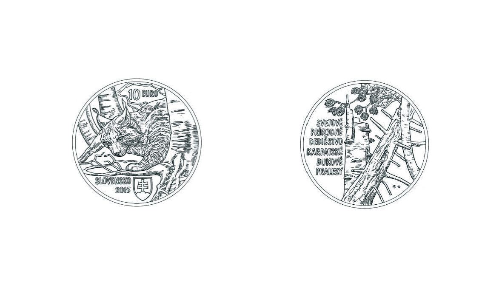

## 369

OZNÁMENIE

Národnej banky Slovenska

z 25. novembra 2014

## o vydaní strieborných zberateľských euromincí v nominálnej hodnote 10 eur s tematikou Svetové prírodné dedičstvo - Karpatské bukové pralesy

1. Úvodné ustanovenia

a) Národná banka Slovenska podľa § 17h ods. 1 zákona Národnej rady Slovenskej republiky č. 566/1992 Zb. o Národnej banke Slovenska v znení neskorších predpisov a podľa § 1 ods. 2 písm. d) zákona Národnej rady Slovenskej republiky č. 1/1993 Z. z. o Zbierke zákonov Slovenskej republiky v znení zákona č. 275/2002 Z. z. oznamuje, že vydáva do obehu strieborné zberateľské euromince v nominálnej hodnote 10 eur s tematikou Svetové prírodné dedičstvo - Karpatské bukové pralesy (ďalej len "zberateľská eurominca").

b) Zberateľská eurominca má štatút zákonného platidla len v Slovenskej republike.

c) Zberateľská eurominca sa razí zo zliatiny obsahujúcej 900 dielov striebra a 100 dielov medi; jej hmotnosť je 18 g a priemer 34 mm. Pri razbe zberateľskej euromince je povolená horná a dolná odchýlka v priemere 0,1 mm; povolená horná odchýlka v hmotnosti je 0,4 g a v obsahu striebra 10/1000.

2. Vzhľad zberateľskej euromince

a) Na líci zberateľskej euromince je vyobrazený rys ostrovid v prostredí bukového pralesa. Štátny znak Slovenskej republiky je pri spodnom okraji zberateľskej euromince. Vľavo od neho je názov štátu "SLOVENSKO", pod ktorým je letopočet "2015". Označenie nominálnej hodnoty zberateľskej euromince "10 EURO" je v hornej časti mincového poľa.

b) Na rube zberateľskej euromince sú vyobrazené kmene buka lesného, ktoré sú kompozične doplnené kmeňom jedle bielej. V ľavej časti mincového poľa sú nápisy "SVETOVÉ PRÍRODNÉ DEDIČSTVO" a "KARPATSKÉ BUKOVÉ PRALESY". Značka Mincovne Kremnica, štátny podnik, ktorú tvorí skratka "MK" umiestnená medzi dvoma razidlami a štylizované iniciálky mena a priezviska autora výtvarného návrhu zberateľskej euromince Karola Lička "KL" sú umiestnené v pravej spodnej časti zberateľskej euromince.

c) Na hrane mince sú nápisy do hĺbky v anglickom jazyku "WORLD HERITAGE" a vo francúzskom jazyku "PATRIMOINE MONDIAL". Medzi nápismi sú pomlčky.

eurominca

Štát vydania: Slovenská republika

Začiatok vydávania: marec 2015
