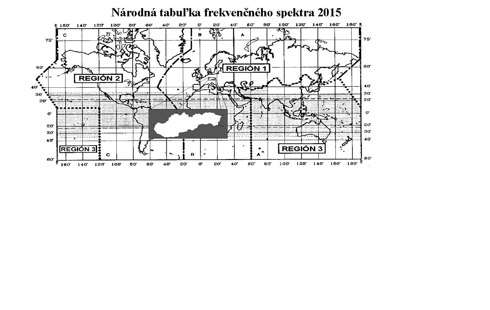

# Čl. I

Nariadenie vlády Slovenskej republiky č. 420/2012 Z. z., ktorým sa ustanovuje národná tabuľka frekvenčného spektra v znení nariadenia vlády Slovenskej republiky č. 505/2013 Z. z. sa mení takto:

- Príloha vrátane nadpisu znie:

- „Príloha k nariadeniu vlády č. 420/2012 Z.z.

- Národná tabuľka frekvenčného spektra 2015

- 

- [príloha](assets/fd87ceb3f6628150e65b9a2471232b854bc6780625ba9fe47e33a4b63c4e1e58.pdf)“.
