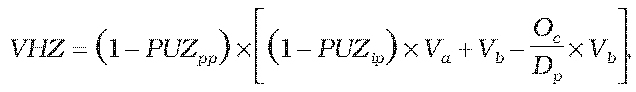

# § 2

(1) Výsledná hodnotiaca známka podľa § 9a ods. 6 zákona sa vypočíta podľa vzorca:

pričom:

VHZ – výsledná hodnotiaca známka

PUZpp– PUZpp sa rovná 0, ak nedošlo k predčasnému ukončeniu zmluvy verejným obstarávateľom alebo obstarávateľom z dôvodu podstatného porušenia povinností dodávateľa (ďalej len „podstatné porušenie“), alebo sa rovná 1, ak došlo k predčasnému ukončeniu zmluvy z dôvodu podstatného porušenia

PUZip – PUZip sa rovná 0, ak nedošlo k predčasnému ukončeniu zmluvy verejným obstarávateľom alebo obstarávateľom z dôvodu iného porušenia povinností dodávateľa, ako je podstatné porušenie (ďalej len „iné porušenie“), alebo sa rovná 1, ak došlo k predčasnému ukončeniu zmluvy z dôvodu iného porušenia

Va – váha kritéria kvality predčasné ukončenie zmluvy z dôvodu iného porušenia

Vb – váha kritéria kvality celkové trvanie omeškania dodávateľa, ku ktorému došlo z dôvodov na strane dodávateľa (ďalej len „celkové omeškanie“)

Oc – celkové omeškanie v dňoch; ide o číslo z množiny celých kladných čísel a 0, ak je jeho hodnota väčšia ako hodnota Dp, rovná sa hodnote Dp

Dp – plánovaná dodávka v dňoch podľa zmluvy; ide o číslo z množiny celých kladných čísel okrem 0.

(2) Váha kritéria kvality predčasné ukončenie zmluvy z dôvodu iného porušenia (Va) je 80 a váha kritéria kvality celkové omeškanie (Vb) je 20.

(3) Do kritéria celkové omeškanie sa nezapočítava prípustné omeškanie dohodnuté v zmluve.

(4) Výsledná hodnotiaca známka sa matematicky zaokrúhli na celé číslo.
