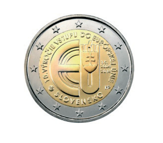

## 65

OZNÁMENIE

Národnej banky Slovenska

z 18. februára 2014

o vydaní pamätných euromincí v nominálnej hodnote 2 eurá pri príležitosti 10. výročia vstupu Slovenskej republiky do Európskej únie

1. Úvodné ustanovenia

- a) Národná banka Slovenska podľa § 17h ods. 1 zákona Národnej rady Slovenskej republiky č. 566/1992 Zb. o Národnej banke Slovenska v znení neskorších predpisov a podľa § 1 ods. 2 písm. d) zákona Národnej rady Slovenskej republiky č. 1/1993 Z. z. o Zbierke zákonov Slovenskej republiky v znení zákona č. 275/2002 Z. z. oznamuje, že pri príležitosti 10. výročia vstupu Slovenskej republiky do Európskej únie vydáva do obehu pamätné euromince v nominálnej hodnote 2 eurá (ďalej len „pamätná eurominca“).

- b) Pamätná eurominca má rovnaké technické parametre ako obehové euromince1) a na jej národnej strane bude použitý pamätný motív [bod 2 písm. b)].

- c) Pamätná eurominca má štatút zákonného platidla v celej eurozóne.

2. Vzhľad pamätnej euromince

- a) Pamätná eurominca sa vydáva s novou spoločnou európskou stranou.2)

- b) Na národnej strane pamätnej euromince je vyobrazená štylizovaná skratka Európskej únie „EÚ“ so štátnym znakom Slovenskej republiky v popredí. V pravej časti mincového poľa je v dvoch riadkoch dátum vstupu Slovenskej republiky do Európskej únie „1. 5. 2004“. Pod ním je letopočet „2014“. V spodnej časti pamätnej euromince je v opise vnútorného kruhu zľava doprava názov štátu „SLOVENSKO“ a v jej hornej časti je v opise zľava doprava text „10. VÝROČIE VSTUPU DO EURÓPSKEJ ÚNIE“. Značka Mincovne Kremnica, štátny podnik, ktorú tvorí skratka „MK“ umiestnená medzi dvoma razidlami, je v ľavej spodnej časti pamätnej euromince a štylizované iniciálky mena a priezviska autorky výtvarného návrhu národnej strany pamätnej euromince Márie Poldaufovej „MP“ sú v jej pravej spodnej časti. Pri okraji pamätnej euromince je dvanásť do kruhu umiestnených hviezd Európskej únie.

- c) Na hrane pamätnej euromince je nápis „SLOVENSKÁ REPUBLIKA“. Začiatok a koniec nápisu je oddelený dvoma hviezdami, medzi ktorými je lipový list.

Štát vydania: Slovenská republika

Začiatok vydávania: apríl 2014

Jozef Makúch v. r.
