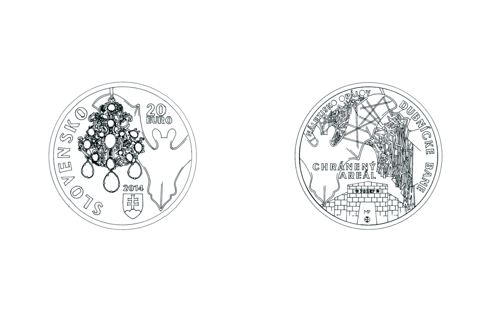

## 87

OZNÁMENIE

Národnej banky Slovenska

zo 4. marca 2014

## o vydaní strieborných zberateľských euromincí v nominálnej hodnote 20 eur s tematikou chránený areál Dubnícke bane – nálezisko opálov

1. Úvodné ustanovenia

- a) Národná banka Slovenska podľa § 17h ods. 1 zákona Národnej rady Slovenskej republiky č. 566/1992 Zb. o Národnej banke Slovenska v znení neskorších predpisov a podľa § 1 ods. 2 písm. d) zákona Národnej rady Slovenskej republiky č. 1/1993 Z. z. o Zbierke zákonov Slovenskej republiky v znení zákona č. 275/2002 Z. z. oznamuje, že vydáva do obehu strieborné zberateľské euromince v nominálnej hodnote 20 eur s tematikou chránený areál Dubnícke bane – nálezisko opálov (ďalej len „zberateľská eurominca“).

- b) Zberateľská eurominca má štatút zákonného platidla len v Slovenskej republike.

- c) Zberateľská eurominca sa razí zo zliatiny obsahujúcej 925 dielov striebra a 75 dielov medi; jej hmotnosť je 33,63 g a priemer 40 mm. Pri razbe zberateľskej euromince je povolená horná a dolná odchýlka v priemere 0,1 mm; povolená horná odchýlka v hmotnosti je 0,4 g a v obsahu striebra 10/1 000.

2. Vzhľad zberateľskej euromince

- a) Na líci zberateľskej euromince je vyobrazený historický náhrdelník osadený dubníckymi opálmi. Náhrdelník je na pozadí doplnený siluetou netopiera, pre ktorého sú Dubnícke bane významným zimoviskom. V spodnej časti mincového poľa je štátny znak Slovenskej republiky. Nad ním je letopočet „2014“. V ľavej časti mincového poľa je v opise zľava doprava názov štátu „SLOVENSKO“.

- b) Na rube zberateľskej euromince je vyobrazená silueta netopiera vo vnútornom prostredí bane. Silueta netopiera je v spodnej časti doplnená vchodom do štôlne Jozef, ktorý je charakteristický pre Dubnícke bane. V hornej časti mincového poľa sú v opise zľava doprava nápisy „NÁLEZISKO OPÁLOV“ a „DUBNÍCKE BANE“. Štylizované iniciálky mena a priezviska autorky výtvarného návrhu zberateľskej euromince Márie Poldaufovej „MP“ a značka Mincovne Kremnica, štátny podnik, ktorú tvorí skratka „MK“ medzi dvoma razidlami, sú umiestnené do vchodu do štôlne Jozef.

- c) Na hrane mince je reliéfny nápis „OSOBITOSTI PRÍRODY SLOVENSKA“. Začiatok a koniec textu je oddelený vyobrazením štylizovaného kvetu.

Štát vydania: Slovenská republika

Začiatok vydávania: jún 2014

Jozef Makúch v. r.
