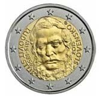

## 194

OZNÁMENIE

Národnej banky Slovenska

zo 14. júla 2015

## o vydaní pamätných euromincí v nominálnej hodnote 2 eurá pri príležitosti 200. výročia narodenia Ľudovíta Štúra

1. Úvodné ustanovenia

- a) Národná banka Slovenska podľa § 17h ods. 1 zákona Národnej rady Slovenskej republiky č. 566/1992 Zb. o Národnej banke Slovenska v znení neskorších predpisov a podľa § 1 ods. 2 písm. d) zákona Národnej rady Slovenskej republiky č. 1/1993 Z. z. o Zbierke zákonov Slovenskej republiky v znení zákona č. 275/2002 Z. z. oznamuje, že pri príležitosti 200. výročia narodenia Ľudovíta Štúra vydáva do obehu pamätné euromince v nominálnej hodnote 2 eurá (ďalej len "pamätná eurominca").

- b) Pamätná eurominca má rovnaké technické parametre ako obehové euromince1) a na jej národnej strane bude použitý pamätný motív [bod 2 písm. b)].

- c) Pamätná eurominca má štatút zákonného platidla v celej eurozóne.

2. Vzhľad pamätnej euromince

- a) Pamätná eurominca sa vydáva s novou spoločnou európskou stranou.2)

- b) Na národnej strane pamätnej euromince je vyobrazený portrét Ľudovíta Štúra. Vpravo od portrétu sú v opise vnútorného kruhu v dvoch riadkoch názov štátu "SLOVENSKO" a letopočet "2015". Vľavo od portrétu sú v opise vnútorného kruhu v dvoch riadkoch meno a priezvisko "ĽUDOVÍT ŠTÚR" a letopočty jeho narodenia a úmrtia "1815 - 1856". Značka Mincovne Kremnica, štátny podnik, ktorú tvorí skratka "MK" umiestnená medzi dvoma razidlami, je v pravej hornej časti pamätnej euromince a štylizované iniciálky autora výtvarného návrhu národnej strany pamätnej euromince akad. soch. Ivana Řeháka "IŘ" sú v jej pravej spodnej časti. Pri okraji pamätnej euromince je dvanásť do kruhu umiestnených hviezd Európskej únie.

- c) Na hrane pamätnej euromince je nápis "SLOVENSKÁ REPUBLIKA". Začiatok a koniec nápisu je oddelený dvoma hviezdami, medzi ktorými je lipový list.

- 

Štát vydania: Slovenská republika

Začiatok vydávania: október 2015

Jozef Makúch v. r.
